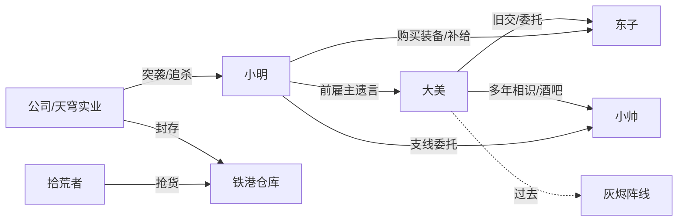

# 角色设定（Design_Characters）

> **保护声明**：本文件第 2–5 节中的“原始设定”直接来自 `场景剧本.docx`，不得改写。
> “视觉设定”“动画规格”“对白语气”为本次 Demo 的扩展内容，用于指导美术与实现。

---

## 1. 角色一览

| 角色 | 定位 | 玩法作用 | 形象关键词 |
| --- | --- | --- | --- |
| 小明 | 主角 / L0 新居民 | 玩家控制 | 疲惫、克制、旧外套、青色围巾 |
| 大美 | 大姐头 / 中间人 | 主线委托人 | 暖红、从容、看穿一切 |
| 东子 | 地下商人 | 商店 / 补给 / 接入装置 | 圆滑、厚重、金色终端光 |
| 小帅 | 酒保 / 机械爱好者 | 支线 / 氛围 | 温和、围裙、油污与笑 |
| 拾荒者 | 底层流民 | 敌人（仓库） | 兜帽、护目镜、拼装护甲 |
| 公司特工 | 秩序执行者 | 敌人（伏击） | 黑甲、无脸、青色扫描线 |

---

## 2. 小明（主角）

### 2.1 原始设定（不可改写）

- **姓名**：小明。
- **身份**：进入自由城的新居民，但没有思维接入装置，实际上被排斥在城市的正规经济体系之外。
- **人物背景**：怀着对新生活的期待，花光全部积蓄才得以进入自由城。来到之后才发现，没有接入 FS 的思维系统网络，便难以获得稳定的工作和收入；所谓遍地都是机会的自由城，与宣传中的景象大相径庭。由于已经无力离开，他只能依靠灰色工作维生。为了获得一套思维接入装置，他开始替一名地下中间人做事，对方承诺在完成足够的工作后帮他解决接入问题。然而，中间人因与公司的冲突遭到特工突袭，主角侥幸逃过一劫，按照中间人最后的指示来到酒吧寻找大姐头。
- **核心动机**：接入 FS 的思维系统网络，真正融入自由城的社会体系，取得稳定的工作和生活。

### 2.2 视觉设定（扩展）

| 项目 | 设定 |
| --- | --- |
| 年龄感 | 二十出头，偏瘦，肩背略驼 |
| 发型 | 黑色短发，略乱，额前有几缕碎发 |
| 服装 | 深橄榄绿旧夹克、深灰工装裤、磨损短靴 |
| 标志物 | 褪色的青绿色围巾（进城时买的，唯一像样的东西） |
| 配件 | 露指手套、旧皮带、腰后枪套 |
| 面部 | 黑眼圈明显，眼神警觉；不常笑 |
| 色板 | 外套 `#2E3B2F`、内衬 `#1B2129`、围巾 `#2FA8A0`、皮肤 `#C98E6B`、头发 `#1A1A1F`、高光 `#7FD8CF` |
| 剪影 | 细长、前倾；围巾末端随动作轻摆 |
| 武器 | 9mm 半自动手枪，枪身磨损，握把缠布 |

### 2.3 像素与动画规格

- 世界精灵：**16×24**，脚底为原点；4 方向（S/N/E/W），每个方向 4 帧行走 + 1 帧待机。
- 行走帧：0 抬左腿、1 过渡、2 抬右腿、3 过渡；头部有 1px 上下浮动。
- 射击帧：朝目标方向，手臂前伸，枪口闪光单独作为特效绘制。
- 受击：整体 1px 后仰 + 红色闪烁 0.1s。
- 头像：**48×48**，半身，背景为酒吧暖光虚化；表情为“平静 / 疲惫”。

### 2.4 对白语气

- 话少，句子短，常以“……嗯”“还行”回应。
- 不主动诉苦；被看穿时会沉默。
- 关键句示例：“我只是想在这里活下去。”“接入之后，我还是我吗？”

---

## 3. 大美（大姐头）

### 3.1 原始设定（不可改写）

- **姓名**：大美。
- **身份**：自由城地下社会中颇有声望的中间人，长期在酒吧接洽委托。
- **人物背景**：在自由城活动多年，拥有广泛的人脉，与主角的前雇主有旧交。过去可能与革命军有过联系，后似乎因理念不合离开反抗军（但具体经历不向玩家直接交代，仅通过她的言行和处事方式留下线索）。
- **性格**：随和、老练，具有较强的人道主义和理想主义倾向。她厌恶自由城的现状，但不认为推翻现有秩序就能够解决问题。在她看来，即使旧秩序被推翻，也未必能建立一个更好的社会，反而可能让普通人在动荡中付出更大的代价。她更倾向于接受现实，在现有规则下寻找改善生活的办法，并尽自己所能帮助那些难以立足的人。因此，她对缺乏社会资源、处境困难的人抱有同情，尤其愿意照顾刚来到自由城的新人。她有自己的行事原则，不愿为了利益轻易让他人承担不必要的风险，同时也清楚地下社会的残酷现实。
- **核心动机**：在维持自身地下委托生意的同时，尽可能帮助那些被自由城现有制度排斥的人。
- **与主角的关系**：因主角的前雇主而结识主角。在了解到他的处境后，为其提供工作机会并承担初始装备的费用。
- **剧情作用**：主角的主要委托提供者，也是玩家了解自由城社会及其矛盾的重要人物。

### 3.2 视觉设定（扩展）

| 项目 | 设定 |
| --- | --- |
| 年龄感 | 三十多岁，姿态放松但随时能起身 |
| 发型 | 深棕长发挽在脑后，鬓角有一缕银灰 |
| 服装 | 暗红色长外套、黑色高领、深色长裤、旧皮靴 |
| 标志物 | 左手无名指的旧戒指（来历不明）；常夹一支未点的烟 |
| 配件 | 耳后可见旧式接入接口，边缘磨得发亮 |
| 面部 | 眼角有细纹，笑意常在，但目光很稳 |
| 色板 | 外套 `#8C2F3F`、内衬 `#15161C`、头发 `#3B2A28`、银发 `#B9B3A8`、皮肤 `#C98E6B`、暖光 `#FFB347` |
| 剪影 | 宽肩长外套，站姿稳，坐在卡座时一条腿搭在另一条上 |
| 道具 | 纸质记事本、钢笔、酒杯 |

### 3.3 像素与动画规格

- 世界精灵：**16×24**，4 方向，待机 2 帧（呼吸/烟灰），行走 4 帧。
- 坐在卡座时使用专用坐姿精灵 **24×24**（半身被沙发遮挡）。
- 头像：**48×48**，暖色侧光，表情“似笑非笑”；愤怒/严肃时眼神变冷（Demo 只用一种）。
- 色彩重点：暗红 + 琥珀，是全游戏最“暖”的角色。

### 3.4 对白语气

- 句子从容，常带一点笑；不逼问，但会直接点破。
- 不说教；道理藏在交易和玩笑里。
- 关键句示例：“这城市的规矩就是这样。你想在这里过日子，就得学着适应。”“要是碰上公司的人，直接回来就行。那点货还不值得拿命去换。”

---

## 4. 东子（商人）

### 4.1 原始设定（不可改写）

- **姓名**：东子。
- **身份**：独立经营的地下商人，主要从事各种管制物品的交易。
- **人物背景**：在自由城地下交易网络中拥有一定的人脉和供货渠道，能够获取包括思维接入装置在内的特殊商品。长期在酒吧接洽生意，与大姐头相识，双方没有从属关系。
- **性格**：精明圆滑，重视利益。习惯利用自身的渠道优势抬高售价，但只要钱到位，就会履行交易。
- **核心动机**：通过地下交易获取利润，维持和扩大自身的生意。
- **与主角的关系**：经大姐头介绍与主角认识，成为主角购买装备、补给，以及获取思维接入装置的重要渠道。
- **剧情作用**：承担商店系统，通过日常交易与交流反映自由城的现状与地下经济环境。

### 4.2 视觉设定（扩展）

| 项目 | 设定 |
| --- | --- |
| 年龄感 | 三十多岁，微胖，久坐 |
| 发型 | 两侧剃短，顶部向后梳，发际线略高 |
| 服装 | 橄榄棕厚外套、花纹衬衫、深色围巾、多口袋工装裤 |
| 标志物 | 额头架着一副旧式护目镜；手腕上串着几枚数据芯片 |
| 配件 | 被淘汰快 20 年的平板电脑、随身终端、腰间钥匙卡盒 |
| 面部 | 笑纹深，眼神精于计算；说话时习惯抬下巴 |
| 色板 | 外套 `#5A4A32`、衬衫 `#7A3B3B`、护目镜 `#C9A227`、皮肤 `#C98E6B`、终端光 `#39E0D0` |
| 剪影 | 敦实，前倾操作终端；卡座里像一堆旧衣服 |
| 道具 | 平板、投射在桌面上的商品目录（青色光） |

### 4.3 像素与动画规格

- 世界精灵：**16×24**，4 方向，待机 2 帧（手指敲终端）。
- 坐姿精灵 **24×24**；商店界面使用头像 + 商品列表。
- 头像：**48×48**，下方青色终端光打在脸上，笑容“和气但算得清”。
- 动画细节：对话时偶尔抬眼看玩家（2 帧切换）。

### 4.4 对白语气

- 圆滑、爱抬价、不装好人；但交易守信用。
- 喜欢用“你情我愿”“这年头”“没办法”作口头禅。
- 关键句示例：“我做生意嘛，你情我愿，我又没逼着谁掏钱。”

---

## 5. 小帅（酒保）

### 5.1 原始设定（不可改写）

- **姓名**：小帅。
- **身份**：酒吧的酒保，负责酒吧的日常经营及设备维护。
- **人物背景**：与大姐头相识多年，彼此十分熟悉。虽然以酒保为职业，但比起调酒，他更喜欢摆弄各种机械设备。闲暇时经常研究、维修一些老旧的机器，酒吧里的设备出现问题时，也大多由他自己动手解决。
- **性格**：随和、善良、富有同情心，平时待人友善，也乐于帮助有困难的人。他十分理解大姐头的处境，也认同她帮助那些处境困难之人的做法。由于知道大姐头平日需要处理许多复杂的事务，他不愿再拿酒吧里的琐事去麻烦她，凡是自己能够解决的问题，都会尽量自己处理。
- **核心动机**：维持酒吧的正常运转，过好自己的生活，同时尽可能帮助身边的人，为大姐头分担一些力所能及的事情。
- **与主角的关系**：主角初到酒吧时便与其相识。随着主角逐渐参与酒吧的日常事务，两人也慢慢熟悉起来。
- **剧情作用**：承担部分支线委托，通过酒吧的日常事务与主角的互动，展现自由城普通人的生活，以及酒吧内部的人际关系。

### 5.2 视觉设定（扩展）

| 项目 | 设定 |
| --- | --- |
| 年龄感 | 二十多岁，精瘦，手臂有旧疤 |
| 发型 | 深棕短发，额前有一撮翘起 |
| 服装 | 白衬衫卷袖、深色马甲、帆布围裙、工装裤 |
| 标志物 | 围裙口袋插着螺丝刀；右手戴防烫手套 |
| 配件 | 手腕上的机械表、吧台后的工具盒 |
| 面部 | 笑眼，话多但不烦人；专注修东西时会皱眉 |
| 色板 | 衬衫 `#D8D2C4`、马甲 `#2B3A3F`、围裙 `#4A3B2E`、皮肤 `#C98E6B`、工具金属 `#8FA3A8` |
| 剪影 | 站姿轻快，常一手拿杯子一手拿工具 |
| 道具 | 玻璃杯、抹布、螺丝刀、点唱机零件 |

### 5.3 像素与动画规格

- 世界精灵：**16×24**，4 方向；待机 2 帧（擦杯子/呼吸）。
- 修理点唱机时使用蹲姿精灵 **16×20**。
- 头像：**48×48**，暖色吧台灯，笑容；谈论点唱机时眼睛发亮。
- 与主角熟悉后，头像可切换为“更放松的笑”（Demo 中可选）。

### 5.4 对白语气

- 热情、随和，句子带生活气；会自嘲。
- 不把麻烦推给大美；对主角的处境有同理心但不说破。
- 关键句示例：“唉，行吧。本来还想着今天能把这破东西给修好呢。”

---

## 6. 拾荒者（敌人）

| 项目 | 设定 |
| --- | --- |
| 来源 | 破产者、逃债者、被除名者；在铁港翻找被公司封存的货物 |
| 外观 | 兜帽、防毒面罩、橙色护目镜、拼接护甲、胶带缠裹的武器 |
| 色板 | 破布 `#3A3A32`、护甲 `#5B5A4E`、护目镜 `#FF8A3D`、金属 `#6E7378` |
| 精灵 | 16×24，4 方向，行走 4 帧；持射钉枪 |
| 行为 | 先警告、再开火；会利用木箱掩体；血量低时会后退 |
| 台词 | 简短、粗粝：“别过来！”“这箱子是我们的。”“放下东西，滚。” |
| 设计意图 | 不是纯粹的恶；他们的处境与小明只差一次坏运气 |

---

## 7. 公司特工（精英敌人）

| 项目 | 设定 |
| --- | --- |
| 来源 | 天穹实业外勤安保，执行封存令与定点清除 |
| 外观 | 黑色轻甲、无标识、全覆式面罩、青色扫描光带、紧凑型冲锋枪 |
| 色板 | 装甲 `#14161C`、内衬 `#242A33`、扫描光 `#39E0D0`、警示光 `#FF3D8B` |
| 精灵 | 16×24，4 方向，行走 4 帧；面罩光带 2 帧闪烁 |
| 行为 | 成组推进、保持距离、优先集火；被击中时面罩短暂变红 |
| 台词 | 只显示系统式短句：“目标确认。”“交出资产。”“封锁已生效。” |
| 设计意图 | 代表制度性的、无面孔的暴力；与拾荒者形成对照 |

---

## 8. 角色关系图

---

## 9. 视觉一致性检查表

- [ ] 小明始终有青色围巾；即使像素很小，也能通过色块辨认。
- [ ] 大美始终以暗红 + 暖光出现；她是画面里的“火”。
- [ ] 东子身边始终有青色终端光；他是“交易”的化身。
- [ ] 小帅始终与吧台/工具/点唱机同框；他是“日常”的锚点。
- [ ] 拾荒者使用暖橙，特工使用冷青；敌我识别不依赖 UI。
- [ ] 所有角色脚底对齐同一基线，避免“漂浮感”。
