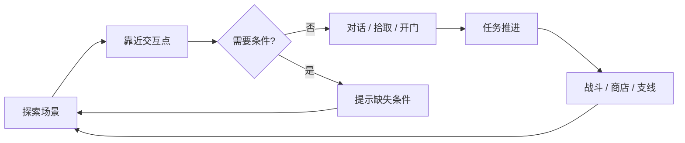

# 玩法设计（Design Gameplay）

---

## 1. 核心循环

- 单场景内以“走位 → 交互 → 读对白 → 目标更新”推进；没有复杂解谜。
- 目标始终显示在 HUD 左上角，并用 3D 世界中的菱形标记指向具体位置。

---

## 2. 操作

| 输入 | 动作 |
| --- | --- |
| `W A S D` | 相对相机移动 |
| `Shift` | 疾跑 |
| 鼠标移动 | 瞄准（从相机向地面打射线得到瞄准点） |
| 鼠标左键 | 射击；空手时为近战出拳 |
| 鼠标滚轮 | 切换武器槽（手枪 / 空手） |
| `R` | 换弹 |
| `E` | 交互 / 推进对话 / 确认选项 |
| `W` / `S`（对话中） | 切换选项 |
| 按住 `Ctrl` 0.8 s | 快进对话（松开取消，遇到选项会停下） |
| `F` | 使用医疗包 |
| `Tab` | 任务日志 |
| `Esc` | 暂停 / 退出菜单 |
| `M` | 静音 |

> 所有交互都用“地面上的人形 + 屏幕提示”双提示，不依赖颜色。

---

## 3. 移动与相机

- 玩家是 XZ 平面上的圆（半径 0.34 m），与 AABB 做推出式碰撞；地面高度固定 y=0。
- 移动方向按相机偏航角旋转，因此“W 永远是画面推进方向”。
- 相机为**区域机位 + 跟随**的混合方案：每个场景预置若干 `CameraZone`，
  按玩家 XZ 位置切换，切换时 0.55 s 平滑混合；同一区域内相机对玩家位置做
  最多 2.6 m 的平滑跟随，玩家走到场景边缘时不会直接跑出画面。
- 相机不跟随鼠标，避免眩晕，也符合固定镜头的构图。
- 开枪、受击、警报会触发小幅相机抖动。

---

## 4. 战斗

| 项 | 规则 |
| --- | --- |
| 武器槽 | 手枪 / 空手，滚轮切换；未领装备前强制空手 |
| 手枪 | 单发；弹匣 12 发，备弹上限 99；伤害 18；射速 0.18 s/发；换弹 1.1 s |
| 徒手 | 扇形近战，伤害 24，有效距离 1.65 m，带击退；冷却 0.46 s |
| 命中判定 | 子弹按帧推进的线段与敌人 XZ 圆求交；障碍物用扩张后的 AABB 判定，
  所以贴着箱子边缘的弹道也会被拦住 |
| 玩家生命 | 100；医疗包回复 40，最多携带 3 个 |
| 死亡 | 画面故障 + 淡出，进入死亡界面，可重试（回到当前场景入口，保留装备） |

### 敌人行为

| 类型 | HP | 距离 | 行为 |
| --- | --- | --- | --- |
| 拾荒者 `SCAVENGER` | 45 | 6–7 m | 步枪单发，保持距离并左右游走 |
| 打手 `THUG` | 85 | 近身 | 直接冲脸，在 1.5 m 内挥钢管（14 伤害），冷却 1.15 s |
| 公司特工 `AGENT` | 70 | 8–9 m | 更远、更密的点射（0.62 s），侧移更快 |

- 战斗中 HUD 显示敌人血条（仅视野内）、准星、当前武器槽与受击方向闪红。
- 战斗不是主要难度来源，重点是“打不打得起”的压迫感：弹药与医疗包都很贵。

---

## 5. 商店

- 商人东子，4 个商品：`9mm 弹药 ×12`（18）、`医疗包`（35）、`能量饮料`（12）、`思维接入装置`（500）。
- 首次对话免费发放新手包（手枪 + 24 发 + 1 医疗包）。
- 购买失败（钱不足 / 已达上限）时给出明确文案，而不是静默失败。

---

## 6. 任务

| 类型 | 内容 | 触发 |
| --- | --- | --- |
| 主线 | 接委托 → 取装备 → 前往铁港 → 取货 → 清理特工 → 返回酒吧 → 结局 | 进酒吧与小帅对话 |
| 支线 | 找回点唱机旧零件 | 与小帅二次对话（主线进度 ≥ 领取装备） |

- 主线阶段：`ENTER_BAR → TALK_BARTENDER → TALK_BIGSISTER → GET_GEAR → GO_WAREHOUSE → FIND_CARGO → DEFEAT_AGENTS → RETURN_BAR → COMPLETE`
- 支线阶段：`NOT_STARTED → ACCEPTED → HAVE_PART → COMPLETED`（也支持 `DECLINED`）
- 所有阶段变化都会写日志并弹 toast；日志界面永远显示“当前该做什么”。

---

## 7. 交互清单

| `id` | 位置 | 作用 |
| --- | --- | --- |
| `bar_entrance` | 街道 | 进入酒吧 |
| `bar_exit` | 酒吧内 | 离开酒吧（未领装备时会被拒绝） |
| `car` | 街道 | 前往铁港（需主线推进到对应阶段） |
| `warehouse_exit` | 铁港 | 返回街道 |
| `cargo` | 铁港中央 | 搬起货物，触发警报与特工增援 |
| `part` | 铁港东侧 | 拾取点唱机零件（需已接支线） |
| `bartender` / `bigsister` / `merchant` | 酒吧内 | 对话 / 商店 |
| `jukebox` / `terminal` / `street_sign` | 酒吧内 / 街道 | 环境叙事 |

---

## 8. 难度与节奏

1. 前三分钟只走路和读对白，不出现敌人。
2. 取货瞬间是唯一的强制战斗，且敌人从固定方向进入，玩家可以提前找掩体。
3. 战斗失败不清空物品，避免惩罚性重开。
4. 结局只给两个选项，不给“最优解”，强调选择的代价而不是奖励。
