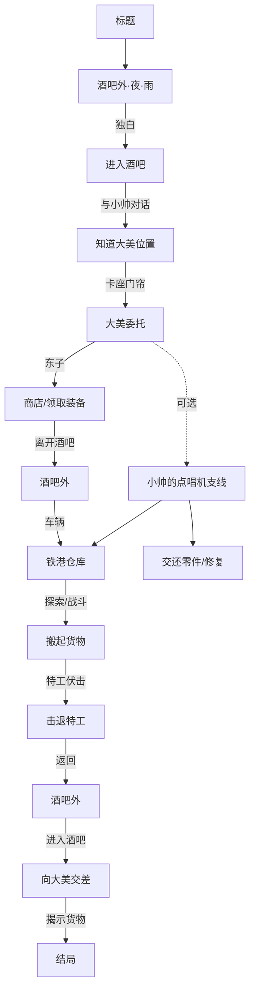

# Demo 剧情设计（Design_Story）

> 原文保护：本文件中的原剧本台词保持原意与人物语气；为 Demo 时长与交互节奏做了删减与重新编排。
> 新增内容（货物真相、结局选择、敌人短句）为扩展，需与 `Design_World.md`、`Design_Characters.md` 保持一致。

---

## 1. Demo 叙事目标

1. 让玩家在 10 分钟内理解“没有接入装置意味着什么”。
2. 让四名原始角色各自完成一次“立场展示”：大美的现实与善意、东子的精明与守信、小帅的日常与温度、小明的沉默与渴望。
3. 用一次具体的取货任务，把“制度性排斥”落到可触摸的货物上：那批货正是小明梦寐以求的接入装置。
4. 以克制的结局收束：不解决任何宏大问题，只让主角第一次拥有选择。

---

## 2. 场景与流程总览



---

## 3. 开场：酒吧外（第一天，夜）

### 3.1 画面与演出

- 黑屏，雨声。
- 画面淡入：酒吧外墙、AFTERGLOW 霓虹、湿地面、主角的车。
- 小明坐在驾驶位（不可操作），手抖，点烟，深吸，吐出烟雾。
- 三段内心独白逐句出现，最后玩家获得控制。

### 3.2 独白（基于原剧本）

| 顺序 | 文本 |
| --- | --- |
| 1 | 就差一点……我也会和他们一起完蛋。 |
| 2 | ……人可能都已经没了，现在找她还有用吗？ |
| 3 | ……算了，来都来了。至少得把这件事告诉她。 |

- 演出结束，任务目标：**进入酒吧**。
- 交互提示：`[E] 推门进入余烬酒吧`。

> 设计意图：把原剧本的“车内抽烟”压缩为 15 秒的可跳过演出，保留情绪与信息。

---

## 4. 第一幕：余烬酒吧（第一天，夜）

### 4.1 进入酒吧

- 门铃响，嘈杂声涌入；画面由冷转暖。
- 吧台后小帅在擦杯子；几名醉汉趴着；角落东子在操作平板；最里侧卡座挂着门帘。
- 任务目标：**向酒保打听大姐头**。

### 4.2 与小帅对话（第一次）

```text
小帅：晚上好，喝点什么？
小明：我来找人。
小帅：找谁？
小明：大美。
小帅上下打量，笑了笑。
小帅：头一次来我们这儿？
小明：嗯。
小帅：难怪，以前没见过你。
小帅指向酒吧深处。
小帅：里面，最靠后的那排卡座。不过她这会儿应该有客人，你可能得等一会儿。
小明：谢了。
小帅：不客气。要喝点什么随时叫我。
```

- 任务更新：**去后排卡座找大美**。
- 首次靠近卡座，触发环境对话：一个不满的委托人掀帘而出。

```text
委托人：怎么就这么死脑筋呢。
委托人：你也是来找她的？
小明：嗯。
委托人：那祝你好运吧。这家伙可轴得很。
```

### 4.3 与大美对话（第一次）

> 演出：黑边；大美坐在卡座里，抬头打量主角。

```text
大美：刚来自由城没多久？
小明：……嗯。
大美：我说怎么没见过你。坐吧。
小明：{前雇主}让我来找你。
大美：哦，他怎么了？
小明：他遇到了点麻烦，想……请你帮忙。不过……现在可能已经来不及了。我只是想过来告诉你一下。
大美：公司终于去收拾他了？
小明：是的，我刚离开据点，公司的人就到了。他们封锁了街道，直接冲了进去。
大美：那他人呢？
小明：不知道。我没敢回去。
大美沉默片刻，叹了口气。
大美：这个蠢货。我早就跟他说过，别去参和公司的破事。
大美：说起来，他能让你来，应该挺信任你的。你跟着他多久了？
小明：有些日子了。
大美：你是为了思维接入，才去跟着他的吧？
小明：……你怎么知道？
大美：见得多了。多少人花了攒了一辈子的钱来到自由城，结果来了才发现，想要找份正经的赚钱工作还得再交一大笔钱。
大美：这时候有人愿意给条门路，那自然就有人肯替他卖命。你也是这样吧？
小明：……嗯。
大美：不过你也别太灰心，城里又不是只有他一个人有门路。
小明：你也能弄到？
大美：我不做这个生意。不过我倒是认识个专门倒腾这些东西的家伙。你待会儿可以自己去问问他。
大美：对了，你老板在铁港还有个仓库，对吧？
小明：嗯，怎么了？
大美：你以前去过那里吗？
小明：去过几次，之前替他送过货。
大美：那正好。我之前托他转交过一批东西，现在他出了这么大的事，那批货恐怕也没人管了。
大美：帮我跑一趟怎么样？你熟悉那边，而且仓库离你们据点挺远，应该还没受到波及。不过消息一旦传开，恐怕就会有人过去抢东西。最好今晚就把东西取回来。
大美：要是碰上公司的人，直接回来就行。那点货还不值得拿命去换。
小明：报酬怎么算？
大美：货带回来，给你一百八。怎么样？
小明：成交。
大美：行，我晚点把详细的委托信息发给你。不过……你这次带装备了吗？
小明：走的急，什么都没有拿。
大美：那正好。刚才跟你提过的那个家伙，除了接入装置，还倒腾些武器、弹药之类的东西。就是有些黑，喜欢宰你们这种没有这个的。
大美：放心，第一套算我请你的。以后缺什么就自己找他买吧。我先给他打个招呼。
小明：他现在在哪？
大美：出去左转，那个靠墙坐着一直捣鼓手里老古董的就是他了。
```

- 事件：`START_MAIN_QUEST`，任务更新：**找东子领取装备**。
- 同时可接支线：与小帅再次对话。

### 4.4 与小帅对话（支线触发）

```text
小帅：还没修好呢？……你好呀，昨晚睡得还不错吧？
小明：挺好的。这东西坏得很严重吗？
小帅：昨天我还以为只是哪里接触不良，结果拆开才发现，里面好几个零件都有问题。
小帅：算了，不说这个了。你能帮我个忙吗？我前几天订了一批酒，本来今天中午就该送到了，可到现在连个影子都没见着。
小帅：那边说东西到转运仓库就没消息了。我想请你替我去仓库那边催一催，看看究竟怎么回事。我也好趁这个工夫把这破玩意儿修好。
小明：我到了那里应该干嘛？
小帅：你就找那边的人，问问我的货是什么情况。要是能让他们今天把货送到，那就再好不过了。
小明：要是货丢了呢？
小帅：那也没办法，真丢了的话你就通知我一声，我再找供货商想办法。
小帅：反正也就是跑个腿，不会让你白忙活的。怎么样，愿意帮这个忙吗？
```

选项：

| 选项 | 结果 |
| --- | --- |
| `行吧，我过去看看。` | 接受支线，任务更新：**在铁港仓库找到点唱机零件** |
| `我还有别的事情要忙。` | 小帅自行前往；支线关闭；返回时点唱机仍未修好 |

- 接受后，小帅补充：“对了，仓库那边最近不太平，你自己小心点。”

### 4.5 与东子对话（第一次）

```text
东子：欢迎光临，你要买什么？
小明：大美让我来找你。
东子：哦，你就是她刚才说的那个倒霉蛋啊。东西已经在给你准备了，马上就到。
小明：对了，听说你能弄到思维接入装置？
东子：能倒是能，不过这价钱可不便宜。
小明：多少？
东子：你自己看看吧。
```

- 打开商店；首次进入时商品目录刚投射到桌面。
- 首次关闭商店后，伙计送来箱子：

```text
东子：喏，都在这儿了。枪、子弹，还有点救命的东西。这次是大美替你付的钱。下次来可就得自己掏腰包了。
东子：以后想要补给随时可以来找我。不补给来看看也好，这里隔三差五会到些新货。当然，前提是你出得起钱。
```

- 事件：`GIVE_STARTER_KIT`（获得手枪、24 发备弹、1 个医疗包、₡0）。
- 任务更新：**前往铁港仓库取回货物**。

### 4.6 离开酒吧

- 与正门交互 → 酒吧外。
- 与车辆交互 → 黑屏 + 雨声 + 引擎声 + 字幕：
  > 铁港 · 仓库区 · 凌晨 02:47
- 进入仓库场景。

---

## 5. 第二幕：铁港仓库（第二天，凌晨）

### 5.1 到达

- 玩家从西侧入口进入；雨声变闷，金属回声。
- 环境文本（自动浮现，不打断操作）：
  > 仓库比记忆里更空。货架被翻过，地上有新鲜的拖痕。
- 任务目标：**找到大姐头的货物**。
- 支线目标（若接受）：**找到点唱机零件**。

### 5.2 探索与拾荒者

- 4 名拾荒者在货堆间翻找。玩家可选择绕行或先手。
- 首次进入视线时，最近的一名拾荒者喊话：

```text
拾荒者：站住。这地方今晚归我们。
拾荒者：不想挨钉子就滚回去。
```

- 若玩家继续靠近或开枪 → 战斗开始，周围拾荒者被唤醒。
- 拾荒者短句（随机）：
  - “别过来！”
  - “这箱子是我们的。”
  - “放下东西，滚。”

### 5.3 货物与伏击

- 中央货物箱有橙色防伪贴和青色指示灯；交互：
  > 箱子比想象中沉。标签被撕掉了一半，只剩下一个模糊的货号。
- 搬起货物 → 东侧卷帘门亮起洋红警报，3 名公司特工进入。
- 短演出：红灯扫过货堆；面罩光带亮起。

```text
特工：目标确认。
特工：交出资产。
```

- 任务更新：**击退公司特工**。
- 音乐切换为高紧张度；玩家可寻找掩体。
- 特工短句：
  - “封锁已生效。”
  - “不要反抗。”
  - “资产回收中。”

### 5.4 战斗结束

- 最后一名特工倒下 → 警报停止，雨声重新变大。
- 任务更新：**带着货物返回酒吧**。
- 玩家可继续搜刮（弹药/医疗包），或直接从西侧离开。
- 若持有零件，返回途中可看到提示：“口袋里那块旧零件还带着机油味。”

---

## 6. 第三幕：回到余烬酒吧（第二天，凌晨）

### 6.1 进入酒吧

- 酒吧已冷清；小帅在吧台后擦杯子；大美坐在吧台前。
- 若接支线且持有零件：先与小帅交付。

```text
小帅：你回来了！东西呢？
小明把零件放在吧台上。
小帅：就是这个……你从哪儿找到的？算了，先别管这个。
小帅：给我十分钟。不，五分钟。
（点唱机修好，音乐响起）
小帅：成了！你听听，这才叫点唱机。
小帅：说好的报酬，拿着。以后想听什么歌，随便点。
```

- 事件：`COMPLETE_SIDE_QUEST`（+₡60，医疗包 ×1，点唱机音乐开启）。
- 若未接支线：小帅不在吧台，桌上留着一张纸条：“去仓库找酒了，别等我。”

### 6.2 与大美交差

```text
大美：哟，回来啦？
小明：嗯，东西拿回来了。
大美检查包裹，动作忽然停住。
大美：……你打开看过吗？
小明：没有。
大美：最好没有。
她掀开箱盖。里面是一排用防静电袋包好的神经桥，接口在灯下泛着冷光。
小明：这是……
大美：接入装置。没登记的，查不到来源，也不会上传你的名字。
小明沉默。
大美：我本来打算把它们拆开，分批送给几个和你差不多的人。现在公司盯上了这批货，得换个地方。
小明：……
大美：你为了这东西，跟了那个蠢货那么久。现在它就在你面前。
大美把箱子往他面前推了推。
大美：想要的话，拿一个走。就当今晚的报酬。
小明：……用了它，我就能找到正经工作了？
大美：能。然后你就会变成系统里的一个名字，一条记录，一个随时可以被找到的人。
大美：想清楚。自由城不会因为你接入了就变好，只是你终于有资格排队了。
```

选项：

| 选项 | 后续 |
| --- | --- |
| `我接。` | 小明伸手拿起一枚神经桥；结局独白偏“决意” |
| `再等等。` | 小明把手收回；结局独白偏“迟疑” |

### 6.3 结局

- 大美没有评价选择，只把箱子合上：

```text
大美：行。想好了再说。反正这玩意儿不会长腿跑了。
大美：今晚辛苦了。去睡吧，明天还有活干。
```

- 画面渐暗，霓虹在雨里闪了两下。
- 结局界面（黑底 + 角色剪影 + 独白）：

**选择“我接”**：
> 我把那枚东西攥在手里，很轻，像一枚硬币。
> 从明天起，自由城会看见我。
> 我只希望，它看见的仍然是我。

**选择“再等等”**：
> 我把手收了回来。
> 不是不想要。只是还没想好，要用什么来换。
> 雨还在下。至少今晚，我还知道自己是谁。

- 字幕：
  > 《余烬自由城》 Demo 结束
  > 感谢游玩
  > `Enter` 重新开始　`Esc` 退出

---

## 7. 可选对话与环境叙事

### 7.1 酒吧内的可交互物

| 物件 | 文本 |
| --- | --- |
| 点唱机 | “外壳上有几道旧划痕，歌单停留在二十年前。” |
| 酒架 | “大部分是空瓶。真正的好酒藏在吧台下面。” |
| 醉汉 | “他嘴里嘟囔着一个已经停用的工号。” |
| 后门 | “门后是后巷。今晚用不上。” |
| 墙上告示 | “招工启事：需 L2 及以上接入等级。” |

### 7.2 仓库内的可交互物

| 物件 | 文本 |
| --- | --- |
| 翻倒的货架 | “货单散了一地，日期是昨天。” |
| 封存封条 | “公司的封条。撕开它需要一点勇气。” |
| 叉车残骸 | “钥匙还插在上面，电池早就空了。” |
| 水洼 | “倒影里，警报灯红得像血。” |

---

## 8. 对白节奏规范

- 单句不超过 40 个汉字；超过则拆分为多个节点。
- 连续旁白不超过 3 句，必须插入玩家操作或画面变化。
- 选项前的台词必须让玩家理解后果；不使用“是/否”式空选择。
- 大美的台词允许长句，但每句只表达一个意思。
- 东子的台词短、带生意口吻；小帅的台词带生活细节。
- 小明的台词尽量短，用省略号表达迟疑。

---

## 9. 与原始剧本的差异说明

| 项目 | 原剧本 | Demo 处理 | 理由 |
| --- | --- | --- | --- |
| 开场车内演出 | 详细描写抽烟 | 压缩为 3 句独白 + 短演出 | 控制 Demo 开场时长 |
| 第一个委托内容 | 去铁港仓库取货 | 完整实现，并补充拾荒者与特工 | 需要可玩关卡 |
| 第二个主线委托 | 标注“待安排” | Demo 不使用，改为结局 | 剧本未提供内容 |
| 货物内容 | 未说明 | 设定为未登记神经桥 | 把动机与奖励绑定，形成叙事闭环 |
| 大美是否给接入装置 | 未说明 | 结局提供选择 | 给 Demo 一个有力收束，同时保留续作空间 |
| 小帅支线 | 有完整对白 | 实现为可选支线，增加零件收集 | 让支线有玩法落点 |
| 前雇主姓名 | 使用占位符 | 对白中保持“他/你老板”，不具名 | 避免与原文冲突，保留神秘感 |
