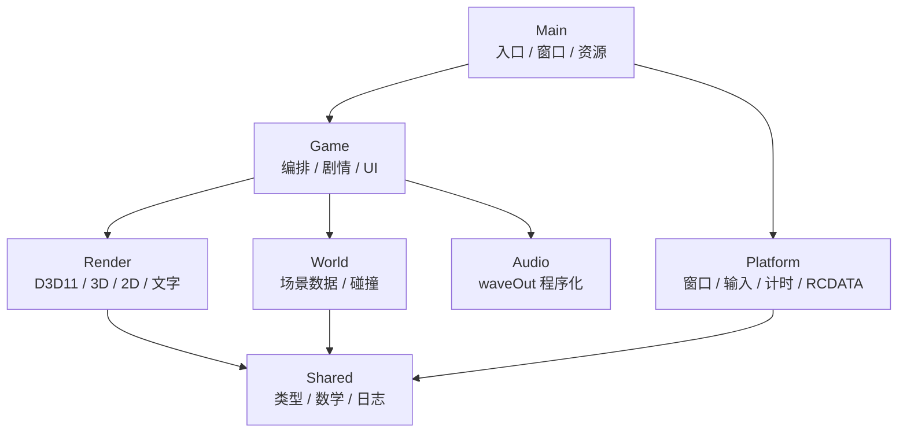
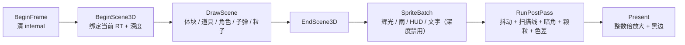

# 技术设计（Design Technical）

---

## 1. 总览



- 依赖方向单向：`Main → Game → {World, Render, Audio} → Shared`；`Platform` 只被 `Main` 与 `Game` 调用。
- 所有 D3D 对象封装在 `Render`；玩法层只通过 `SceneFrame`、`SpriteBatch`、`TextRenderer` 等接口间接使用。

---

## 2. 组件职责

| 组件 | 关键文件 | 职责 |
| --- | --- | --- |
| `Shared` | `Shared_Types.hpp`、`Shared_Math.*`、`Shared_Log.*` | Vec2/Vec3/Mat4/AABB/Color、碰撞与射线、日志 |
| `Platform` | `Platform_Window.*`、`Platform_Input.*`、`Platform_Time.*`、`Platform_Resource.*` | Win32 窗口、键鼠状态、高精度计时、RCDATA 读取 |
| `Render` | `Render_Device.*`、`Render_Mesh.*`、`Render_SpriteBatch.*`、`Render_Text.*`、`Render_Texture.*` | 设备与状态、文本网格解析、2D 精灵批次、GDI 文字纹理 |
| `World` | `World_Types.hpp`、`World_Scenes.*`、`World_Collision.*` | 场景体块/道具/灯光/机位/交互、AABB 碰撞世界 |
| `Game` | `Game_App.*`、`Game_Renderer.*`、`Game_Characters.*`、`Game_Story.*`、`Game_UI.*`、`Game_Quest.*`、`Game_Inventory.*`、`Game_Dialogue.*` | 玩法编排与所有界面 |
| `Audio` | `Audio_System.*` | 程序化音乐与音效（无音频文件） |
| `Main` | `Main_Entry.cpp` | 命令行解析、窗口与主循环、内嵌网格库拼接 |

---

## 3. 渲染管线



要点：

1. `m_currentTarget` 记录当前渲染目标；`BeginScene3D` 按其尺寸设置视口（头像 RT 依赖这一点）。
2. `SpriteBatch::Flush` 每次绑定：输入布局、顶点/索引缓冲、VS/PS、常量缓冲、SRV、采样器、混合状态、光栅状态、**禁用深度的深度模板状态**。缺一不可。
3. 后处理在独立的 `m_capture` RT 上进行；`CaptureOffscreen` 读回该 RT 并写 BMP。
4. 所有尺寸以 `INTERNAL_WIDTH/HEIGHT` 为准；界面坐标空间固定 480×270。

---

## 4. 场景与几何生成

- `World_Scenes` 用 `Block(center, half, color, pattern, solid)` 描述房间与家具体块；`half` 是半长。
- `GameRenderer::DrawScene` 在场景加载时把体块合成为一份网格（`SCENE_ROOM_<id>` → 部件），之后每帧只提交一次索引绘制。
- 静态道具来自 `.fcm`，按 `Prop` 的位置与朝向实例化；`hidden` 的道具可在运行时隐藏（如被搬走的货、被拾取的零件）。
- 角色由 `Game_Characters` 按骨架生成网格，动画在 CPU 侧按部件计算变换，逐部件提交。

---

## 5. 数学约定

- 左手还是右手：视图矩阵为右手系（`LookAt`），透视矩阵为 D3D 深度约定（近平面 0，远平面 1）。
- 矩阵行主序，与 HLSL `row_major float4x4` + `mul(rowVector, matrix)` 一致：

```
Perspective(fov, aspect, near, far):
    m00 = 1 / (aspect * tan(fov/2))
    m05 = 1 / tan(fov/2)
    m10 = far / (near - far)
    m11 = -1
    m14 = near * far / (near - far)
```

- 世界坐标 y 向上；角色朝向用绕 Y 的弧度表示，`0` 面向 `+Z`。
- 2D 屏幕坐标 y 向下；`SpriteBatch` 的正交矩阵负责翻转。

---

## 6. 文字渲染

1. `TextRenderer::Get(text, size, maxWidth)` 按 `text + size + maxWidth` 缓存 `TextBlock`。
2. 首次构建：创建 32 位 DIB → GDI `TextOutW` → 用亮度生成 alpha、RGB 置白 → 上传为 BGRA 纹理 → 记录每行的宽度与换行信息。
3. 绘制：按 `visibleUnits` 截取源矩形，实现逐字显示；阴影是偏移 1 px 的半透明副本。
4. 已知代价：数值型文本（血量、弹药、计时）每帧变化会不断新建纹理。若出现卡顿，应改为字形图集 + 逐字形四边形。

---

## 7. 音频

- 全部由代码合成（正弦/方波/噪声 + 包络），通过 `waveOut` 双缓冲输出。
- 音乐按场景切换，音效通过 `SfxId` 触发（枪声、拾取、购买、警报、死亡）。
- 无外部音频文件；静音通过 `M` 键或 `Initialize(..., muted)` 控制。

---

## 8. 资源与内嵌

- `Resources/Resources.rc` 把 `Resources/Meshes/Props/*.fcm` 以 `RCDATA` 嵌入：`MESH_COMMON`、`MESH_STREET`、`MESH_BAR`、`MESH_HARBOR`。
- `Main_Entry::LoadMeshLibrary` 依次读取并拼接为一份文本，交给 `MeshLibrary::AddText` 解析。
- 最终 exe 不读取任何外部文件；`Tools/OffscreenTest` 例外，它直接读 `Resources/Meshes/Props/*.fcm` 以支持热改。

---

## 9. 性能预算（480×270）

| 项 | 预算 | 现状 |
| --- | --- | --- |
| 场景三角形 | < 60k | 约 20–30k |
| 每帧绘制调用 | < 200 | 场景 1 + 道具 N + 角色部件 + 精灵批次若干 |
| 精灵四边形 | < 1000 | 雨 160 + HUD 若干 |
| 内存 | < 200 MB | 约 60 MB（含 32 位 DIB 缓存） |

---

## 10. 已知技术债

1. 文本纹理按字符串缓存，无上限；长期运行会增长。
2. 角色动画在 CPU 侧逐部件计算，部件多时有一定开销。
3. `.fcm` 解析器对错误输入只做跳过与日志，没有严格校验。
4. 后处理为固定管线，参数散落在 `PostConstants` 中，缺少统一配置入口。
