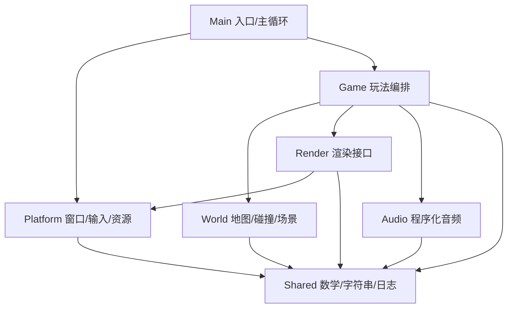

# 技术设计（Design_Technical）

> 目标：在无第三方依赖的前提下，用 C++17 + Win32 + D3D11 实现一个稳定、可测试、可嵌入单文件的 2D 游戏 Demo。

---

## 1. 总体架构



### 1.1 分层规则

| 层 | 可以做 | 不可以做 |
| --- | --- | --- |
| Shared | 纯逻辑、数学、字符串、随机、日志 | 包含 D3D/窗口类型 |
| Platform | Win32、计时、输入、RCDATA 读取 | 包含玩法规则 |
| Render | D3D11、纹理、批处理、文字、后处理 | 修改游戏状态 |
| World | 地图数据、碰撞、场景查询 | 直接绘制 |
| Game | 状态机、实体、对话、任务、UI 布局 | 直接调用 D3D API |
| Audio | waveOut、合成器、混音 | 依赖窗口消息 |
| Main | 初始化顺序、消息循环、帧循环 | 承载玩法细节 |

---

## 2. 组件与文件规划

```text
Components/
├─ Main/
│  ├─ Inc/（无公开头文件，入口仅 .cpp）
│  └─ Src/Main_Entry.cpp
├─ Shared/
│  ├─ Inc/Shared_Types.hpp, Shared_Math.hpp, Shared_String.hpp, Shared_Random.hpp, Shared_Log.hpp
│  └─ Src/Shared_Math.cpp, Shared_String.cpp, Shared_Random.cpp, Shared_Log.cpp
├─ Platform/
│  ├─ Inc/Platform_Window.hpp, Platform_Input.hpp, Platform_Resource.hpp, Platform_Time.hpp
│  └─ Src/...
├─ Render/
│  ├─ Inc/Render_Texture.hpp, Render_Device.hpp, Render_SpriteBatch.hpp, Render_Text.hpp, Render_PostFX.hpp
│  └─ Src/...
├─ World/
│  ├─ Inc/World_Types.hpp, World_Map.hpp, World_Collision.hpp, World_Scene.hpp, World_SceneData.hpp
│  └─ Src/...
├─ Game/
│  ├─ Inc/Game_App.hpp, Game_Types.hpp, Game_Player.hpp, Game_Enemy.hpp, Game_Bullet.hpp,
│  │      Game_Interaction.hpp, Game_Dialogue.hpp, Game_Story.hpp, Game_Quest.hpp,
│  │      Game_Inventory.hpp, Game_Shop.hpp, Game_UI.hpp, Game_Particles.hpp
│  └─ Src/...
└─ Audio/
   ├─ Inc/Audio_System.hpp
   └─ Src/Audio_System.cpp
```

> 实际实现可按需合并小文件，但必须保持“渲染 / 玩法 / 平台”分层，且头文件命名规范。

---

## 3. 主循环

```text
WinMain
  ├─ 解析命令行（--shot / --scene / --frames，用于无头截图）
  ├─ 注册窗口类，创建 1440×810 窗口
  ├─ RenderDevice::Initialize(hwnd)
  ├─ ArtPack::LoadFromResource(GetModuleHandle(nullptr), L"ART_PACK")
  ├─ TextRenderer::Initialize(device)
  ├─ AudioSystem::Initialize()
  ├─ GameApp::Initialize(hwnd)
  └─ while (running)
       ├─ Input::Poll()
       ├─ dt = Time::Tick()（上限 50ms）
       ├─ GameApp::Update(dt)
       ├─ GameApp::Render()        // 渲染到 480×270 离屏纹理
       ├─ GameApp::Present()       // 最近邻缩放到窗口/全屏
       └─ Input::EndFrame()
```

### 3.1 固定内部分辨率

- 所有游戏坐标、UI 布局、字体大小均以 480×270 为基准。
- 呈现阶段计算整数缩放：
  - `scale = max(1, min(clientW / 480, clientH / 270))`
  - 若窗口小于 960×540，则允许 1× 并居中；窗口最小尺寸限制为 960×540。
- 黑边用深色填充；鼠标坐标换算时减去偏移并除以 scale。
- `Alt+Enter` 切换无边框全屏（保存窗口样式与位置）。

---

## 4. 资源管线

### 4.1 ArtGen

- 独立 C++ 程序 `Resources/ArtGen/ArtGen_Main.cpp`，只依赖标准库。
- 输出：
  - `Resources/Art/*.png`（RGBA8，非压缩 Deflate，供审阅）；
  - `Resources/ArtPack.bin`（运行时资产包）。
- 生成器使用固定随机种子，保证可重复构建。
- 绘图原语：矩形、线、椭圆、多边形、噪声、抖动、描边、5×7 像素字。

### 4.2 资产包格式（FCPK v1）

```text
Header:
  char[4]  magic = "FCPK"
  uint16   version = 1
  uint16   count
Entries (count 个):
  char[32] name        // ASCII 大写，0 填充
  uint16   width
  uint16   height
  uint32   dataOffset  // 从文件起始的字节偏移
  uint32   dataSize    // width * height * 4
Data:
  BGRA8（预乘 alpha 关闭，straight alpha）
```

- 小端序；运行时一次性读入内存并建立名称索引。
- 纹理创建使用 `DXGI_FORMAT_B8G8R8A8_UNORM`；采样器：
  - 像素艺术：`D3D11_FILTER_MIN_MAG_MIP_POINT`；
  - 文字：`D3D11_FILTER_MIN_MAG_MIP_LINEAR`。
- 缺失资源：返回 1×1 洋红占位纹理，并写日志。

### 4.3 RC 嵌入

`Resources/Resources.rc`：

```rc
ART_PACK RCDATA "ArtPack.bin"
```

- `windres` 将其编译为目标文件，链接进 exe。
- 运行时 `FindResourceW(GetModuleHandleW(nullptr), L"ART_PACK", RT_RCDATA)`。
- 路径相对 `.rc` 所在目录，避免绝对路径。

---

## 5. 渲染

### 5.1 设备与目标

- D3D11 设备：`D3D11CreateDevice`，`D3D11_CREATE_DEVICE_BGRA_SUPPORT`。
- 离屏目标：`480×270`，`DXGI_FORMAT_B8G8R8A8_UNORM`，带深度不需要。
- 交换链：`DXGI_SWAP_EFFECT_DISCARD`，`DXGI_FORMAT_B8G8R8A8_UNORM`，双缓冲。
- 顶点着色器：正交投影，`POSITION(float2) + TEXCOORD(float2) + COLOR(float4)`。
- 像素着色器：`Texture.Sample(PointSampler, uv) * color`；文字使用线性采样。
- 混合：普通 Alpha（`SRC_ALPHA / INV_SRC_ALPHA`）；光效使用加色（`ONE / ONE`）。
- 呈现：全屏三角形/四边形，采样离屏纹理，`Point` 采样，输出到交换链。

### 5.2 SpriteBatch

- 动态顶点缓冲：8192 个四边形（4 顶点/6 索引）。
- 每帧 `Begin(projection)` → 多次 `Draw` → `End()`。
- 按纹理分组以减少状态切换；同纹理连续绘制合并到一个批次。
- 支持：源矩形、目标矩形、颜色 tint、翻转（通过 uv）、旋转（可选）。
- 绘制顺序：背景瓷砖 → 地面装饰 → 角色/道具（按脚底 y 排序）→ 子弹/粒子 → 光照（加色）→ 天气 → 后处理 → UI。

### 5.3 文字渲染

- 使用 GDI 在 32bpp DIB 上绘制，再上传为 D3D11 纹理：
  1. `CreateFontW(-px, ... L"Microsoft YaHei UI" / L"SimSun")`；
  2. 清空 DIB 为黑，`SetBkMode(TRANSPARENT)`，`SetTextColor(RGB(255,255,255))`；
  3. `DrawTextW` 或逐行 `TextOutW`；
  4. 将 RGB 亮度转换为 alpha，RGB 置白，形成可着色遮罩；
  5. `CreateTexture2D` + `UpdateSubresource`。
- 缓存：`key = px|maxWidth|text`，LRU 上限 256 条；切换场景时清空一次性文本。
- 段落结构保存每行文本、宽度、每个字符的 x 偏移，用于打字机局部显示。
- 阴影：同一纹理偏移 `(1,1)`，用 `#0B0E17` 绘制。
- 字体回退：`Microsoft YaHei UI` → `Microsoft YaHei` → `SimSun`；创建失败时使用 `DEFAULT_GUI_FONT` 并记录日志。

### 5.4 后处理

- 暗角：预生成 480×270 RGBA 遮罩，普通 Alpha 叠加。
- 扫描线：4×4 纹理平铺，alpha 0.04。
- 受伤：全屏红色 tint 脉冲（Alpha 0–0.25）。
- 屏幕震动：渲染前给相机施加偏移，按时间衰减。
- 雨天：100–160 个雨丝粒子，循环下落，按场景启用；近景雨丝更亮。
- 霓虹闪烁：按时间与随机相位调制光晕 alpha。

---

## 6. 输入与窗口

- `Platform_Input`：
  - 键状态：`down[256]`、`pressed[256]`、`released[256]`；
  - 鼠标：客户端坐标、按键、滚轮；
  - `EndFrame()` 复制 `down → previous` 并清空 pressed/released。
- 焦点丢失时清空按键，避免“卡键”。
- 窗口过程处理：`WM_DESTROY`、`WM_SIZE`、`WM_KEYDOWN/UP`、`WM_MOUSEMOVE`、`WM_LBUTTONDOWN/UP`、`WM_MOUSEWHEEL`、`WM_SETFOCUS/KILLFOCUS`、`WM_ACTIVATEAPP`。
- `WM_GETMINMAXINFO` 限制最小客户区 960×540。
- 关闭窗口时设置原子布尔 `m_running = false`。

---

## 7. 世界与碰撞

### 7.1 地图

- 格子地图：`width × height`，每格 16px；每格存 `tileType` 与 `blocked`。
- 场景蓝本包含：
  - 主题（BAR/STREET/HARBOR）；
  - 地板/墙体字符数组；
  - 道具列表（资源名、像素位置、是否阻挡、碰撞盒）；
  - 交互物列表（ID、位置、提示、启用条件）；
  - 角色/NPC 初始位置与朝向；
  - 敌人出生点与类型；
  - 出入口与目标点；
  - 相机模式（固定/跟随）与环境参数（雨、雾、色调）。
- 蓝本以 C++ `constexpr` 数据定义在 `World_SceneData.cpp`，避免运行时解析错误。

### 7.2 碰撞

- 玩家/敌人为圆形（半径 5–6px），与格子 AABB 和道具 AABB 做轴分离移动：
  1. 先移动 X，检测碰撞，若碰撞则回退；
  2. 再移动 Y，检测碰撞，若碰撞则回退。
- 敌人之间使用简单分离力，避免完全重叠。
- 子弹：每帧步进，检测格子与道具；使用射线步进（按速度分 2–4 个子步）避免穿透。
- 视线：DDA 网格射线，步长 8px，遇到阻挡即失败。

---

## 8. 游戏状态与实体

### 8.1 状态机

```text
TITLE
  → PLAYING（场景内自由移动）
      ↔ DIALOGUE
      ↔ SHOP
      ↔ JOURNAL
      ↔ PAUSED
      ↔ DEAD
  → CUTSCENE（开场/伏击/结局）
  → EPILOGUE
```

- 状态切换由 `GameApp::SetMode()` 统一处理；切换时清理输入、暂停实体更新。
- 对话/商店/日志期间：敌人、子弹、粒子停止；环境动画继续。
- 死亡时：显示重试界面；`Enter` 从场景检查点恢复。

### 8.2 实体

| 实体 | 字段 | 更新 |
| --- | --- | --- |
| Player | pos、hp、ammoMag、ammoReserve、medkits、money、facing、invulnTimer | 输入、碰撞、射击、装填、治疗 |
| Enemy | pos、hp、type、state、shootTimer、alerted、pathTimer | 视线、移动、射击、受击 |
| Bullet | pos、vel、damage、hostile、life | 步进、碰撞、销毁 |
| Particle | pos、vel、life、color、size、additive | 阻尼、淡出 |
| Pickup | pos、type、amount、bob | 靠近拾取 |

- 实体使用 `std::vector` 存储；每帧末尾移除死亡/过期对象（swap-erase）。
- 深度排序：按脚底 y 升序，`std::stable_sort`。

---

## 9. 音频

- `waveOut` 双缓冲/四缓冲，44.1kHz、16bit、立体声。
- 混音线程每 1024 帧填充一次：
  - 音乐：按场景的和弦进行 + 琶音 + 低音；音量 0.25；
  - 环境：雨声（滤波噪声）、室内低频嗡鸣、工业脉冲；音量 0.2；
  - SFX：枪声、命中、装填、拾取、UI、警报、开门；音量 0.5。
- 简化合成器：正弦/方波/三角波 + 噪声 + ADSR 包络。
- 事件通过无锁环形队列提交；音频线程只读。
- `M` 键静音；窗口失焦时降音量（可选）。

---

## 10. 构建

### 10.1 根 Makefile

- 更新 `CXX_INCLUDES_PATHS`：所有组件的 `Inc`。
- 更新 `CXX_SOURCES_PATHS`：所有组件的 `Src`。
- `LIB_LINK`：`-lgdi32 -luser32 -ld3d11 -ld3dcompiler -ldxgi -lwinmm -lole32 -luuid -lshlwapi`
- `WIN_RESOURCE_SCRIPTS = Resources/Resources.rc`
- `OUTPUT_CHAR_ENCODING = UTF-8`（源码中的窄字符串保持 UTF-8，文字系统按 UTF-8 解析）。
- `GUI = 1`，`LDFLAGS += -mwindows`；入口使用 `WinMain`。
- `-static` 保持静态链接。

### 10.2 Tools Makefile

- 独立编译，不污染根 Makefile。
- `UnitTests`：只链接 Shared 的纯逻辑源文件 + 测试源文件。
- `OffscreenTest`：链接全部组件源文件（排除 `Main_Entry.cpp`）+ 自带 `main`。
- 输出到 `Tools/<工具>/Build/<工具>.exe`。

---

## 11. 无头验证

### 11.1 UnitTests

- 覆盖：
  - `Shared_Math`：向量运算、AABB、clamp、lerp；
  - `Game_Inventory`：购买、扣款、上限、失败条件；
  - `Game_Quest`：阶段推进、支线状态、任务文本；
  - 对话数据：节点数量、跳转索引有效性、事件枚举覆盖。
- 输出 `[PASS]/[FAIL]` 与汇总；失败返回非 0。

### 11.2 OffscreenTest

- 创建 `SW_HIDE` 窗口（不激活、不显示）。
- 初始化真实 D3D11 管线与游戏。
- 通过 `GameApp::DebugLoadScene(SceneId)` 加载场景，模拟固定步长 1/60s，渲染 N 帧。
- 从交换链/离屏目标读回像素，写 BMP 到 `Temp/Screenshots/`。
- 不调用 `SetForegroundWindow`、不移动鼠标、不发送键盘事件。
- 可选 `--scene bar|street|harbor|title`。

---

## 12. 性能目标

| 指标 | 目标 |
| --- | --- |
| 帧率 | 1080p 窗口下稳定 60 FPS（VSync） |
| 绘制调用 | < 300/帧 |
| 纹理数 | < 120 |
| 内存 | < 150 MB |
| exe 体积 | < 20 MB |
| 启动时间 | < 1.5 秒（含资源解包） |

- 瓷砖每帧绘制约 510 个四边形（酒吧），精灵 < 100，粒子 < 200；完全在动态缓冲范围内。
- 文字纹理按需创建，避免每帧重新 GDI 渲染。

---

## 13. 风险与缓解

| 风险 | 影响 | 缓解 |
| --- | --- | --- |
| 系统中文字体缺失 | 文字变方块 | 字体回退链；极端情况使用 5×7 像素字显示拼音/英文 |
| `d3dcompiler_47.dll` 缺失 | 无法编译着色器 | 记录日志并显示错误文本；Windows 10/11 默认存在 |
| 隐藏窗口 swapchain 截图失败 | 无法视觉验收 | 提供离屏 RTV 模式作为备选；先 Present 再读回 |
| 静态链接体积/兼容性 | 启动失败 | 使用 MinGW 官方静态运行时；避免异常跨 DLL |
| 中文换行/断字 | UI 溢出 | 按像素宽度测量，逐字换行；禁止在标点前断行（简易规则） |
| 音频线程竞态 | 爆音/崩溃 | 事件环形队列 + 原子音量；退出时先停线程再释放 waveOut |
| 输入法/Alt 键 | 卡键 | 失焦清空状态；Alt+Enter 使用 `WM_SYSKEYDOWN` |

---

## 14. 编码与注释约定（摘要）

- 每个头文件使用 `__<文件名>_HPP__` 保护宏。
- 公开 API 使用 `@brief / @param [IN|OUT|IN/OUT] / @return`。
- 宏与枚举常量全大写；类名大驼峰；函数/变量小驼峰；成员 `m_` 前缀。
- 禁止在 UI 层直接调用 D3D；禁止在渲染层修改游戏状态。
- 新增文件必须同步 Makefile 目录索引与 `Tools/README.md`（若属于测试工具）。

---

## 15. 目录与提交检查清单

- [ ] 根 `make` 通过（Release + Debug）。
- [ ] `Tools/Makefile` 通过（UnitTests + OffscreenTest）。
- [ ] `Resources/Art` 与 `Resources/ArtPack.bin` 同步。
- [ ] `Resources/Resources.rc` 路径正确、无绝对路径。
- [ ] `git status` 无临时文件；`.gitattributes` 覆盖新增文本类型。
- [ ] `Agent_Mem.md` 已更新阶段与验证结果。
