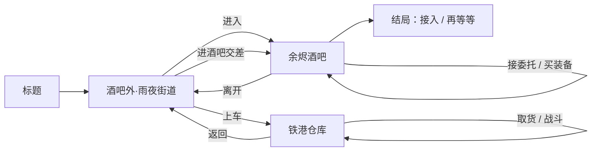

# 世界观设计（Design World）

> 本文件描述《余烬自由城》的地理、组织与基调。角色设定见 `Design_Characters.md`，剧情节点见 `Design_Story.md`。

---

## 1. 一句话世界

自由城（Free City）是一座“谁都能来、谁都不属于”的城市。城里唯一的秩序来自 **Fortshine（FS，繁星集团）**：它不发号施令，只是把所有东西都变成可计价的条目——住所、工作、身份、甚至神经接入的资格。

---

## 2. 关键名词

| 名词 | 含义 |
| --- | --- |
| 自由城 / Free City | 城市本体。移民、灰产、公司外包在此混杂；对外宣称“机会之城” |
| FS / Fortshine / 繁星集团 | 垄断企业。掌握接入网络与大部分合法岗位，用“合规”维持排斥 |
| CPL | 城内的市政特许执照体系，决定谁能开店、谁能住进有电梯的楼 |
| 思维接入（Mind Access） | 接入城市网络的必要手续。未登记的设备可以绕过审核，但不被承认 |
| 未登记接入装置 | 黑市货，500 信用点一只；查不到来源，也不上传使用者姓名 |
| ACCESS DENIED | FS 系统的标准拒绝回显，在 Demo 中作为终端符号反复出现 |
| 信用点 | 城内通用货币；也用来衡量一个人“还值不值得被服务” |

> 名词与语气沿用远端 Godot 仓库既有设定；与 `场景剧本.docx` 冲突时以剧本为准。

---

## 3. 地理

### 3.1 旧城区（Demo 主舞台）

- 雨、砖墙、霓虹、积水；街道窄，灯光永远不够亮。
- 地标：**余烬酒吧**。老板小帅，常客是拿不出接入资格的人。
- 氛围关键词：湿冷、低矮、有人味、随时会断电。

### 3.2 铁港（Iron Harbor）

- 仓库区。旧集装箱、桁架屋顶、吊灯、卷帘门、地面积水。
- 白天是物流，夜里是灰色转运点；公司的人偶尔来“清点”。
- 氛围关键词：工业、空旷、回声、单一暖光下的巨大阴影。

### 3.3 公司区（本 Demo 不进入）

- 玻璃、白光、干净的走廊。只在对话与远景里被提到，用作对照。

---

## 4. 组织与势力

| 势力 | 行为 | 在 Demo 中的表现 |
| --- | --- | --- |
| FS / 繁星集团 | 用流程而非暴力维持秩序；必要时派“特工”执行 | 铁港的武装特工、终端里的 `ACCESS DENIED` |
| 自由城拾荒者 | 依附于物流缝隙生存；见货就抢 | 铁港的普通敌人 |
| 酒吧常客 | 边缘人网络；信息与交易的节点 | 小帅、大美、东子的对话 |
| CPL 执法 | 纸面存在，实践中只服务付得起的人 | 只在台词中被提到 |

---

## 5. 基调与视觉母题

1. **冷与暖的对抗**：环境是冷灰蓝，实用光源（吧台灯、吊灯、霓虹、车灯）是暖琥珀或洋红。参考 *SIGNALIS* 的光色逻辑，不复制其画面。
2. **低清多面体**：所有物体都由少量平面构成；靠色块、明暗与光斑建立体积，而不是贴图细节。
3. **制度性困境必须可见**：门上锁、终端拒绝、价目表、需要刷卡的入口——玩家用眼睛就能读懂“你不被允许”。
4. **雨与扫描线**：雨是常态，不是气氛点缀；后处理的扫描线与抖动让画面像一段被反复复制的监控录像。

---

## 6. Demo 内的空间动线

- 三个场景用同一套体块 + 道具 + 灯光系统搭建，尺寸分别约 14×10 m、24×20 m、14×10 m。
- 场景之间用淡出过渡；玩家位置与朝向由 `StartTransition` 指定，不允许穿墙。

---

## 7. 写作要求

1. 台词短、留白多；不用解释性旁白替玩家下结论。
2. 不写“正义战胜公司”的爽点；写“你终于有资格排队了”的荒诞。
3. 每个 NPC 至少有一句只属于他的口头习惯（小帅的客套、大美的直白、东子的市侩）。
4. 不使用现实商标、真实人名、可识别的现实政治符号。
