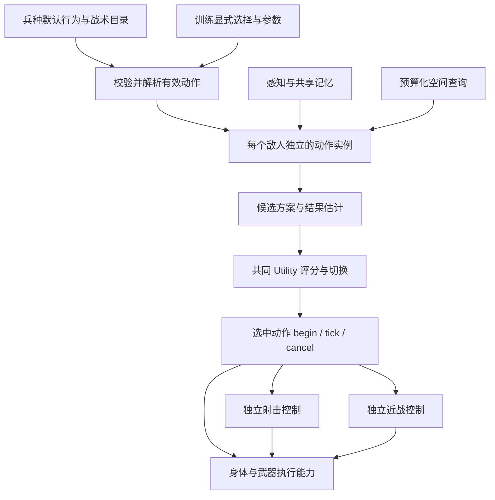

# 敌人 AI：代码结构、维护与使用部署

## 训练参数的个人／协调器适用范围（2026-10-26）

按用户要求，`Training → Profile` 的分类和各参数已补充 `##` 注释，区分“仅个人 Utility”“个人与协调器共用”“仅协调器”及“旧资源兼容”。个人指无小队或0级情报共享下的个人决策；协调器指1/2级团队指挥。“共用”也包括成员执行器、身体、感知和火控在团队指挥下读取，不代表协调器会运行个人 Utility。以下记录当前调用关系，本轮只补说明，不改参数值或运行行为。

| 分类 | 当前适用范围与例外 |
| --- | --- |
| AI | `patrol_pause_seconds` 仅个人；受击位置误差共用 |
| 作战能力（Tactics） | 被动防护、受击倍率和普通火控共用；`stress_tolerance`、支援长点射仅团队；远程选位上限和重选间隔仅个人 |
| Cover | 速度、蹲藏时间、观察时间共用；`low_cover_preference`、换弹掩体偏好及个人卡住绕行参数仅个人，不是团队评分权重 |
| Search | 位置提示概率/衰减、快速追查、重点搜索速度和有效观察时长共用；个人 TRACK、覆盖目标、搜索超时和个人导航参数不用于团队搜索 |
| Suppression | 已训练的有限压制方案共用；旧出口时长/枪数字段只保留兼容存储 |
| Fire Decision / Perception | 统一火控和成员感知共用；火控评分不等于团队岗位分配评分 |
| Selection | 翻越偏好、攻击占位几何和掩体线索推断共用；个人掩体质量参数不替代团队防御检查；诊断参数不参与评分 |
| 近战战术参数（Action Overrides） | 对应战术的个人执行和团队提案/命令共用，仍须训练解锁 |
| 小队配合（已移出 Training） | 统一在 `Squad → Profile` 配置；0级个人也读取所属小队的情报/间距参数，无绑定时用现有默认值 |

同名共用参数可能有不同含义：`Search Radius` 是个人搜索边界，在团队中只参与围绕线索的选点排序，不能限制整区覆盖；`Focused Search Speed Multiplier` 在团队中是搜索任务基础速度，不受个人 `Focused Search Seconds` 时窗限制；`Search Pause Seconds` 在团队中是可边走边累计的有效观察时长，最少0.25秒。提示间隔与排序半径采用首个具备搜索能力成员的冻结配置；提示概率/误差按当次合格成员读取，每次小队机会只抽一次，不按人数累加概率。

团队在本场装配时冻结成员训练与能力，改值后需重新加载战斗。配置存在不等于已解锁动作；具体字段的适用范围以[训练配置](../movement_demo/scripts/enemy/config/enemy_training_profile.gd)及其模块注释为入口。Godot 原生属性帮助读取这些 `##` 注释，已有自定义检查器提示仍由对应插件提供。

本轮验证：12个配置脚本的 Godot `--check-only` 全部通过，并逐文件核对非注释内容与修改前一致；未修改资源值、接口或执行流程，因此未重跑行为回归。

### 移除个人训练 Cooperation（2026-10-26）

用户随后要求删除重复的训练入口。`EnemyTrainingProfile` 已移除 `cooperation` 属性，`Training → Profile` 不再显示或保存该模块；旧文件中的同名字段只在加载时接收并丢弃，重新保存会自然去掉，其他训练参数与战术解锁保持。旧 `Action Overrides` 中的协作模块也不参与训练查询，不能重新覆盖队级设置。本次不批量重写用户保存的训练资源。

`EnemyContext.setting("cooperation", ...)` 统一查询所属 Squad 的 Profile（保留旧区域显式绑定）；无绑定或配置缺失时按调用方原有缺省值回退，不再查询 Training。0级个人 Utility 仍依赖以下共享参数，所以保留 `cooperation_settings.gd` 和情报/预约/间距服务：`intel_seconds` 默认5秒、`checked_point_seconds` 默认3秒、`cover_inspection_seconds` 默认20秒、`spacing_margin` 默认0.45米。有小队的0级成员和1/2级成员仍使用同一小队配置来源。只有原来依赖无绑定个人 Training 覆盖这些值的旧配置会改用默认值；需要自定义时在0级 Squad 的 Profile 设置。

删除的是个人训练中的重复配置，并未删除团队协调器、共享情报、物理预约或个人基础间距。个人/团队决策分流、动作解锁与团队本场冻结规则保持。验证见[配置来源清理](enemy-tests.md#移除个人训练cooperation2026-10-26)。

2026-10-26 玩家收敛接口清理：敌人的恢复计算不变。普通枪仍使用 `WeaponData.stabilize_seconds` 从初始概率恢复到满概率，霰弹仍使用 `ShotgunSettings.settle_seconds`；初始满值时按0到1恢复。检查器入口分别是 **Weapon → 瞄准与散布 → 敌人恢复（原算法）**、**Weapon → Shotgun → 敌人恢复（原算法）**。玩家公式／统一时间不参与敌人计算，原AI掩体阶段估时仍读原字段，未修改身体、火控、Utility或协调器代码。

爆头防护与身体状态（2026-10-25，已实施）：**Training → Profile → 作战能力 → 爆头防护** 是直接复选框，默认关闭。开启后免于爆头秒杀，仍承受攻击武器配置倍率伤害（默认3倍），存活时进入“被爆头状态”。个人模式沿原训练查询读取，普通／强协作遵守本场冻结配置；仅更换外观不会获得防护。检查器显示“作战能力”，内部 `Profile.tactics`、模块键和资源引用不迁移。

按用户最新要求，状态由**攻击武器**配置时长、保留移速和精度上限，默认1秒、0%移速、0%精度上限。**不禁止射击，不取消当前AI动作，不注入协调器占用／任务失败，不暂停Utility、感知或团队循环。** 转向、跟踪瞄准方向、姿态、换弹和近战仍按原流程。原AI可依当前精度、位置与射击结果自然改选；不承诺所有行为都完全不受间接影响。即使精度为0，原火控仍可能选择开枪。

`enemy_headshot_state.gd` 由身体独占计时，状态强度使用本枪快照，不反查敌人自己的武器。精度损失复用近战／枪击的 `apply_aim_penalty()`；减速合并进原 `get_hit_movement_multiplier()`，与普通减速取较强者，普通命中不能覆盖尚未结束的爆头限制。状态内精度只允许恢复至配置上限，不抬高更差精度；结束后按原规则继续恢复。原 `can_move()`、`can_fire()` 保持原资格语义，最终移动根据实际倍率执行。重力、碰撞、受击外力继续；零移速时翻越按原安全落地流程收尾，不开始新翻越。暂停冻结，死亡／复位／退场／对话清理；换枪不清除。接口见[完整设计](superpowers/specs/2026-10-25-headshot-stagger-execution-design.md)。

逐发装填补充（2026-10-25）：**Weapon → Shotgun → 逐发装填** 可开启逐发补弹，默认关闭。原身体请求／取消／更新入口继续拥有执行过程，已完成的一发立即入匣，未完成的取消不扣弹；第一发完成不自动结束换弹。原换弹动作、空间评估、近战打断估时和协调快照统一读取 `ammo.reload_remaining_seconds()`，按实际缺口、备弹和当前这一发进度估计补满时间。只替换耗时来源，不新增 Utility、协调策略或自动中断条件；玩家的右键中断不传播为敌人的决策规则。

霰弹装备（2026-10-25）：敌人原 **Weapon → Fire Mode → 霰弹** 接入同样的图样配置，原 AI 仍逐枪请求 `try_fire()`；身体入口先查询全部弹丸，再按目标合计伤害，每枪只消耗一发、发送一次通知。原视野、冷却、兵种与弹药资格均保留；屏幕外按下述概率逐枪判定，不对每颗弹丸单独抽取。个人 Utility 和协调器不增加霰弹专用策略。配置与范围见[霰弹说明](gameplay/SHOTGUN.md)。

## 血条、视距与屏幕内开火（2026-10-25）

公共敌人场景增加 **HealthBar**，默认显示无数字的生命比例条。全灭回收时保留静态尸体，回收其他角色组件；用法及生命周期见[表现说明](gameplay/PRESENTATION.md#临时敌人血条与波次尸体2026-10-25)。

敌人视距按原要求关联武器锁定范围。2026-10-26 用户将此前“屏幕外完全禁射”调整为默认50%开火机会成功，失败时跳过这一枪、不耗弹。视距配置仍在 **Training → Profile → perception**（感知设置资源）：

| 字段 | 当前含义 |
| --- | --- |
| Use Weapon Sight Range | 默认开启；远程敌人以自身 Weapon 的 Aim Range 为基础视距 |
| Weapon Sight Extra Distance | 默认额外2米，可设0；这是实现初值，不是用户固定要求 |
| Sight Distance | 近战、无武器或关闭武器联动时使用，原默认10米 |

屏外参数在**敌人根节点 → Shooting → Offscreen Fire Chance**，内部字段 `offscreen_fire_chance`，范围0～100%，默认50%。0%完全禁射，100%保留正常开火，屏幕内始终按正常规则射击；近战不受影响。可在公共敌人、兵种／关卡预设或具体实例保存覆盖，不修改武器或训练资源。

普通射击与合法记忆压制继续核对原视角、真实枪线、权限、反应、冷却、弹药和友军安全条件，再由身体 `try_fire()` 对该次机会抽取一次。失败不产生弹丸、伤害、近弹、枪声、后坐或实际射击事件，也不耗弹；仍消耗机械冷却、AI射击间隔和本轮一次点射配额。因此不会逐帧重抽或延长点射来补足枪数。`can_fire()` 保持纯资格查询，不抽随机数；身体的 `shot_attempt_count` 记录合法尝试，原 `shot_count`／`shot_fired` 只记录实际发射。概率使用独立随机序列，不扰动弹道或战术随机数。

屏幕外仍可移动、追击及正常累计射击反应，进入画面只移除概率限制，不清除已有冷却与停顿。50%表示同等合法机会下的长期平均，短时间可能连续跳过或连续成功，不代表每两枪强制放行一枪；实际命中率继续由瞄准与弹道决定。

`systems/combat_view.gd` 只查询所属 Viewport 的活动 Camera3D：以敌人躯干点进入画面内8像素为屏内／屏外判定边界。它不承担墙体遮挡判断、不修改AI情报。没有活动相机的纯逻辑模拟保持原行为；正常关卡必须配置实际活动相机。多人／分屏未验收。玩家锁定使用同一画面判断，无额外8像素内边距。

## 关卡敌人波次（2026-10-25）

2026-10-26出生搜索：每个 Wave 新增“出生搜索 → Search On Spawn”（默认true）和 `Spawn Search Error Radius`（默认3米）。树序首波（用户称第0波）强制排除，原信号仍从1计数；后续波实际提交时一次取样，整波就绪后经 `AI.receive_spawn_search_hint()` 交给成员 Context。只保存 `source=wave_spawn` 的冻结位置、误差、时间和目标身份，不写真实目击、瞄点或压制证据，不广播给旧波。

个人 Search 收到 `spawn_search` 后直接复用 `begin_search()`，搜索换轮及普通调查超时不解除出生警戒；普通／强配合协调器仅在缺少正常情报和既有真实目标时，从本队成员提示初始化原搜索目标，继续拥有全部任务。真实目击接管、正常声音／共享视觉及训练可选hint继续按原规则运行；不新增循环或第二套任务表。成员持有提示避免首次小队注册／Profile重置丢失，死亡记忆重置、换区域和退出清理，整轮重启重新取样。操作见[波次使用说明](gameplay/ENEMY_WAVES.md#后续波出生即搜索)，设计及验证见[实施记录](superpowers/specs/2026-10-26-wave-spawn-search-design.md)。

关于恢复巡逻：已有个人 AI 在真实／团队视觉接敌后持续搜索，小队保留目标后同样不回未警戒巡逻；从未目击的普通声音调查仍可以结束。本次出生提示单独要求持续搜索，不通过伪造视觉记忆获取交战权限。

区域可选接入一个 `EnemyWaves`，各波按直接子节点顺序出场。每波下面放原 Squad 和敌人，或在“兼容已有场景 → Existing Squads”中引用本区已有小队。普通新部署不需要填路径或登记每个敌人；血量、训练、武器、Profile 仍在原节点配置。拖放步骤与第一关示例见[快速上手](gameplay/LEVEL_MAPS.md#敌人波次快速上手)。

父区域在子树入树前捕获完整部署为仅内存的 PackedScene，规范化快照所有权以保留关卡拥有的手工成员；实例化由引擎隔离本地资源，普通共享资源保持引用。未来波次没有身体、AI、导航成员或近弹监听接入运行世界。公开组件保留，原生内部节点由原类型创建；不捕获非序列化运行状态。

波次配置 `wait_for_previous_clear` 默认true：紧邻上一波全灭并清理后才开始本波 `start_delay_seconds`；false则从上一波实际出场起计时，允许多波同时作战。首波始终从本轮开始计时，后续波不越过尚未生成的前波。上下顺序只看 EnemyWaves 的直接子波次，不按名字编号；等待全灭只依赖相邻前波，不要求所有更早波都清空。

控制器只从本次生成成员的真实 `died` 减员，每波独立持有小队与存活集合，另汇总总存活人数；同波多小队合并统计，尸体未释放不妨碍清波。清空后在下个有效区域时钟安全销毁该波小队，确认退树注销后发出该波清空信号，其他波继续运行和计时；意外移除活成员进入错误状态。所有波都已生成且全部退树后才最终完成，不能因最后出场的一波先死而提前结束。等待／重试沿区域 `has_active_player()` 时钟，暂停、死亡和对话冻结。最后玩家离场先取消本轮所有波，区域复位排除仍待删除的成员；没有组件时仍按原流程刷新。

固定点生成检查不排除玩家，使用原站姿胶囊半径／高度、碰撞掩码及本区域导航，并额外排除同波成员重叠；只在完整检查通过后一次生成。角色／可移动物体占位会等待，静态障碍、空波、重复／跨区小队引用等给中文诊断并停止推进。不会自动换点、跳波或推开玩家。沿原身体支持直立、无缩放角色，可平移和水平旋转区域与部署。

维护接口：`capture_templates(region)` 只由区域早期调用；`start_encounter()` 可手动启动且重复调用无效；`advance_from_region(delta)` 只由有效区域物理时钟推进；`reset_encounter()` 取消本轮；`owns_runtime_enemy(enemy)` 在待删除期间仍有效；`debug_snapshot()` 返回状态、1起始的待生成或最近生成波次 `wave`、仍有活人的编号数组 `active_waves`、总存活／待生成人数、剩余秒数及原因。`wave_started(index)`、`wave_cleared(index)` 编号从1开始，清空信号允许乱序；`encounter_completed()` 最终只发一次，不自动切场或循环。当前参数是实现默认值，范围与验证见[实施记录](superpowers/plans/2026-10-25-level-enemy-waves.md)。

## 翻越接触的身体推力（2026-10-24）

玩家翻越接触敌人时调用 `enemy_actor.gd.can_receive_body_push()`／`receive_body_push(direction, distance, duration)`，默认1米／0.25秒。此入口不触发伤害、受击事件、准度打断或减速，水平外力沿原身体移动与碰撞执行；同次翻越每个敌人最多一次。外力生效期间仅去掉自主移动中抵消推力的分量，避免持续接近再次顶住玩家；原近战受击入口不启用此限制。暂停冻结，死亡／区域复位仍经原外力清理。AI 不新增动作或持有推力进度，敌人自身翻越预检不变。玩家落点预检与背墙回退规则见[移动说明](gameplay/MOVEMENT.md)。

## 仅情报共享的近战接近（2026-10-24）

0级仍由个人 Utility 决策。“待命”表示没有当前动作，与1/2级的 `guard` 警戒岗位不同。本次复现中，多名近战只提出同一侧的接敌停点，停点被队友身体或预留位置占用后，全部候选被过滤，导致看得见玩家仍持续待命。

当前实现由原 `melee_engage` 和已训练的 `melee_rush` 共用接近点准备：普通接近路线可用时保持原行为；不可用时，围绕最后合法已知位置检查至多5个侧向接近点。候选须满足武器距离、高差、环境射线、身体空间、完整导航与原占用规则，再由原 Utility 比较。正在执行且仍有效的侧向点保持稳定；实际 Agent 走向选中的点，基础挥击仍由原控制器核实。未训练者不会解锁突进，改路不返还突进冷却，也不赋予0级团队任务。

搜索覆盖选点先按原代价排序，再依次核对实时占用，直到找到最低代价的可用点；相同代价保留原顺序。这样避免对所有采样点重复检查队友，但不改变评分、已查范围、导航或预留事务。验证范围及尚未通过的整队性能诊断见[敌人测试](enemy-tests.md)。

## 远近协同实施（2026-10-24）

### 追加修复：团队调用突进与持续追击

用户补充短程突进不触发、追击时短暂停步，并要求与支援点射一起核对命令链路。核查确认突进原来只有个人 `begin/tick`，团队继承通用 `execute_command`，没有执行有限加速。该阶段曾冻结 `contact_motion` 能力；后续统一提案已移除专用选择字段，由突进动作提供有限接敌方案。AI 通过纯值 `command_runtime_state()` 发布冷却/执行状态；Context 只传递快照，不持有动作对象。协调器保持唯一任务所有权，不调用个人 Utility，也不按具体动作 ID 增加分支。

有限突进不作为永久默认岗位；训练、武器、真实目击或本人换弹观察、当前冷却及完整路线长度均须合格。进入突进距离、冷却恢复或本段结束后可重新规划执行器，已有普通接近候选不能仅靠零改派成本永久遮蔽它。动作沿原路线及通行许可执行加速，接近终点限速；原身体处理碰撞和挥击。任务改派/取消不返还冷却，暂停冻结计时，区域复位按原记忆代际清理。原参数在本场能力装配时冻结，默认值见 [近战说明](gameplay/MELEE.md)。

持续小幅目击更新导致攻击点失效时，先完成已开始的预算内整队规划，再采样下一次小位移；不再每帧清空准备进度。正常大幅目标更换仍按原规则处理。验收区分无遮挡追击停顿、真实身体让行与挥击占用：前摇及收招仍按原团队执行规则停步，不把这段占用解释为等待射手。

支援点射链路已通过真实任务验证：训练支援执行器接受任务，关联队友实际换弹后可以超过普通配额，切到近战时由原 Fire 结束长点射并开始普通间歇。本次未改 Fire 的配额或间歇规则；旧时序夹具补齐实际训练、团队绑定、能力装配和任务接受，原三项断言全部保留。用户另确认强配合资源曾改为普通档、改回后试玩正常；此反馈不等同于旧显式 `--level=2` 自动用例提前重新目击的原因，二者分别记录。

该次突进修复不能代表全部战术接入。当时复核发现的攻击占位空职责、近战掩体专用过程缺口，已在统一提案阶段2补齐；读取、提出方案、实际执行仍分别验收。

### 原三个实施阶段

按用户指定的[远近协同设计](superpowers/specs/2026-10-24-ranged-melee-cooperation-design.md)分阶段实施。首阶段由 `squad_combat_tactics.gd` 核对近战岗位的冻结武器距离、高差、环境遮挡及导航投影，当前预留0.16米到达余量。新的合法目击令岗位失效时，协调器调整近战位置，保留仍有效的队友任务；不降低全队1米目标更换阈值。到点后持续0.5秒攻击几何不成立，上报原命令协议重排；正常转向、冷却和收招不算岗位失败。实际命中继续由原近战控制器与身体核实。

阶段2：同一作战组件按成员实际武器准备接敌候选，远程比较侧向射界，混编按近战当前接近方向准备后侧位置；近战候选仍经过真实攻击几何。完整组合代价同时比较射线夹角、保留当前火力、前后距离和接近路线长期占据枪线的风险，原最终身体/枪线冲突及通行仍为硬约束。短暂穿越由原火控与通行处理；窄口没有侧向候选时允许保留原射位。候选池先容纳不同位置，再尝试同一位置的其他合格职责，避免多个岗位名称用尽空间预算。职责不自动解锁训练。

阶段3：协调器持有 `squad_support.gd`，没有新的独立更新循环。接敌支援绑定提供者与受益者的完整任务身份，长点射只消费当前真实换弹、避险或实际移动需求；失效、完成或替换的任务不复用旧关联。近战已有合法出手机会时，原共用近战入口优先执行，不等待射手。

搜索关系保存检查任务、提供者任务、责任区域、准备/掩护/失效阶段及等待期限。候选以 `supported_sites` 限定从该射位朝向实际可观察的检查区，不能仅凭相同 `overwatch_for/sync_key` 关联整座掩体两端。`ready` 表示当前可观察责任区、身体和装备可用，隐藏阶段不代表已经开火；原 Fire 仍按本人目击与实时枪线执行。实际到位、视角、蹲/站藏身空间、射程、枪线、友军安全、弹药、换弹、身体占用和受压均参与核对。短暂点射间歇不撤销仍有效的观察岗。

当前默认入口等待2秒，同一位置的连续等待跨任务替换累计；实际就绪或离开该位置才允许新等待。身体/弹药/压力持续不可用0.35秒即请求重排，旧岗位4秒内不重复分配。组件提供最多1.4米的独立检查候选，经原导航、身体和观察验证后才能提交，带 `support_mode=independent`，不宣称仍受掩护。短段保留原强档同步组，以当前身体位置作为新准备点；能观察原检查区时保留其关注点，仍被遮挡时只核实近处可见区域，不把原检查区记作已查。检查完成、转入接敌、任务替换、死亡/离区/换队及复位清理相关身份与依赖。数值是实现默认值，不是新增用户要求。

有效掩护路线在其他成员重排时保留；整队方案在准备、出发两个通行阶段均排除掩护者反过来等待其检查者的循环。强档准备期间所有成员使用同一准备通行表，掩护者仍不参加突入屏障。新检查路线即使终点靠近当前身体，也须实际经过规定的准备段；未放行前不累计关键岗位的检查完成时间，沿途地图观察仍按真实视野记录。后行者只在自己的前方1.4米交叉口核对已安排前行者的剩余路线，避免提前停进其后续必经路段；其他无依赖成员仍只检查邻近真实身体。`blocked` 反馈在新任务提交前保持失效，旧执行器同帧的执行/完成报告不能恢复它。只读诊断新增 `support` 副本，不写就绪或观察事实。

## 统一战术的装配与运行（2026-10-24）

训练在场景进入树、装备就绪后的首次能力装配读取，发生在队伍开始规划之前。1/2级将整个个人训练复制为本场配置，感知、几何、火控和动作参数共享这份快照；编辑原训练资源不会在战中重新解锁或改变参数，重新装配/加载后生效。0级个人模式仍遵循原配置刷新方式。

需要重新安排任务时，协调器通过 Context 请求 AI 遍历本场已装配动作。`prepare_command_offers(query, cursor, deadline_usec)` 只准备纯值候选，`validate_command_offer(query, offer)` 在提交和接单前再次核对。全部动作共用本次约2.5毫秒截止时间，剩余游标下轮继续；当前有效任务在此期间继续执行。时间预算是分段检查，不能抢占一次物理查询，所以仍需测量实际峰值。候选池默认8项，先保留不同执行器/角色，再补空间差异；不是每个动作分别获得一份预算。

成员之间也轮流准备，各自保存动作游标，避免一个成员的复杂候选阻塞整队。接敌阶段若已有成员处于保底警戒、受阻或完成状态，可用当前合法候选提前提交整队方案，同时保留仍有效的队友任务。提前提交不清空未完成的动作游标，剩余动作仍获查询，候选完成后参与完整比较。搜索和巡逻继续等待其完整观察/支援候选集，不使用接敌阶段的提前提交规则。

头顶“警戒”是 `guard` 保底岗位，不能一概解释为正常战术等待；诊断应同时读取任务原因、实际速度、身体占用与准备进度。最新合法目击下的攻击终点、实际占位和通行仍由原规划提交链复核，不另加绕过候选比较的快速续接。

- 攻击占位复用原攻击区域、合法枪线和身体遮挡评估。每次准备一个掩体附近的区域批次，当前最多24个原区域细分为32个近处样本，单动作最多检查96点或得到6个合法候选；这些是实现限额，不是用户要求。只返回位置和掩体实例 ID，执行原移动/保持射击过程，不私自换目的地。
- 近战掩体接近复用原入口、出口和接敌几何，当前提交步骤为 `approach → exit → contact`。准备时先按原有效性/推进条件排除无用入口，再逐个出口续算，复用选中出口的评估，避免一次查询连续算完多个出口后重复计算。游标仅保存坐标、实例 ID 和纯值结果。低墙实际蹲稳后原地起身观察，高墙沿批准路线绕出；后续目的地仍由协调器提交。每步保留原时限、已完成掩体记忆及真实近战控制器。
- 压制的队友支援、近身压力和本人失视都由同一动作提供方案。支援继续绑定具体队友任务；本人失视只能消费真实、未过期的本人事件一次，合同明确携带 `frozen_personal_evidence` 权限。提交、接单及原 Fire 核对原事件、所有者、冻结瞄点、半径和期限，实际发射才扣枪数；共享报告不获得记忆射击权限。
- `plan_key` 与 `stage` 标记同一战术过程。相同过程改派通过 `continue_command()` 接续路线，不重开压制波次或重置观察/躲藏计时；阶段变化仍按正常接单执行。动作适用窗口失败不会把可用站位一起封禁。

这些接口不新增节点、个人选优循环或第二套火控。新增动作实现共同协议即可参与；没有实现的动作返回明确原因，不能仅凭装配名称宣称已能执行。验证只覆盖已记录的代表场景，不代表所有地图和手感已验收。

## 地图观察与连续路线（2026-10-23）

### 2026-10-24 补充：转角前后分别观察与检查记忆

用户在左侧高掩体演示中明确：先走到上方检查、再往下检查的路线可以保留；问题是前往上方拐点时已经朝右下方。应先关注上方藏身区，实际到达拐点后再转向后续检查区。此要求适用于普通、强配合及单人幸存者，不把有意义的折返一律判为错误。

`enemy_search_formation.gd` 从已有掩体变换和冻结线索生成 `approach_look_position`，表示入口前应关注的近侧区域；原 `look_position` 继续表示越过入口后的检查区。字段经 `squad_contract.gd` 的搜索步骤契约传递。`enemy_action.gd` 以实际路线游标及准备点到达距离切换阶段，`enemy_search.gd` 在选择尚未完成样本时保留这个阶段规则，不再每帧用最终观察点覆盖入口前朝向。普通导航顶点不新增停顿，等待通行时仍使用相应阶段朝向；真实重新目击仍优先转向本人已知玩家。

本次保留检查路线、同步条件及最终观察完成门槛，未将入口前的关注方向当作最终区域已查。沿途面积仍仅凭实际视角和遮挡记录；生产代码不读取隐藏玩家坐标决定阶段。当前切换使用已有0.08米到达容差，近侧关注点与最终关注点关于掩体中面对应，这些是实现方式而非用户指定数值。

提示改变搜索优先级时不再清空 `_covered`。同一岗位只有观察位置相同（当前容差0.25米）、实际观察时地图版本仍有效且未到原30秒复查期限，才暂不重派；地图面积岗位仍由面积账本判断。新真实情报引起目标更换、不同掩体面或观察位置、地图变化和到期复查均可重新调查。记录保存完成观察时的地图版本，避免长期任务沿用发出时旧版本而立即被重复安排。

### 2026-10-24 补充：分入口检查、远侧掩护与机动速度

用户要求：中间高掩体一侧空间不足时，不让三人排队全挤过去；可以两人或一人搜索，其余寻找另一侧或远处的有效掩护。侧翼移动中应关注玩家，包抄和队友等待时应合理奔跑。以下是当前实现，不把人数偏好及速度数值当作用户指定参数。

`enemy_search_formation.gd` 交错提供两端检查与更外侧/更深处的掩护候选，保留预算内的完整导航和身体检查；近入口不通时仍可尝试宽绕位置。`enemy_team_planner.gd` 对同一掩体同一端最多选一个当前检查者，结合路线、真实枪线和身体间距比较整队分工；有条件时偏向两人检查、一人掩护，也允许只有一个检查者。不把侧翼数量扩张到超过半队（单人上限一人），避免降低行程成本后全员都被标成侧翼。

搜索中的掩护沿用有资格的 `support` 执行器，任务以 `overwatch_for` 关联实际检查组；不参加检查者的到位屏障。候选必须能看到蹲/站藏身空间、具备环境枪线、射程和当前弹药；正式开火仍只凭个人目击。观察线被挡、关联检查结束或搜索者减员时重新分工，不能长期守着失效任务；未训练支援的成员不会因团队等级获得该动作。强档仅同步实际需要共同突入的检查者，后续单人检查可以独立推进。

接敌、侧翼和支援在暂时失去个人视野时继续面朝任务中的合法威胁位置，不被移动方向覆盖；重新目击后使用个人最新位置。无关联掩体的短暂失视先调查最后线索附近，再扩展地图，避免机动中断后全队偏离线索。0级个人决策和隐藏信息边界保持原语义。

Squad Profile 新增 `run_speed_multiplier`（当前默认2.0），装配时冻结进能力档案，再随任务下发。侧翼和远侧掩护长距离转移使用该倍率；协调器只根据当前有效任务的等待反馈、实际准备就绪成员下达 `hurry`。旧任务反馈不会让成员持续加速。临近目的地/准备点1.4米恢复原任务速度，交通许可、身体占用、检查朝向和同步放行仍优先；原视觉追击时窗另行保留。

本轮按[地图战术搜索设计](superpowers/specs/2026-10-23-squad-tactical-search-design.md)实施，范围包括全部配合档位。0级保留个人选优和原搜索范围，但个人面积检查同样使用严格视觉；1/2级共用队级覆盖、路线与战术规划，2级额外协调关键步骤和行进间距。原 `can_observe_position()` 的近距警觉语义不改；严格观察由 `enemy_visual_observation.gd` 单独提供。

每个协调器经 `squad_search.gd` 持有独立 `squad_map_coverage.gd`。范围取本区导航地图的楼层边界，再用静态地面及碰撞核实藏身空间，不把墙内部当作目的地；观察位置与覆盖样本分别保存。当前面积格1.5米、每格四个0.75米子样本，各自核对真实眼高、朝向、视距以及0.45/1.2米藏身高度。玩家身体从环境探针排除，队友仍可遮挡真实观察；地面建图忽略所有角色，避免临时站位改变面积分母。该离散表示是当前实现精度，并不承诺任意小几何细节的精确面积。

巡逻、接敌及搜索都能贡献观察，按实际检查的时间累计，当前面积样本最低0.25秒；跳过的预算帧不补记时间。记录保留原观察者、任务身份、时间和短期监视期限。新线索/提示不重置历史；30秒后未复核的区域进入复查竞争，优先推进未查区域。静态几何版本变化时，在预算内从记录的观察位置重新核对相关遮挡，失效的检查重新排队；不能仅因处于同一地图块就抹掉无关历史。死亡/离队撤销监视者和责任，场景复位清空本场记录。不同小队各自持有记录，不因共用导航地图自动合并覆盖或指挥。

`squad_search_route.gd` 准备当前调查及最多两个未来步骤，记录样本、地图/线索版本、预计新增面积和恢复条件。选点先考虑最后合法线索与有关掩体入口，再按真实路径准备其余区域；尽可能从能看清目标面积的偏移位置检查，无需走到每个面积格中心。未来路线只用于准备与显示，不预占整条路线；全队提交仍只发布当前岗位，交通执行检查前方短段。未来区域已经被队友核实则跳过，身体占用/地图变化后由协调器重新核对。

未查候选不足12个时，补充最多四个低优先级复查岗位：距成员至少3米、至少8秒未检查，预计新增面积为零。它们让剩余盲区暂时无法通行时仍能维持真实检查；不把这些盲区删掉，也不把复查称作新增覆盖。一般观察保留轮询游标，不因缓存更新反复从近处开始。

移动和朝向独立输出，命令执行器使用协调器指定的待查样本转向，移动中同样累计地图面积；`sweep` 步骤可在行进中完成，关键 `inspect` 步骤还需抵达放行后的岗位并实际检查。长路段可使用本场冻结的 `combat_pursuit_seconds / combat_pursuit_speed_multiplier`，只在最后真实视觉证据的时窗内加速，距检查/准备点1.4米内恢复原速度；声音和 hint 不续期。`observation_progress()` 返回协调器核实的进度，`report(... complete)` 必须匹配当前身份、地图和实际观察，单独报告 `observed=true` 无效。个人 Utility 仍只在0级运行。

2026-10-24 修正双侧掩体检查的观察目标：`enemy_search_formation.gd` 根据冻结线索的来向及掩体自身变换，生成背面中央和靠近两端的藏身区域；不能把入口移动向量延长后当作观察目标。普通和强配合共用该几何，绕过端点时由原身体转向逐步朝内检查。当前内侧岗位看背面中央，外侧岗位看端部向内最多1米的位置，并随横向间距增加观察深度，避免队友身体挡住视线；0.6米基础深度与每档0.6米增量是实现默认值。候选仍需通过遮挡与导航检查，实际完成仍需真实视野；不读取隐藏玩家位置。

接敌候选增加训练允许的正常掩体躲藏/探出/撤回步骤，压力请求仍可优先改派避险；正常候选拒绝探出后落入已知威胁3米内的位置。完整方案比较行程、暴露、弹药/换弹、压力、改派与岗位偏好，排除最终身体占据队友预计枪线的组合。资格由本场档案约束，具体职责可以替补；预计射界和“支援”标签仍不授权实际开火。

Debug 地面显示未查（橙）、部分查（黄）、近期查过（绿）、待复查（紫）及无法到达且尚未观察（灰）；责任预约为空心蓝圈，未来路线为虚线，白箭头为实际身体朝向。读取副本不触发导航或补记观察。参数与预算是当前实现默认值；实际验证及限制以[敌人测试](enemy-tests.md)为准。

## 团队指挥（2026-10-23 完整重写）

本节实现依据是[用户确认的完整重写计划](superpowers/plans/2026-10-23-squad-coordinator-rewrite.md)。协调器、整队规划、通行和任务交接为新实现；旧代码仅用于核对调用与删除范围。场景路径、原脚本 UID、个人行为、感知、导航、身体和火控保持原职责。此前记录中的建议模式、空任务退回个人和单人接管不再适用；历史验证仍保存在 [enemy-tests.md](enemy-tests.md)，不是当前接口说明。

| 小队 Profile 等级 | 决策入口 | 实际行为 |
| --- | --- | --- |
| 仅视野共享（0） | 原个人 Utility | 情报经协调器收发，成员自主评分；无团队岗位。 |
| 战术配合（1） | 协调器任务表 | 全员持续受指挥，允许可行步骤异步推进。 |
| 强配合（2） | 同一任务表 | 关键掩体入口等参与者真实就位并共同续接；普通面积扫查按实际间距调速，后员跟进后前员继续，无关职责继续执行。 |

在 `Arena/Squad → Profile → Level` 设置等级，把敌人放在该 Squad 下。节点独占一个协调器，区域统一提供活跃时钟、关系与空间服务；同阵营同通信组的两个 Squad 也有独立任务表。旧显式区域绑定接入同一种协调器，没有绑定时保持个人模式。个人 Training 控制可选动作是否装配；团队指挥权限不自动解锁 `cooperate` 或 `suppression`。检查器允许单独选择可选协作战术。

### 在检查器切换或新建配合配置

选中 **Squad 节点**，将 `resources/enemy/cooperation/` 内的 `intel_only.tres`、`tactical.tres`、`coordinated.tres` 拖到 **Profile** 的资源框，分别为仅视野共享、战术配合、强配合；也可从 Profile 右侧资源菜单选择“加载”。节点底部的 **Script** 是 `squad_controller.gd`，不用于设置预设。

点击 Profile 资源展开后，在 **Level** 下拉框选择等级。要单独调整当前小队，先在资源菜单选择“设为唯一/Make Unique”；直接编辑共享 `.tres` 会影响引用它的其他小队。需要新的可复用预设时，在 Profile 菜单新建 **EnemyCooperationSettings**，设置 Level 与相关参数，再“另存为”一个新的 `.tres`。新增预设是保存一组配置，不会自动新增第四种决策等级。运行中的能力档案按本场装配冻结，改配置后重新运行场景核对。

2026-10-24 检查器修复：原 `@export var profile: Settings` 在本工程编辑器中生成了 `hint_string="GDScript"`，使资源框按脚本筛选，点击进入脚本且拒绝三个 `.tres`。`cooperation_settings.gd` 现注册为 `EnemyCooperationSettings`，Squad 与旧区域绑定的 Profile 明确使用这个资源类型。保留原脚本路径/UID、预设资源及等级语义；不修改用户现有预设参数。

### 团队评分与个人风险权重（2026-10-26）

用户要求小幅提高躲藏倾向、在Squad提供协调器评分接口，并补齐个人Utility参数注释；后续明确两种决策模式都提高。当前实现保留原职责：等级0／无绑定仍由个人Utility选择，等级1／2仍由协调器提交整队任务。

选中 **Squad → Profile → 团队评分（普通／强配合）**。评分按总代价较低者优先，下列倍率属于软偏好，不能解锁训练外动作、绕过掩体遮蔽、碰撞、路线、友军枪线或攻击条件。只改一支小队时先把Profile“设为唯一”，共享预设会影响所有引用者；保存配置后重新运行核对。

| 参数 | 默认 | 增大后的主要效果 |
| --- | --- | --- |
| 掩体偏好 | 1.35 | 更愿意选择可行的躲藏、探头、掩护撤退；1为原基础评分尺度。不是概率，也不改变实际躲藏时间。 |
| 行动代价权重 | 1 | 更看重执行器原候选代价（含移动耗时、暴露等），相对减轻整队配合项的影响；不改变真实速度。 |
| 持续火力权重 | 1 | 更重视保留攻击岗位与当前可持续火力，较小值更允许全队暂时停火转移。 |
| 交叉火力权重 | 1 | 全远程交战更愿意展开射界，减少同侧重叠。 |
| 远近协同权重 | 1 | 混编交战更重视远程后侧位置、远近间距及避免穿越队友枪线。 |
| 搜索掩护权重 | 1 | 更重视避免有条件却未安排掩护、或对同一检查重复安排掩护。 |

掩体偏好范围0.1～5，其余倍率0～5；其余项设0只关闭对应软代价，原资格、通行和真实检查者关联仍需满足。所有新字段使用中文标签，并在源码与数值控件悬停帮助中说明生效模式、默认值及调整方向。受伤触发避险的 `Training → Profile → 作战能力 → Stress Tolerance` 继续控制个人抗压阈值，未把触发条件改成队伍评分。

纯值 `squad_scoring.gd` 为候选池与整队规划提供同一算分接口。执行器的 `estimate` 保持原值，规划另存 `planning_cost`；掩体正代价除以偏好倍率，负偏好分乘倍率，任务续接不会累积打折。原翻越等负偏好分保留；组合剪枝计入剩余成员最低分，避免误删后续有收益的方案。原搜索预算、候选数量、模板资格及任务提交边界保持。队伍调试快照新增只读 `scoring`，可核对实际消费值。

个人模式入口仍在 **Enemy → AI → Utility AI**：`Utility Risk Weight` 默认由3提高至4，其余个人权重、重评／保持时间和切换门槛不改。风险权重会乘上伤势、近期受击／近弹和可见近身压力，因而更愿意接受停火转移和避险；无压力时不强制躲藏。已有显式保存的权重继续优先，不改写场景或训练资产。九个个人接口的注释补齐生效模式、默认值、单位和调整含义；这些不是协调器的权重或周期。

本次实跑同时修复换弹候选消费多段翻越路线时读取旧 `before/after` 字段的问题：安全门控和附近掩体偏好共用完整摘要，原单段格式兼容，真实导航与换弹执行保持。验证范围及旧夹具失败见[本次测试记录](enemy-tests.md#躲藏倾向与squad评分接口2026-10-26)。

### 战斗档案与默认分工

成员完成装配后，AI 通过 `install_member_capabilities()` 保存纯值档案：兵种能力、训练标识、成功装配的动作及其生效参数、实际武器资格和身体数据。`member_capability_snapshot()` 返回副本，不暴露 Resource 或动作实例。本场任务重排、换弹、移动与减员不重读训练、不重建默认模板；下一次加载场景按新配置重新装配。运行时新增成员才补充本队模板。主动调用配置刷新属于工具层操作，不是战斗调度路径。

`squad_contract.gd` 从全队实际动作能力建立角色适配及缺岗清单。当前默认优先匹配一个有资格的支援者、一个侧翼者，其余接敌；单人直接接敌，侧翼数量不超过半队。缺少某能力时只使用已装配的替代职责。模板是 planner 的硬约束，角色不是调试标签。即时身体位置、视野、弹药、换弹、移动和近战占用通过 `member_runtime_snapshot()` 更新。

### 个人训练如何参与团队决策

2026-10-24 统一接入阶段1、2：默认行为、短程突进、掩体与撤退、攻击占位、近战掩体接近及完整有限压制均使用共同提案、整队评分和命令执行入口。联合行为收尾与验证范围见[实施计划](superpowers/plans/2026-10-24-unified-command-actions.md)，用户要求见[设计](superpowers/specs/2026-10-24-unified-command-actions-design.md)。

训练资源仍在每次战斗初始化时装配并冻结；运行期的遍历对象是本场已装配动作，不重新加载训练或解锁战术。协调器经 Context 纯值查询通道请求候选，AI 持有的 `enemy_command_offers.gd` 轮询各动作共同的 `prepare_command_offers / validate_command_offer`，沿用每次约2.5毫秒的准备预算。当前每动作最多保留六个有效机会，整队规划前每成员最多八个提案，再加合法保持岗位；先保留不同执行器/角色，再补充不同空间位置。候选不是个人 Utility 分数，获选、通行、同步与原子提交仍归协调器。

动作窗口失效不会封禁其他动作可用的同一站位。近战终点的小位移先请求重排，仍安全的接近段继续执行；紧急修订复用有效队友任务，提交前用最新合法目击核对近战终点。地图版本在接单前变化时重新核对真实剩余路线，通过后接受；不能仅因版本数字变化取消仍可走的任务，也不能跳过实际几何检查。

当前读取链是 `Enemy/Training.profile → EnemyActionLibrary.resolve() → 成功装配动作 → freeze_command_capability() → install_member_capabilities() → 协调器候选与执行器`。动作的 `roles` 决定它能承担哪些团队任务，`parameters` 保存本场生效参数。协调器不是绕过个人训练统一发放所有战术；已装配动作也不等于其个人行为分支已完整接入团队指挥。

| 配置/能力 | 当前消费方式与边界 |
| --- | --- |
| 个人选择的可选战术、兵种资格与装备 | Library 解析并装配；没有装配或没有对应 `command_roles()` 的动作不能承担该团队岗位。 |
| `tactics.stress_tolerance` | 冻结进成员档案，`squad_defense.gd` 判断该成员的受压避险。 |
| 搜索移动速度、观察停留、短时追查 | 从对应成员的搜索动作参数进入站位预计、命令执行与真实观察计时。 |
| hint 参数 | 按有资格成员的冻结配置进行队级一次采样；搜索公共半径和调度间隔目前取首个可搜索成员的配置，不是每人独立计时。 |
| 掩体躲藏/探出、掩护撤退参数 | 防御组件和原动作命令入口消费实际装配的参数；资格与身体条件仍需满足。 |
| 普通/支援点射、射击与近战条件 | 继续由原火控和身体按训练/武器条件执行；团队支援标签不授予越过枪线或攻击范围的权限。 |
| `cooperation` 参数 | 统一读 Squad/区域显式绑定的 Profile；无绑定时用调用方默认值。个人 Training 已移除此模块，旧字段不参与读取。 |
| 个人 Utility 权重与切换策略 | 仅共享情报/无绑定的个人分支使用；普通和强配合不运行个人 Utility，这是既定设计，不应为了使用这些权重重新放权。 |

本次核对仍存在明确接入边界：`enemy_attack_position_action.gd` 没有声明团队执行岗位；`enemy_melee_cover_action.gd` 继承的团队入口是基础 `shelter/cover_peek`，个人掩体接近、出口选择和后续突进流程不能据此认定已被团队完整使用。近战 `melee_rush` 的命令入口、有限加速和状态快照已由另一轮维护在 `6c1d2f4` 提交，验证见本文开头的追加修复及[敌人测试](enemy-tests.md)，不计为本次检查器验证成果。后续接入应逐项核对资格、参数、岗位候选、原动作执行和实战结果；相关审计要求见[设计补充](superpowers/specs/2026-10-24-ranged-melee-cooperation-design.md#11-个人训练能力的接入审计2026-10-24)。

### 目标、任务与执行

合法视觉、声音和真实检查结果都由 Context 上报协调器，再经区域的关系/存储基础设施传输；接收者不重发为自己的新目击，不刷新原时间。共享报告不设置个人 `sees_player`，不授予穿墙射击。区域没有第二套团队决策器。

协调器保存 `patrol / contact / search` 队级目标。全员失视时冻结最后合法线索；报告过期、队列失败、岗位超时和减员均不能把搜索当作完成。`squad_search.gd` 先调查有关掩体入口，再根据持久面积记录扩展到本区未查空间；训练 `search_radius` 在普通/强配合中表示初始重点调查范围，不再是整场地图边界。个人搜索仍保留原半径语义。剩余任务少于人数时允许部分成员警戒，不能让完整分工要求锁住剩余搜索。

团队 hint 使用本场搜索能力参数：开关、失视/搜索概率、间隔、最大距离、误差和衰减；同一次队级机会只抽一次概率，人数不放大概率。它是明确标记 `source=hint` 的不确定位置样本，与真实目击点、时间和开火权限分离。新样本改变线索优先级及未来路线，不清空地图记录，不中断仍有效的当前观察段。关闭 hint 后不读取隐藏位置来更新搜索中心。

未警戒巡逻由小队统一分配，但每名成员围绕本场冻结的**自身出生点**活动，不向首个队友集合。范围在 **Squad → Profile → 巡逻 → Patrol Radius** 调整，默认3米，仅作用于普通／强配合的未警戒巡逻。每人固定12个方位，沿顺序验证第一个合法目的地；导航投影最多偏移0.4米，整条巡逻路线不得超出该半径加0.5米。身体、路线与队友通行仍按原接口验证。

抵达后保留原约0.5秒观察，真实完成反馈通过任务身份和实际位置核对后，才推进个人顺序。最近两个到达点在8秒内暂不重访，重排或跨轮不清空；重复反馈不推进。已出发队员保持当前巡逻段，换弹、发现玩家等仍按原规则中断。失败岗位沿用4秒暂避，无法组成整队布局时尝试后续岗位，不再清空全队访问重选最近点。狭窄区域仅剩一两个可用点时允许等待后重访，不承诺任何地形都不折返。`squad_patrol.gd` 只保存成员进度与候选，任务提交和临时让位仍归原协调器；巡逻访问与搜索覆盖独立，减员只清理对应成员，场景复位清空。仅共享情报／无小队绑定的个人随机巡逻入口不变。设计与实测见[出生点巡逻修复](superpowers/specs/2026-10-26-local-squad-patrol-design.md)。

每名存活成员始终有任务，包含 `generation / task_id / version / member_id / profile_id`、目标/证据身份、动作、岗位、位置、完整路径、准备点、通行依赖、期限和结束条件。状态包括 pending、executing、waiting、blocked、occupied、complete、replaced。旧身份反馈无效；失败、等待或任务期限不产生覆盖。准备期间使用明确警戒任务，不能重新启用个人选优。

指挥中的贴身自卫由 `enemy_action.gd` 共用执行入口提交原近战请求，支援、侧翼、警戒、搜索和换弹岗位均可使用自身武器已有的近战能力。先核对本场装备档案，再由原控制器和身体检查当前武器、真实个人视野、范围、朝向、遮挡及冷却。挥击全程维持当前动作的请求身份，上报 `occupied / melee`，保持任务与路线，不进入个人 Utility；不能因为 `melee_active` 再把自己的前摇取消。反应朝向只取当前可见玩家，失视由原控制器取消。当前实现挥击期间停步、不射击、不观察计时，收招后恢复协调器任务；被打断的换弹须实际续换并补弹，不能仅凭“不再换弹”报告完成。

`enemy_team_planner.gd` 对全体成员岗位搜索完整组合，`squad_traffic.gd` 检查路径、等待身体、最终占位及完整离开顺序。提交前按当前身体重新核对通行，并原子替换全队任务与公开预约。遇到阻塞会标记失败岗位、换入口或安排临时让位与恢复目标；正常有人通过的等待不算卡死。原局部避障和碰撞仍实际执行，协调器不能穿人或直接改身体位置。

执行时只为前方1.4米的真实冲突等待，短段沿路线转角累计，不为远处队友占住整条长路。强配合按 `sync_key` 对关键掩体入口分组：准备点等齐、完成检查后共同续接；普通沿途面积扫查不设置逐格屏障。前员向外移动且后员正在沿相同方向跟进时，间距4～7米逐步减速，超出7米等待跟进；这些是当前实现默认值。真实换弹、身体占用与不同出口职责不产生额外队列屏障。终点持续0.75秒无法观察时反馈失败重排，观察完成时长仍使用本场 `search_pause_seconds`（最低0.25秒）。

强配合关键步骤验证完整入位路线、全员准备点占位及离开顺序；入位依赖与放行后的依赖分开保存，同侧后排仍参与该关键步骤。换弹和无关接敌职责不加入屏障。就绪按真实位置、任务有效性和身体可用性重算；重排或减员使屏障失效时，先等待并重建依赖。普通档保持异步推进。

已完成观察不会被后续闲置反馈重新改成执行。强配合先完成者保持岗位等待本轮其余观察者，正常完成不触发个人先行换点；新目击、真实受阻、换弹、超时或减员仍可触发必要重排。有效的未完成搜索路段优先保留。掩体岗位沿墙端分开，视线朝掩体背面展开；完整组合排除队友最终身体挡住必要观察线的方案。

AI 在入口分流：0 级调用原选择器；1/2 级直接验证、接受和执行命令，包含只剩一人的情况。`EnemyAction.begin_command / execute_command / command_work` 是新的执行协议；具体动作只执行指定职责。Fire 和近战控制器继续独立检查本人视野、射程、枪线、弹药和身体门槛，支援标签不等于已就绪火力。空匣实际换弹，占用期间保留团队身份，结束后重新分工。

看见玩家但当前枪口无法形成合法射击点时，报告的 `aim_position` 可以无效。协调器选未来站位时以已知脚底点估计身体高度，不让无效向量淘汰全队岗位；该估计不授权实际开火。接敌准备期间优先使用已装配接敌执行器承担警戒，目标移动重排保留有效战斗任务，已有合法射界者继续战斗。相同脚底位置的新瞄准信息也会更新，不能永久冻结首次无效值。

当前实现默认调度周期为 0.2 秒；导航候选按成员分帧准备，每人最多保留6个工作岗位及1个原地警戒备选。首次几何方案失败后，前3次替代方案在后续区域帧继续准备，之后恢复常规间隔。完整组合最多256次、递归节点最多2048，每次通行顺序搜索最多2048次尝试；强配合分别检查整条路线、入位及离开。新实体墙与烘焙导航不一致时，对实际盒形碰撞体尝试最多四条边界绕行，仍逐段检查胶囊和导航；不能把导航返回路径当作可穿墙。这些是算法实现预算，不是用户指定参数。任务基础期限16秒，长路线至少保留预计行程加4秒；静止受阻阈值1.25秒，失败岗位暂避4秒。搜索移动倍率从本场动作档案的 `focused_search_speed_multiplier` 读取，用于预计行程与实际移动；观察使用本场 `search_pause_seconds`。仍保留身体半径、`spacing_margin`、真实枪线及原性能验收门槛。

### 受压避险与训练抗压值

用户确认的边界是保持团队指挥，由协调器优先改派避险任务；压力不会使成员退出团队或启用个人 Utility。此前掩体动作没有团队角色、协调器没有消费受击/近弹压力，因此个人会躲藏的能力没有进入团队任务表。现在 `squad_defense.gd` 由协调器持有，接入已有压力事实并安排有限掩体步骤，原个人掩体评分和执行保持独立。

在敌人 `Training → Profile → tactics → Stress Tolerance` 设置 `stress_tolerance`，范围0～4、当前默认0.4，越低越早避险。压力使用现有受击压力与近弹压力之和；单次受击增加 `0.5 + damage/max_health`，两类压力分别按原速率衰减。0表示对任何明显压力敏感，不表示关闭。设置随训练资源保存，装配时写入本场档案；运行中修改不改变本场阈值，重新加载场景后生效。这些默认值和恢复比例是当前实现参数，不是额外用户要求。

超过阈值后，只从实际训练装配的 `cover` / `covering_retreat` 能力产生 `shelter`；`cover_peek` 由 `cover` 执行器承担，`covering_retreat` 自身只承担撤离。原训练依赖关系保持不变：掩护撤退会包含基础掩体动作，没有装配相关能力时不能凭压力解锁。隐藏点检查来自已知威胁方向的身体中心及两侧遮蔽、实际导航和胶囊；半身掩体还检查蹲姿。成员先抵达掩护并保持训练的躲藏时间，压力降到阈值的一半后探出或起身，通过原个人视野和枪线实际射击，再回掩护并恢复团队职责。探出时再次受压会提前改派躲藏。低掩体空匣会在躲藏处实际换弹，近战与身体占用仍走共用执行入口。

岗位候选和完整组合按约2.5毫秒准备预算跨帧续算，实体盒障碍的四种绕行分开检查，保留游标与已验证候选；提交前再次核对真实身体。地图采样每次约0.5毫秒，各成员一般观察约0.25毫秒、当前任务观察约0.65毫秒；单次几何查询不能中断，整队实测仍必须通过原16/50毫秒门槛。正常掩体保留最多两个候选，为其他可行战术留出选择；压力请求最多六个，附近掩体/站位采样有界。候选复用已有同步几何批处理，未来步骤复用本次候选集合，避免重复查询。调试读取不触发查询。

协调器同时为有资格队友安排支援；支援只有本人有视野且原火控允许时才会实际开火，推进/避险/换弹需求可延长原点射。掩体被移除、暴露或路线失败时反馈协调器重新规划。没有可达掩体或下一步骤无法提交时，有限等待后恢复普通团队任务，后续危险可再请求避险；不永久站在原地，也不伪造保护/观察结果。调试快照增加 `pressure`、`defense`，训练档案显示抗压阈值。

### 显示与验证入口

Debug 只读 Context 快照，在地图地面绘制剩余路线、方向、准备点和目的地；不创建大面板，不触发导航或规划。死亡/离区移除任务和依赖，复位清空计划与预约。主场景无任务 UI 和交互演示物；底层交互组件仍有独立夹具。

保存地图实战入口为 `tests/enemy/squad_command_runtime_test.gd`，参数包括 `--level=0/1/2`、`--search`、`--crowded`、`--blocked-exit`、`--mixed`。它运行真实感知、AI、身体和武器，串联接敌、搜索、换弹、3→2→1及场景重载。`--patrol` 单独验证1/2级在未发现玩家时连续巡逻20秒、实际到达多个不同岗位。`--level=2 --search --handoff` 用实例内第二道真实遮挡验证连续搜索、先到等待和后续轮次重设同步；标准墙后搜索仍保留8秒重新接敌断言。`squad_command_contract_test.gd` 补充通行、准备点占位、观察线和能力约束的最小边界。准确结果及旧测试替换清单见 [敌人测试](enemy-tests.md)。

以下个人动作、Utility 评分和动态配置说明适用于仅共享情报/无绑定成员；团队执行只复用其能力与底层安全约束，不调用个人评分。

## 在 Godot 中配置敌人

1. 打开 `movement_demo/scenes/arena.tscn`，选择 `Enemy/UnitType`。敌人已是独立场景实例；如需展开子节点，右键 Enemy 启用“可编辑子节点”。主场景中的路径仍为 `Arena/Enemy/UnitType`。
2. `profile` 是可保存、复制和复用的 `EnemyUnitProfile` 资源。现成模板位于 `resources/enemy/units/ranged.tres` 和 `resources/enemy/units/melee.tres`。
3. 展开兵种资源，可以分别配置“默认行为”和“战术动作”。默认行为仍是独立模块；模板只是预先填好的组合。
4. 选择同一敌人的 `Training`，其 `profile` 是可复用的 `EnemyTrainingProfile`。检查器上方的“战术解锁”由当前兵种的战术目录生成。
5. 训练参数在 `profile` 内分组保存。开火反应时间位于 `tactics.fire_reaction_seconds`；它是训练参数，射击服务只读取该值并记录当前敌人的计时进度。

检查器插件为 `addons/enemy_training_inspector`，已在项目中启用。若编辑器在修改代码时一直开着，重新打开项目以加载新资源类型和插件。

### 按关卡维护兵种示范（2026-10-24）

本次提供两关的可复用示范，采用“公共敌人 → 公共兵种 → 关卡预设”的场景继承；目录分类与继承关系分别负责查找和复用。没有新增兵种脚本子类，也没有改写当前关卡摆放。80／120生命和第二关解锁突进都是示例参数，不是用户已确认的难度设定。

目录中的 `lvl_1`／`lvl_2` 是地图编号，与 `Squad → Profile → Level` 的团队配合等级无关；团队意识仍在地图所属小队配置。

```text
scenes/enemy/enemy.tscn                    公共节点、身体、AI与表现
  └─ types/melee.tscn                     继承Enemy，指定近战资格和公共武器
       ├─ levels/lvl_1/melee.tscn         继承近战兵，覆盖80生命和第一关训练
       └─ levels/lvl_2/melee.tscn         继承近战兵，覆盖120生命和第二关训练
```

两份关卡预设只保存父场景引用、`max_health` 和 `Training.profile`；完整身体／AI／碰撞树从父场景加载。公共近战兵沿用 `resources/enemy/units/melee.tres` 和 `resources/weapons/enemy_test_melee.tres`。训练分别保存在 `resources/enemy/training/levels/lvl_1/melee.tres` 与 `lvl_2/melee.tres`，第一关仅有兵种默认行为，第二关另显式选择 `melee_rush`。基础场景仍保留原有远程默认配置，近战子场景覆盖对应资格和武器。

维护时按修改范围选入口：

1. **改某一关的血量**：打开该关的 `levels/lvl_N/melee.tscn`，选根节点，在 `Posture → Max Health` 修改；保存后拖入对应关卡的 Squad。关卡实例上的额外覆盖值会优先于预设，统一调整前需检查是否已有局部覆盖。
2. **改某一关的训练**：选预设的 `Training → Profile`，编辑本关独立 `.tres`。同关同种兵引用同一资源可统一调参；需要某个敌人例外时另存训练资源。武器需要按关区分时，同样另存武器资源并在该关预设根节点覆盖 `Weapon`。
3. **改所有关卡的近战兵**：打开 `types/melee.tscn` 修改公共武器、资格或未被子场景覆盖的属性。子场景已有显式覆盖时保留自己的值；例如父场景最大生命改成999，两份示例仍保持80／120。
4. **改所有敌人的公共组件**：在 `enemy.tscn` 或既有共用脚本修改节点与执行功能。子场景不复制这些组件，保留原节点路径和UID。
5. **新增第三至第五关配置**：按实际需要建立 `levels/lvl_3` 至 `lvl_5`，从 `types/melee.tscn` 新建继承场景，并引用本关独立训练。复制现有的薄预设也仍保留继承关系，但复制后要给训练资源另存本关路径，避免修改同一份配置。无需为每关复制所有兵种的完整节点树。

现有 `scenes/enemy/enemy_melee_lvl1.tscn` 是用户建立的完整独立副本，本次保留；它共用脚本，但不会继承 `enemy.tscn` 后续的节点／场景属性改动。新示范尚未替换地图里的任何实例。维护验证与父场景修改传播结果见[敌人测试](enemy-tests.md#2026-10-24-关卡兵种继承示范)。

### 三关战术解锁与训练隔离（2026-10-26）

用户要求将现有三关敌人的战术开启分别保存。当前七个兵种预设与训练资源按以下对应关系维护；上述2026-10-24内容是最初的两关示例，其血量与战术示例值不覆盖后续本地调参。

| 关卡 | 现有兵种预设 | Training.profile 所在目录 |
| --- | --- | --- |
| 第一关 | `scenes/enemy/levels/lvl_1/melee.tscn` | `resources/enemy/training/levels/lvl_1/melee.tres` |
| 第二关 | `scenes/enemy/levels/lvl_2/{melee,pistol,smg}.tscn` | `resources/enemy/training/levels/lvl_2/` 下同名 `.tres` |
| 第三关 | `scenes/enemy/levels/lvl_3/{melee,pistol,smg}.tscn` | `resources/enemy/training/levels/lvl_3/` 下同名 `.tres` |

第一、二关原近战训练保持原文件和用户配置。其余五个预设将此前共用的 `training/arena.tres` 复制为各自独立训练，保留当时全部显式战术选择和嵌套参数，包括对当前兵种隐藏的选择；没有重设难度或自动增加战术。公共兵种和公共Enemy继续复用原节点／脚本，不再由这些关卡预设直接编辑公共训练。

在对应关卡的敌人预设中选择 **Training → 战术解锁** 即可独立勾选。同关同兵种的所有实例仍共用这份配置；要让单个敌人例外，需另外复制训练并覆盖其 `Profile`。新增关卡或复制兵种预设时，仍须给训练另存本关路径；仅复制／继承 `.tscn` 不会自动分离外部 `.tres`。`enemy_training.gd` 在运行时的复制只隔离运行状态，不解决编辑器中的共享资源编辑。

当前本地第一、二关地图沿用对应关卡预设。第三关地图在本次验证后的最新保存中已移除原三个公共Enemy实例，保留空Squad；后续拖入 `scenes/enemy/levels/lvl_3/` 下的兵种预设即可使用第三关独立训练，无需再拆分资源。若直接拖入公共 `enemy.tscn` 或 `types/` 场景，仍须覆盖其 `Training.profile`，它们不会根据所在地图自动选择训练。

默认行为不在训练中重复勾选；要移除搜索或换弹模块，应修改兵种的默认行为列表。训练仍可调整这些模块的训练参数。

压制统一为“火力压制”一个入口，保留可见目标与最后暴露点方案；出口射击方案已移除。旧 `exit_suppression` 选择仍兼容解析为 `suppression`，不创建第二个实例，也不恢复出口射击。选择“掩护撤离”或近战“掩体接近”仍自动包含“掩体躲藏与探头”。自动包含项显示为勾选且锁定，并注明来源；父子独立参与评分，取消高级项保留此前手动启用的基础项。

更换兵种后，旧兵种独有的显式选择保存在训练资源里，但隐藏且不装配。切回原兵种可以恢复。高级项缺少兵种提供的关联基础项时，检查器解释原因，运行时拒绝启用。单独打开训练 `.tres` 时，需在面板中明确选择预览兵种；该预览不修改资源，不借用上一个敌人的兵种。

兵种与 `Enemy → Weapon` 分别配置，切回远程不会自动把武器的近战模式改成枪械。远程兵的 Weapon 应使用 `Fire Mode = Semi Auto / Automatic`；不兼容的纯近战装备会被卸下，空装备也是合法运行状态。远程接敌在候选、提交校验和执行有效性检查中统一核对 `actor.can_use_firearms()`，无资格时不读取空武器射程、不保留旧枪械方案；有效近战推开仍按原资格独立参选。重新装备合法枪械后，原 Utility 可恢复接敌和开火，不需重建 AI 或修改搜索逻辑。

搜索外挂提示的递减方式位于 **Training → Profile → Search → Search Hint Decay Mode**；也可打开训练 `.tres` 后展开 Search。检查器提供下拉选项，资源文本仍保存整数，编号保持兼容：

| 保存值 | 方式 | 相关参数 |
| --- | --- | --- |
| 0 | 不递减 | 使用基础 `Search Hint Chance` |
| 1 | 按时间线性递减 | `Search Hint Linear Decay Seconds` 指定降到最低倍率的时间 |
| 2 | 按时间指数递减 | `Search Hint Half Life Seconds` 指定时间倍率的半衰期 |
| 3 | 按距离线性递减 | `Search Hint Distance Falloff` 指定玩家离开本轮搜索中心多远时降到最低倍率 |
| 4 | 时间与距离共同递减 | 时间指数倍率与距离线性倍率相乘，再限制到最低倍率 |
| 5 | 自定义公式 | 调用搜索动作的 `_custom_search_hint_decay_multiplier`；默认返回1，需定制公式才有递减效果 |

`Search Hint Min Multiplier` 限制最低倍率，最终概率为基础概率乘以倍率。递减仅影响 SEARCH 期间的提示；刚失视时的 `Lost Target Hint Chance` 单独计算。新建训练资源的默认模式为4，已有训练 `.tres` 中保存的模式优先。

### 失视后的调查与搜索覆盖

个人搜索选点先检查区域公共身体占位和目的地预约，所有协作等级都适用；是否使用队友已检查信息再由团队权限决定。仅共享情报时也不能先选中被占用的点，再在执行阶段反复拒绝并重建整轮搜索。对应现场验证见 [搜索占位修复](enemy-tests.md#2026-10-23-仅共享情报时搜索反复停步)。

2026-10-07 按本轮优化请求，在原搜索动作、感知服务和覆盖组件内补强无提示调查；兵种／训练／动作装配、统一评分、场景节点和已有参数保存值保持原状。以下是当前实现，不新增隐藏玩家实时追踪或额外位置情报来源。

2026-10-08 用户确认在原调查与搜索模块内保留交战后的追查紧迫感，按已知线索有序调查，连续扑空后再恢复区域搜索；不改变协调器、装配、统一评分、公共记忆和场景结构。现有 `TRACK / SEARCH` 继续承担执行，不新增公共状态或独立追踪动作。

同日用户进一步要求接敌后持续搜寻，不因时限解除警戒。当前通过 `has_combat_contact()` 判断个人目击或合法共享目击形成的交战警戒：搜索忽略原 `search_seconds` 总时限；达到覆盖目标或本轮可用位置耗尽时，以原已知线索重建下一轮。个人 `has_visual_memory` 仍只由本人目击产生。没有交战情报的普通调查（含纯声音调查）沿用原结束规则；死亡、离开战斗区等真实复位仍按场景原规则清理记忆。

换轮继续累计搜索时间、保留提示检查间隔，不刷新目击年龄或恢复提示概率，也不重新获得快速追查。新一轮重新核实地面，玩家可能返回原已查区域；搜索范围仍受原 `search_radius` 限制，不保证找到已经远离线索区域的玩家。当前实现每轮间至少观察0.5秒，无可达地面时也按此间隔重试，避免每帧重建网格。这个间隔是实现默认保护，不是解除警戒时限。短时加速、单段调查、路线超时和卡住换路继续生效；它们结束当前路段，不结束交战警戒。提示支线不累计首次沿线调查的已核实轨迹，避免长时间搜索增长历史队列。

失视后仍先尝试配置允许的那一次概率提示。无可用提示时，先确认最后真实目击位置附近，再在证据仍新鲜时沿最后可见方向和速度核实下一段预测。静止目标直接调查目击位置；没有视觉记忆时使用已有受击等证据。目击位置不可达时仍可尝试原短程预测回退，即使线索较旧也保留普通调查的导航恢复能力；均不可达才进入附近可达区域。提示快照、误差重采样和 SEARCH 段边界的提示检查规则保持，轨迹与出口选择不读取隐藏玩家实时位置。

近期视觉交战在原搜索动作内采用“快速追查 → 重点查找 → 区域搜索”的节奏。各路段开始时按最后目击年龄决定速度并保留到本段结束，不因候选重评或记忆刚跨期突然降速、换点或续时。快速段受原路段时限和快速追查时长上限共同约束；新目击、真实新线索、受压中断、卡住和到时规则继续有效。到点、获得位置提示和暂时切换动作均不刷新真实目击年龄；声音触发的普通调查使用原速度。界面用“快速追查／沿线调查／重点查找／区域搜索”区分当前表现。

首次沿线调查扑空后，覆盖辅助最多从目击附近两个既有掩体各取当前面的两个出口，以原方向可信度与实际导航长度安排重点检查。附近范围沿用 Selection 的 `cover_inference_distance`，出口仍须在原搜索圆内，满足身体空间和导航限制。已核实的轨迹位置不重复加入重点；已取出的出口从本轮重点队列移除，动态封堵则跳过。重点结束或证据变旧后继续原地面覆盖搜索；出口不是额外面积样本，不能虚增覆盖率，尚未实际观察的地面仍可被后续区域搜索选中。所有新增进度只在本敌人的搜索／覆盖实例中保存，复位、撤权时清理，普通动作切换保留原调查段。

新增参数在 **Training → Profile → Search**。以下为当前实现默认值，可在试玩后调整，不是用户指定的固定数值：

| 字段 | 默认值与含义 |
| --- | --- |
| `combat_pursuit_seconds` | 最后目击4秒内可开始快速段；每段快速执行最多4秒，且不超过原路段时限；0关闭快速加速 |
| `combat_pursuit_speed_multiplier` | 快速追查倍率1.8；不降低原本更高的基础速度 |
| `focused_search_seconds` | 最后目击8秒内可接续轨迹预测、优先核实掩体出口和采用重点查找速度 |
| `focused_search_speed_multiplier` | 重点查找倍率1.0；路段结束后才按新证据年龄重定速度 |
| `focused_search_pause_seconds` | 新鲜线索阶段到点观察最多0.25秒，不延长原本更短的停留 |

普通 `track_move_speed_multiplier / search_move_speed_multiplier` 和保存的场景参数保留。近战、远程共用搜索行为，新速度均通过原身体移动接口执行，换弹等身体限速仍有效；正常交战、躲藏和掩体进攻继续自行提交原 Utility 候选。

覆盖率继续使用原圆心、`Search Radius`、`Search Coverage Radius` 和地面样本计算，但到达调查点后，仅排除当前实际站位能够观察的样本。`enemy_perception.can_observe_position(position)` 复用真实感知的距离、视角、TRACK 周边视角和近身警戒规则，并调用原环境射线检查遮挡；环境查询排除玩家身体，隐藏位置不会影响覆盖结果。真实玩家感知仍要求射线命中玩家，地面可观察查询不会写入目击记忆。

这替代了此前“不考虑墙壁的假想小圆覆盖”实现：墙后、实际视角外或感知距离外的样本保留为待调查目标。仅在到达调查点时复核该点附近样本，不增加每帧全图扫描；路径拐点和失败目标仍不计覆盖。覆盖只是有限区域内的采样近似。`search_coverage_goal` 继续表示一轮的覆盖目标，视觉接敌后换轮而不解除警戒；`search_seconds` 字段保留以兼容已有资源，仅限制未目击玩家的普通调查。

## 半身掩体、姿态与翻越（2026-10-08）

用户要求所有角色站高统一为1.75米。敌人身体在 `enemy_body_motion.gd` 内执行蹲起与单次翻越；原兵种、训练和动作实例继续决定战术。默认蹲高1米、蹲起0.2秒、蹲速0.5倍，眼位站1.55／蹲0.88米、枪口站1.30／蹲0.72米是可调初值。身体复制胶囊资源并保留材质和半径，碰撞与可见模型同步变矮，起身前检查头顶空间。`is_crouching()` 表示蹲姿完成；近战入口另外检查过渡量，未站稳不能出手。敌人不获得玩家独享的蹲姿精度加成。

身体提供 `get_body_height/get_posture_body_height`、`get_eye_position/get_muzzle_position/get_torso_position/get_visibility_points`，以及假定姿态的 `get_posture_eye_position/get_posture_muzzle_position`。未来站姿落点按站姿胶囊与枪口评估，不借用敌人当前蹲姿。感知由实际眼位射向目标头肩／躯干；只有头部可见不授权换弹观察。射击在开火前从枪口再次核实实际可见样本。搜索覆盖采用固定的假定蹲姿眼高，不读取隐藏玩家的当前姿态。

### 已发现玩家的低掩体接触（2026-10-21）

用户确认：敌人已经发现玩家，并看着玩家躲进半身掩体后，应继续围绕该掩体交战与追查；不能仅因蹲下、失视计时或概率提示失败就转入大范围搜索。首次目击前的蹲藏仍按真实视线判断；“保持接触”不等于持续可见或可以穿墙射击。

当前实现位于原 `enemy_search.gd`：真实失视或合法共享目击形成低掩体关联时，搜索实例保留冻结位置、掩体弱引用、几何与记忆代际。原 `TRACK` 执行接近，既有两端检查仍可由小队正常指派。普通追查比较最后已知点和两端可恢复观察的位置；端点被占时可接近墙前合法位置，仍检查导航、占位与公共预约。路线失败、短段到时、普通动作切换或共享目击过期不删除这份未核实线索；当前无路时面对已知位置，并按默认1秒间隔重试。这个间隔是实现参数，不刷新目击、压制或小队任务期限。

本人实际看清最后藏身位置，或收到同目标、同位置且晚于本次接触的有效队友检查记录，才允许回到普通区域搜索。不同位置的新声音、受击线索或合法共享观察可替代旧线索；重新目击恢复原交战。掩体移走、碰撞失效、目标／记忆代际改变，以及仅来自队友的线索发生通信身份变化时失效。已接受的两端任务仍使用原固定期限，检查完成只发布真实观察事实。

保持低掩体关注期间不使用概率位置提示更新目标，也不读取隐藏玩家姿态或坐标；状态文字为“接近已知掩体／警戒已知掩体”。感知、Fire、压制权限、统一评分、节点路径和资源接口保持原职责。自动验证与仍需试玩的范围见[本轮验证](enemy-tests.md#2026-10-21-半身掩体接触保持)。

### 低墙战术与翻越

显式翻越候选通过原 `outcome.preference_credit` 获得 `Training → Profile → Selection → Vault Preference` 的信用，参数为 `selection.vault_preference`，0关闭。2026-10-26 用户要求降低过强的翻越倾向，基础默认值由6分降为2分，个人与团队消费点的缺省值同步调整。个人候选在 `EnemyAction.expand_route_candidates()` 保留原1.5倍计分，因此默认信用由9分降为3分；团队协调器按基础值计分，默认由6分降为2分。2分基础值是本次用户指定值，1.5倍是此前的实现调参值；不更改原火力、风险、信息权重及实际耗时。偏好只作用于通过原路线与几何查询的候选，保留动作保持／切换门槛，其他更优方案仍可胜出。后续已接入下述0/1/2级共用分段路线；等级按本地 Squad 配置读取。修改并保存训练后重新运行关卡，以新实例读取参数。

高评分不越过实际起跳预检：玩家或队友占据落点时，身体仍以 `landing_space` 拒绝翻越。lvl3 的贴墙复现中，玩家与预定落点水平相距0.6米，仍小于两者身体所需净空；该情况不能靠继续加分解决。连续追击与玩家翻越过程中的候选接续需另行核对，不能以偏好参数完成代替整条追击流程的验收。

2026-10-25 追加核对用户报告的 lvl1 右侧低墙：翻越代价3.8已低于绕行12，个人选择却被0.6秒动作保持期延后；到期时起点移动使路线重新准备，部分方向还因绕行转向而失视。当前同一动作的普通步行候选可以及时细化为已验证的翻越路线：去掉新候选的 `route` 后，必须仍通过原 `same_option` 身份检查，且原动作允许中断、候选满足切换优势并通过提交校验。切换动作、模式或明确目的地仍使用原保持期；不将旧缓存路径视作新起点的合法路线，不改变协调器或身体预检。当前地图双向自主翻越及占位对照见[现场续查](enemy-tests.md#2026-10-25-个人翻越评分加权)。

同日用户进一步指出玩家正在翻越或刚落地时仍绕圈，并提出按面积选择翻越位置。当前采用运行时墙面区域选点：原生连接仍负责寻路；个人起跳实际失败后，从该低墙的真实完整墙面中准备最多两个侧方候选，分别验证两侧导航、站立净空和完整弧线，身体到达后再次按真实角色碰撞预检。中央点被占不会直接否定整面墙，具体位置使用 `crossing_key` 区分；同一原生通道继续保守串行，不承诺同时多人并排翻越。该优化没有把墙体烘成普通可行走地面，没有缩小身体或落点检测范围，原生烘焙脚本及保存导航未修改。团队仍使用原通道与评分。

追击准备同时修复终点抖动：在目标水平移动不超过0.5米、原停靠点仍在实际近战范围内且可站立／通行时，保留该点原坐标并重新按原入口取路；不会把旧路径改名当成新终点。普通动作切换保留仍有效的停靠点，复位与配置变化清理；临近同层地面的微小脚底高度差按合法已知目标高度对齐。当前近战路线带优先标记，优先及已开始的分段验证逐显示帧推进，避免普通四步间隔下敌人走出0.5米后准备反复重启；原24点／2毫秒预算与动作切换分差保持。0.5米、0.05米高度对齐、区域最小侧移0.8米及最多两个候选均为当前实现参数，不是用户指定的固定数值。真实玩家输入与验证范围见[区域选点记录](enemy-tests.md#2026-10-25-运行时翻越区域与真实玩家跟进)。

同日修复0级个人追击的候选断档：普通路径不连通时，`planning_path` 将当前已知目的地作为优先请求；总队列仍最多32个，优先请求最多4个，相距0.5米以内且高度差不超过0.5米的旧优先请求只在待处理队列中合并。已完成的路线仍严格归属原目的地，不复用成另一终点；复位及原位置／导航／几何失效一并清理两种队列。每次仍只在原24点／2毫秒预算中准备一条连接，不在候选收集时同步做翻越几何。

近战已看到目标但暂时没有可用接近路线时，原 `melee_engage` 提供等待路线的候选，面向合法已知目标，实际路径一旦就绪就移除该等待候选。它不伪造路径、目击或攻击资格，失视继续交回原搜索，真实挥击仍受身体距离、朝向与遮挡检查。后续团队已通过下述显式分段接口接入翻越，个人的等待意图仍不替团队选择任务。

### 个人与团队共用的翻越导航（2026-10-24）

保留矮墙碰撞和普通导航阻挡，所属区域服务增量建立导航层2的双向 `NavigationLink3D`。普通 Agent／`_path_to()` 保持层1，只有共用查询显式读取层1+2并逐点验证本区／链接归属。当前引擎的区域过滤会连同链接多边形一起排除，因此原生带链接查询保留过滤列表为空，再严格检查返回元数据；相邻替代的纯步行查询限定本区域。查询依据个人兵种或本场冻结的团队移动能力，不开放额外训练或攻击资格。

墙面翻越范围按用户后续要求延伸至真实碰撞盒两端，不再按身体半径内缩；短于导航角色直径的矮墙也可建立安全连接。连接沿全长均匀采样，默认间隔不超过1.5米（原每墙16条／每区128条预算上限仍保留），两端分别检查站姿空间和完整抬升通道。身体执行使用同一全宽几何判断；某一端有静态障碍时只排除该通道，动态占位仍由起跳预检与原通行互斥处理。个人 Utility 与团队读取原共用路线接口，评分和动作选择规则保持。

`enemy_navigation_route.gd` 返回纯值版本化路线：`points` 只供交通和显示，`segments` 分别表示 walk 点列与 vault 的 link_key、数字 cover/owner ID、几何版本、实际脚底入口／落点、方向及耗时。区域链接端点属于导航面，实际落点可能更近墙；落地后的同侧短步行也经过胶囊校验。支持一条路线多个翻越段，旧单次翻越结构保留兼容视图。

个人队列与团队提案都保存验证游标，每次推进最多一次原生查询、四个几何验证单位，并遵守原截止时间；最多256摘要点、8次翻越，超限拒绝且保留普通绕行。已完成结果短时缓存，未完成工作不会因一秒缓存期限从头重做。团队特化动作保留 pending 游标，重算移动速度时包含固定翻越时间；团队继续由协调器选任务，成员不回退个人 Utility。

动作共用原分段执行器，实际 `begin_vault()` 仍重查角色占位、完整轨迹和落地空间。开始失败只让该 AI 短时避开该连接，最多尝试两个邻接通道，不禁用全局链接。相同或胶囊范围相交的翻越通道一次只允许一个身体；已腾空后取消任务、死亡或退队，物理占用保留到实际落地。路线失效先停止并请求重规划，不把摘要当步行路径继续撞墙。

公共掩体新增原生烘焙辅助，使用方式与保存资源步骤见 [关卡导航](gameplay/LEVEL_MAPS.md#区域导航与空小队)。静态连接只适用于当前平地、直立盒体和站高范围；世界层、生命周期、三档实战与性能边界见 [敌人测试](enemy-tests.md#2026-10-24-共用翻越路线执行)。

按用户后续要求，低墙只用外围连续一圈架枪／蹲藏带，不再生成高墙的墙角扇环或侧向探头点；高墙保持原规则。同一圈由 `cover_region` 提供 `low_cover_band` 及 `crouch/stand` 元数据，站姿开火与蹲姿隐藏仍分别检查真实几何。低墙跳过高墙专用的部分遮身比例门槛和四角禁用内圈，保留35条身体采样的真实保护比例、墙面距离、胶囊占位、导航、感知、射程与完整枪口通道。

远程敌人在原 `cover` 内比较有限的“到低墙→蹲稳→起身打一轮→蹲回”方案；`enemy_low_cover_cycle.gd` 只保存该方案内部进度，不增加战术ID。实际开火继续交给原射击控制器，以原连射轮剩余枪数为准，保留反应、射速、瞄准、弹药和实际射界；完成后先蹲回再交还Utility重评。选中后的短蹲藏、起身、射击和蹲回是一段有限执行，避免中间被同点探头方案反复重启；紧急候选、伤害重评、失去火力资格、空匣或换弹仍可接管。失视、超时和卸枪会结束射击，撤权／取消清空本轮请求。原地、途中和到掩体后换弹继续独立比较。

新增 `Training → Cover` 参数 `low_cover_preference`（初值8分）、`low_cover_preference_distance`（4米）和 `low_cover_hide_seconds`（0.6秒）。附近合法低墙方案通过已有通用 `preference_credit` 获得软偏好：范围前半段保留完整分值，后半段线性衰减至0，避免一米左右的实际接近同时承担路线代价和大幅减少偏好；0分关闭偏好但保留候选。它不修改实际火力缺失、路线、姿态耗时或暴露估计，其他更好方案仍可胜出。这些是按实际候选比较验证的实现初值，不是用户指定数值。候选仍在原分帧预算内准备；附近低墙优先排队只适用于具备可用枪械的远程敌人，近战保留原队列顺序。缓存排序同时考虑一轮射击方案，避免仅按“整段纯躲藏”代价把近墙候选提前淘汰。重建各动作队列时，同一轮基础掩体列表只构建一次，各消费者获得独立数组与点字典；完整几何输入未变时可复用上一轮的纯候选坐标，实际路径、占位、暴露和评分仍重新检查，详见下方同步评估说明。静态攻击格与调度队列也分别持有数组，清理队列不能清空可复用的格子缓存。

低墙候选、执行复核与预览通过 `low_cover_attack_target` 使用同一组已知目标采样，避免躯干被挡却能射到头肩时误删落点。`context.known_target_points(feet)` 只在当下已获视觉授权且位置匹配当前记忆时读取实际可见身体点；失视后仅提供明确的假定站姿眼位，不查询隐藏姿态。预览把整批采样冻结，分帧评估只使用传入快照；显式空快照拒绝低墙射击，未传参数的旧标量调用仍兼容。

所有动作共用的 `_query_path_to` 分别验证目标投影和路径终点：目标到所属导航区域投影的水平误差不超过5厘米，路径末端到实际目标的水平误差也不超过5厘米；末端到导航投影点的高度误差独立保留0.5米容差，兼容现有高于地面的烘焙导航。水平终点直接对实际目标检查，与原攻击位协议一致，避免两个合法投影偏移方向不同时额外淘汰可达点。断连岛产生的短部分路径不能再因“距目标不足半米”通过躲藏、换弹或通用动作提交。攻击位仍保留自己的实际目标终点检查，掩体资格继续核实身体空间、真实遮挡及已知威胁下的路线安全；合法单次翻越连接按原规则另行评估。低墙环带本身仍是几何采样区域，未裁剪成导航多边形，整格预览颜色不表示格内每一点都可达。

`enemy_route_planner.gd` 只生成一次翻越连接，按已知目的地比较普通路线和“走到入口→翻越→落地后行走”。查询最多检查邻近两个低墙，和原空间评估共用24点／2毫秒的分帧预算，候选收集只排队及使用就绪连接。缓存随位置、导航、墙几何和身体尺寸失效。已选动作独占 `enemy_route_motion.gd` 的路段进度；通用 `execute_tick/route_tick` 协议推进原时限，避免原导航提前到达／绕行逻辑抢先完成显式路线。撤权、失效或取消不会让旧请求在落地后复活。协调器只转发通用姿态和翻越意图，不识别具体动作ID。

规划入口按墙面生成后，可在原点水平0.35米内选择所属导航区域的最近位置，避免重烘焙的导航边缘与固定入口相差约0.1米时丢失合法翻越。0.35米是当前实现的有限选点范围，不是共享寻路容差或新增战术权重。候选仍须处于原墙侧，导航高度差不超过原0.5米容差；以实际脚底层重新检查完整站姿空间、翻越轨迹及前后严格路径。远投影、静态占用、无合法落地或路径不完整时拒绝，不修改用户导航网格，也不把路径末端5厘米检查放宽。

分帧路线准备完成后发出通用重评通知；若更好的显式路线候选仅因原动作保持时间未到而暂缓，选择器在保持时间到期时再次比较。原保持时长、切换优势及动作可中断规则不变，普通候选仍采用原调度，避免移动中的新路线在下一次周期检查前已过期。翻越自主执行专项会先清空候选缓存，不能用预先算好的路线代替真实发现与执行。

共享几何负责规划与实际起步复核，身体逐帧碰撞移动。翻越期间射击、近战和换弹入口均拒绝请求，仍承受伤害；实际换弹被中断，射击冷却、证据、调查和突进时限继续推进。受击、死亡、离场、动态阻挡后保持安全下落，临时站在墙顶不释放攻击占用。墙顶恢复时若较近原落点被动态占用或移动持续无进展，会检查另一原端点；两端都被占用时保留翻越占用，释放后继续碰撞移动并安全落地，不恢复已撤销的动作。原Utility比较真实路程时间、翻越不能攻击的时间和可观察威胁下的暴露，不设置“遇低墙必翻”。

近距低墙兜底位于 `Training → Perception`：`close_cover_intelligence_enabled`、`close_cover_intelligence_distance`（默认2米）、`close_cover_intelligence_cooldown`（默认4秒）。实际物理测试确认默认1.1米墙能在1.66米距离挡住蹲姿玩家全部采样点，因此默认开启，仍可独立关闭。只有双方位于同一低墙两侧、同层、足够近且没有额外遮挡时才发布一次准确位置事件。墙端按双方实际身体半径判断是否仍与墙段重叠，保留中线真实穿墙要求；修复中心略越过墙端、身体仍被墙挡住时的漏报，不扩大2米距离。离开距离带0.5米并持续0.5秒、且冷却结束后才能重武装。切姿态、切动作和重新目击均不直接清除接触锁。以上数值是实现初值，不是固定玩法要求。

准确事件保存来源、冻结脚底点、捕获时间、有效期、事件ID和低墙情境，不设置 `sees_player/has_visual_memory/last_seen_position`，不生成可见移动或换弹证据。按2026-10-09最新压制要求，单凭墙后近距坐标不再启动扫射；该线索继续用于调查。未曾真实目击的敌人不会因此永久警戒。搜索优先调查该新线索，不被旧 `last_seen` 吞掉；新事件同时撤去旧搜索移动路线，正在翻越的身体自行安全落地，但不会恢复旧路线。同一事件不能通过切换动作重新启动调查。原带误差提示仍只有调查能力。

真实失视另存最后实际看见且枪口可达的身体采样点 `aim_position`，脚底记忆继续供调查使用。向最后暴露点扫射时使用冻结采样，不能把看到的头部改为墙后的躯干，也不从隐藏玩家当前姿态补造瞄准点。每个真实失视事件最多一波；重评、切动作和同一证据的新共享报告不能续窗。采样仍受 `target_radius` 限制，每个实际目标点都需通过完整枪口至目标射线。

2026-10-08的低墙消失点偏好参数保留：`suppression.low_cover_point_preference` 默认1分，0关闭。它只对通过最新触发、射界及有限波次检查的低墙点方案提供通用 `outcome.preference_credit`，不能把隔墙无效射击变成合法候选；其他更好候选仍可胜出。2026-10-09移除出口的用户要求取代此前保留出口的方向。

这个偏好也适用于玩家没有蹲下的普通失视。分类只检查最后观察点与静态环境；眼位射线越过低墙时，补查该点下部遮挡，两条射线均要求线索足够靠近低墙。分类随事件冻结，玩家隐藏后移动或改变姿态不会跟着更新。

敌人移动声使用 `movement_noise_radius`、`crouching_noise_multiplier`（默认0.5）及 `fast_noise_multiplier`（默认2）。旧 `fast_movement_noise_radius` 作为兼容读写入口转换到倍率，仅“普通半径0、旧快速半径非0”保存独立覆盖。新倍率明确设置后清除旧覆盖；序列化只保存有效来源，保留旧默认6米的零基础特殊配置。声音按实际水平位移产生，换弹限速后不使用快速声，不改变枪声。

## 文件职责

运行脚本按职责放在 `scripts/enemy/` 下，整体目录见 [项目目录结构](project-layout.md)。测试与诊断集中在 `tests/enemy/`。

| 层次/职责 | 主要文件 |
| --- | --- |
| 兵种资源与节点入口 | `scripts/enemy/config/enemy_unit_profile.gd`、`scripts/enemy/enemy_unit_type.gd`、`resources/enemy/units/` |
| 训练资源与节点入口 | `scripts/enemy/config/enemy_training_profile.gd`、`scripts/enemy/enemy_training.gd`、`scripts/enemy/config/`、`resources/enemy/training/` |
| 公共动作定义和装配规则 | `scripts/enemy/config/enemy_action_definition.gd`、`scripts/enemy/enemy_action_library.gd`、`resources/enemy/actions/` |
| 动作公共协议 | `scripts/enemy/actions/enemy_action.gd` |
| 姿态与翻越身体执行 | `scripts/enemy/services/enemy_body_motion.gd` |
| 基础友军间距、局部让行、堵点观察与卡角恢复 | `scripts/enemy/services/enemy_local_motion.gd`，身体私有辅助，不分派战术 |
| 分帧翻越路线评估与动作路段执行 | `scripts/enemy/services/enemy_route_planner.gd`、`scripts/enemy/actions/enemy_route_motion.gd` |
| 掩体动作内部的一轮低墙射击 | `scripts/enemy/actions/enemy_low_cover_cycle.gd`，不独立装配或评分 |
| 通用协调、评分与切换 | `scripts/enemy/enemy_ai.gd`、`scripts/enemy/enemy_action_selector.gd`、`scripts/enemy/enemy_utility_score.gd` |
| 公共记忆、证据和查询接口 | `scripts/enemy/services/enemy_memory.gd`、`scripts/enemy/services/enemy_context.gd` |
| 区域观察、关系、成员版本与公共物理预约 | `scripts/enemy/services/enemy_cooperation.gd`，由竞技场持有 |
| 小队配置与生命周期入口 | `scripts/world/squad_controller.gd`、`scenes/world/squad.tscn` |
| 统一团队任务、岗位、版本、执行反馈与支援交接 | `scripts/enemy/services/squad_coordination.gd`，由各小队持有；显式区域绑定转换为同类实例，无隐式个人训练回退 |
| 感知和空间查询 | `scripts/enemy/services/enemy_perception.gd`、`scripts/enemy/services/enemy_cover_selection.gd`、`scripts/enemy/services/enemy_spatial_evaluator.gd` |
| 射击节奏与稳枪/开火选择 | `scripts/enemy/services/enemy_fire_controller.gd`、`scripts/enemy/services/enemy_fire_decision.gd` |
| 近战请求与动作阶段 | `scripts/enemy/services/enemy_melee_controller.gd`；身体负责实际命中与冷却 |
| 近战接敌的共用路径与结果估计 | `scripts/enemy/services/enemy_melee_approach.gd`，只读导航与已观察证据 |
| 搜索提示与区域覆盖 | `scripts/enemy/services/enemy_search_hints.gd`、`scripts/enemy/services/enemy_search_coverage.gd` |
| 掩体检查的只读几何与路径校验 | `scripts/enemy/services/enemy_cover_inspection_geometry.gd`；具体站位和放行在协调器，执行及反馈在原 `actions/enemy_search.gd` |
| 竞技场接入与复位 | `scripts/world/shooting_range.gd`、`scenes/enemy/enemy.tscn` |
| 基础执行能力 | `scripts/enemy/enemy_actor.gd`、武器和弹药组件 |

区域分配公共身份并校验关系；协调器通过 `store_visual / read_visual / planning_observation` 等存储接口取得合法事实，通过 `commit_squad_reservations` 原子提交全员目的地。成员只调用协调器的情报入口，不直接消费区域报告字典。

当前默认行为入口为 `scripts/enemy/actions/enemy_patrol_action.gd`、`scripts/enemy/actions/enemy_search.gd`、`scripts/enemy/actions/enemy_tactics.gd`（远程接敌）、`scripts/enemy/actions/enemy_melee_action.gd`（近战接近）和 `scripts/enemy/actions/enemy_reload_action.gd`。远程模板仍装配巡逻、搜索、接敌、换弹四个默认行为；近战模板保留巡逻、搜索、接近三个默认行为。
射击、移动、近战挥击是底层执行能力，本身不登记为默认行为或战术行为。现有行为组织这些能力并可提供多个方案；远程接敌的站定射击、移动退让和近战推开共享 `engage` 行为 ID，近战方案由 `plan = melee` 区分，仍由 Utility 统一选择，不另建装配项或训练开关。

战术入口为 `scripts/enemy/actions/enemy_cover_action.gd`、`scripts/enemy/actions/enemy_covering_retreat_action.gd`、`scripts/enemy/actions/enemy_attack_position_action.gd`、`scripts/enemy/actions/enemy_suppression_action.gd` 和 `scripts/enemy/actions/enemy_cooperation_action.gd`。旧 `enemy_exit_suppression_action.gd` 仅为兼容包装，不再独立装配。掩体、撤离与换弹各自拥有 `scripts/enemy/actions/enemy_cover_motion.gd` 的移动执行实例，不访问另一个可选动作的运行实例。

近战兵目录包含基础 `cover`、`actions/enemy_melee_cover_action.gd`（掩体接近）与 `actions/enemy_melee_rush_action.gd`（短程突进）。`cover` 只要求移动能力，枪械掩护撤离仍要求 `firearms`；`melee_cover` 通过定义中的 `includes` 自动包含基础躲藏，并拥有独立的移动组件。突进复用近战接近的路径估计，通过原 `motion` 请求短时加速。掩体升级与突进独立由训练解锁，不借另一个动作实例执行。预设、参数和玩法边界见 [近战兵接敌](gameplay/MELEE.md#近战兵的掩体接近与突进)。

2026-10-24 新增独立训练动作 `melee_intercept`（近战堵截），通过近战兵种目录与原 Training 检查器装配，保存的训练不自动勾选。0级提供个人 Utility 候选，1/2级实现统一 `prepare_command_offers` / `validate_command_offer` 协议；协调器没有该 ID 的专用分支，不新增默认行为或公共任务入口。参数使用原 `melee_tactics` 分区，指挥档随战斗能力档案冻结；使用见[近战堵截](gameplay/MELEE.md#近战堵截)。

`enemy_melee_interception.gd` 只用合法本人/共享目击推测有限路线，每次至多两个时间点。预测按导航路程截取，接近路径先经过侧方点再到预测路线旁的攻击位置，核对完整可达、身体占用、武器距离和无遮挡。已选路线不会被通用路线扩展改成抄近路追尾。到达时间与普通追赶的预计耗时差进入原评分；命令提案也计入节省的追赶暴露时间，仍受整队通行与枪线冲突检查。奔跑不借用或解锁短程突进。

`enemy_melee_intercept_action.gd` 持有选中的位置、路线与固定截止时间，沿原身体移动与挥击入口执行；合法出手机会仍可立即挥击。新目击只用于核对原预测，停步、明显折返、偏离、失视超时或期限结束后退出，失败短暂延后重试。有限任务使用接敌职责和 `approach_only`，不被普通接敌停点刷新收回当前目标身边；预测不更新观察记忆、已查面积，也不授予视线或攻击许可。此处为基于现有协议的动作扩展，原搜索及其他动作职责不变。

`resources/enemy/actions/*.tres` 中两个脚本引用各有用途：`script` 指向资源结构 `EnemyActionDefinition`，`implementation` 指向动作实现。多个参数版本可以共用同一个实现，公共几何和移动算法也可以使用辅助脚本。这不代表一个动作同时运行两套逻辑。

### 基础执行接口与冲突规则

以下是当前实现的接口约定，不是能力种类上限。行为通过 `motion()` 提交执行意图；协调器转交意图，身体及对应服务再次检查执行条件。新增行为不能仅靠自身的 `tick()` 保证互斥。

| 职责 | 查询与调用方式 |
| --- | --- |
| 身体自主移动／转向 | `actor.can_move()` / `can_turn()`；实际 `move_character()` / `face_direction()` 内也检查相同条件 |
| 枪械换弹／开火 | `actor.can_reload()` / `can_fire()`；实际 `request_reload()` / `try_fire()` 再次校验 |
| 近战请求及完成状态 | `context.melee.can_request(visible)`、`is_active_for(owner)`；选中行为输出 `melee` 意图，由 `update()` 推进 |
| 近战期间退让 | 行为查询 `context.melee.allows_movement(owner)`，不读取控制器的 `Phase` 或 `phase` |
| 近战表现 | 适配器读取 `presentation_state()` 返回的独立快照；快照只供表现，不作为战术条件或可写执行状态 |

当前规则：开始近战会中断换弹；前摇禁止自主移动，出手后允许收招退让；整次挥击期间不能主动转向、开火、换弹或通过移动倍率冲刺。身体用本次是否已执行出手来判断移动许可，控制器仍独占阶段与计时，不新增第二份阶段状态。真实受击推移不受自主移动许可限制。取消只解除执行占用，近战冷却继续由身体推进；死亡与区域复位按既有规则清理。

协调器先处理朝向和近战意图，再提交移动及射击意图，使开始挥击的同一帧也受约束。这只是执行冲突处理；个人模式仍由 Utility 选方案，指挥模式执行当前任务；两者均不绕过身体互斥。将来不同能力有不同冲突规则时，在各自执行接口中扩展条件查询，不在每个行为中复制一套阶段判断。

### 掩体推断与旧出口参数

掩体推断距离位于 **Training → Profile → Selection → Cover Inference Distance**，默认仍为 `1.75` 米，感知中的失视归因和搜索仍使用它。Selection 保留旧压制几何查询接口作兼容；当前压制动作不再使用它推断或轮扫出口。旧出口时长及每侧射击次数仅保留资源序列化兼容，不再产生运行方案，也不作为新的压制调参项。

该字段从 `exit_suppression` 分组移入 `selection`。本次核对的工程资源没有保存该字段的显式自定义值，因此没有重设场景参数。若从工程外导入旧训练资源，需要将旧字段及其 `overridden` 键迁到 Selection；旧出口字段和动作上的同名转发入口已移除，避免留下两个调参来源。

## 运行过程

以下流程图描述个人 Utility 分支。普通与强配合使用前述任务执行链，跳过候选评分与自主选择。



动作估计共同时间窗口内的火力缺失、暴露与信息损失，由选择器统一算代价。保持时间、切换优势和动作的可中断条件控制切换。一个模块可以提供多个目的地或方案，不需要为每个内部阶段创建动作资源。

空间评估按帧分配点数与耗时预算。相同几何查询可声明共享查询通道；缓存由公共服务管理，动作之间不获取彼此实例。查询预算权重和初始近点扫描只控制计算调度，不参与动作评分或训练解锁。

选择器和空间扫描通过 Context 的 `begin_geometry_evaluation` / `end_geometry_evaluation` 包围同步只读评估。Selection 环境射线、Context 身体占位及 Fire 枪线按完整输入复用结果；嵌套批次只在最外层结束时清除。缓存不跨提交或身体执行保留，同一物理帧里障碍变化仍由实时查询验证。团队服务的 `line_safe` 直接检查符合原共享资格和新鲜度的成员位置，避免为友军射线安全生成任务、支持等整套深拷贝快照。同步批次内复用环境射线参数，以及完整枪口形状查询的排除列表和物理空间句柄；所有实际采样与形状检查保持，最外层返回释放引用。同次接敌候选收集复用相同近战推开事实与完全重复位置的验证，保留候选及原评分结果。

2026-10-14 目的地预约筛选：Context 先按位置收集本次决策的候选，再调用区域 `reservation_offers_available(context, offers)`，结果按输入顺序返回 `Array[bool]`。多个候选共用本次调用内的预约几何、友军当前身体与合法枪线，身份、动作权限、版本和期限仍逐条检查；只返回可用性，不公开或持久保存障碍投影。空／单候选不准备共同数组，原 `reservation_offer_available` 与动作准备、提交、持续验证保留实时提前退出查询。同帧下一次查询重新读取当前状态，候选顺序、重复位置、原地自保及个人代价保持。合同与实景结果见[验证记录](enemy-tests.md#2026-10-14-目的地预约批量筛选优化)。

共同路线与暴露结果也只在上述只读批次内复用，替代此前的整物理帧缓存。路线键保留实际起点、速度、威胁、时间窗、换弹和 Fire 时序／射程；每次返回独立结果字典。姿态眼位／枪口偏移、安全距离及当前风险系数按批次读取一次，最外层退出后清理；执行与同帧下一批次重新读取身体、配置、压力和物理状态。原0.5米路线采样、每点三条暴露射线及评分公式保持。`cover_region.get_candidates()` 单次调用内复用盒体尺寸和完整变换，保留各墙面全部候选与顺序；换弹候选排序同次读取一次身体位置。

Spatial 的掩体列表准备另保留最多一份纯坐标表：当前导航区域／版本、有序掩体与碰撞身份、实际形状与完整变换、候选参数、角色精确位置，以及站姿眼位转换后的局部威胁面均须匹配。低墙最近点与环带采用不同的0.001边界，分别入键。目标在同侧的小位移不再重复枚举相同坐标；换面、几何或配置变化立即重建，调用方取得深复制，普通非准备查询仍实时枚举。此缓存不保存路径、身体占用、枪线或成本；初始化循环仅释放临时数组，`reset_evaluation` 与 Context 离场的 `clear_cover_preparation` 清理全部引用。与区域共享的静态地图索引职责不同，两者分别维护。

共享上下文不持有动作注册表或 AI 控制器引用。动作结束通过结果和事件交回决策，不直接调用另一个具体动作。未授权模块不创建；撤销当前模块时统一取消其执行、导航目标和射击请求，其他有效模块保留实例。死亡、离场、对话暂停和战斗复位通过协调器处理公共清理。

运行开始时，每个敌人复制兵种和训练配置。运行进度留在本敌人的动作/服务中，配置资源不保存瞄准点、阶段、计时器等进度。

### 评分与射击节奏

2026-10-24 起，命中／压制精度损失、擦过范围以及子弹击中速度损失与时长统一来自攻击武器的纯值快照。受方 Training → Profile → tactics 只提供三个倍率：`hit_accuracy_loss_multiplier`、`suppression_accuracy_loss_multiplier`、`hit_speed_loss_multiplier`，默认×1，遵守原 `mark_override`、保存重载和本场训练配置读取；射击与附带近战共用对应倍率。精度损失按百分点扣减，速度倍率乘损失量而非剩余速度，各项检查器注释说明单位、示例及0的语义。旧固定损失字段及 `cover.shot_radius` 已删除。

命中快照通过身体 `weapon_effects_received` 交给 Context，Context 读取训练倍率并调用身体 `apply_aim_penalty`／`apply_hit_slowdown`；无攻击来源的生命事件保留原生命、警戒和压力通知，但不产生固定准度惩罚。擦过由 `notice_shot(origin, endpoint, effects)` 读取攻击武器范围，记录原警戒、攻击方向线索和近弹压力，再结算压制精度损失。FireController 原先监听生命／近弹并读取旧损失的两个订阅已移除，避免重复结算；基础效果不依赖掩体、攻击占位或压制战术装配。

近弹继续使用真实碰撞截断的弹道线段和遮挡检查；自己的射击、同阵营射击以及直接命中的同一发不重复计入近弹。免除精度损失不等于免除真实警戒；擦过不减速。有效命中减速覆盖强度与时长、不叠乘，状态和物理计时只属于身体，击退／重力独立。参数表见 [战斗说明](gameplay/COMBAT.md#命中压制与击中减速2026-10-24)。

成功开始换弹立即将中心概率降到 0，换弹期间及完成的这一帧保持最低，然后按武器原有延迟和速度恢复。取消不返还旧准度，失败的换弹请求不改变准度。初始中心概率为 100% 时，恢复速度按 `stabilize_seconds` 内从 0 恢复到 100% 计算，避免受罚后永久不能恢复；其他初始值沿用原计算。路线评分的可开火时间必须晚于换弹完成，同步评估批次缓存包含感知距离、枪程与枪械资格等输入，配置重置会清理路线缓存。

个人共同代价仍由火力缺失、暴露与信息损失组成，并保留个人情境偏好，数值越低越优；旧团队协作收益及其权重已经移除。普通/强配合不执行这段评分。共同窗口、个人权重、保持时长、切换优势及威胁半衰期仍在 AI 节点调整，其他个人参数在 Training。

用户要求换弹更主动依托附近掩体。换弹定义原本使用 `cover` 参数段，新增 `reload_cover_preference`（默认6，0关闭）及 `reload_cover_preference_distance`（默认4米）。仅对已经通过真实占位、所属墙遮蔽与安全路线检查的方案给予显式 `preference_credit`：按实际水平路线长度，距离前半段保留完整系数、后半段衰减到0，再乘同一时间窗相对原地换弹的实际暴露降低比例。没有遮蔽收益、绕行过远或穿过已知威胁近身范围时不获信用；其他更低总代价仍能胜出。实际火力缺失、暴露、信息代价、共同权重及原切换门槛不被伪改。

原地换弹会用实际当前位置、低墙碰撞与已知威胁确认蹲下是否更安全，主动请求蹲姿；不只继承已有站姿。抵达低墙沿原转移组件请求蹲姿，同点重复目的地不会另起转移，姿态过渡仍保守计入尚暴露时间。0偏好仅关闭分数信用，保留原地蹲姿与真实几何防护。换弹动作通过原 `evaluation_points/evaluate_point` 协议独立保留按换弹收益排序的候选，避免纯躲藏缓存先淘汰附近低墙；几何点常驻，满匣评估立即返回空，空匣或基础换弹中才做物理评估，仍共用每帧2毫秒／24点预算。三种方案、基础换弹进度、过程中动作接管、移动限速和弹药互斥保持原规则；翻越替代路线重新检查安全性和信用。

以下为 Utility 参数的脚本默认值，场景检查器中的保存值优先；悬停参数可查看同义的代码文档注释。

| 参数 | 默认值 | 调整含义 |
| --- | --- | --- |
| `Utility Horizon Seconds` | 4 秒 | 各动作共同估计未来多长时间；调大更重视到位后的持续收益，调小更重视眼前收益，不规定动作必须执行多久 |
| `Utility Fire Weight` | 3 | 火力缺失时间的代价；调大更重视维持／恢复射击，调小更能接受停火转移或躲藏，0忽略此项 |
| `Utility Risk Weight` | 3 | 暴露风险的基础权重；结合伤势、受击／近弹与近身压力，调大更重视掩护和退让，0忽略风险项 |
| `Utility Information Weight` | 1 | 信息损失的代价；调大更重视持续观察或重新找到目标，调小更能接受失视躲藏，0忽略此项 |
| `Utility Cooperation Weight` | 4 | 每秒实际支持或新增有效射界的收益；0关闭该评分信用，不关闭基础情报共享 |
| `Utility Recheck Seconds` | 0.4 秒 | 正常重评间隔；调小响应更及时、计算更频繁，受击或配置变化等可提前请求重评 |
| `Utility Hold Seconds` | 0.6 秒 | 新方案通常至少保持多久；调大减少反复切换，但也延迟接管，0取消此等待 |
| `Utility Switch Advantage` | 0.5 分 | 新方案需降低超过此绝对代价差才通常允许切换；调大更稳定，调小更容易换动作，需与三个权重的尺度一起考虑 |
| `Utility Threat Half Life Seconds` | 4 秒 | 失去新证据后，旧威胁确定性减半的时间；调大保留避险影响更久，不改变受击／近弹压力自身的衰减速度或可见目标的近身压力 |
| `Debug Utility` | 关闭 | 配合 Debug 总开关，在成功切换动作后输出选中动作及代价构成；完整候选可在运行时查看 `utility_options` |

保持时间与切换分差只保护仍然有效、且没有主动释放保持的方案；动作自身的中断条件也需满足。更频繁重评不代表一定更频繁切换。希望受击后更重视躲藏，可提高风险权重或降低火力／信息权重；这些是所有动作共用的取舍，也会影响退让和转移。威胁半衰期不会删除记忆，也不等同于“受击后固定躲藏多久”。

射击服务在满足当前动作意图、反应时间、射界和武器执行条件后，比较稳枪与开火。稳定度目标是偏好：稳定度正在恢复会增加等待收益；近距离压力与已等待时长增加开火收益，避免持续移动时永远等不到目标精度。相关参数在训练的 `tactics` 和 `fire_decision` 中，具体反应、连射数量和停顿以保存的资源为准。

2026-10-10 调整后的 `tactics` 默认值为普通 `burst_shot_count=3` 发、支援 `support_burst_shot_count=6` 发、轮间 `burst_pause_seconds=1.8` 秒、AI 扳机间隔倍率 `shot_interval_multiplier=1.5`；竞技场训练保存的普通点射与停顿也已改为3发／1.8秒。只有 `support_intent` 对应仍未满足的真实队友换弹、推进或撤退需求时，才允许延长当前轮到支援上限，单独的动作名称或掩护标签不授予长点射。需求消失即恢复普通配额；当前轮已经打满普通配额时进入停顿，不借切换意图再领一轮。单敌人及关闭高级协作时仍采用普通节奏，近身与自身撤退的紧迫性继续影响原开火比较。

Fire 独立保存 AI 扳机间隔，实际间隔不得短于武器机械冷却；例如武器原间隔0.2秒时，倍率1.5使 AI 至少间隔0.3秒扣扳机。`WeaponData`、武器机械最大射速及玩家开火不变。动作切换、失视或修改支援意图不会清空已经消耗的枪数和间隔；复位才清理生命周期计时。候选等待、压制／低墙执行及协作支持窗口共用 `shot_interval_seconds()`、`shot_wait_seconds()`、`burst_window_seconds()` 等时序查询，1.8秒停顿期间不发布已就绪火力，也不把预计恢复当作当前正在开枪。

近战候选的停火预测按实际并行计时：挥击期间原点射停顿、AI间隔和武器冷却继续倒计时，不再与整段挥击时间重复相加。停火会清除反应和稳枪进度，因此恢复射击仍支付新的反应与稳枪等待；近战取消换弹，只有空匣计入重新完整装填，保留弹药可直接恢复射击。Fire 的只读 `pause_after_no_fire_seconds()` / `estimated_reset_steady_wait()` 同时处理支援长点射退出时触发的普通配额停顿，不修改真实计时、弹药或评分权重。

2026-10-09 用户明确压制用于让玩家暂时不敢露头：本人刚失去视野时，可向最后真正暴露的位置扫射一波；近距离压力、掩护队友换弹／推进／撤退，以及自身撤退也能提高持续射击的价值。无需等到玩家消失，单敌人也可有近身及自身撤退需求。仍由共同 Utility 和稳枪／开火比较决定，不按情境强制指定赢家。

个人失视方案消费一次真实事件，冻结最后目击的 `aim_position`、期限和剩余连射数量；实际发射才扣本波枪数。主动躲藏造成的失视不另开一波。共享报告本身不启动压制；用共享目标提供掩护时，必须存在尚未被满足的队友支援请求，同一请求不能靠不断刷新目击报告重复开波。失去需求、证据到期、连射耗尽、换弹或射界失效时退出。

候选、提交、执行和最终记忆射击均检查完整枪口至冻结点的射线、射程及友军安全线，远处硬墙同样会拒绝。低墙最后露出的头部点可以保留为短时压制位置；不能读取隐藏玩家坐标修正目标。近身和可见掩护把实际紧迫性加入原开火比较，仍遵守反应、瞄准、武器射速、连射停顿及移动开火权限。自身掩护撤离由原移动动作提交射击意图，撤离路线与时限继续推进，不为压制原地停住。

左右出口射击、双侧封锁射击岗位和单人轮扫已退出运行候选与协作收益；上述分侧步行检查不提供出口射击权限。旧脚本 UID、训练 ID 和资源加载仅作兼容，不恢复出口行为；历史出口几何工具继续供独立几何检查，不能授权射击。完全躲入硬掩体、原暴露点也不可射时，压制不获虚构火力收益，换角度、接近、掩体行动或搜索继续按原规则参与比较。

身体本地避让由 `enemy_local_motion.gd` 在原 `move_character()` 内执行，不改动作的导航目标或认领。友军避让只针对实际近距身体，有限检查可通行侧路；同向跟随、停步者短时让位、迎面稳定优先级处理共享通道。每条让行短段仍需胶囊扫掠和所属导航区域验证。没有容身空间时有限等待／退让，原卡住处理仍有效；暂停、死亡、翻越、近战禁移或外力击退不被自动让行覆盖。实际自主避让速度参与移动射击判断和支持快照，站定射击意图不会把正在让路的人误报为静止掩护。

基础间距也由同一身体辅助维护：具有区域关系服务和有效导航区域时，即使关闭高级“团队协作”仍启用。`cooperation.spacing_margin` 默认0.45米，是实际身体之间的额外余量；附近友军过密时按稳定优先级尝试少量合法短移，失败则有限退避，不让两人同时反复互推。它不产生包抄或两端检查岗位，不新增全队目的地分配；单人无友军可分散，保持原导航与动作执行。

同一身体辅助还处理实际胶囊已偏离导航走廊、导航代理却跳过邻近起点而持续撞静态墙角的情况。当前默认在连续0.2秒真实墙面碰撞且无进展后，才查询所属区域的最近点；偏离不超过0.75米时，检查最近点及沿返回方向深入一个身体半径的短点。全程保留胶囊扫掠与导航校验，修正距离不超过1.1米、执行不超过1.2秒，不改原动作目标、近战范围或碰撞。无合法短点则有限失败，查询重试至少间隔0.5秒；正常行走不增加导航查询。单人及协作开关均适用，身体禁移、翻越、击退和复位清理旧修正。这些为当前实现保护参数。

前方站定者身处较长窄门时，原地和前后0.45米都没有侧让空间，可再有限检查前方0.9／1.35／1.8米的出门点；前进段和侧向段都须真实可通，不能跳过墙、玩家或导航边界。该扩展只供收到合法让路请求的身体使用，不替后方单位选择长距离绕路。长段有不超过2.5秒的执行期限，侧让停留按请求者的实际移动意图与通过门口所需距离估计，并限制在1.2至3秒；到期不续约。判断是否已放行使用实际出门点，避免队友尚未越过新站位就提前返回通路。这些是当前有限局部修正的默认参数。

持续无法通过真实友军身体时，本地辅助只上报实际堵点，由 Context 保存有限的路线阻塞证据。当前默认要求没有明显前进的真实阻塞累计1.25秒，记录最多6个堵点且各保留4秒；这些是实现参数，不是用户指定的固定数值。同一堵点的短暂停步与局部退让可在最多2秒的实际碰撞间隔内保留累计值，停步／退让本身不增加阻塞时间；沿原通路方向取得0.1米实际进展、友军移开或身体能力限制会清除旧累计，不能靠间歇等待累加出假堵塞。同一堵点报告满4秒后，只有再次发生真实通行失败才从零重新累计1.25秒并再次上报，旧累计或时间流逝不会自动续写堵点。短时让行和正常跟随不立即登记，友军移开0.5米、死亡、离区、关系不再允许让行或期限结束时解除路线记忆。普通动作切换不清空或延长路线记忆，区域复位与离场清空。共享路径入口在原导航缓存之后实时拒绝经过该堵点的路线，因此换成同窄口另一终点也不会立即重试；向外退出及其他合法路线继续参与原 Utility 比较。该记忆不禁用整个动作、不指定次优方案，也不改变导航边界、身体碰撞或评分预算。没有堵路记录时立即返回，单人路径不增加物理查询。

掩体路线不得穿过已知威胁约 1.5 米内的近身范围；起点已经很近时仍允许向外撤离。主动接近威胁会增加路线的暴露估计。有效转移保留自己的进度，新的受伤或紧急换弹可以重评；实际受阻且绕行失败后短暂排除目的地。候选查询不探测隐藏玩家的位置，执行时的近距离避障则包含玩家身体。搜索进入调查后，同一份旧威胁不能在段边界将其拉回躲藏，新的受伤或明显新增近弹仍能解锁避险。

攻击位置使用墙角 270° 扇环区域，默认内外半径为 0.55／1.5 米。内圈禁用；身体距墙面还需保留碰撞半径加 0.1 米的余量。`enemy_attack_geometry.gd` 在已知玩家到墙角的遮挡边界附近细分区域，并从已知玩家位置向模拟敌人胶囊轮廓发射五层七列射线，按轮廓宽度加权，默认保留 20%～65% 的所属墙体遮挡。射线止于身体，敌人在墙与玩家之间不会获得身后墙体的掩护。

中心弹道、枪口前半米的三维散布空间、导航、武器射程和感知距离仍是硬条件。远处外围散布擦墙只降低有效火力估计，不再将部分遮身区域全部淘汰；实际开火复用同一枪口安全检查。2026-10-22 按用户要求停用默认运行时的区域预览及其额外扫描，`debug_attack_points` 默认 false；不影响 AI 正常选位查询。旧预览仅供显式手动诊断：绿色合格区域、橙色其余候选、暗红色内圈，基于最后目击信息。执行前和占位期间仍复核实际位置。

基础区域保持稳定顺序，局部细分和物理查询在公共空间预算中完成；候选收集复用预算评估结果并重新计算共同代价，提交时精确复核。训练 `selection` 中的 `attack_minimum_protection`、`attack_maximum_protection`、`attack_refinement_levels` 控制遮挡范围与细分层数，默认细分一层。调高密度会增加完整刷新所需时间。

远程敌人看到玩家进入最小交战距离时，即使满血且未受击，也会产生近身风险。普通接敌允许先退一小步，再继续退回距离带；路线估计计入实际可用的移动射击时间，避免原地射击以零代价压住退让方案。隐藏玩家的实时距离不会用于这一压力。

目标进入有效近战范围后，远程接敌同时比较直接退让与先挥击推开再退让。后者保留选中的退路，前摇停步，出手后在收招期间开始移动；收招未结束仍禁止开火。共同路径估计允许指定开始时间 `start_seconds`（缺省0），把前摇、退让与恢复火力放在同一时间窗口；该参数进入同步评估批次的缓存键，原路径调用保持原结果。近战候选不能按挥击后一直站着计风险，也不能先扣除整段时间的玩家追近距离，导致击退创造的短暂窗口被抹掉。

## 添加动作或新兵种

1. 实现继承 `scripts/enemy/actions/enemy_action.gd` 的独立动作入口。通常实现 `collect_candidates`、`validate`、`begin`、`tick`、`reset`；按需要实现取消、中断、事件和空间评估接口。
2. 创建 `EnemyActionDefinition` `.tres`，填写唯一 ID、名称、类别、实现、能力要求和参数。`includes` 只声明训练自动包含关系，与脚本 `extends` 分开。
3. 将定义加入兵种对应板块。如果是战术，Training 检查器会自动出现新勾选项；如果是默认行为，无需训练解锁。
4. 需要新的参数组时，可以继承 `scripts/enemy/config/module_settings.gd`，设置 `section` 并提供导出字段，将其资源放入训练 `action_overrides`。现有 AI 和评分器无需注册新动作 ID。

新增参数字段的 setter 调用 `mark_override`，以区分“采用动作默认参数”和“训练明确覆盖”。动作定义的 `parameters` 可为兵种的某个行为提供数值变体；需要不同流程时替换实现。复用模板时，可复制某个动作定义再修改其参数，不必复制其他行为。

霰弹枪、狙击枪等细分兵种后续可以作为新的兵种配置和接敌实现加入。能力标识、行为列表和动作协议不限制将来有哪些兵种、基础执行能力或战术。远程接敌与现有近战接近行为均可提交底层挥击请求。将现有 `units/melee.tres` 与 `weapons/enemy_test_melee.tres` 分别配置到 UnitType 和 Weapon 即可使用；可选近战战术在 Training 中勾选，详见 [近战装备与战术说明](gameplay/MELEE.md#近战兵装备近战武器)。

### 近战战术的证据与估计边界

2026-10-07 按用户确认的有界扩展接入掩体接近和短程突进，保留协调器、动作装配器、选择器与统一代价公式。默认近战接近现在提供到达可攻击位置、冷却和前摇的实际时间估计，与可选方案比较；没有武器时不预支攻击收益。玩家能站在导航边缘外，接敌路径允许以可出手的近侧落点求路，最终命中仍由基础控制器复核。

贴墙玩家的脚底可能略超出烘焙导航，直接脚底路径和沿接近方向后退的单个落点都可能被拒绝。近战路径服务此时检查所属导航区域的最近停靠点：计入 NavigationAgent 的到达容差后仍须在当前武器范围内，同时满足高度、身体空间和真实无遮挡条件，再通过原严格路径查询。末段停止距离扣除停靠点与目标的偏移，避免高估可攻击范围。查询只使用最后目击位置；不放宽通用导航的 5 厘米落点容差，不修改掩体、选择器或挥击执行。这样绕出重新目击后仍有合法接近候选，不会因候选全空而待命、随后重复选择掩体。

`enemy_perception.observes_reload(visible)` 只在真实视觉允许时读取正在换弹这一事实；上下文累计观察反应并维护短时证据。看到结束／取消时撤销，失视时只衰减，不订阅墙后状态或读取实时位置。动作只查询 `context.observed_reload_window()`，将机会折算为短期暴露变化；该窗口不是已知的精确剩余换弹时间。现有远程候选不使用这个新估计。

掩体落点必须有推进意义且通过原可达、遮挡和身体空间检查。已在掩体旁时也可发起绕出进攻，但出口须缩短已知目标距离；不能为启动升级反复跑回原地。独立查询通道 `melee_cover_geometry` 仍受原空间预算调度，先过滤没有推进意义的落点并按自身距离安排查询；首次预算内优先准备一个候选，只影响计算顺序，不改变动作评分或切换规则。

2026-10-07 用户确认基础躲藏与掩体接近采用升级包含关系，并要求优先选择接敌效率更好的出口、代价接近时换侧。当前近战基础 `cover` 在实际受伤或近弹压力仍存在时提供新的躲藏候选，侧后方掩体也可用；压力沿用原证据衰减，不由低血量无限续期。有效转移途中压力消退仍完成该段，到位后可探出或交回其他动作。已经能有效近战出手时不提供基础躲藏候选。远程躲藏与掩护射击规则保持原实现。

近战对全身掩体的接近在原 `RUN_TO_COVER → PEEK_OUT → WATCH` 中完成进入与绕出。根据躲藏落点所属墙面取得既有两端出口，过滤身体占位、不可达、失败点和到已知目标的遮挡，不混入其他墙面的探头点。出口比较包含进入、绕出和出口至已知目标的真实导航路径、可攻击距离、有限奔跑时间、暴露与失视估计。各段速度决定接敌时间，整段暴露与原突进一样用等效速度近似。共同代价与接敌时间都接近时才优先实际入口的对侧，明显绕远时选择更有效的同侧；单出口仍可执行，无可接近路径时只能提供有限恢复观察的出口。入口只由本动作实际转移记录，从已经躲好的掩体起步时不伪造入口。进掩体前经原预算评估出口，到位时按实际入口及最新已知证据复核；开始绕出后不逐帧换边。

候选保留同一方案标识，并按剩余路段重估；新受击、紧急方案、可利用的换弹机会或重新目击仍允许重评。失视时换弹证据只为预计能在评估窗口内接敌的方案解除段保护，不能单凭换弹记忆让搜索打断有效推进。重新发现玩家后可在本动作内有限奔跑接敌，到出手范围交回基础挥击；失视、路径失败、时限结束或撤销训练时退出，不会无限追赶。出口封堵、无合法路线、原路段超时或观察结束后由原共同决策／搜索接管。旧目击超时仍拒绝新的推进及未完成的 `RUN_TO_COVER`，既有 `PEEK_OUT / WATCH` 可用完原剩余时限，不刷新目击期限，也不读取隐藏玩家实时位置。

半身掩体没有侧向 Peek 点，近战推进在原 `enemy_melee_cover_action` 内使用环带的同点站姿作为恢复观察位置，不套用高墙两端出口。候选仍核对真实蹲藏、站姿空间、导航和到已知目标的观察／接敌路径，并计入蹲起与短暂停留时间。到位后必须实际蹲稳，再按原 Cover 的 `low_cover_hide_seconds` 有限停留，随后原地起身；普通重评不跳过这段姿态动作，紧急情况、受击、撤权和超时仍可退出。站稳且重新目击后沿用原有限奔跑接敌，评分也按这段实际限时速度估计；原 Utility 可让更好的接近／突进及既有翻越候选接管，未重见则有限观察后交回搜索。去重记录仍防止立即选回同一低墙。新进度仅属于本动作实例，不改全身掩体出口选择，不增加近战低墙优先权，不读取隐藏目标实时位置。

低墙后的有限奔跑使用 `_charge_path()`，对原接敌算法给出的实际停靠点重新求严格步行路径，评分和执行共用该规则。仅由翻越拼接得到的规划路径不能当成普通快跑：无真实步行路线时该段退出，由原接敌／突进动作提交显式翻越候选。玩家位于导航外时，已有的近侧合法停靠回退继续有效；高墙原接敌路径与通用 `Approach` 接口不变。

`enemy_cover_motion.start_utility_peek()` 可接收仅本段有效的可选速度，缺省仍读原 Cover 探头速度，复位清除覆盖；近战不会改写远程或基础动作的训练参数。`enemy_melee_approach.contact_path()` 可传入候选出口作为估计起点，省略时仍从当前身体出发；继续保留导航边缘、高差、墙体与近战范围限制。新增运行进度只保存在动作／移动组件实例中，协调器、选择器、共同评分、身体与挥击控制器不新增战术分支。

2026-10-07 绕出连续性修正：此前“最后目击最多5秒”也用于取消正在执行的绕出，可能在路径仍合法且移动计时尚未耗尽时，让当前候选消失并直接交给搜索。现只为同一掩体、同一出口、尚有剩余计时的既有绕出／观察保留候选；新方案评估及开始前校验仍要求近期目击，不增加第二份记忆或计时器。候选评估不续时、不重新选择出口；路径、身体空间、遮挡和动作中断规则沿用原检查。该修正仅在掩体动作内完成，不更改统一评分、导航服务或搜索提示概率。

近战掩体动作还短时记录已到达的掩体弱引用、当时目击位置和截止时间，避免绕出过程中或完成后重新选回同一掩体的相邻落点。当前段仍可继续；新段在 `cover_memory_seconds` 内排除该掩体，目击目标位移达到 `cover_minimum_progress` 后可重新评估。该记录仅属于动作实例，沿用活跃证据时钟，复位通过记忆代际失效，撤销训练后随实例销毁，不增加公共记忆字段。

突进拥有自己的持续时间和截止冷却，使用上下文的活跃证据时钟，普通切换不清空冷却；区域复位通过记忆代际使旧截止时间失效。运行时撤销战术按原装配协议取消并销毁实例，再授权会创建新实例。

突进候选的到达时间只计剩余加速时长，之后按普通移动估计；暴露用相应等效速度近似。持续追逐不会获得无限加速收益。身体、基础近战控制器与表现适配器继续维护原执行和动画边界，行为不读取近战阶段枚举。

## 迁移与回归

竞技场的现有训练覆盖值迁入 `resources/enemy/training/arena.tres`，兵种入口改为引用远程模板。迁移基于本次开始时的工作区，保留场景几何、武器参数及已有搜索提示机制。

原先已不参与 Utility 的概率开关和强制躲藏计时不再作为有效配置展示。旧远程侧移/墙体奖励字段保留存储值，但不展示为当前 Utility 的有效权重。训练节点暂留旧字段名的参数转发，便于旧调用迁移；没有第二份参数存储。未被当前场景使用的旧敌人/掩体实现及八个已被替代的旧结构测试、探针已清理，清单见实施记录。其他专项测试按各自入口保留；当前模块化系统的统一验收入口如下。

```powershell
python movement_demo/tests/enemy/run_enemy_regressions.py --godot E:/Godot/Godot_v4.7.2-stable_win64_console.exe
```

运行器把脚本异常视为失败，即使 Godot 返回 0；日志写入 `movement_demo/logs/enemy_regressions/`。可在命令末尾指定单个测试名。检查器交互检查单独运行：

```powershell
& E:/Godot/Godot_v4.7.2-stable_win64_console.exe --headless --editor --path E:/Godot/movement_demo --script res://tests/enemy/enemy_training_inspector_test.gd
```

评分、预算、实战运行、射击、压制射界、失视搜索、受阻恢复、动态装配、保存重载、资源隔离及扩展动作均有对应检查。射击节奏的独立测试隔离地图掩体，避免固定测试位置随地图编辑失效；真实射界仍由专项场景检查。重新接敌回归按“重新目击后八秒内恢复实际开火”验收，保留失视推进、持续躲藏、换弹等原有断言，避免额外合法压制过程挤占一个固定的总录像时长。

最终验证结果与环境限制记录于 `superpowers/plans/2026-09-29-enemy-modular-ai.md`。

## 维护协议

文档修改遵守 [文档维护约束](project-layout.md#文档维护约束)。本说明中的当前实现和历史记录不构成改变用户已确认方向的授权。尤其保留近战与移动、射击并列的基础执行层级，以及玩家、敌人攻击实现分离的要求；后续 agent 不得为适配自己的方案而改写这些约束。

`enemy_actor.gd.receive_melee_hit()` 独立处理敌人受击，伤害沿用 `receive_hit()`，末尾统一接收攻击武器纯值 `effects` 快照。精度损失与减速由Context读取训练倍率后交给身体执行，与射击共用对应倍率，不再无条件精度清零；近战默认100%精度损失、50%速度损失持续0.5秒均为攻击武器初值。击退通过身体碰撞移动执行。身体的 `get_effective_movement_multiplier()` 先应用姿态／换弹／挥击限制，再乘 `get_hit_movement_multiplier()`，击退不乘减速。AI 正常提交移动的帧只推进一次，AI 未激活时由身体补推进；减速计时也只在身体物理入口推进，不由行为维护。死亡与区域复位调用 `clear_hit_effects()` 清理外力和减速；原 AI 停用分支在对话时通知同一身体入口清理。暂停冻结，换枪或行为切换不解除减速。

敌人主动近战沿用射击分层：动作提交 `melee` 意图，AI 转交近战控制器，控制器管理前摇／收招和参数快照，actor 提供 `can_melee()`、`begin_melee()`、`execute_melee()` 及射击／换弹互斥。近战冷却仅由 actor 物理更新推进；取消和切动作保留冷却，复位归零。动作无需也不能调用玩家 Combat 的近战攻击实现。现有远程接敌提供 `engage / melee` 方案，估计停火时间、推开后的空间暴露与障碍限制，仍经过原统一评分；没有独立挥击行为或近距离强制动作分支。同一接敌行为内切换方案也遵守前摇／收招的中断边界，执行完成后重新选择原射击或退让方案。敌人武器的体力消耗字段只对玩家有效。操作、受击及后续近战兵范围见 [近战说明](gameplay/MELEE.md)。

模型、动画和子弹命中特效由独立表现组件接入，见 [接入说明](gameplay/PRESENTATION.md)。EnemyPresentation 读取身体的实际移动、瞄准和 Ammo 进度，并响应实际开火、死亡及复位通知；普通移动和冲刺分别映射。AI、训练与动作模块不操作动画播放器。空模型继续保留原 Body 倒地和复位效果。

2026-10-09 补齐姿态与装备外观接口：EnemyPresentation 通过身体的 `get_posture_presentation_state()` 取得独立姿态快照，BodyMotion 记录真实蹲起方向、翻越进度及下落状态；活体实际翻越落地只发一次 `vault_landed`。后端支持蹲姿瞄准／射击／换弹／受击、蹲起过渡、下落及落地片段，缺素材时保留安全蹲姿或胶囊，不用站姿换弹覆盖真实蹲藏。实际蹲起优先于单播放器的一次性事件。装备资源提供可选武器模型和偏移，留空显示方块，挂点跟随外部模型或实际枪口高度；外观不参与感知、弹道、近战或 Utility。原战术装配与评分不变，压制共用真实开火通知，动画不负责攻击解锁或换弹完成。

### 改动应放在哪里

| 要改的内容 | 修改位置 |
| --- | --- |
| 某兵种有哪些默认行为和战术 | `resources/enemy/units/` 中的兵种 `.tres` |
| 某训练配置解锁哪些战术、反应与数值水平 | `resources/enemy/training/` 和 Training 检查器 |
| 单个动作的触发条件、候选、执行阶段 | `scripts/enemy/actions/` 对应动作实现 |
| 所有候选共用的代价公式 | `scripts/enemy/enemy_utility_score.gd`，同时验证评分与空间候选筛选 |
| 重评、保持、统一切换和取消 | `scripts/enemy/enemy_ai.gd` |
| 实际移动、武器、弹药或命中执行 | `scripts/enemy/enemy_actor.gd`、`scripts/weapons/` |
| 共享感知、证据、射界、空间预算 | `scripts/enemy/services/` |
| 检查器选项、包含来源、撤销／重做 | `addons/enemy_training_inspector/` |

新增战术通常不需要修改 AI 或选择器。动作通过共享上下文请求公共能力，不能获取另一个可选动作实例来完成自己的执行；公共算法应提取成服务或由各动作独立持有的组件。

移除或替换动作实现时，协调器必须显式调用空间服务 `unregister`，再释放注册表中的实例；不要仅依赖弱引用自行过期。旧实例可能仍被调试器持有，同一帧撤销后恢复同名动作也必须只使用新实例。共享查询通道只移除对应使用者，其他有效动作保留注册。

### 动作生命周期

所有入口继承 `scripts/enemy/actions/enemy_action.gd`，公共接口如下。

| 接口 | 职责 |
| --- | --- |
| `setup(context)` | 接收本敌人的公共上下文，定义、ID 与参数分组由装配器赋值 |
| `collect_candidates(visible)` | 提供当前可选方案及结果估计，不执行移动、开火或切换其他动作 |
| `validate(candidate, visible)` | 提交执行前确认方案仍有效 |
| `begin(candidate, visible)` | 记录选中的方案并初始化本动作进度；不能执行时返回 false |
| `valid(visible)` | 检查正在执行的方案是否仍可继续 |
| `tick(delta, visible)` | 推进本动作，返回运动、朝向、射击／近战意图和运行状态 |
| `cancel(reason)` / `reset()` | 清除本动作进度；取消时不能重新启动其他战术 |
| `can_interrupt(...)` / `hold_released()` | 表达中断与保持边界，供协调器统一决策 |
| `on_event(...)` / `on_shot_fired()` | 响应公共事件或实际发射结果 |
| `configuration_changed()` | 配置变化时刷新本动作依赖的参数分组或缓存 |

用基类 `option(...)` 构建候选，提供 `unavailable_seconds`、`exposed_seconds`、`information_loss` 等共同估计，最终代价由统一评分器计算。用 `motion(...)` 返回 `direction`、`multiplier`、`facing`、`fire`、`melee`、`running`；新增 `melee` 缺省为空，旧调用和不带此字段的输出继续有效。近战意图为 `{"owner": action_id}`，控制器核实动作已装配且当前被选中，其他动作不能借此绕过选择。完成时将本动作 `_running` 设为 false，由协调器收尾。

涉及大量位置采样时，实现 `evaluation_points()`、`evaluate_point()` 等空间接口，通过分帧服务取得结果。不要在每次候选收集时同步穷举整张地图。`evaluation_weight()`、查询通道和初始扫描数量只影响计算调度，不应解释为战术优先级。

### 配置与资源规则

- 动作 ID 在一个兵种中必须唯一；改 ID 时同时迁移训练的显式选择和 `includes`，不要只改文件名。
- 脚本继承负责代码复用；训练自动包含由 `.tres` 的 `includes` 声明。两者互不推导。
- 自动包含关系不能成环；关联动作也必须出现在当前兵种的战术目录中，且满足能力要求。
- 参数读取优先级为训练明确覆盖、动作定义参数、默认值／调用回退。新参数资源字段的 setter 调用 `mark_override`，避免保存时把未调整的默认值当成显式覆盖。
- 同一个 `.tres` 在编辑器里可以被多个敌人引用。要只调整一个敌人，先复制资源或设为唯一；运行开始时的深复制只隔离运行状态，不改变编辑器里的共享关系。
- 执行进度保存在动作／服务实例中，不写回公共定义资源。共享记忆保存证据，不能作为任意动作私有阶段的杂物箱。
- 删除一个动作前，先从兵种目录、训练显式选择和包含关系中移除，再检查场景／脚本引用，最后删除实现与 UID。运行中撤销由协调器取消，不手动清空其他动作的计时器。

### 日常维护与验证

先复现具体问题，再定位到候选估计、选案、执行或身体能力层。运行时可查看 AI 的 `utility_options`、`utility_current`、`actions`；`frame_costs` 和选择器的 `collection_costs` 记录以微秒计的耗时。Debug 总开关与 AI 的 `debug_utility` 配合使用。

按用户 2026-10-23 要求，验证以当前现场复现和直接受影响的检查为主；改协议、权限、公共服务或资源路径时选择相关边界验证，不默认运行完整敌人回归。必要检查通过后停止，只有新修改、失败或明确关联风险才扩大范围，详见 [验证范围](testing.md#验证范围与试玩优先级)。保留有意义的失败记录，不能为通过测试而改变玩家地图、武器数值或放宽性能门槛。

## 接入与部署

### 在本项目运行

1. 使用当前验证的 Godot 4.7.2 标准版导入 `movement_demo/project.godot`，等待资源扫描完成。
2. 主场景入口为 `res://scenes/main.tscn`；F5 运行项目。编辑敌人时打开 `res://scenes/arena.tscn`。
3. 给 `Enemy/UnitType.profile` 选择 `res://resources/enemy/units/ranged.tres` 或自己的兵种；给 `Enemy/Training.profile` 选择训练资源。
4. 在 Training 顶部“战术解锁”勾选动作，保存场景及修改的外部资源。武器在 Enemy 的 Weapon 中调整，现有示例位于 `resources/weapons/`。
5. 运行后进入 CombatZone，观察初次接敌、失视、搜索、换弹、死亡和离场复位。检查器无战术选项时，确认插件启用、同一敌人的 UnitType 与 Training 都有资源；不要在停止运行后继续查看旧 Remote 节点。

目录迁移后建议关闭旧编辑器会话并重新打开项目，避免仍打开的旧路径场景被再次保存。继续使用项目随附的插件，不要因清理目录移除自动加载所依赖的插件文件。

### 直接拖入竞技场

将 `res://scenes/world/squad.tscn` 放入 Arena，再将 `res://scenes/enemy/enemy.tscn` 放在 Squad 下的可通行导航面。选择 Squad 编辑 Profile、阵营和通信组；另一支独立队伍使用另一个 Squad。迁移成员保留世界变换、训练和武器。直接放在区域下时，仅显式区域绑定产生团队任务；没有绑定则运行个人与情报行为。

```text
Arena                         shooting_range.gd 区域控制器
├── CombatZone                Area3D + BoxShape3D，能够检测玩家
├── NavigationRegion3D       启用且已烘焙的本区导航
└── Squad                     拖入 scenes/world/squad.tscn
    ├── Enemy                拖入 enemy.tscn
    └── Enemy2               再拖入另一个实例
```

敌人向父级查找最近的区域控制器，只绑定该区域的 CombatZone 和导航。玩家进入本区才激活，最后一名玩家离场时，本区普通直接子靶和已注册敌人各复位一次；不会刷新其他竞技场。可选波次组件另按上文销毁受管成员、回到首波等待；没有组件时仍使用原地复位。没有全地图激活或自动传送。

场景已包含身体、碰撞、武器、NavigationAgent3D、UnitType、Training、AI/Perception、AI/Cover、外观和标签。默认引用现有远程兵种与竞技场训练；需要不同敌人时，修改该实例的 UnitType/Profile、Training/Profile 或 Weapon。只调一个实例的资源时先“设为唯一”或复制 `.tres`；运行时兵种、训练和搜索状态已按敌人隔离。

保留 prefab 内部节点名称；竞技场的 CombatZone 与 NavigationRegion3D 仍由区域控制器按名称提供。导航尚未同步时等待；缺少区域、导航或玩家时待命。出生点不在本区 BoxShape3D 战斗范围、导航不可站立或身体空间被占用时停用并提示，请在编辑器调整位置后重新运行。新加入区域必须等待自身导航同步，不能因为全局导航地图已就绪就立即运行。区域/导航节点释放、替换、敌人释放和重新挂父节点均维护注册与动作清理。

本场景用于现有项目的战斗区域。沿用 `scenes/main.tscn` 的玩家接口、`player` 组及项目的 DebugSettings、GameState 等自动加载；它不是跨项目独立安装包。新增掩体使用 `scenes/world/cover.tscn`，碰撞与导航尺寸需要匹配。自动化已覆盖多实例和跨区域隔离，性能门槛仍来自现有单敌人测试。

### 运行时改配置

仅共享情报/无绑定成员保留原动态装配。普通与强配合以战斗初始化档案为准：修改兵种、训练或装备配置后重新加载场景。以下强制刷新示例仅供个人模式工具使用，不用于战斗调度：

```gdscript
var training = enemy.get_node("Training")
training.profile.selected_tactics.assign([&"suppression"])
enemy.get_node("AI").refresh_configuration(true)

# 团队意识改所属小队；区域正常刷新时各成员统一生效。
var squad = EnemyTeamCooperationBinding.squad_for_member(enemy)
if squad != null and squad.profile != null:
    squad.profile.level = 2  # 强配合；编辑共享模板会影响所有引用队伍
```

默认可选动作目录保留统一压制和团队协作，动作必须可独立拆装。`selected_tactics` 中的 `cooperate` 只表示个人能执行协作动作，团队权限必须另有 Squad 或显式区域绑定。旧出口动作 ID 只转换为统一压制数据。运行时修改不自动保存为 `.tres`；动作配置变化只撤销受影响的执行资源，不重新引入旧调度器。

### 打包与交付

本次完成的是项目内接入与目录迁移，尚未创建目标平台导出预设或交付安装包。正式发布时在 Godot 的导出界面配置目标平台并安装匹配的导出模板，主场景使用 `scenes/main.tscn`。

导出需包含 `scenes/`、`scripts/`、`resources/` 和实际自动加载依赖；游戏使用的 NPC 对话资源已归入 `resources/dialogue/`。优先用包含所有游戏资源的预设，再明确排除 `logs/` 与 `tests/`；不要只导出某一个场景而漏掉通过资源路径动态加载的动作、训练或兵种配置。项目已有 `logs/.gdignore`，调试副本不得打包为游戏内容。

发布前完成主场景启动、配置读取、移动和实际射击、三种换弹安排、失视搜索、死亡／复位检查，并在导出程序中复测。编辑器检查器插件用于制作资源，运行时使用已保存的配置；导出结果是否能正确运行必须由目标平台上的实际验证确认。

## 常见问题

| 现象 | 优先检查 |
| --- | --- |
| Training 没有勾选项 | 插件是否启用，UnitType/Training 的 profile 是否为空；单独打开训练资源时是否选择预览兵种 |
| 高级动作勾不上 | includes 是否缺项或成环，定义类别、唯一 ID、实现基类和能力要求是否有效 |
| 基础项勾选且灰色 | 查看“由某高级项包含”的来源；取消对应高级项后才能单独修改 |
| 改一个敌人影响多个 | 编辑器里是否共享同一兵种／训练 `.tres`，是否需要复制为独立配置 |
| 敌人完全不动 | CombatZone 重叠、player 组、导航同步、节点路径、有效动作清单 |
| 有射击意图却没开火 | 兵种枪械能力、真实射界、枪口跟准、弹药／换弹、反应／连射停顿和玩家状态 |
| 移动资源后报找不到文件 | 使用新路径重新打开场景；检查 load/preload、场景 ext_resource、自动加载和动态目录字符串 |
| 性能检查偶发超限 | 保留实际峰值，确认同时运行的游戏／编辑器负载；隔离复测，不能直接放宽阈值 |

### 已清理字段与保留依据

| 分组 | 移除的字段 | 原因 |
| --- | --- | --- |
| tactics | `ranged_flank_weight`、`ranged_wall_support_weight`、`ranged_wall_probe_distance` | 当前候选及 Utility 评分不读取，修改不影响行为 |
| selection | `away_from_threat_weight`、`closer_to_threat_weight`、`cover_quality_weight` | 仅旧同步 `choose_cover` 使用；当前由统一路线/风险评分负责 |
| exit_suppression | `target_radius` | 出口动作覆盖了普通区域采样流程，该字段没有消费者 |

普通压制的 `suppression.target_radius`、感知用的 `search.track_sight_angle_degrees` 继续保留；原公共近弹检测 `cover.shot_radius` 已按2026-10-24用户新要求移除，范围改由攻击武器 `near_miss_radius` 提供。原动作上无消费者的重复转发仍保持清理。所有搜索提示模式和 CUSTOM 扩展保留。NoiseData 的 `audio_stream` 是有文档与持久化测试的音频预留，当前不驱动播放；对话资源动态访问的 GameState 字段、动作基类协议和引擎/信号回调均保留。

Training 节点的旧前缀字段与无消费者的配置包装已移除，统一使用 `training.profile.setting(section, key)` / `set_setting(section, key, value)`。切兵种直接替换 `unit_type.profile`。攻击占位只执行统一评分已选定的位置，删除无人使用的旧 `start/can_start/FIND` 遍历及专用结果信号；掩体和压制也不再保留无人订阅的 finished 信号。公共动作协议与事件保持不变。

搜索动作仍控制计时、导航与中断；`enemy_search_hints` 计算概率及单个误差样本，`enemy_search_coverage` 独立持有每个敌人的采样、排序与覆盖进度。辅助组件不反向持有动作，不访问其他可选模块，保持随机抽样顺序和失视信息边界。

旧测试的合并、替代与已取消规则见 [清理映射](superpowers/plans/2026-09-29-enemy-cleanup-test-mapping.md)。
