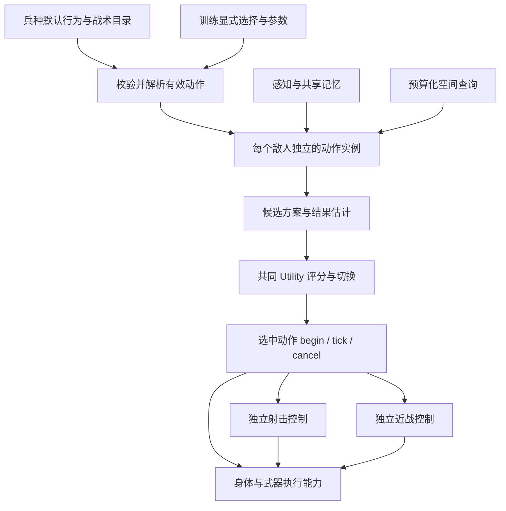

# 敌人 AI：代码结构、维护与使用部署

### 支援续接异常与调试含义（2026-10-22，本次修复）

三档共用个人 Utility、动作、导航、身体与火控。仅视野共享不下发战术任务；战术配合使用可拒绝的建议；强配合在同一任务协议上增加接受后的岗位约束和必要的共同放行。Debug 的“规划中／未接受”只描述调度，不能当作身体正在等待。

原 `_extend_combat` 在延续 `support` 计划时，把只有 `tactic/bundles` 的值传给新计划的 `_proposed_links`，后者读取不存在的 `beneficiary_id/request_id`，在正常调度循环抛错。当前将移动掩护关系抽为原 planner 内的 `_movement_support_links`：新计划仍创建原请求关系，补充分工只追加新移动成员的依赖；原请求、受支援者、已接受任务和期限由协调器保留。没有用默认受支援者或捕获异常掩盖缺字段。

Debug 统一显示等级、个人／建议／任务及接受状态，另行显示当前实际动作、移动／原地和真实换弹剩余时间。规划中仍显示正在进行的个人动作与目标；读取不产生候选或修改导航。各场景验证范围及尚未复现部分见 [本次记录](enemy-tests.md#2026-10-22-现场支援续接异常与实际动作核对)。

### 持续团队岗位与执行可用性（2026-10-22）

协调器在每次规划和通行检查中通过 `coordination_motion_state()` **主动读取所有成员的实际站位、速度、身体空间和可用性**；这些事实不依赖个人先选择协作动作。动作／导航服务提供的是经过验证的能力与路线候选，不是成员位置的唯一来源。当前站位可承担的观察／射击职责独立于个人侧移状态和失败冷却准备；个人 Utility 继续评估候选、处理实际自保并执行已接受职责。

强配合的常规战斗方案在原36次组合／2048次冲突预算内补齐其余成员岗位。完整的原位保持方案先于复杂两人组合准备，避免预算耗尽后漏掉第三人；保持岗位具有具体位置、预约和动作执行合同。观察岗位必须由本人实际看到目标，候选生成、缓存候选接单及持续执行都核验本人视野；只有队友目击时不能在当前位置建立观察岗。观察岗位不给虚构火力收益，也不建立“必须等射手”的推进依赖。保持方案仍可在执行段边界转为真实掩护换弹或撤退，保留原统一评分及实际支援检查。没有合法团队岗位的成员继续原个人接敌／搜索和路线准备，不能为了补齐人数把盲站包装成观察职责。

2026-10-22 修复强配合“一人攻击、其他人保持队形”：原 `Cooperate._watch_candidate()` 用团队视野替代本人视野，且原位验证与执行合同一直允许盲站。现由同一动作验证真实观察能力；失去该能力即通过原执行合同退出，由既有协调器修复任务。头顶仅对实际观察岗显示“目视跟踪目标”。保存地图的具体前后对照见[共享接敌记录](enemy-tests.md#2026-10-22-强配合共享接敌时盲站观察岗位)。

已接受的保持岗位仍通过原空间预算准备下一步合法站位与包抄候选；不因个人动作处于运行状态停止准备。协调器决定是否发布新的任务，个人不能用新候选自行覆盖旧职责。`revise` 操作可在某成员自己的真实执行段边界安排掩护换弹，保持其余成员的任务身份、路线、当前阶段与原期限；正在支援其他人的射手须先完成真实火力交接。满员小队可以选择已有前线岗位接替火力，无需凭空等待一个未分配任务的成员，实际到位及射击条件仍由原支援检查确认。

动作候选可能跨过共享目击或任务来源变化，发布前按协调器实时资格排除已经失效的候选；最终批次依旧原子校验。不能让一项过期搜索候选连带撤掉同一成员的合法战斗岗位。新团队岗位可接管普通个人搜索／侧移，真实身体占用和已接受的不可打断段仍保留。无法接单时明确拒绝；个人评分变化不自行丢弃已接受岗位。原位保持正常到期及紧急自保不会被误记为该站位走不通。

通用执行合同的 `available_after_seconds`／`availability_reason` 公开真实暂时占用。Context 保存值，协调器纳入集合预演和固定接受期限；真实换弹尚未结束时不宣称可立即接单，旧任务失效也不等于身体换弹已经完成。期限和位置可达性仍分别核验，反馈不能续期。

搜索修复使用逐成员优先通行集合，替换原单个 `exclusive` 全队停行入口。只有剩余路线实际冲突的成员等待，其他通路继续入位；进度与等待链仍逐人检查。正式任务的调试快照包含已经保存的候选路径；没有路径时只画真实站位，待分工、未接单、换弹占用与个人行动分别显示。验证结果另见 [敌人测试](enemy-tests.md)，本节不替代验收记录。

两侧分组保留成员的横向顺序，协调器比较导航服务验证过的两端行程、当前占用时间和队列深度，再选择分界；不再把居中的第三人固定分给左列。选定分组后仍完整校验每个后排站位、通路和等待，单侧／纵队回退及原任务截止条件保持。

2026-10-22 本地复核时 `resources/enemy/cooperation/coordinated.tres` 保存为 `level = 1`（普通配合），本次没有修改该资源。强配合的保存地图专项在场景实例中复制 Profile 并设置等级 2，明确验证最高等级行为；不把普通等级的实际运行说成已经启用强制集合。

### 搜索调度与个人模块的交接（2026-10-21，验收记录另列）

本轮按用户明确重贴的[完整计划](superpowers/plans/2026-10-21-squad-search-handoff.md)重整搜索调度。个人 Utility、Unit／Training 装配及可替换行为模块保留。协调器分配团队任务、具体站位和通行顺序，个人 Search／导航验证并执行，身体层维持实际碰撞，火控继续独立检查射击条件。移除 Search 后，不能继续持有搜索岗位，也没有协调器内部的替代 Search。

新增入位命令身份 `order_id` 纳入原决策修订通知。新命令触发正常 Utility 重评，普通个人追查不再被当作有效旧执行；任务接受、撤销和紧急自保仍经既有事务。正式岗位继续使用原 `plan_id`、`assignment_id`、版本与 `phase_id`；交通修复的 `motion_revision` 另校验移动反馈，旧报告不能更新新修复阶段。真实中断无需等待旧路线恢复。

`EnemyContext.coordination_motion_state()` 提供当前位置、速度、身体半径、步速、间距和可移动状态；`inspection_route()` 提供个人导航／身体验证的路线候选。协调器不访问 Search 的内部状态机，也不直接移动身体。队形 helper 在下发前验证全员位置、路线及通行顺序，部分布局失败时不发布其中几个人的可执行入口。行程估算用有限的通路推进预览计算实际等待，不能简单把所有人的完整路程相加；初始计划预算包含等待，受原命令和证据期限限制，执行报告与修复不续期。

队级交通状态逐人保存实际位置、最近进度、等待关系及有限修复次数。无进展沿依赖链判断，不能因第三人在别处走动而漏掉两人互挡。先选择合法通路并调整通行顺序；没有可前进成员时，为阻挡者提出经导航和胶囊验证的具体临时让路点，待受益成员通过后恢复原岗位。优先腾出目标站位，路线图同时包含目标附近的接近点，避免把两名已到位成员之间的合法窄隙误判为无路。原个人前驱追赶和本队自主侧让入口被替换；其他单位的普通避让及实际碰撞保持有效。

若下发前的并行通路预演发生循环等待，使用同一组已逐人验证的路线，按优先成员的剩余通路实际腾空情况放行相交路线；不相交者仍可同时移动。再次预演包括这些等待，不能用延长期限使不可行计划过关。强配合整队检查不再叠加较短的普通集合阶段超时，由逐成员进度检查和原总期限负责失效；布局回退也继承同一证据的原截止时间。已接受的队列动作遇到身体无进展或新静态阻碍时报告受阻，由队级修复处理，不另开个人1.5秒退出计时。普通个人搜索与旧双人检查保留自己的执行规则。

路线从真实身体位置开始。交战或位移使成员偏离导航边缘时，保留接回冻结路线的投影入口，不能跳过入口直切下一拐点。起点等于当前身体的首顶点不要求已经处于导航网格内；后续顶点仍检查导航，全部连接仍通过真实胶囊占位和扫掠，不能以此穿过墙体。

`inspection_status()` 是只读后台接口，返回命令／岗位身份、交通版本、实际位置、准备位置、当前目标、期限、等待对象、原因和最近执行报告。读取不会推进修复或延长任务。头顶区分接近搜索站位、等待指定队员入位／让路、通路受阻和重新安排通行。`waiting`／`blocked` 是执行回报，不能当作已检查目标不存在；完成仍需要原观察验证。

Debug 路径视图通过 Context 的 `coordination_debug_snapshot()` 读取协调器 `debug_member_snapshot()`，返回复制后的实际路线、准备位置、检查目标、让路目标、等待对象和任务状态；不生成候选、不寻路、不改任务或导航。视图每秒最多刷新十次，区分团队搜查、其他团队岗位和个人行动。其他岗位没有保存整条路线时仅显示站位，个人目标用灰色标记。声音圈与高开销掩体区域预览默认关闭；显示配置不改变声音事件或听觉。使用说明见[Debug 操作](gameplay/PLAYER_HEALTH.md)。

这些是当前实现约定，具体阈值及有限图搜索策略不是用户指定参数。验收通过与遗留失败单独记录于[敌人测试](enemy-tests.md)，不能以本节说明代替运行证明。

### 最高级协作的掩体整队搜查（2026-10-21）

用户本轮明确要求：最高级配合在搜查时应更紧凑，由协调器先决定整队搜查同一掩体，再在掩体左右两个端口各排一队；前后错位，窄处收为纵队，第三人及更多成员也有岗位。交战时仍可按局势分散。这里指围绕掩体两侧的队列，不是固定世界坐标下的行军阵型。

用户后续明确：玩家消失的掩体尽量采用列队搜查，包括最左侧的高墙；不能两边进入时可在可行一侧直线排队，并允许微调站位。队友没有亲眼看见玩家不应成为脱离全队搜索的理由。普通等级也由协调器安排包抄，但无需最高等级的严格集合。仍有人真实看见玩家时继续交战。

当前实现沿用小队／区域／个人三层职责。存在合法失视调查线索且没有当前友军目击时，强配合协调器直接建立本轮 `inspection_order`，不等待个人先提出调查候选。掩体任务按掩体轴分左右侧，并冻结每侧的前后顺序。纯 planner 要求所有可参与成员都有经过本地校验的岗位后才提交整队计划；两侧各一名 `inspect_left / inspect_right` 前排，其余为 `inspect_follow`。该搜查目标优先于个人更便宜的绕行，不再因个人方案胜出而把整队拆散；原已核实的空匣／近战／自保例外及身体不可打断条件仍有效。其他意识等级和未绑定队级配置的旧双人检查不使用这项整队目标。

入队同样由协调器统一安排。每种布局在下发前，通过成员自己的导航／胶囊查询准备具体 `entry`、`peek`、冻结的 `approach`／`crossing` 路线以及 `passage_priority`，所有成员路线准备好才允许集合推进。掩体同侧按实际接近前排位置的路程分前后；无墙集合按各自实际路程确定先行者，不用成员编号或距目击点的直线距离代替入队可行性。每人使用同一套已确定坐标，不能在执行中各自改变错位位置或改走新的最短路。

`EnemyContext.inspection_motion` 转发到所属协调器，根据实际成员位置、下一物理步和冻结路线给出本步可走的路点及停靠边界。低优先级成员在前方通路腾空前保持距离；已经占在队友通道内的成员，只有自己的目的地能完全让开通路时才允许先移出，避免停在半路反过来堵住前排。队列等待不计入个人卡路超时，也不刷新整轮截止时间；获得通行许可后仍无实际进展或出现静态断路时回报受阻，由协调器有限修复；任务身份失效仍经原事务退出。运动仍经原 Action／AI／身体控制与碰撞执行，协调器不移动身体。

当前入队通路保留 `spacing - 0.06` 米的成员中心间距，具体停靠误差不大于0.025米，防止前排提前停下累计占掉后排空间。这些是实现默认值，不是用户指定参数。原集合放行仍要求全员实际就绪，不能用“已给坐标”代替到位；原0.18米就绪校验不放宽。保存地图的全程入队验证额外记录身体碰撞、临时侧移和最小间距，不能只凭最终恢复目击认定队列成功。

失视可能先由射程／视角边界触发，此时原射线没有关联掩体。共享调查线索现在同时冻结最后看见的运动方向和速度；协调器依据原目击点、观察者位置与有限运动投影，统一选取附近已知掩体作为调查假设。投影沿用个人搜索的 `min(track_distance, speed × 1.25)`，掩体距离仍受原 `cover_inference_distance` 限制；原目击点、证据身份和截止时间保留，推断不会写回射击证据或读取隐藏身体。各成员消费同一份冻结目标，不能边走边分别改猜。

斜向失视的掩体推断检查投影两端及其对盒形掩体各角的最近接近位置，不能只用距墙中心最近的点否决整条运动线索。此前中心取点落在墙正面，会漏掉同一投影后段经过的端角，把整队任务误降为检查墙前目击点；该点被看清后就解除队列，两人转回个人掩体行动。现在有合法端角假设时直接安排该掩体的全员搜查，仍须实际集合、按序绕角，真实接敌才撤销旧任务。仅在正面中部短距离接近或背离掩体的运动仍不构成端角假设，不扩大原投影长度或推断距离。

未能关联掩体时，同一指令先安排全员在最后目击点的来路一侧紧凑集合，再共同前进观察。当前点位默认在目击点前方1.2米横向排列，集合点再后退2米；间距沿用队列身体余量，所有点位和路径仍要通过本地导航与胶囊校验。这是无墙情况下的实施回退，不把空地假装成掩体。普通等级沿用同一协调器的互补包抄建议、人数限制和位置预约，成员通过原 Utility 接受建议；不要求全员入位或等待统一放行。

执行分为集结、全员接受和实际入位、共同放行、按前后顺序绕角、真实观察完成。准备整队方案时，个人搜索只走向自己的近侧集合位；后排不得抢过本侧前排。排队中前面的成员经过后排最终目的地是正常通行，等待受整轮原截止时间限制，不续期；静态断路、任务失效和真实接敌仍会退出。完成仍要求实际到达并通过自己的视角、距离和遮挡核验，不把排队位置或队友报告当成本人已看清。

几何辅助 `services/enemy_search_formation.gd` 在协调器调用时准备合法位置、路线与通行顺序，持有无跨帧状态的路线投影和通路相交计算；本队安排仍由协调器保存和下发。辅助不移动身体、不读隐藏玩家坐标。当前实施初值为纵向间距至少1.2米，同时不小于成员最大身体直径＋基础间距余量＋0.2米；奇数后排向外错位0.45米，静态空间不足时在同侧收成纵队。位置和整个路径必须通过导航及身体扫掠检查，不能挤穿墙或凭空生成端口。通用移动接口的可选 `stop_position` 由 Action 经 AI／Actor 传给 LocalMotion，将前方友军阻挡探测裁剪到协调器许可的本步停靠边界，避免为了通过仍被占用的队列通路而请求队友散开；省略时保持原行为。

端口或整列站位不可行时，动作通过 `report_inspection_preparation` 回报当前岗位的真实路线结果，协调器尝试可行一侧的单前排＋全部后排纵队；planner 以 `search_sides` 核对所需前排。每种布局对同一证据、成员和几何组合只尝试一次；掩体布局均失败后再试共同检查目击点，仍无合法整队路线才解除本轮集合过滤，避免永久待命。准备窗口使用包含通行等待的普通步速预演，首次准备回报可计入2秒余量，始终受本轮原截止时间限制；重复查询和布局切换不续期。几何或成员变化可在剩余期限内重新准备。上述数值是实现默认值，不是用户指定等待时间。

较远的集合接近沿用现有短时追查速度：默认从线索原时间起4秒内最多使用1.8倍步速；进入两倍队列间距范围后步行入位，实际绕角始终步行。收到指令或等待队友不会重启追查时钟。全员真实观察完成后结束本轮目标，不能因短期空点记录到期又重新集合检查同一轮。

观察终点若过近最后目击点，会把同侧整列一起向前微调，保留纵向间距与完整路线校验，避免前排身体永久挡住另一列的观察射线。队列选择事务暂时失败时，旧远程接敌动作在本人失视后也停止发出可见射击意图；近战收招和既有合法共享接敌分支保持原权限。

两侧队列与原双人检查共用 `approach_uses_assigned_end` 路线约束：不能先绕进对端的墙背后，再穿到分配端口。普通个人掩体转移在失视且已有整队搜查命令时可被集合动作接管，不再因“完成当前转移”而独自绕出；远程和近战掩体动作都使用这一交接条件，真实受压自保、正在翻越和近战身体占用保留保护。共同放行仍由协调器核实全部成员接受并实际到达集合位，不能仅靠发布岗位或开始移动就放行。

共享目击携带本轮真实接触身份。同一位置重新目击也会更新计划身份、取消旧搜查及其预约；持续目击只更新报告，不反复重启队列。仍有人真实看见目标时不再分配调查岗位。本人没看见的成员不会因此获得个人视野或隔墙直射权限；再次全员失视时用新线索开始下一轮，不恢复旧轮进度。

验证范围与尚未通过的外围回归见[本轮测试记录](enemy-tests.md#当前回归)。现有地图、兵种、武器和用户训练配置未为本功能改写。

2026-10-15 查询批次复用：空间增量扫描与候选比较各自在一次同步只读调用中复用协作快照、按目标隔离的规划来源；嵌套调用只由最外层建立和清除快照，规划来源返回独立值。快照准备计入原空间时间预算，仍为24点／2000微秒。基础位置候选在同一投影循环中复用成员身份；准备、提交、执行及下一批查询继续核对实时权限、身体和版本，不保存跨帧授权。实际收益和整帧限制见[测试记录](enemy-tests.md#当前回归)。

现有岗位和已发布offer的有效性只核对该岗位的资格，不再枚举所有无关岗位；例如前线火力检查不读取包抄证据。`SquadCoordination._coordination_role_allowed()` 与完整 `_coordination_roles()` 的结果必须逐项等价，增加岗位时同步维护两处及查询专项。每次仍读取实时成员、目标、团队意识、训练与身体状态，不缓存许可，也不改变计划的身份、期限或维护周期。

2026-10-15 等待与观察恢复：侧翼成员接受岗位时可能已偏离发布候选时的准备点，必须沿真实安全路线返回协调器保留的 `staging_position`，再报告就绪并等待共同放行；不得用接受时的位置替换预约点或提前推进路线段。双人检查到达观察点后，若视野范围内的实际射线仅被友军身体短暂遮住，沿用接近阶段的1.5秒有限恢复窗口；静态遮挡、视野失效和原任务期限仍按原规则退出。只有真实观察成功才提交完成，不刷新期限。

身体让路期间，`enemy_local_motion.has_temporary_correction()` 只报告仍有有效友军伙伴、剩余时间和实际局部目的地／停驻时间的有限避让。协作动作和已接受的分区搜索在此期间重新建立路线进度基准，避免把侧移、等待和返回误判为战术卡死；原导航验证、真实到达、支援／观察条件和总任务期限继续生效。未分配岗位的个人掩护 HOLD 继续提供当前合法射位供协调器比较，必须连同候选进入正常评分和正式发布；不能因此刷新当前掩护期限、提前接受岗位或把未来火力记为当前支援。

协作路点被友军占用时，Context 用真实胶囊查询区分友军与静态障碍；仅友军阻挡可沿原路线继续通过身体碰撞／让路处理，连续1.5秒无进展则退出，期间不能报告到达或完成。只有所有当前占位身体都实际移动至少0.1米，才能重新计算局部堵塞时间；执行者自身侧移不能替永久不动的友军免责。历史受阻路线证据可触发原始静态导航复核，但不能在胶囊实际已离开后继续判路点被占。不能提前在远处停止所有移动，否则近身让路不会收到通行请求；静态断路仍退出，原任务期限始终生效。此分类与检查动作共用，不把规划中的友军预测当成物理通行权限。侧翼缓存候选正式发布前重新核对已知队友是否占据出发段；已有守点候选保留返回原射位的路点，使发布后发生身体偏移时仍能合法接收并实际到位。

局部换人产生新的共同阶段时，协调器保留有效侧翼的岗位身份、目标、进度及原截止时间，并以该成员此刻实际身体位置作为新阶段的集合点；这不改变初次接受岗位时必须回到原发布准备点的规则。动作暂停原路线段，等待本阶段的新鲜实际就绪后续行。已经实际完成的成员不再参加集合屏障；有效前线岗位的普通点射暂停也不使其在修复其他成员时被撤销。新成员的接受、实际到位、真实火力和旧反馈隔离条件保持。

额外侧翼岗位失败且无替代者时，若同一计划仍有有效前线和侧翼组合，只撤销该失败岗位、预约、伙伴引用与支援链接，保留其余身份和期限并重新要求本阶段实际就绪。不能用此规则删除必要支援或最后一个侧翼，也不适用于双端检查。战术建议只在个人选择后预约；提交时再次复核当前人数和实际站位，防止两个已准备事务分别通过旧人数检查后占用同一个剩余包抄名额。

上述局部修复也接收集合超时的额外侧翼：必须已有真实就绪的前线和未完成侧翼，且所有未就绪成员都只是侧翼，才标记迟到岗位失败并走原有受限修复。不会续写该岗位或整队计划的原期限，也不允许缺少必要火力时强行放行。针对动作保持结束预约的重评只消除浮点计时尾数；普通重评周期、保持时长和切换优势仍用原参数。

路线准备的首个有效翻越备选仍立即请求普通 Utility 重评。身体停在同一位置时，其余备选只加入原缓存，交由现有周期读取，避免每准备一个点就重跑整套决策；身体实际移动后仍立即通知新就绪路线，防止较短路线在下次周期前因起点变化失效。原0.5米起点容差、1秒缓存寿命、配置／几何重置、路线额度、动作保持和切换条件不变。

长帧引发同一 process 帧内补跑多个物理步时，空间候选准备队列只推进一次，下一 process 帧继续；显式重置后可重新初始化。翻越路线按距上次实际准备至少4个物理步调度，避免可用准备时机始终落在奇数步时被固定取模饿死。原24点／2000微秒上限保持，移动、碰撞、感知、Fire、现有动作验证和计划时钟仍逐物理步运行。避免补跑时再次叠加整份准备预算，不通过降低物理频率或延长任务期限掩盖卡顿。

分区搜索同样用真实胶囊区分路点上的经过友军与静态障碍。友军确实在移动时沿现有身体让路机制接近；未移开的身体继续占点，不能提前观察。连续无进展仍按原 `search_stuck_repath_seconds` 退出，永久堵点、静态墙和总任务期限不因分类而放宽。观察成功仍要求当前真实视线，完成记录绑定原岗位身份。

2026-10-15 支援到位修复：`front_support` 的0.35米预约到位半径不能代替真实射界。移动阶段若半径边缘仍在墙后，继续沿已验证路线接近最终点；只有实际目击和当前枪口通路成立，才允许提前停驻，否则最终水平误差须收敛到0.01米。已建立岗位保留原有限失视恢复，Fire仍逐次检查开火资格。协作空间点枚举在一次同步调用内只读取一次共同规划来源，候选顺序与前线半空间筛选条件保持。

2026-10-14 按[小队节点设计](superpowers/specs/2026-10-13-squad-node-coordinator-design.md)拆分区域与队级职责：`Arena/Squad`（`world/squad_controller.gd`）持有本队唯一的 `profile` 和 `services/squad_coordination.gd` 实例。节点的 `faction_id`、`communication_group` 决定区域关系与情报资格，小队自身运行身份决定任务归属；两个同阵营、同通信组、共用模板的节点仍是两个独立小队。区域 `enemy_cooperation.gd` 保留观察、关系、成员版本和公共预约，地图仍由 Arena 的唯一 `enemy_tactical_map` 提供。

三档 `profile.level` 为 0 仅情报共享、1 战术配合、2 强配合；新建 `scenes/world/squad.tscn` 使用独立的第 0 档资源，现有竞技场继续引用强配合模板。成员归最近的小队祖先，可跨普通整理容器，嵌套小队不重复登记。缺少 Profile 时给出诊断并停用队级战术，不借用旧区域绑定。编辑外部共享模板影响所有引用它的队伍；只调一队应先设为唯一。Training 面板显示所属队和等级，按钮跳到小队节点；个人训练、能力限制及撤销重做独立保留。

区域以现有活跃时钟统一推进各小队，同一物理帧每个节点至多推进一次；小队不另建物理循环或地图缓存。配置／成员变更撤销旧岗位、建议与预约。同区域换队保留个人感知记忆、训练、生命、弹药和世界坐标下的原出生位置，成员版本更新使旧票据失效；跨区域移动重新绑定区域服务。区域复位仍由区域遍历成员，每个身体只复位一次。

未放入 Squad 的成员只有在 `Arena.team_cooperation_bindings` 明确配置队伍时才使用区域持有的同类协调器；该入口只转换配置，不维护另一套调度。没有上述绑定时，个人 `cooperate` 训练不会创建协调器或隐式升为强配合。公共情报、物理预约和友军枪线仍由区域服务提供，独立于队内人数与通信资格：单人也参加区域排重，不同通信组仍保持友军枪线安全。实际行为和性能结果见[测试记录](enemy-tests.md#当前回归)。

地图信息沿现有路径自动更新：标准掩体加入所属 `NavigationRegion3D` 后会被发现，移动、旋转、缩放及尺寸改变会使相关几何候选和共享静态地图失效并按原额度重建；小队消费经过成员本地验证的候选，不维护第二份掩体清单。导航资源仍须与实际几何一致，自动更新掩体信息不等于自动重新烘焙导航。

第二档由纯 planner 在原组合预算内提议互补包抄位置，依据真实友军站位保留前线，并将实际占侧与已接受的侧翼移动计入半队名额。普通建议和强配合统一安装到协调器的任务表，使用相同的任务身份、版本、接受／拒绝、执行反馈、取消和固定期限；普通任务标记为 `constraint_mode=advisory`，不要求全员集结。建议尚未选中时不预约位置，Context 保留合法个人选项；选中后才沿同一准备／提交事务预约并执行。第二档不等待友军掩护，射频暂停不构成等待条件，也不获得未来火力信用。

第三档部署由 Context 发布每人的最佳合法个人代价与原评估窗口，planner 将各人的单位时间代价投影到全队共同的最短窗口，并计入未分配成员的个人基准，比较保持、集中、分散及原岗位组合。缺少新鲜个人基准时暂不新建强制部署；不改变个人 Utility 公式。集中／分散位置由原协作动作在既有 Spatial 配额内生成，默认部署间隔2.5米，继续核对胶囊占位、实际导航和路线安全。前线可以先转移到合法射击位置，但预计到位后的射击时窗与当前 Fire 发布的实际就绪分开保存；共同起步仍消费实际到位和火力事实。执行中的合法岗位保留原期限和短段连续性，候选缓存暂缺不触发整队替换。

第三档行动支援使用同一计划中的 `support_links`。链接记录受援者、支援者、行动种类、请求身份、是否需要实际就绪和原计划期限；一人不能接收冲突的双重承诺，依赖不能成环。换弹与掩护撤退动作各自提供经过原空间评估的 `assisted_reload`／`assisted_retreat` 候选；协作动作和本人已训练的压制动作提供支援位。planner 比较同一窗口内可重叠的行动时长，扣除个人评分已计入的合作收益，不改变个人权重，也不将预计火力写成当前 ready。已接受但尚未起步的请求明确标为 preparing，不计实际行动收益。普通掩护允许目标任一侧的合法射位，包抄仍须通过异侧与半队名额检查。

从遮挡后建立射界可以提供仅用于支援的合法位置，不必同时增加包抄角度；这类点不冒充集中／分散收益，也不直接成为个人推进。新鲜共享接敌下的射位转移沿 Search 原有的 `combat_contact` 中断条件执行。Spatial 首个有效候选就绪、本人岗位身份或版本变化时，已绑定的强配合 AI 提前进行一次正常 Utility 决策，避免等待原决策周期期间候选先因身体移动失效。候选就绪通知仅用于多成员场景；单人保留个人决策节奏。通知不重复几何查询，不强选动作，不解除身体锁，也不授予实际开火权限；单个空间任务的普通移动重建不会逐帧重复通知。是否接受和开始支援仍由原动作合同及当前 Fire 事实验证。

非紧急主动补弹须等待指定友军实际就绪或当前身体确有遮蔽；空匣与真实自保保持原独立执行许可。撤退需求来自当前伤势或压力，不能仅凭支援加分制造无意义撤退。受伤成员的首批防御几何仍在原 Spatial 队列准备时，暂不承诺长团队机动，个人 AI 持续运行。支援者达到小队 `reload_rounds_ratio` 阈值后安排火力交接；接替者须实际到位、有当前阶段新鲜反馈且 Fire 真正就绪，才替换原支援身份。局部修复先记录 `pending_provider_id`，期间不计有效掩护；无可用替代者按原最多2秒恢复窗口降级。反馈、修复、换阶段与交接均不续写整轮期限。

单人不生成等待队级安排的非空弹匣补弹预览；多成员场景中，未能发布有效团队 offer、又没有独立合法支援机会的预览同样不能进入个人候选。否则低代价但执行校验必定失败的补弹会反复压住普通搜索。已经开始的合法补弹、补完后的转移和空匣自救仍沿原合同执行。

小队协议按成员身份和关系工作。不同绑定队伍即使关系为友方、可以通信，也不共享岗位、行动支援请求或战术威胁收益；个人感知与命中阵营系统仍沿用当前适配层，不将此接口接入描述为完整友军 AI。

2026-10-11 协调器整合：基础共享与站位预约始终启用；高级开关控制 `squad_coordination` 调用 `enemy_team_planner` 分配两端检查、侧翼／前线和地图搜索岗位。Action 提供经过本地验证的候选，个人 Utility 选择执行并保留自保与身体保护，Fire 仍独立检查实际开火条件。核心整合的最后10套专项／237项通过，当前本地工程启动通过；性能及部分旧行为验收仍未通过，具体结果见 [测试记录](enemy-tests.md)。

真实目击可以留下最长20秒的冻结规划线索，原精确共享情报仍按原5秒期限失效；读取、改派和玩家在遮挡后的移动都不刷新线索。任务接受、就位和执行共用固定期限。前线短暂失视可保留原岗位最多2秒，但失视期间不获得射击或真实掩护资格；真实自保与断路会反馈失效，不能无限等待。

`enemy_tactical_map.gd` 在区域内共享静态地图模板，自动分批准备并感知导航与碰撞变化；它不持有玩家位置，也不替代每个敌人的路线、身体和射界验证。准备计入原 Spatial 每帧24点／2000微秒额度，其中地图最多4点，同区域每帧只推进一次。搜索岗位按精确样本分工，完成依赖实际观察；局部成员失败时保留其他有效岗位的原期限与已查记录。单人及高级 OFF 保留原个人搜索。

协调器的身份热路径直接比较成员当前阵营／通信组与注册值，JSON 域键只在需要保存身份时生成；同帧换组、换阵营仍立即失效，不缓存资格结论。公开岗位与规划快照先排除内部 `raw_offers` 再深复制，保留嵌套值隔离；真实占位、版本、证据与提交检查仍读取当前状态。纯 planner 的岗位候选池只在单次 `propose()` 内复用，局部修复排序取得独立数组，输出备选继续深复制。已接受岗位的内部只读投影不重复复制嵌套摘要；不跨周期保存路线、枪线或计划有效性，也不改变组合次序、冲突计数及原预算。测量与回归结果见 [测试记录](enemy-tests.md)。

本次实现对应 `superpowers/specs/2026-09-28-enemy-modular-ai-design.md`。当前主场景使用独立动作模块和统一 Utility 评分，不再由 AI 主循环按具体战术 ID 分派执行。

文中 `res://` 相对于 `movement_demo/project.godot`，不是仓库根目录。先看“在 Godot 中配置敌人”进行调参；新增动作看“添加动作或新兵种”和“维护协议”；放进新地图看“接入与部署”。完整文件分类见 [项目目录](project-layout.md)。

2026-10-09 按用户授权实现区域内友方情报共享、临时战术分工和统一压制，并加入分工搜索、主动协调换弹。设计边界见 [协作方案](superpowers/specs/2026-10-09-enemy-cooperation-design.md)，集成验证状态见 [实施记录](superpowers/plans/2026-10-09-enemy-cooperation.md)。

掩体检查的位置与共同放行由协调器决定，原 Search 执行导航并报告真实到位、受阻和完成；身体及 Fire 继续处理碰撞和射击。[统一队伍规划器](superpowers/specs/2026-10-10-enemy-team-coordinator-design.md)接入公共位置预约、团队岗位与共同阶段；其当前验收限制见本页开头和 [测试记录](enemy-tests.md#当前回归)。旧的个人两端抢位、包抄轮次和通用 claim 分配器已删除。

路线样本复用在同步只读候选比较中复用同路径已采样的曝光值，速度／换弹／火控时间仍逐候选计算，采样密度与累计顺序不变；空间预算扫描不额外建立样本数组，最外层评估返回即清空。已经换弹时不再估算最终会丢弃的“到掩体后开始换弹”候选。该补修阶段曾通过单人和预算门槛的定向复核；后续协调器整合的性能未完成项及完整／定向结果分别见[验证记录](enemy-tests.md#当前回归)，不沿用早期通过结论。

纯 `enemy_team_planner.propose(snapshot, limits)` 接收合法能力／情报／候选／占位快照并返回有界岗位方案。区域服务管理全成员公共位置预约；小队协调器直接读取身体位置、速度和占用，并通过原动作与导航接口取得可执行候选。无团队任务时继续个人 Utility；普通 Search 只检查并维护自己的公共目的地预约，不再申请仅强配合才允许的搜索 claim。

基础预约不依赖高级协作开关。Context 对个人已有候选生成只含身份、位置及有效期的 offer，board 按实际胶囊、间距和当前友军枪线筛掉冲突；不同通信组但允许共享空间的友军也互相排重，不因此共享目标情报。AI 保留完整 `utility_options` 与原评分，仅让合法占位集合参与选择，原地防御仍可执行。原 `validate` 后准备预约，`begin` 成功再提交；旧动作清理保留待接受预约，失败回滚，死亡／离场／复位释放身份及占位。原令牌期限不续写，仍有效的持续个人动作可在实时复核后重新申请基础预约，这不构成高级共同计划续期。退为单人后清除旧offer和预约，继续原个人行为。

通用 Action 协议为 `coordination_offers`、`assignment_escape`、`execution_contract`，默认空岗位、无自保例外和已到段边界。AI 在只读评分结束后发布纯值offer；Context 不持有或调用动作实例，只生成岗位资格集合和事务。无指派的战术预览不自行执行，普通候选继续可选；有效已接受短段不因候选缓存暂缺或成本波动丢失，同岗位备选在真实段边界选择。空匣换弹、可实际挥击的近战及真实受击／近弹下的遮蔽撤退由动作核实，`urgent` 标签不授予例外。身体不可打断保护独立于候选和任务有效性。生产 board 已通过这些接口发布两端／侧翼及地图搜索岗位；接口合同与实景验收分别记录。

2026-10-15 受击接续修正：已接受的 `cooperate` 和压制支援岗位不在 damage 通知中无条件结束。伤势、准度惩罚与立即重评继续生效；正常 Utility 比较原有效岗位与动作自行核实的自保候选，选中后仍报告 `self_preservation` 并释放原执行。协作短路段允许已核实的自保接管，单独的 `urgent` 标签不能放行。未接受岗位的个人协作／压制保留原受击中断，真实路径、弹药、死亡、失效及原期限照常约束执行。

## 敌人协作

打开 `scenes/arena.tscn`，选中 Arena，在 **Team Cooperation Bindings → 竞技场小队 → Profile → Level** 选择整队档位；选中成员的 Training 时，也可点击“编辑整队团队意识配置”进入同一资源。修改的是匹配该绑定的整队团队意识，其他个人战术仍在各成员 Training 中设置。

| 档位 | 调节器安排 | 资源 |
| --- | --- | --- |
| 仅视野共享 | 共享真实目击，保留基础间距与枪线安全；个人独立决策 | `resources/enemy/cooperation/intel_only.tres` |
| 战术配合 | 根据友军站位建议互补包抄；个人 Utility 自主选择，不等待同步 | `resources/enemy/cooperation/tactical.tres` |
| 强配合 | 选择保持／集中／分散部署，必要成员到位同步，协调推进、撤退和换弹的实际支援及火力交接 | `resources/enemy/cooperation/coordinated.tres` |

当前 `arena_team.tres` 按默认阵营 `enemy` 与空通信组绑定强配合模板。其他小队新建绑定并匹配各成员的阵营与通信组；复用模板只共享参数，不共享计划。需要单独调参时复制 Profile 资源再编辑，否则所有引用该模板的绑定都会采用新参数。小队划分不依赖玩家身份；完整友军感知、敌我识别和命中规则的迁移仍是后续工作。

同一战斗区的同阵营、同通信组敌人默认共享真实目击报告。收到有效报告即形成战斗接触，各人仍独立判断能否看见、开枪和近战，不伪造个人 `sees_player` 或 `last_seen`。所有人失视后，情报停在最后观察位置并过期，搜索可以继续，精确压制不能无限续时。

远程接敌在原 `engage` 中提供 `shared_contact` 方案：本人尚未看见时，按新鲜报告移动到真实可达、具备预期视线与射界的位置，途中不给射击收益或开火意图；重新目击后回到原普通接敌，报告过期后回到失联搜索。搜索与该方案共同按实际到位时间和观察遮挡计算信息缺失，仍由原 Utility 比较。基础接敌不依赖高级协作训练。调试标签区分共享接敌、战斗调查、失联搜索与普通噪声调查；`is_alerted` 以及 `TRACK / SEARCH` 的既有接口保留，它们不是新增的全局战斗状态机。

试玩时将 `scenes/enemy/enemy.tscn` 放到对应 Squad 下，保持出生位置在导航区域。团队权限来自小队 Profile 或显式区域绑定；个人 Training 只控制动作能力，不能隐式创建小队或提升配合等级。无绑定成员仍共享合法情报并保留个人 Utility、搜索和公共空间预约。远程专门压制仍需本人训练，普通枪械支援不强制切换到压制动作；武器、出生位置及导航独立。

当前协作包括具体移动／射界岗位、掩护与辅助行动、全员掩体调查。个人调查只维护自己的公共位置预约。团队压制必须对应正式 `front_support` 任务；真实个人失视或近距压制继续由原 Utility 选择，实际瞄准、节奏与枪线仍由 Fire 控制。2026-10-09 用户要求移除的出口封锁及轮扫不恢复。枪口未对准、射线被挡、稳枪、连射停顿、换弹和空匣都不算已就绪支援；近战威胁不冒充枪械支持。

侧向推进只提交已验证可步行的有限路段，不把步行支持信用复制给翻越；其他动作继续使用原翻越能力。收益分别检查移动期间受掩护和抵达后形成射界的真实时间交集，取较大值而不重复相加；支援到位时队友需求已经结束则没有收益。同一次只读候选收集复用团队快照，提交认领及执行前恢复实时查询。单人不产生等待友军任务，也不会凭自己的火力获得主动补弹机会。

用户要求同组同目标成员集中一侧时，最多 `floor(N/2)` 人转到另一侧，其余保留前线。`cooperate / opposite_flank` 只提供合法候选，协调器冻结已知锚点、正面轴和任务期限并分配岗位。实际占侧者与已接受的 `flank` 任务按并集计算，不把观察／掩护岗位算成侧翼。接受事务再次核对人数和身体占位；反馈不能改目的地或续期。旧 `_flank_rounds` 与 claim 分配器已删除。全队失视后转入调查，旧目击报告不能继续授权新的战斗包抄或驻守岗位。

`services/enemy_flank_route.gd` 根据合法已知锚点生成两个转向的有限弧线与检查点，每段复用原步行导航和占位检查；路径不得直穿锚点周围1.5米区域。首段还检查路径与友军身体的0.75米净空，避免中间成员抢到岗位后穿过前线队友，外沿成员可按真实可走路线参选。动作按短段执行，到检查点重新比较 Utility 并核对真实支援，不能把远端最终射界提前算成当前火力。新目击使目标位置明显偏离本轮锚点、路线失效、证据过期或名额撤销时重评；不会读取隐藏玩家位置让绕行路线偷偷跟随。原静止掩护能力作为正式 `front_support` 候选保留；个人动作不再另行选择受援者或认领支援任务。

远距包抄仍由这个几何辅助生成，不另设行为或增加评分权重。近处保留两个转向、两个终点半径；当前距离超过6.5米时，先提出内收到5米轨道的接近段，再绕向原定另一侧终点。每侧只保留少量方向转折点，交由原严格导航绕障；不可站立的中间理想点可以略过，但不能伪装成有效检查点，也不能把场外点吸附到边界后当作原目的地。最终目的地不变，实际连接仍须通过净空与期限检查。真实导航折线再分为最长约2米的执行短段，逐段复核路径、占位与目标净空。候选总路程按配置移动速度估算，沿用 `flank_plan_seconds - 1` 的筛选预算，默认是13秒；移除的是按初始大半径推算后超过10段就直接丢弃的限制，不是整轮时限。身体蹲姿、临时受击减速、避让和等候仍可能增加实走时间；执行与岗位的默认14秒期限不续期，走不完即退出重评，不把瞬时减速假定为全程状态。新增 `enemy_flank_route_test` 覆盖远距候选、现有地图真实导航、时间边界及共享盲态信息预测，验证结果由测试记录另行确认。

短段检查点按真实导航折线累计距离生成，内部几厘米的导航角点保留在该段路径内，不单独触发战术驻留；共享盲态的包抄预测与接敌、搜索使用同一观察口径，下一检查点仍超出视距或被硬墙遮挡时，整段保持信息缺失，不预支最终另一侧的视野。

远距专项最初附带的人工双人必选断言不作为行为要求：真实诊断发现旧目标位置的另一侧终点枪线被 CoverA 阻挡，且从远处先接敌恢复观察可以合理优先。专项保留该位置的阻枪线负例；自主绕行、正面实弹及半队名额继续由正式的1／2／3／6人开关对照与当前本地场景实测覆盖，不用固定距离必须选中某动作来代替结果验收。

枪械能力使用另一侧弧线路线建立新射界；近战能力保留已有的受掩护接近，按真实攻击范围、高度与无遮挡条件估计威胁，不套用枪械的远端射击半径绕圈。近战接近也不能借此越过本轮另一侧人数上限，分工依据当前武器能力，不依赖兵种名称。

火力状态区分实际 `ready` 与正常连射暂停的 `support_cycle_valid / support_resume_seconds`。后者只在本人仍可见、静止、弹药及枪械资格正常、反应和转枪完成、完整枪线与友军枪线畅通，且剩余阻碍确为连射暂停时成立；稳枪、换弹、空匣、真遮挡和失视不能冒充暂停。暂停仍为 `ready=false`、`support_seconds=0`，不产生火力信用。已提交短段有有限的支持恢复容错，检查点仍重新比较 Utility；最近真实支持的短容错或合法连射暂停可保持路线连续性，容错耗尽且不存在合法暂停时才等待恢复。恢复失败或时限耗尽退出，不因任一正常停顿立刻丢弃整条侧路，也不无限等待。实际射击始终发布 `target` 火力射界，位置预约另存 `position_lane_id`，防止到位保持者的火力被误归为位置槽。

原地掩护及到位保持的预测只计算本次实际剩余保持时间，扣除反应、稳枪、机械冷却、AI 扳机间隔及连射停顿；当前转枪未完成、目标超出范围、完整环境枪线或友军枪线不合法时不预支火力。新选中的原地掩护以配置保持时间和一轮真实支援所需时间的较大值为初始窗口，再受队友请求剩余时间及任务固定期限限制；执行中的重评只消费剩余保持时间，不重开一轮期限。请求结束或执行条件失效可以提前停火，不保证每次都打满长点射。事实发布与实际执行都检查当前枪口方向，不能用期望瞄准方向畅通代替仍被墙挡住的当前弹道。

普通动作结束通过现有动作终止与 Context 任务事务释放本动作的预约和执行资源；不会通过旧 `cooperation_clear_execution()`／通用 claim 清理另一位队员的任务。仍由身体执行的换弹及其真实请求身份独立维护。团队支援失效由协调器根据任务反馈和实际火力处理，清理不刷新事实时间或任务期限；死亡、离场、复位仍撤销相应成员的全部任务和预约。

分工搜索只共享短时有效、实际通过视角／距离／遮挡检查的地面样本，不把整片圆形区域认成安全。队友观察不增加自己的覆盖百分比；过期或出现更新的真实目击后可重新检查。取消、超时、死亡、离场、撤权会释放调查点。

强配合掩体检查仍由原 `search` 执行：真实失视或合法共享线索冻结已知位置和观察来源，协调器先分配每位参与者独立的准备位置、检查位置和完整路线。两侧可行时前排分两端、其余成员排后列；单侧可行时使用纵队。执行层接受后按“接近指定站位 → 等待实际全员到位 → 按通行顺序检查 → 到点观察”执行，不能由个人另行挑端或用原地无落点等待代替第三人的岗位。只有实际视角、距离和遮挡核实才记为调查完成；导航受阻不能算目标已不存在。个人或普通配合搜索保留独立调查能力，所有等级遵守公共空间预约。

各配合等级使用同一失视调查信息：真实消失地点优先于随机提示，合法已知轨迹可推断附近掩体并检查绕角位置。个人 Search 和团队 Search 共用已有掩体几何能力；等级只决定分工与共同放行，不能决定是否收到调查线索。全队失视且没有真实伤害／近弹压力时，旧的跑向掩体动作退出，不能依靠旧风险评分继续转移。真实换弹、翻越和紧急自保仍按原身体及动作合同处理。

调查线索与精确射击证据分开：`cover_inspection_seconds` 默认20秒，只授权冻结位置调查；目击情报默认5秒，精确开火继续要求个人视线或原火控允许的有效证据。全队失视并已有调查线索时，旧共享报告不再作为持续交战接近的授权。任务默认上限16秒，受线索原期限限制；协调器纳入实际行程、身体占用及等待关系，到点观察默认0.5秒。旧的个人双端等待计时器已删除，不能靠等待到期散队判定调查完成。

主动协调换弹是“还有少量子弹时，趁队友真正能掩护，提前补满”；原 Utility 比较原地、移动中或抵达掩体后补装。非紧急补装名额互斥，必要空匣换弹不受排班禁止。弹药不足或支援失效时不保证两人都能提前补装；保持真实换弹时长、补满规则及身体中断限制。

Cooperation 默认值属于实施参数：情报5秒、支援准备估计1.2秒、普通计划4秒、包抄任务14秒、支援恢复2秒、横向候选3米、搜索位置排重半径1米、已查样本3秒、提前补弹余弹比例35%／最小支援0.5秒；掩体线索20秒、计划上限16秒、观察0.5秒。已删除无调用的 `lane_hold_seconds`、`search_claim_seconds`、`cover_inspection_wait_seconds`。`search_claim_radius` 保留资源字段名，仅用于公共搜索位置排重，不恢复 claim 分配器。Utility 协作权重默认4；收益只计真实支援窗口和合法新增射界，任务标签不等于火力已生效。

服务提供敌对、共享、合作及身体让行关系查询，但感知和伤害仍面向唯一玩家；多方混战尚未实现。同战斗区的同阵营或显式友军可互相让路，不要求同通信组；情报与战术任务仍受通信组隔离。未来新增兵种按武器、路径和执行能力扩展分工，不建立兵种名称配对表。训练预设只是保存参数组合的便利方式，现有 Training 足够使用。

## 在 Godot 中配置敌人

1. 打开 `movement_demo/scenes/arena.tscn`，选择 `Enemy/UnitType`。敌人已是独立场景实例；如需展开子节点，右键 Enemy 启用“可编辑子节点”。主场景中的路径仍为 `Arena/Enemy/UnitType`。
2. `profile` 是可保存、复制和复用的 `EnemyUnitProfile` 资源。现成模板位于 `resources/enemy/units/ranged.tres` 和 `resources/enemy/units/melee.tres`。
3. 展开兵种资源，可以分别配置“默认行为”和“战术动作”。默认行为仍是独立模块；模板只是预先填好的组合。
4. 选择同一敌人的 `Training`，其 `profile` 是可复用的 `EnemyTrainingProfile`。检查器上方的“战术解锁”由当前兵种的战术目录生成。
5. 训练参数在 `profile` 内分组保存。开火反应时间位于 `tactics.fire_reaction_seconds`；它是训练参数，射击服务只读取该值并记录当前敌人的计时进度。

检查器插件为 `addons/enemy_training_inspector`，已在项目中启用。若编辑器在修改代码时一直开着，重新打开项目以加载新资源类型和插件。

默认行为不在训练中重复勾选；要移除搜索或换弹模块，应修改兵种的默认行为列表。训练仍可调整这些模块的训练参数。

压制统一为“火力压制”一个入口，保留可见目标与最后暴露点方案；出口射击方案已移除。旧 `exit_suppression` 选择仍兼容解析为 `suppression`，不创建第二个实例，也不恢复出口射击。选择“掩护撤离”或近战“掩体接近”仍自动包含“掩体躲藏与探头”。自动包含项显示为勾选且锁定，并注明来源；父子独立参与评分，取消高级项保留此前手动启用的基础项。

更换兵种后，旧兵种独有的显式选择保存在训练资源里，但隐藏且不装配。切回原兵种可以恢复。高级项缺少兵种提供的关联基础项时，检查器解释原因，运行时拒绝启用。单独打开训练 `.tres` 时，需在面板中明确选择预览兵种；该预览不修改资源，不借用上一个敌人的兵种。

兵种与 `Enemy → Weapon` 分别配置，切回远程不会自动把武器的近战模式改成枪械。远程兵的 Weapon 应使用 `Fire Mode = Semi Auto / Automatic`；不兼容的纯近战装备会被卸下，空装备也是合法运行状态。远程接敌在候选、提交校验和执行有效性检查中统一核对 `actor.can_use_firearms()`，无资格时不读取空武器射程、不保留旧枪械方案；有效近战推开仍按原资格独立参选。重新装备合法枪械后，原 Utility 可恢复接敌和开火，不需重建 AI 或修改搜索逻辑。

搜索外挂提示的递减方式位于 **Training → Profile → Search → Search Hint Decay Mode**；也可打开训练 `.tres` 后展开 Search。检查器提供下拉选项，资源文本仍保存整数，编号保持兼容：

| 保存值 | 方式 | 相关参数 |
| --- | --- | --- |
| 0 | 不递减 | 使用基础 `Search Hint Chance` |
| 1 | 按时间线性递减 | `Search Hint Linear Decay Seconds` 指定降到最低倍率的时间 |
| 2 | 按时间指数递减 | `Search Hint Half Life Seconds` 指定时间倍率的半衰期 |
| 3 | 按距离线性递减 | `Search Hint Distance Falloff` 指定玩家离开本轮搜索中心多远时降到最低倍率 |
| 4 | 时间与距离共同递减 | 时间指数倍率与距离线性倍率相乘，再限制到最低倍率 |
| 5 | 自定义公式 | 调用搜索动作的 `_custom_search_hint_decay_multiplier`；默认返回1，需定制公式才有递减效果 |

`Search Hint Min Multiplier` 限制最低倍率，最终概率为基础概率乘以倍率。递减仅影响 SEARCH 期间的提示；刚失视时的 `Lost Target Hint Chance` 单独计算。新建训练资源的默认模式为4，已有训练 `.tres` 中保存的模式优先。

### 失视后的调查与搜索覆盖

个人搜索选点先检查区域公共身体占位和目的地预约，所有协作等级都适用；是否使用队友已检查信息再由团队权限决定。仅共享情报时也不能先选中被占用的点，再在执行阶段反复拒绝并重建整轮搜索。对应现场验证见 [搜索占位修复](enemy-tests.md#2026-10-23-仅共享情报时搜索反复停步)。

2026-10-07 按本轮优化请求，在原搜索动作、感知服务和覆盖组件内补强无提示调查；兵种／训练／动作装配、统一评分、场景节点和已有参数保存值保持原状。以下是当前实现，不新增隐藏玩家实时追踪或额外位置情报来源。

2026-10-08 用户确认在原调查与搜索模块内保留交战后的追查紧迫感，按已知线索有序调查，连续扑空后再恢复区域搜索；不改变协调器、装配、统一评分、公共记忆和场景结构。现有 `TRACK / SEARCH` 继续承担执行，不新增公共状态或独立追踪动作。

同日用户进一步要求接敌后持续搜寻，不因时限解除警戒。当前通过 `has_combat_contact()` 判断个人目击或合法共享目击形成的交战警戒：搜索忽略原 `search_seconds` 总时限；达到覆盖目标或本轮可用位置耗尽时，以原已知线索重建下一轮。个人 `has_visual_memory` 仍只由本人目击产生。没有交战情报的普通调查（含纯声音调查）沿用原结束规则；死亡、离开战斗区等真实复位仍按场景原规则清理记忆。

换轮继续累计搜索时间、保留提示检查间隔，不刷新目击年龄或恢复提示概率，也不重新获得快速追查。新一轮重新核实地面，玩家可能返回原已查区域；搜索范围仍受原 `search_radius` 限制，不保证找到已经远离线索区域的玩家。当前实现每轮间至少观察0.5秒，无可达地面时也按此间隔重试，避免每帧重建网格。这个间隔是实现默认保护，不是解除警戒时限。短时加速、单段调查、路线超时和卡住换路继续生效；它们结束当前路段，不结束交战警戒。提示支线不累计首次沿线调查的已核实轨迹，避免长时间搜索增长历史队列。

失视后仍先尝试配置允许的那一次概率提示。无可用提示时，先确认最后真实目击位置附近，再在证据仍新鲜时沿最后可见方向和速度核实下一段预测。静止目标直接调查目击位置；没有视觉记忆时使用已有受击等证据。目击位置不可达时仍可尝试原短程预测回退，即使线索较旧也保留普通调查的导航恢复能力；均不可达才进入附近可达区域。提示快照、误差重采样和 SEARCH 段边界的提示检查规则保持，轨迹与出口选择不读取隐藏玩家实时位置。

近期视觉交战在原搜索动作内采用“快速追查 → 重点查找 → 区域搜索”的节奏。各路段开始时按最后目击年龄决定速度并保留到本段结束，不因候选重评或记忆刚跨期突然降速、换点或续时。快速段受原路段时限和快速追查时长上限共同约束；新目击、真实新线索、受压中断、卡住和到时规则继续有效。到点、获得位置提示和暂时切换动作均不刷新真实目击年龄；声音触发的普通调查使用原速度。界面用“快速追查／沿线调查／重点查找／区域搜索”区分当前表现。

首次沿线调查扑空后，覆盖辅助最多从目击附近两个既有掩体各取当前面的两个出口，以原方向可信度与实际导航长度安排重点检查。附近范围沿用 Selection 的 `cover_inference_distance`，出口仍须在原搜索圆内，满足身体空间和导航限制。已核实的轨迹位置不重复加入重点；已取出的出口从本轮重点队列移除，动态封堵则跳过。重点结束或证据变旧后继续原地面覆盖搜索；出口不是额外面积样本，不能虚增覆盖率，尚未实际观察的地面仍可被后续区域搜索选中。所有新增进度只在本敌人的搜索／覆盖实例中保存，复位、撤权时清理，普通动作切换保留原调查段。

新增参数在 **Training → Profile → Search**。以下为当前实现默认值，可在试玩后调整，不是用户指定的固定数值：

| 字段 | 默认值与含义 |
| --- | --- |
| `combat_pursuit_seconds` | 最后目击4秒内可开始快速段；每段快速执行最多4秒，且不超过原路段时限；0关闭快速加速 |
| `combat_pursuit_speed_multiplier` | 快速追查倍率1.8；不降低原本更高的基础速度 |
| `focused_search_seconds` | 最后目击8秒内可接续轨迹预测、优先核实掩体出口和采用重点查找速度 |
| `focused_search_speed_multiplier` | 重点查找倍率1.0；路段结束后才按新证据年龄重定速度 |
| `focused_search_pause_seconds` | 新鲜线索阶段到点观察最多0.25秒，不延长原本更短的停留 |

普通 `track_move_speed_multiplier / search_move_speed_multiplier` 和保存的场景参数保留。近战、远程共用搜索行为，新速度均通过原身体移动接口执行，换弹等身体限速仍有效；正常交战、躲藏和掩体进攻继续自行提交原 Utility 候选。

覆盖率继续使用原圆心、`Search Radius`、`Search Coverage Radius` 和地面样本计算，但到达调查点后，仅排除当前实际站位能够观察的样本。`enemy_perception.can_observe_position(position)` 复用真实感知的距离、视角、TRACK 周边视角和近身警戒规则，并调用原环境射线检查遮挡；环境查询排除玩家身体，隐藏位置不会影响覆盖结果。真实玩家感知仍要求射线命中玩家，地面可观察查询不会写入目击记忆。

这替代了此前“不考虑墙壁的假想小圆覆盖”实现：墙后、实际视角外或感知距离外的样本保留为待调查目标。仅在到达调查点时复核该点附近样本，不增加每帧全图扫描；路径拐点和失败目标仍不计覆盖。覆盖只是有限区域内的采样近似。`search_coverage_goal` 继续表示一轮的覆盖目标，视觉接敌后换轮而不解除警戒；`search_seconds` 字段保留以兼容已有资源，仅限制未目击玩家的普通调查。

## 半身掩体、姿态与翻越（2026-10-08）

用户要求所有角色站高统一为1.75米。敌人身体在 `enemy_body_motion.gd` 内执行蹲起与单次翻越；原兵种、训练和动作实例继续决定战术。默认蹲高1米、蹲起0.2秒、蹲速0.5倍，眼位站1.55／蹲0.88米、枪口站1.30／蹲0.72米是可调初值。身体复制胶囊资源并保留材质和半径，碰撞与可见模型同步变矮，起身前检查头顶空间。`is_crouching()` 表示蹲姿完成；近战入口另外检查过渡量，未站稳不能出手。敌人不获得玩家独享的蹲姿精度加成。

身体提供 `get_body_height/get_posture_body_height`、`get_eye_position/get_muzzle_position/get_torso_position/get_visibility_points`，以及假定姿态的 `get_posture_eye_position/get_posture_muzzle_position`。未来站姿落点按站姿胶囊与枪口评估，不借用敌人当前蹲姿。感知由实际眼位射向目标头肩／躯干；只有头部可见不授权换弹观察。射击在开火前从枪口再次核实实际可见样本。搜索覆盖采用固定的假定蹲姿眼高，不读取隐藏玩家的当前姿态。

### 已发现玩家的低掩体接触（2026-10-21）

用户确认：敌人已经发现玩家，并看着玩家躲进半身掩体后，应继续围绕该掩体交战与追查；不能仅因蹲下、失视计时或概率提示失败就转入大范围搜索。首次目击前的蹲藏仍按真实视线判断；“保持接触”不等于持续可见或可以穿墙射击。

当前实现位于原 `enemy_search.gd`：真实失视或合法共享目击形成低掩体关联时，搜索实例保留冻结位置、掩体弱引用、几何与记忆代际。原 `TRACK` 执行接近，既有两端检查仍可由小队正常指派。普通追查比较最后已知点和两端可恢复观察的位置；端点被占时可接近墙前合法位置，仍检查导航、占位与公共预约。路线失败、短段到时、普通动作切换或共享目击过期不删除这份未核实线索；当前无路时面对已知位置，并按默认1秒间隔重试。这个间隔是实现参数，不刷新目击、压制或小队任务期限。

本人实际看清最后藏身位置，或收到同目标、同位置且晚于本次接触的有效队友检查记录，才允许回到普通区域搜索。不同位置的新声音、受击线索或合法共享观察可替代旧线索；重新目击恢复原交战。掩体移走、碰撞失效、目标／记忆代际改变，以及仅来自队友的线索发生通信身份变化时失效。已接受的两端任务仍使用原固定期限，检查完成只发布真实观察事实。

保持低掩体关注期间不使用概率位置提示更新目标，也不读取隐藏玩家姿态或坐标；状态文字为“接近已知掩体／警戒已知掩体”。感知、Fire、压制权限、统一评分、节点路径和资源接口保持原职责。自动验证与仍需试玩的范围见[本轮验证](enemy-tests.md#2026-10-21-半身掩体接触保持)。

### 低墙战术与翻越

按用户后续要求，低墙只用外围连续一圈架枪／蹲藏带，不再生成高墙的墙角扇环或侧向探头点；高墙保持原规则。同一圈由 `cover_region` 提供 `low_cover_band` 及 `crouch/stand` 元数据，站姿开火与蹲姿隐藏仍分别检查真实几何。低墙跳过高墙专用的部分遮身比例门槛和四角禁用内圈，保留35条身体采样的真实保护比例、墙面距离、胶囊占位、导航、感知、射程与完整枪口通道。

远程敌人在原 `cover` 内比较有限的“到低墙→蹲稳→起身打一轮→蹲回”方案；`enemy_low_cover_cycle.gd` 只保存该方案内部进度，不增加战术ID。实际开火继续交给原射击控制器，以原连射轮剩余枪数为准，保留反应、射速、瞄准、弹药和实际射界；完成后先蹲回再交还Utility重评。选中后的短蹲藏、起身、射击和蹲回是一段有限执行，避免中间被同点探头方案反复重启；紧急候选、伤害重评、失去火力资格、空匣或换弹仍可接管。失视、超时和卸枪会结束射击，撤权／取消清空本轮请求。原地、途中和到掩体后换弹继续独立比较。

新增 `Training → Cover` 参数 `low_cover_preference`（初值8分）、`low_cover_preference_distance`（4米）和 `low_cover_hide_seconds`（0.6秒）。附近合法低墙方案通过已有通用 `preference_credit` 获得软偏好：范围前半段保留完整分值，后半段线性衰减至0，避免一米左右的实际接近同时承担路线代价和大幅减少偏好；0分关闭偏好但保留候选。它不修改实际火力缺失、路线、姿态耗时或暴露估计，其他更好方案仍可胜出。这些是按实际候选比较验证的实现初值，不是用户指定数值。候选仍在原分帧预算内准备；附近低墙优先排队只适用于具备可用枪械的远程敌人，近战保留原队列顺序。缓存排序同时考虑一轮射击方案，避免仅按“整段纯躲藏”代价把近墙候选提前淘汰。重建各动作队列时，同一轮基础掩体列表只构建一次，各消费者获得独立数组与点字典；完整几何输入未变时可复用上一轮的纯候选坐标，实际路径、占位、暴露和评分仍重新检查，详见下方同步评估说明。静态攻击格与调度队列也分别持有数组，清理队列不能清空可复用的格子缓存。

低墙候选、执行复核与预览通过 `low_cover_attack_target` 使用同一组已知目标采样，避免躯干被挡却能射到头肩时误删落点。`context.known_target_points(feet)` 只在当下已获视觉授权且位置匹配当前记忆时读取实际可见身体点；失视后仅提供明确的假定站姿眼位，不查询隐藏姿态。预览把整批采样冻结，分帧评估只使用传入快照；显式空快照拒绝低墙射击，未传参数的旧标量调用仍兼容。

所有动作共用的 `_query_path_to` 分别验证目标投影和路径终点：目标到所属导航区域投影的水平误差不超过5厘米，路径末端到实际目标的水平误差也不超过5厘米；末端到导航投影点的高度误差独立保留0.5米容差，兼容现有高于地面的烘焙导航。水平终点直接对实际目标检查，与原攻击位协议一致，避免两个合法投影偏移方向不同时额外淘汰可达点。断连岛产生的短部分路径不能再因“距目标不足半米”通过躲藏、换弹或通用动作提交。攻击位仍保留自己的实际目标终点检查，掩体资格继续核实身体空间、真实遮挡及已知威胁下的路线安全；合法单次翻越连接按原规则另行评估。低墙环带本身仍是几何采样区域，未裁剪成导航多边形，整格预览颜色不表示格内每一点都可达。

`enemy_route_planner.gd` 只生成一次翻越连接，按已知目的地比较普通路线和“走到入口→翻越→落地后行走”。查询最多检查邻近两个低墙，和原空间评估共用24点／2毫秒的分帧预算，候选收集只排队及使用就绪连接。缓存随位置、导航、墙几何和身体尺寸失效。已选动作独占 `enemy_route_motion.gd` 的路段进度；通用 `execute_tick/route_tick` 协议推进原时限，避免原导航提前到达／绕行逻辑抢先完成显式路线。撤权、失效或取消不会让旧请求在落地后复活。协调器只转发通用姿态和翻越意图，不识别具体动作ID。

规划入口按墙面生成后，可在原点水平0.35米内选择所属导航区域的最近位置，避免重烘焙的导航边缘与固定入口相差约0.1米时丢失合法翻越。0.35米是当前实现的有限选点范围，不是共享寻路容差或新增战术权重。候选仍须处于原墙侧，导航高度差不超过原0.5米容差；以实际脚底层重新检查完整站姿空间、翻越轨迹及前后严格路径。远投影、静态占用、无合法落地或路径不完整时拒绝，不修改用户导航网格，也不把路径末端5厘米检查放宽。

分帧路线准备完成后发出通用重评通知；若更好的显式路线候选仅因原动作保持时间未到而暂缓，选择器在保持时间到期时再次比较。原保持时长、切换优势及动作可中断规则不变，普通候选仍采用原调度，避免移动中的新路线在下一次周期检查前已过期。翻越自主执行专项会先清空候选缓存，不能用预先算好的路线代替真实发现与执行。

共享几何负责规划与实际起步复核，身体逐帧碰撞移动。翻越期间射击、近战和换弹入口均拒绝请求，仍承受伤害；实际换弹被中断，射击冷却、证据、调查和突进时限继续推进。受击、死亡、离场、动态阻挡后保持安全下落，临时站在墙顶不释放攻击占用。墙顶恢复时若较近原落点被动态占用或移动持续无进展，会检查另一原端点；两端都被占用时保留翻越占用，释放后继续碰撞移动并安全落地，不恢复已撤销的动作。原Utility比较真实路程时间、翻越不能攻击的时间和可观察威胁下的暴露，不设置“遇低墙必翻”。

近距低墙兜底位于 `Training → Perception`：`close_cover_intelligence_enabled`、`close_cover_intelligence_distance`（默认2米）、`close_cover_intelligence_cooldown`（默认4秒）。实际物理测试确认默认1.1米墙能在1.66米距离挡住蹲姿玩家全部采样点，因此默认开启，仍可独立关闭。只有双方位于同一低墙两侧、同层、足够近且没有额外遮挡时才发布一次准确位置事件。墙端按双方实际身体半径判断是否仍与墙段重叠，保留中线真实穿墙要求；修复中心略越过墙端、身体仍被墙挡住时的漏报，不扩大2米距离。离开距离带0.5米并持续0.5秒、且冷却结束后才能重武装。切姿态、切动作和重新目击均不直接清除接触锁。以上数值是实现初值，不是固定玩法要求。

准确事件保存来源、冻结脚底点、捕获时间、有效期、事件ID和低墙情境，不设置 `sees_player/has_visual_memory/last_seen_position`，不生成可见移动或换弹证据。按2026-10-09最新压制要求，单凭墙后近距坐标不再启动扫射；该线索继续用于调查。未曾真实目击的敌人不会因此永久警戒。搜索优先调查该新线索，不被旧 `last_seen` 吞掉；新事件同时撤去旧搜索移动路线，正在翻越的身体自行安全落地，但不会恢复旧路线。同一事件不能通过切换动作重新启动调查。原带误差提示仍只有调查能力。

真实失视另存最后实际看见且枪口可达的身体采样点 `aim_position`，脚底记忆继续供调查使用。向最后暴露点扫射时使用冻结采样，不能把看到的头部改为墙后的躯干，也不从隐藏玩家当前姿态补造瞄准点。每个真实失视事件最多一波；重评、切动作和同一证据的新共享报告不能续窗。采样仍受 `target_radius` 限制，每个实际目标点都需通过完整枪口至目标射线。

2026-10-08的低墙消失点偏好参数保留：`suppression.low_cover_point_preference` 默认1分，0关闭。它只对通过最新触发、射界及有限波次检查的低墙点方案提供通用 `outcome.preference_credit`，不能把隔墙无效射击变成合法候选；其他更好候选仍可胜出。2026-10-09移除出口的用户要求取代此前保留出口的方向。

这个偏好也适用于玩家没有蹲下的普通失视。分类只检查最后观察点与静态环境；眼位射线越过低墙时，补查该点下部遮挡，两条射线均要求线索足够靠近低墙。分类随事件冻结，玩家隐藏后移动或改变姿态不会跟着更新。

敌人移动声使用 `movement_noise_radius`、`crouching_noise_multiplier`（默认0.5）及 `fast_noise_multiplier`（默认2）。旧 `fast_movement_noise_radius` 作为兼容读写入口转换到倍率，仅“普通半径0、旧快速半径非0”保存独立覆盖。新倍率明确设置后清除旧覆盖；序列化只保存有效来源，保留旧默认6米的零基础特殊配置。声音按实际水平位移产生，换弹限速后不使用快速声，不改变枪声。

## 文件职责

运行脚本按职责放在 `scripts/enemy/` 下，整体目录见 [项目目录结构](project-layout.md)。测试与诊断集中在 `tests/enemy/`。

| 层次/职责 | 主要文件 |
| --- | --- |
| 兵种资源与节点入口 | `scripts/enemy/config/enemy_unit_profile.gd`、`scripts/enemy/enemy_unit_type.gd`、`resources/enemy/units/` |
| 训练资源与节点入口 | `scripts/enemy/config/enemy_training_profile.gd`、`scripts/enemy/enemy_training.gd`、`scripts/enemy/config/`、`resources/enemy/training/` |
| 公共动作定义和装配规则 | `scripts/enemy/config/enemy_action_definition.gd`、`scripts/enemy/enemy_action_library.gd`、`resources/enemy/actions/` |
| 动作公共协议 | `scripts/enemy/actions/enemy_action.gd` |
| 姿态与翻越身体执行 | `scripts/enemy/services/enemy_body_motion.gd` |
| 基础友军间距、局部让行、堵点观察与卡角恢复 | `scripts/enemy/services/enemy_local_motion.gd`，身体私有辅助，不分派战术 |
| 分帧翻越路线评估与动作路段执行 | `scripts/enemy/services/enemy_route_planner.gd`、`scripts/enemy/actions/enemy_route_motion.gd` |
| 掩体动作内部的一轮低墙射击 | `scripts/enemy/actions/enemy_low_cover_cycle.gd`，不独立装配或评分 |
| 通用协调、评分与切换 | `scripts/enemy/enemy_ai.gd`、`scripts/enemy/enemy_action_selector.gd`、`scripts/enemy/enemy_utility_score.gd` |
| 公共记忆、证据和查询接口 | `scripts/enemy/services/enemy_memory.gd`、`scripts/enemy/services/enemy_context.gd` |
| 区域观察、关系、成员版本与公共物理预约 | `scripts/enemy/services/enemy_cooperation.gd`，由竞技场持有 |
| 小队配置与生命周期入口 | `scripts/world/squad_controller.gd`、`scenes/world/squad.tscn` |
| 统一团队任务、岗位、版本、执行反馈与支援交接 | `scripts/enemy/services/squad_coordination.gd`，由各小队持有；显式区域绑定转换为同类实例，无隐式个人训练回退 |
| 感知和空间查询 | `scripts/enemy/services/enemy_perception.gd`、`scripts/enemy/services/enemy_cover_selection.gd`、`scripts/enemy/services/enemy_spatial_evaluator.gd` |
| 射击节奏与稳枪/开火选择 | `scripts/enemy/services/enemy_fire_controller.gd`、`scripts/enemy/services/enemy_fire_decision.gd` |
| 近战请求与动作阶段 | `scripts/enemy/services/enemy_melee_controller.gd`；身体负责实际命中与冷却 |
| 近战接敌的共用路径与结果估计 | `scripts/enemy/services/enemy_melee_approach.gd`，只读导航与已观察证据 |
| 搜索提示与区域覆盖 | `scripts/enemy/services/enemy_search_hints.gd`、`scripts/enemy/services/enemy_search_coverage.gd` |
| 掩体检查的只读几何与路径校验 | `scripts/enemy/services/enemy_cover_inspection_geometry.gd`；具体站位和放行在协调器，执行及反馈在原 `actions/enemy_search.gd` |
| 竞技场接入与复位 | `scripts/world/shooting_range.gd`、`scenes/enemy/enemy.tscn` |
| 基础执行能力 | `scripts/enemy/enemy_actor.gd`、武器和弹药组件 |

当前默认行为入口为 `scripts/enemy/actions/enemy_patrol_action.gd`、`scripts/enemy/actions/enemy_search.gd`、`scripts/enemy/actions/enemy_tactics.gd`（远程接敌）、`scripts/enemy/actions/enemy_melee_action.gd`（近战接近）和 `scripts/enemy/actions/enemy_reload_action.gd`。远程模板仍装配巡逻、搜索、接敌、换弹四个默认行为；近战模板保留巡逻、搜索、接近三个默认行为。
射击、移动、近战挥击是底层执行能力，本身不登记为默认行为或战术行为。现有行为组织这些能力并可提供多个方案；远程接敌的站定射击、移动退让和近战推开共享 `engage` 行为 ID，近战方案由 `plan = melee` 区分，仍由 Utility 统一选择，不另建装配项或训练开关。

战术入口为 `scripts/enemy/actions/enemy_cover_action.gd`、`scripts/enemy/actions/enemy_covering_retreat_action.gd`、`scripts/enemy/actions/enemy_attack_position_action.gd`、`scripts/enemy/actions/enemy_suppression_action.gd` 和 `scripts/enemy/actions/enemy_cooperation_action.gd`。旧 `enemy_exit_suppression_action.gd` 仅为兼容包装，不再独立装配。掩体、撤离与换弹各自拥有 `scripts/enemy/actions/enemy_cover_motion.gd` 的移动执行实例，不访问另一个可选动作的运行实例。

近战兵目录包含基础 `cover`、`actions/enemy_melee_cover_action.gd`（掩体接近）与 `actions/enemy_melee_rush_action.gd`（短程突进）。`cover` 只要求移动能力，枪械掩护撤离仍要求 `firearms`；`melee_cover` 通过定义中的 `includes` 自动包含基础躲藏，并拥有独立的移动组件。突进复用近战接近的路径估计，通过原 `motion` 请求短时加速。掩体升级与突进独立由训练解锁，不借另一个动作实例执行。预设、参数和玩法边界见 [近战兵接敌](gameplay/MELEE.md#近战兵的掩体接近与突进)。

`resources/enemy/actions/*.tres` 中两个脚本引用各有用途：`script` 指向资源结构 `EnemyActionDefinition`，`implementation` 指向动作实现。多个参数版本可以共用同一个实现，公共几何和移动算法也可以使用辅助脚本。这不代表一个动作同时运行两套逻辑。

### 基础执行接口与冲突规则

以下是当前实现的接口约定，不是能力种类上限。行为通过 `motion()` 提交执行意图；协调器转交意图，身体及对应服务再次检查执行条件。新增行为不能仅靠自身的 `tick()` 保证互斥。

| 职责 | 查询与调用方式 |
| --- | --- |
| 身体自主移动／转向 | `actor.can_move()` / `can_turn()`；实际 `move_character()` / `face_direction()` 内也检查相同条件 |
| 枪械换弹／开火 | `actor.can_reload()` / `can_fire()`；实际 `request_reload()` / `try_fire()` 再次校验 |
| 近战请求及完成状态 | `context.melee.can_request(visible)`、`is_active_for(owner)`；选中行为输出 `melee` 意图，由 `update()` 推进 |
| 近战期间退让 | 行为查询 `context.melee.allows_movement(owner)`，不读取控制器的 `Phase` 或 `phase` |
| 近战表现 | 适配器读取 `presentation_state()` 返回的独立快照；快照只供表现，不作为战术条件或可写执行状态 |

当前规则：开始近战会中断换弹；前摇禁止自主移动，出手后允许收招退让；整次挥击期间不能主动转向、开火、换弹或通过移动倍率冲刺。身体用本次是否已执行出手来判断移动许可，控制器仍独占阶段与计时，不新增第二份阶段状态。真实受击推移不受自主移动许可限制。取消只解除执行占用，近战冷却继续由身体推进；死亡与区域复位按既有规则清理。

协调器先处理朝向和近战意图，再提交移动及射击意图，使开始挥击的同一帧也受约束。这只是执行冲突处理；采用何种方案仍由 Utility 决定，没有给近战候选增加评分优先级。将来不同能力有不同冲突规则时，在各自执行接口中扩展条件查询，不在每个行为中复制一套阶段判断。

### 掩体推断与旧出口参数

掩体推断距离位于 **Training → Profile → Selection → Cover Inference Distance**，默认仍为 `1.75` 米，感知中的失视归因和搜索仍使用它。Selection 保留旧压制几何查询接口作兼容；当前压制动作不再使用它推断或轮扫出口。旧出口时长及每侧射击次数仅保留资源序列化兼容，不再产生运行方案，也不作为新的压制调参项。

该字段从 `exit_suppression` 分组移入 `selection`。本次核对的工程资源没有保存该字段的显式自定义值，因此没有重设场景参数。若从工程外导入旧训练资源，需要将旧字段及其 `overridden` 键迁到 Selection；旧出口字段和动作上的同名转发入口已移除，避免留下两个调参来源。

## 运行过程



动作估计共同时间窗口内的火力缺失、暴露与信息损失，由选择器统一算代价。保持时间、切换优势和动作的可中断条件控制切换。一个模块可以提供多个目的地或方案，不需要为每个内部阶段创建动作资源。

空间评估按帧分配点数与耗时预算。相同几何查询可声明共享查询通道；缓存由公共服务管理，动作之间不获取彼此实例。查询预算权重和初始近点扫描只控制计算调度，不参与动作评分或训练解锁。

选择器和空间扫描通过 Context 的 `begin_geometry_evaluation` / `end_geometry_evaluation` 包围同步只读评估。Selection 环境射线、Context 身体占位及 Fire 枪线按完整输入复用结果；嵌套批次只在最外层结束时清除。缓存不跨提交或身体执行保留，同一物理帧里障碍变化仍由实时查询验证。团队服务的 `line_safe` 直接检查符合原共享资格和新鲜度的成员位置，避免为友军射线安全生成任务、支持等整套深拷贝快照。同步批次内复用环境射线参数，以及完整枪口形状查询的排除列表和物理空间句柄；所有实际采样与形状检查保持，最外层返回释放引用。同次接敌候选收集复用相同近战推开事实与完全重复位置的验证，保留候选及原评分结果。

2026-10-14 目的地预约筛选：Context 先按位置收集本次决策的候选，再调用区域 `reservation_offers_available(context, offers)`，结果按输入顺序返回 `Array[bool]`。多个候选共用本次调用内的预约几何、友军当前身体与合法枪线，身份、动作权限、版本和期限仍逐条检查；只返回可用性，不公开或持久保存障碍投影。空／单候选不准备共同数组，原 `reservation_offer_available` 与动作准备、提交、持续验证保留实时提前退出查询。同帧下一次查询重新读取当前状态，候选顺序、重复位置、原地自保及个人代价保持。合同与实景结果见[验证记录](enemy-tests.md#2026-10-14-目的地预约批量筛选优化)。

2026-10-14 协作查询优化：Fire 的支援时序通过 Context `cooperation_support_snapshot()` 读取区域 `support_snapshot()`，仅投影请求与有效火力窗口；既有候选预览内复用原只读快照，预览外每次实时读取，不增加几何快照或支援压力缓存。完整／精简投影共用原新鲜度、实时身份及开火能力检查；同次身份核验后复用协作域比较。协调器继续补齐有效声明和已接受计划需求，没有计划时省去无结果的重复扫描，并以静止／可移动火力的最长覆盖计算原支援缺口。原发布请求时长、固定任务期限、0.35秒新鲜度与全部几何／规划预算保持。局部收益及尚未解决的运行、性能问题见[验证记录](enemy-tests.md#2026-10-14-协作查询性能优化)。

共同路线与暴露结果也只在上述只读批次内复用，替代此前的整物理帧缓存。路线键保留实际起点、速度、威胁、时间窗、换弹和 Fire 时序／射程；每次返回独立结果字典。姿态眼位／枪口偏移、安全距离及当前风险系数按批次读取一次，最外层退出后清理；执行与同帧下一批次重新读取身体、配置、压力和物理状态。原0.5米路线采样、每点三条暴露射线及评分公式保持。`cover_region.get_candidates()` 单次调用内复用盒体尺寸和完整变换，保留各墙面全部候选与顺序；换弹候选排序同次读取一次身体位置。

Spatial 的掩体列表准备另保留最多一份纯坐标表：当前导航区域／版本、有序掩体与碰撞身份、实际形状与完整变换、候选参数、角色精确位置，以及站姿眼位转换后的局部威胁面均须匹配。低墙最近点与环带采用不同的0.001边界，分别入键。目标在同侧的小位移不再重复枚举相同坐标；换面、几何或配置变化立即重建，调用方取得深复制，普通非准备查询仍实时枚举。此缓存不保存路径、身体占用、枪线或成本；初始化循环仅释放临时数组，`reset_evaluation` 与 Context 离场的 `clear_cover_preparation` 清理全部引用。与区域共享的静态地图索引职责不同，两者分别维护。

动作通过 `evaluation_revision()` 请求重建自己的空间队列。协作按当前证据身份、冻结锚点、正面轴和动作执行状态使几何失效；人数与名额由协调器及接受事务实时复查。候选收集重算当前支援和弹药成本，不能沿用缓存中的旧开火状态。旧 `flank_geometry_revision(context)` 服务转发已移除。

共享上下文不持有动作注册表或 AI 控制器引用。动作结束通过结果和事件交回决策，不直接调用另一个具体动作。未授权模块不创建；撤销当前模块时统一取消其执行、导航目标和射击请求，其他有效模块保留实例。死亡、离场、对话暂停和战斗复位通过协调器处理公共清理。

运行开始时，每个敌人复制兵种和训练配置。运行进度留在本敌人的动作/服务中，配置资源不保存瞄准点、阶段、计时器等进度。

### 评分与射击节奏

受伤与近弹的准度损失属于公共射击服务，不依赖掩体、攻击占位或压制动作。Training → Profile → tactics 的 `damage_accuracy_penalty` 默认 0.15（15 个百分点），`nearby_shot_accuracy_penalty` 默认 0.02（2 个百分点）；0 关闭相应损失，新字段遵守 `mark_override` 和保存重载规则。身体只提供 `apply_aim_penalty` 执行接口，参数由服务读取本敌人的训练快照。近弹使用真实碰撞截断的弹道线段和遮挡检查；自己的射击、同阵营射击以及直接命中的同一发不重复计入近弹。

成功开始换弹立即将中心概率降到 0，换弹期间及完成的这一帧保持最低，然后按武器原有延迟和速度恢复。取消不返还旧准度，失败的换弹请求不改变准度。初始中心概率为 100% 时，恢复速度按 `stabilize_seconds` 内从 0 恢复到 100% 计算，避免受罚后永久不能恢复；其他初始值沿用原计算。路线评分的可开火时间必须晚于换弹完成，同步评估批次缓存包含感知距离、枪程与枪械资格等输入，配置重置会清理路线缓存。

共同代价由火力缺失时间、暴露时间和信息损失组成，再减去已有情境偏好及可验证的协作收益，数值越低越优。协作收益按共同窗口、实际弹药／连射、需求缺口及新增射界封顶；不重复奖励已有队友覆盖，重评本人时不把自己的现有支持扣掉。空间遮挡质量与血量／近期压力分别计算。共同窗口、权重、保持时长、切换优势及威胁半衰期在 **AI 节点的 Utility AI 分组**调整，其他训练参数在 Training。换弹仍通过原地、先转移再换和移动中换参与比较。

用户要求换弹更主动依托附近掩体。换弹定义原本使用 `cover` 参数段，新增 `reload_cover_preference`（默认6，0关闭）及 `reload_cover_preference_distance`（默认4米）。仅对已经通过真实占位、所属墙遮蔽与安全路线检查的方案给予显式 `preference_credit`：按实际水平路线长度，距离前半段保留完整系数、后半段衰减到0，再乘同一时间窗相对原地换弹的实际暴露降低比例。没有遮蔽收益、绕行过远或穿过已知威胁近身范围时不获信用；其他更低总代价仍能胜出。实际火力缺失、暴露、信息代价、共同权重及原切换门槛不被伪改。

原地换弹会用实际当前位置、低墙碰撞与已知威胁确认蹲下是否更安全，主动请求蹲姿；不只继承已有站姿。抵达低墙沿原转移组件请求蹲姿，同点重复目的地不会另起转移，姿态过渡仍保守计入尚暴露时间。0偏好仅关闭分数信用，保留原地蹲姿与真实几何防护。换弹动作通过原 `evaluation_points/evaluate_point` 协议独立保留按换弹收益排序的候选，避免纯躲藏缓存先淘汰附近低墙；几何点常驻，满匣评估立即返回空，空匣或基础换弹中才做物理评估，仍共用每帧2毫秒／24点预算。三种方案、基础换弹进度、过程中动作接管、移动限速和弹药互斥保持原规则；翻越替代路线重新检查安全性和信用。

以下为 Utility 参数的脚本默认值，场景检查器中的保存值优先；悬停参数可查看同义的代码文档注释。

| 参数 | 默认值 | 调整含义 |
| --- | --- | --- |
| `Utility Horizon Seconds` | 4 秒 | 各动作共同估计未来多长时间；调大更重视到位后的持续收益，调小更重视眼前收益，不规定动作必须执行多久 |
| `Utility Fire Weight` | 3 | 火力缺失时间的代价；调大更重视维持／恢复射击，调小更能接受停火转移或躲藏，0忽略此项 |
| `Utility Risk Weight` | 3 | 暴露风险的基础权重；结合伤势、受击／近弹与近身压力，调大更重视掩护和退让，0忽略风险项 |
| `Utility Information Weight` | 1 | 信息损失的代价；调大更重视持续观察或重新找到目标，调小更能接受失视躲藏，0忽略此项 |
| `Utility Cooperation Weight` | 4 | 每秒实际支持或新增有效射界的收益；0关闭该评分信用，不关闭基础情报共享 |
| `Utility Recheck Seconds` | 0.4 秒 | 正常重评间隔；调小响应更及时、计算更频繁，受击或配置变化等可提前请求重评 |
| `Utility Hold Seconds` | 0.6 秒 | 新方案通常至少保持多久；调大减少反复切换，但也延迟接管，0取消此等待 |
| `Utility Switch Advantage` | 0.5 分 | 新方案需降低超过此绝对代价差才通常允许切换；调大更稳定，调小更容易换动作，需与三个权重的尺度一起考虑 |
| `Utility Threat Half Life Seconds` | 4 秒 | 失去新证据后，旧威胁确定性减半的时间；调大保留避险影响更久，不改变受击／近弹压力自身的衰减速度或可见目标的近身压力 |
| `Debug Utility` | 关闭 | 配合 Debug 总开关，在成功切换动作后输出选中动作及代价构成；完整候选可在运行时查看 `utility_options` |

保持时间与切换分差只保护仍然有效、且没有主动释放保持的方案；动作自身的中断条件也需满足。更频繁重评不代表一定更频繁切换。希望受击后更重视躲藏，可提高风险权重或降低火力／信息权重；这些是所有动作共用的取舍，也会影响退让和转移。威胁半衰期不会删除记忆，也不等同于“受击后固定躲藏多久”。

射击服务在满足当前动作意图、反应时间、射界和武器执行条件后，比较稳枪与开火。稳定度目标是偏好：稳定度正在恢复会增加等待收益；近距离压力与已等待时长增加开火收益，避免持续移动时永远等不到目标精度。相关参数在训练的 `tactics` 和 `fire_decision` 中，具体反应、连射数量和停顿以保存的资源为准。

2026-10-10 调整后的 `tactics` 默认值为普通 `burst_shot_count=3` 发、支援 `support_burst_shot_count=6` 发、轮间 `burst_pause_seconds=1.8` 秒、AI 扳机间隔倍率 `shot_interval_multiplier=1.5`；竞技场训练保存的普通点射与停顿也已改为3发／1.8秒。只有 `support_intent` 对应仍未满足的真实队友换弹、推进或撤退需求时，才允许延长当前轮到支援上限，单独的动作名称或掩护标签不授予长点射。需求消失即恢复普通配额；当前轮已经打满普通配额时进入停顿，不借切换意图再领一轮。单敌人及关闭高级协作时仍采用普通节奏，近身与自身撤退的紧迫性继续影响原开火比较。

Fire 独立保存 AI 扳机间隔，实际间隔不得短于武器机械冷却；例如武器原间隔0.2秒时，倍率1.5使 AI 至少间隔0.3秒扣扳机。`WeaponData`、武器机械最大射速及玩家开火不变。动作切换、失视或修改支援意图不会清空已经消耗的枪数和间隔；复位才清理生命周期计时。候选等待、压制／低墙执行及协作支持窗口共用 `shot_interval_seconds()`、`shot_wait_seconds()`、`burst_window_seconds()` 等时序查询，1.8秒停顿期间不发布已就绪火力，也不把预计恢复当作当前正在开枪。

近战候选的停火预测按实际并行计时：挥击期间原点射停顿、AI间隔和武器冷却继续倒计时，不再与整段挥击时间重复相加。停火会清除反应和稳枪进度，因此恢复射击仍支付新的反应与稳枪等待；近战取消换弹，只有空匣计入重新完整装填，保留弹药可直接恢复射击。Fire 的只读 `pause_after_no_fire_seconds()` / `estimated_reset_steady_wait()` 同时处理支援长点射退出时触发的普通配额停顿，不修改真实计时、弹药或评分权重。

2026-10-09 用户明确压制用于让玩家暂时不敢露头：本人刚失去视野时，可向最后真正暴露的位置扫射一波；近距离压力、掩护队友换弹／推进／撤退，以及自身撤退也能提高持续射击的价值。无需等到玩家消失，单敌人也可有近身及自身撤退需求。仍由共同 Utility 和稳枪／开火比较决定，不按情境强制指定赢家。

个人失视方案消费一次真实事件，冻结最后目击的 `aim_position`、期限和剩余连射数量；实际发射才扣本波枪数。主动躲藏造成的失视不另开一波。共享报告本身不启动压制；用共享目标提供掩护时，必须存在尚未被满足的队友支援请求，同一请求不能靠不断刷新目击报告重复开波。失去需求、证据到期、连射耗尽、换弹或射界失效时退出。

候选、提交、执行和最终记忆射击均检查完整枪口至冻结点的射线、射程及友军安全线，远处硬墙同样会拒绝。低墙最后露出的头部点可以保留为短时压制位置；不能读取隐藏玩家坐标修正目标。近身和可见掩护把实际紧迫性加入原开火比较，仍遵守反应、瞄准、武器射速、连射停顿及移动开火权限。自身掩护撤离由原移动动作提交射击意图，撤离路线与时限继续推进，不为压制原地停住。

左右出口射击、双侧封锁射击岗位和单人轮扫已退出运行候选与协作收益；上述分侧步行检查不提供出口射击权限。旧脚本 UID、训练 ID 和资源加载仅作兼容，不恢复出口行为；历史出口几何工具继续供独立几何检查，不能授权射击。完全躲入硬掩体、原暴露点也不可射时，压制不获虚构火力收益，换角度、接近、掩体行动或搜索继续按原规则参与比较。

身体本地避让由 `enemy_local_motion.gd` 在原 `move_character()` 内执行，不改动作的导航目标或认领。友军避让只针对实际近距身体，有限检查可通行侧路；同向跟随、停步者短时让位、迎面稳定优先级处理共享通道。每条让行短段仍需胶囊扫掠和所属导航区域验证。没有容身空间时有限等待／退让，原卡住处理仍有效；暂停、死亡、翻越、近战禁移或外力击退不被自动让行覆盖。实际自主避让速度参与移动射击判断和支持快照，站定射击意图不会把正在让路的人误报为静止掩护。

基础间距也由同一身体辅助维护：具有区域关系服务和有效导航区域时，即使关闭高级“团队协作”仍启用。`cooperation.spacing_margin` 默认0.45米，是实际身体之间的额外余量；附近友军过密时按稳定优先级尝试少量合法短移，失败则有限退避，不让两人同时反复互推。它不产生包抄或两端检查岗位，不新增全队目的地分配；单人无友军可分散，保持原导航与动作执行。

同一身体辅助还处理实际胶囊已偏离导航走廊、导航代理却跳过邻近起点而持续撞静态墙角的情况。当前默认在连续0.2秒真实墙面碰撞且无进展后，才查询所属区域的最近点；偏离不超过0.75米时，检查最近点及沿返回方向深入一个身体半径的短点。全程保留胶囊扫掠与导航校验，修正距离不超过1.1米、执行不超过1.2秒，不改原动作目标、近战范围或碰撞。无合法短点则有限失败，查询重试至少间隔0.5秒；正常行走不增加导航查询。单人及协作开关均适用，身体禁移、翻越、击退和复位清理旧修正。这些为当前实现保护参数。

前方站定者身处较长窄门时，原地和前后0.45米都没有侧让空间，可再有限检查前方0.9／1.35／1.8米的出门点；前进段和侧向段都须真实可通，不能跳过墙、玩家或导航边界。该扩展只供收到合法让路请求的身体使用，不替后方单位选择长距离绕路。长段有不超过2.5秒的执行期限，侧让停留按请求者的实际移动意图与通过门口所需距离估计，并限制在1.2至3秒；到期不续约。判断是否已放行使用实际出门点，避免队友尚未越过新站位就提前返回通路。这些是当前有限局部修正的默认参数。

持续无法通过真实友军身体时，本地辅助只上报实际堵点，由 Context 保存有限的路线阻塞证据。当前默认要求没有明显前进的真实阻塞累计1.25秒，记录最多6个堵点且各保留4秒；这些是实现参数，不是用户指定的固定数值。同一堵点的短暂停步与局部退让可在最多2秒的实际碰撞间隔内保留累计值，停步／退让本身不增加阻塞时间；沿原通路方向取得0.1米实际进展、友军移开或身体能力限制会清除旧累计，不能靠间歇等待累加出假堵塞。同一堵点报告满4秒后，只有再次发生真实通行失败才从零重新累计1.25秒并再次上报，旧累计或时间流逝不会自动续写堵点。短时让行和正常跟随不立即登记，友军移开0.5米、死亡、离区、关系不再允许让行或期限结束时解除路线记忆。普通动作切换不清空或延长路线记忆，区域复位与离场清空。共享路径入口在原导航缓存之后实时拒绝经过该堵点的路线，因此换成同窄口另一终点也不会立即重试；向外退出及其他合法路线继续参与原 Utility 比较。该记忆不禁用整个动作、不指定次优方案，也不改变导航边界、身体碰撞或评分预算。没有堵路记录时立即返回，单人路径不增加物理查询。

掩体路线不得穿过已知威胁约 1.5 米内的近身范围；起点已经很近时仍允许向外撤离。主动接近威胁会增加路线的暴露估计。有效转移保留自己的进度，新的受伤或紧急换弹可以重评；实际受阻且绕行失败后短暂排除目的地。候选查询不探测隐藏玩家的位置，执行时的近距离避障则包含玩家身体。搜索进入调查后，同一份旧威胁不能在段边界将其拉回躲藏，新的受伤或明显新增近弹仍能解锁避险。

攻击位置使用墙角 270° 扇环区域，默认内外半径为 0.55／1.5 米。内圈禁用；身体距墙面还需保留碰撞半径加 0.1 米的余量。`enemy_attack_geometry.gd` 在已知玩家到墙角的遮挡边界附近细分区域，并从已知玩家位置向模拟敌人胶囊轮廓发射五层七列射线，按轮廓宽度加权，默认保留 20%～65% 的所属墙体遮挡。射线止于身体，敌人在墙与玩家之间不会获得身后墙体的掩护。

中心弹道、枪口前半米的三维散布空间、导航、武器射程和感知距离仍是硬条件。远处外围散布擦墙只降低有效火力估计，不再将部分遮身区域全部淘汰；实际开火复用同一枪口安全检查。2026-10-22 按用户要求停用默认运行时的区域预览及其额外扫描，`debug_attack_points` 默认 false；不影响 AI 正常选位查询。旧预览仅供显式手动诊断：绿色合格区域、橙色其余候选、暗红色内圈，基于最后目击信息。执行前和占位期间仍复核实际位置。

基础区域保持稳定顺序，局部细分和物理查询在公共空间预算中完成；候选收集复用预算评估结果并重新计算共同代价，提交时精确复核。训练 `selection` 中的 `attack_minimum_protection`、`attack_maximum_protection`、`attack_refinement_levels` 控制遮挡范围与细分层数，默认细分一层。调高密度会增加完整刷新所需时间。

远程敌人看到玩家进入最小交战距离时，即使满血且未受击，也会产生近身风险。普通接敌允许先退一小步，再继续退回距离带；路线估计计入实际可用的移动射击时间，避免原地射击以零代价压住退让方案。隐藏玩家的实时距离不会用于这一压力。

目标进入有效近战范围后，远程接敌同时比较直接退让与先挥击推开再退让。后者保留选中的退路，前摇停步，出手后在收招期间开始移动；收招未结束仍禁止开火。共同路径估计允许指定开始时间 `start_seconds`（缺省0），把前摇、退让与恢复火力放在同一时间窗口；该参数进入同步评估批次的缓存键，原路径调用保持原结果。近战候选不能按挥击后一直站着计风险，也不能先扣除整段时间的玩家追近距离，导致击退创造的短暂窗口被抹掉。

## 添加动作或新兵种

1. 实现继承 `scripts/enemy/actions/enemy_action.gd` 的独立动作入口。通常实现 `collect_candidates`、`validate`、`begin`、`tick`、`reset`；按需要实现取消、中断、事件和空间评估接口。
2. 创建 `EnemyActionDefinition` `.tres`，填写唯一 ID、名称、类别、实现、能力要求和参数。`includes` 只声明训练自动包含关系，与脚本 `extends` 分开。
3. 将定义加入兵种对应板块。如果是战术，Training 检查器会自动出现新勾选项；如果是默认行为，无需训练解锁。
4. 需要新的参数组时，可以继承 `scripts/enemy/config/module_settings.gd`，设置 `section` 并提供导出字段，将其资源放入训练 `action_overrides`。现有 AI 和评分器无需注册新动作 ID。

新增参数字段的 setter 调用 `mark_override`，以区分“采用动作默认参数”和“训练明确覆盖”。动作定义的 `parameters` 可为兵种的某个行为提供数值变体；需要不同流程时替换实现。复用模板时，可复制某个动作定义再修改其参数，不必复制其他行为。

霰弹枪、狙击枪等细分兵种后续可以作为新的兵种配置和接敌实现加入。能力标识、行为列表和动作协议不限制将来有哪些兵种、基础执行能力或战术。远程接敌与现有近战接近行为均可提交底层挥击请求。将现有 `units/melee.tres` 与 `weapons/enemy_test_melee.tres` 分别配置到 UnitType 和 Weapon 即可使用；可选近战战术在 Training 中勾选，详见 [近战装备与战术说明](gameplay/MELEE.md#近战兵装备近战武器)。

### 近战战术的证据与估计边界

2026-10-07 按用户确认的有界扩展接入掩体接近和短程突进，保留协调器、动作装配器、选择器与统一代价公式。默认近战接近现在提供到达可攻击位置、冷却和前摇的实际时间估计，与可选方案比较；没有武器时不预支攻击收益。玩家能站在导航边缘外，接敌路径允许以可出手的近侧落点求路，最终命中仍由基础控制器复核。

贴墙玩家的脚底可能略超出烘焙导航，直接脚底路径和沿接近方向后退的单个落点都可能被拒绝。近战路径服务此时检查所属导航区域的最近停靠点：计入 NavigationAgent 的到达容差后仍须在当前武器范围内，同时满足高度、身体空间和真实无遮挡条件，再通过原严格路径查询。末段停止距离扣除停靠点与目标的偏移，避免高估可攻击范围。查询只使用最后目击位置；不放宽通用导航的 5 厘米落点容差，不修改掩体、选择器或挥击执行。这样绕出重新目击后仍有合法接近候选，不会因候选全空而待命、随后重复选择掩体。

`enemy_perception.observes_reload(visible)` 只在真实视觉允许时读取正在换弹这一事实；上下文累计观察反应并维护短时证据。看到结束／取消时撤销，失视时只衰减，不订阅墙后状态或读取实时位置。动作只查询 `context.observed_reload_window()`，将机会折算为短期暴露变化；该窗口不是已知的精确剩余换弹时间。现有远程候选不使用这个新估计。

掩体落点必须有推进意义且通过原可达、遮挡和身体空间检查。已在掩体旁时也可发起绕出进攻，但出口须缩短已知目标距离；不能为启动升级反复跑回原地。独立查询通道 `melee_cover_geometry` 仍受原空间预算调度，先过滤没有推进意义的落点并按自身距离安排查询；首次预算内优先准备一个候选，只影响计算顺序，不改变动作评分或切换规则。

2026-10-07 用户确认基础躲藏与掩体接近采用升级包含关系，并要求优先选择接敌效率更好的出口、代价接近时换侧。当前近战基础 `cover` 在实际受伤或近弹压力仍存在时提供新的躲藏候选，侧后方掩体也可用；压力沿用原证据衰减，不由低血量无限续期。有效转移途中压力消退仍完成该段，到位后可探出或交回其他动作。已经能有效近战出手时不提供基础躲藏候选。远程躲藏与掩护射击规则保持原实现。

近战对全身掩体的接近在原 `RUN_TO_COVER → PEEK_OUT → WATCH` 中完成进入与绕出。根据躲藏落点所属墙面取得既有两端出口，过滤身体占位、不可达、失败点和到已知目标的遮挡，不混入其他墙面的探头点。出口比较包含进入、绕出和出口至已知目标的真实导航路径、可攻击距离、有限奔跑时间、暴露与失视估计。各段速度决定接敌时间，整段暴露与原突进一样用等效速度近似。共同代价与接敌时间都接近时才优先实际入口的对侧，明显绕远时选择更有效的同侧；单出口仍可执行，无可接近路径时只能提供有限恢复观察的出口。入口只由本动作实际转移记录，从已经躲好的掩体起步时不伪造入口。进掩体前经原预算评估出口，到位时按实际入口及最新已知证据复核；开始绕出后不逐帧换边。

候选保留同一方案标识，并按剩余路段重估；新受击、紧急方案、可利用的换弹机会或重新目击仍允许重评。失视时换弹证据只为预计能在评估窗口内接敌的方案解除段保护，不能单凭换弹记忆让搜索打断有效推进。重新发现玩家后可在本动作内有限奔跑接敌，到出手范围交回基础挥击；失视、路径失败、时限结束或撤销训练时退出，不会无限追赶。出口封堵、无合法路线、原路段超时或观察结束后由原共同决策／搜索接管。旧目击超时仍拒绝新的推进及未完成的 `RUN_TO_COVER`，既有 `PEEK_OUT / WATCH` 可用完原剩余时限，不刷新目击期限，也不读取隐藏玩家实时位置。

半身掩体没有侧向 Peek 点，近战推进在原 `enemy_melee_cover_action` 内使用环带的同点站姿作为恢复观察位置，不套用高墙两端出口。候选仍核对真实蹲藏、站姿空间、导航和到已知目标的观察／接敌路径，并计入蹲起与短暂停留时间。到位后必须实际蹲稳，再按原 Cover 的 `low_cover_hide_seconds` 有限停留，随后原地起身；普通重评不跳过这段姿态动作，紧急情况、受击、撤权和超时仍可退出。站稳且重新目击后沿用原有限奔跑接敌，评分也按这段实际限时速度估计；原 Utility 可让更好的接近／突进及既有翻越候选接管，未重见则有限观察后交回搜索。去重记录仍防止立即选回同一低墙。新进度仅属于本动作实例，不改全身掩体出口选择，不增加近战低墙优先权，不读取隐藏目标实时位置。

低墙后的有限奔跑使用 `_charge_path()`，对原接敌算法给出的实际停靠点重新求严格步行路径，评分和执行共用该规则。仅由翻越拼接得到的规划路径不能当成普通快跑：无真实步行路线时该段退出，由原接敌／突进动作提交显式翻越候选。玩家位于导航外时，已有的近侧合法停靠回退继续有效；高墙原接敌路径与通用 `Approach` 接口不变。

`enemy_cover_motion.start_utility_peek()` 可接收仅本段有效的可选速度，缺省仍读原 Cover 探头速度，复位清除覆盖；近战不会改写远程或基础动作的训练参数。`enemy_melee_approach.contact_path()` 可传入候选出口作为估计起点，省略时仍从当前身体出发；继续保留导航边缘、高差、墙体与近战范围限制。新增运行进度只保存在动作／移动组件实例中，协调器、选择器、共同评分、身体与挥击控制器不新增战术分支。

2026-10-07 绕出连续性修正：此前“最后目击最多5秒”也用于取消正在执行的绕出，可能在路径仍合法且移动计时尚未耗尽时，让当前候选消失并直接交给搜索。现只为同一掩体、同一出口、尚有剩余计时的既有绕出／观察保留候选；新方案评估及开始前校验仍要求近期目击，不增加第二份记忆或计时器。候选评估不续时、不重新选择出口；路径、身体空间、遮挡和动作中断规则沿用原检查。该修正仅在掩体动作内完成，不更改统一评分、导航服务或搜索提示概率。

近战掩体动作还短时记录已到达的掩体弱引用、当时目击位置和截止时间，避免绕出过程中或完成后重新选回同一掩体的相邻落点。当前段仍可继续；新段在 `cover_memory_seconds` 内排除该掩体，目击目标位移达到 `cover_minimum_progress` 后可重新评估。该记录仅属于动作实例，沿用活跃证据时钟，复位通过记忆代际失效，撤销训练后随实例销毁，不增加公共记忆字段。

突进拥有自己的持续时间和截止冷却，使用上下文的活跃证据时钟，普通切换不清空冷却；区域复位通过记忆代际使旧截止时间失效。运行时撤销战术按原装配协议取消并销毁实例，再授权会创建新实例。

突进候选的到达时间只计剩余加速时长，之后按普通移动估计；暴露用相应等效速度近似。持续追逐不会获得无限加速收益。身体、基础近战控制器与表现适配器继续维护原执行和动画边界，行为不读取近战阶段枚举。

## 迁移与回归

竞技场的现有训练覆盖值迁入 `resources/enemy/training/arena.tres`，兵种入口改为引用远程模板。迁移基于本次开始时的工作区，保留场景几何、武器参数及已有搜索提示机制。

原先已不参与 Utility 的概率开关和强制躲藏计时不再作为有效配置展示。旧远程侧移/墙体奖励字段保留存储值，但不展示为当前 Utility 的有效权重。训练节点暂留旧字段名的参数转发，便于旧调用迁移；没有第二份参数存储。未被当前场景使用的旧敌人/掩体实现及八个已被替代的旧结构测试、探针已清理，清单见实施记录。其他专项测试按各自入口保留；当前模块化系统的统一验收入口如下。

```powershell
python movement_demo/tests/enemy/run_enemy_regressions.py --godot E:/Godot/Godot_v4.7.2-stable_win64_console.exe
```

运行器把脚本异常视为失败，即使 Godot 返回 0；日志写入 `movement_demo/logs/enemy_regressions/`。可在命令末尾指定单个测试名。检查器交互检查单独运行：

```powershell
& E:/Godot/Godot_v4.7.2-stable_win64_console.exe --headless --editor --path E:/Godot/movement_demo --script res://tests/enemy/enemy_training_inspector_test.gd
```

评分、预算、实战运行、射击、压制射界、失视搜索、受阻恢复、动态装配、保存重载、资源隔离及扩展动作均有对应检查。射击节奏的独立测试隔离地图掩体，避免固定测试位置随地图编辑失效；真实射界仍由专项场景检查。重新接敌回归按“重新目击后八秒内恢复实际开火”验收，保留失视推进、持续躲藏、换弹等原有断言，避免额外合法压制过程挤占一个固定的总录像时长。

最终验证结果与环境限制记录于 `superpowers/plans/2026-09-29-enemy-modular-ai.md`。

## 维护协议

文档修改遵守 [文档维护约束](project-layout.md#文档维护约束)。本说明中的当前实现和历史记录不构成改变用户已确认方向的授权。尤其保留近战与移动、射击并列的基础执行层级，以及玩家、敌人攻击实现分离的要求；后续 agent 不得为适配自己的方案而改写这些约束。

`enemy_actor.gd.receive_melee_hit()` 独立处理敌人受击，伤害沿用 `receive_hit()`，当前准度清零后按原规则恢复，击退通过身体碰撞移动执行。末尾可选参数 `slow_multiplier / slow_seconds` 由攻击者武器快照传入，缺省保持旧调用无减速；正常挥击默认使目标自主移动降为50%、持续0.5秒。身体的 `get_effective_movement_multiplier()` 先应用姿态／换弹／挥击限制，再乘受击倍率，击退不乘减速。AI 正常提交移动的帧只推进一次，AI 未激活时由身体补推进；减速计时也只在身体物理入口推进，不由行为维护。死亡与区域复位调用 `clear_melee_hit_effects()` 清理外力和减速；原 AI 停用分支在对话时通知同一身体入口清理。暂停冻结，换枪或行为切换不解除减速。

敌人主动近战沿用射击分层：动作提交 `melee` 意图，AI 转交近战控制器，控制器管理前摇／收招和参数快照，actor 提供 `can_melee()`、`begin_melee()`、`execute_melee()` 及射击／换弹互斥。近战冷却仅由 actor 物理更新推进；取消和切动作保留冷却，复位归零。动作无需也不能调用玩家 Combat 的近战攻击实现。现有远程接敌提供 `engage / melee` 方案，估计停火时间、推开后的空间暴露与障碍限制，仍经过原统一评分；没有独立挥击行为或近距离强制动作分支。同一接敌行为内切换方案也遵守前摇／收招的中断边界，执行完成后重新选择原射击或退让方案。敌人武器的体力消耗字段只对玩家有效。操作、受击及后续近战兵范围见 [近战说明](gameplay/MELEE.md)。

模型、动画和子弹命中特效由独立表现组件接入，见 [接入说明](gameplay/PRESENTATION.md)。EnemyPresentation 读取身体的实际移动、瞄准和 Ammo 进度，并响应实际开火、死亡及复位通知；普通移动和冲刺分别映射。AI、训练与动作模块不操作动画播放器。空模型继续保留原 Body 倒地和复位效果。

2026-10-09 补齐姿态与装备外观接口：EnemyPresentation 通过身体的 `get_posture_presentation_state()` 取得独立姿态快照，BodyMotion 记录真实蹲起方向、翻越进度及下落状态；活体实际翻越落地只发一次 `vault_landed`。后端支持蹲姿瞄准／射击／换弹／受击、蹲起过渡、下落及落地片段，缺素材时保留安全蹲姿或胶囊，不用站姿换弹覆盖真实蹲藏。实际蹲起优先于单播放器的一次性事件。装备资源提供可选武器模型和偏移，留空显示方块，挂点跟随外部模型或实际枪口高度；外观不参与感知、弹道、近战或 Utility。原战术装配与评分不变，压制共用真实开火通知，动画不负责攻击解锁或换弹完成。

### 改动应放在哪里

| 要改的内容 | 修改位置 |
| --- | --- |
| 某兵种有哪些默认行为和战术 | `resources/enemy/units/` 中的兵种 `.tres` |
| 某训练配置解锁哪些战术、反应与数值水平 | `resources/enemy/training/` 和 Training 检查器 |
| 单个动作的触发条件、候选、执行阶段 | `scripts/enemy/actions/` 对应动作实现 |
| 所有候选共用的代价公式 | `scripts/enemy/enemy_utility_score.gd`，同时验证评分与空间候选筛选 |
| 重评、保持、统一切换和取消 | `scripts/enemy/enemy_ai.gd` |
| 实际移动、武器、弹药或命中执行 | `scripts/enemy/enemy_actor.gd`、`scripts/weapons/` |
| 共享感知、证据、射界、空间预算 | `scripts/enemy/services/` |
| 检查器选项、包含来源、撤销／重做 | `addons/enemy_training_inspector/` |

新增战术通常不需要修改 AI 或选择器。动作通过共享上下文请求公共能力，不能获取另一个可选动作实例来完成自己的执行；公共算法应提取成服务或由各动作独立持有的组件。

移除或替换动作实现时，协调器必须显式调用空间服务 `unregister`，再释放注册表中的实例；不要仅依赖弱引用自行过期。旧实例可能仍被调试器持有，同一帧撤销后恢复同名动作也必须只使用新实例。共享查询通道只移除对应使用者，其他有效动作保留注册。

### 动作生命周期

所有入口继承 `scripts/enemy/actions/enemy_action.gd`，公共接口如下。

| 接口 | 职责 |
| --- | --- |
| `setup(context)` | 接收本敌人的公共上下文，定义、ID 与参数分组由装配器赋值 |
| `collect_candidates(visible)` | 提供当前可选方案及结果估计，不执行移动、开火或切换其他动作 |
| `validate(candidate, visible)` | 提交执行前确认方案仍有效 |
| `begin(candidate, visible)` | 记录选中的方案并初始化本动作进度；不能执行时返回 false |
| `valid(visible)` | 检查正在执行的方案是否仍可继续 |
| `tick(delta, visible)` | 推进本动作，返回运动、朝向、射击／近战意图和运行状态 |
| `cancel(reason)` / `reset()` | 清除本动作进度；取消时不能重新启动其他战术 |
| `can_interrupt(...)` / `hold_released()` | 表达中断与保持边界，供协调器统一决策 |
| `on_event(...)` / `on_shot_fired()` | 响应公共事件或实际发射结果 |
| `configuration_changed()` | 配置变化时刷新本动作依赖的参数分组或缓存 |

用基类 `option(...)` 构建候选，提供 `unavailable_seconds`、`exposed_seconds`、`information_loss` 等共同估计，最终代价由统一评分器计算。用 `motion(...)` 返回 `direction`、`multiplier`、`facing`、`fire`、`melee`、`running`；新增 `melee` 缺省为空，旧调用和不带此字段的输出继续有效。近战意图为 `{"owner": action_id}`，控制器核实动作已装配且当前被选中，其他动作不能借此绕过选择。完成时将本动作 `_running` 设为 false，由协调器收尾。

涉及大量位置采样时，实现 `evaluation_points()`、`evaluate_point()` 等空间接口，通过分帧服务取得结果。不要在每次候选收集时同步穷举整张地图。`evaluation_weight()`、查询通道和初始扫描数量只影响计算调度，不应解释为战术优先级。

### 配置与资源规则

- 动作 ID 在一个兵种中必须唯一；改 ID 时同时迁移训练的显式选择和 `includes`，不要只改文件名。
- 脚本继承负责代码复用；训练自动包含由 `.tres` 的 `includes` 声明。两者互不推导。
- 自动包含关系不能成环；关联动作也必须出现在当前兵种的战术目录中，且满足能力要求。
- 参数读取优先级为训练明确覆盖、动作定义参数、默认值／调用回退。新参数资源字段的 setter 调用 `mark_override`，避免保存时把未调整的默认值当成显式覆盖。
- 同一个 `.tres` 在编辑器里可以被多个敌人引用。要只调整一个敌人，先复制资源或设为唯一；运行开始时的深复制只隔离运行状态，不改变编辑器里的共享关系。
- 执行进度保存在动作／服务实例中，不写回公共定义资源。共享记忆保存证据，不能作为任意动作私有阶段的杂物箱。
- 删除一个动作前，先从兵种目录、训练显式选择和包含关系中移除，再检查场景／脚本引用，最后删除实现与 UID。运行中撤销由协调器取消，不手动清空其他动作的计时器。

### 日常维护与验证

先复现具体问题，再定位到候选估计、选案、执行或身体能力层。运行时可查看 AI 的 `utility_options`、`utility_current`、`actions`；`frame_costs` 和选择器的 `collection_costs` 记录以微秒计的耗时。Debug 总开关与 AI 的 `debug_utility` 配合使用。

按用户 2026-10-23 要求，验证以当前现场复现和直接受影响的检查为主；改协议、权限、公共服务或资源路径时选择相关边界验证，不默认运行完整敌人回归。必要检查通过后停止，只有新修改、失败或明确关联风险才扩大范围，详见 [验证范围](testing.md#验证范围与试玩优先级)。保留有意义的失败记录，不能为通过测试而改变玩家地图、武器数值或放宽性能门槛。

## 接入与部署

### 在本项目运行

1. 使用当前验证的 Godot 4.7.2 标准版导入 `movement_demo/project.godot`，等待资源扫描完成。
2. 主场景入口为 `res://scenes/main.tscn`；F5 运行项目。编辑敌人时打开 `res://scenes/arena.tscn`。
3. 给 `Enemy/UnitType.profile` 选择 `res://resources/enemy/units/ranged.tres` 或自己的兵种；给 `Enemy/Training.profile` 选择训练资源。
4. 在 Training 顶部“战术解锁”勾选动作，保存场景及修改的外部资源。武器在 Enemy 的 Weapon 中调整，现有示例位于 `resources/weapons/`。
5. 运行后进入 CombatZone，观察初次接敌、失视、搜索、换弹、死亡和离场复位。检查器无战术选项时，确认插件启用、同一敌人的 UnitType 与 Training 都有资源；不要在停止运行后继续查看旧 Remote 节点。

目录迁移后建议关闭旧编辑器会话并重新打开项目，避免仍打开的旧路径场景被再次保存。继续使用项目随附的插件，不要因清理目录移除自动加载所依赖的插件文件。

### 直接拖入竞技场

将 `res://scenes/world/squad.tscn` 放入 Arena，再将 `res://scenes/enemy/enemy.tscn` 放在 Squad 下的可通行导航面。选择 Squad 编辑 Profile、阵营和通信组；另一支独立队伍使用另一个 Squad。迁移成员保留世界变换、训练和武器。直接放在区域下时，仅显式区域绑定产生团队任务；没有绑定则运行个人与情报行为。

```text
Arena                         shooting_range.gd 区域控制器
├── CombatZone                Area3D + BoxShape3D，能够检测玩家
├── NavigationRegion3D       启用且已烘焙的本区导航
└── Squad                     拖入 scenes/world/squad.tscn
    ├── Enemy                拖入 enemy.tscn
    └── Enemy2               再拖入另一个实例
```

敌人向父级查找最近的区域控制器，只绑定该区域的 CombatZone 和导航。玩家进入本区才激活，最后一名玩家离场时，本区直接子靶和已注册敌人各复位一次；不会刷新其他竞技场。这里没有全地图激活、自动生成器或自动传送。

场景已包含身体、碰撞、武器、NavigationAgent3D、UnitType、Training、AI/Perception、AI/Cover、外观和标签。默认引用现有远程兵种与竞技场训练；需要不同敌人时，修改该实例的 UnitType/Profile、Training/Profile 或 Weapon。只调一个实例的资源时先“设为唯一”或复制 `.tres`；运行时兵种、训练和搜索状态已按敌人隔离。

保留 prefab 内部节点名称；竞技场的 CombatZone 与 NavigationRegion3D 仍由区域控制器按名称提供。导航尚未同步时等待；缺少区域、导航或玩家时待命。出生点不在本区 BoxShape3D 战斗范围、导航不可站立或身体空间被占用时停用并提示，请在编辑器调整位置后重新运行。新加入区域必须等待自身导航同步，不能因为全局导航地图已就绪就立即运行。区域/导航节点释放、替换、敌人释放和重新挂父节点均维护注册与动作清理。

本场景用于现有项目的战斗区域。沿用 `scenes/main.tscn` 的玩家接口、`player` 组及项目的 DebugSettings、GameState 等自动加载；它不是跨项目独立安装包。新增掩体使用 `scenes/world/cover.tscn`，碰撞与导航尺寸需要匹配。自动化已覆盖多实例和跨区域隔离，性能门槛仍来自现有单敌人测试。

### 运行时改配置

编辑当前敌人的 `UnitType.profile` 或 `Training.profile`；协调器每帧检查配置变化。需要立即生效时，可调用该敌人的 `AI.refresh_configuration(true)`。以下例子只修改已进入运行树的敌人实例：

```gdscript
var training = enemy.get_node("Training")
training.profile.selected_tactics.assign([&"suppression"])
enemy.get_node("AI").refresh_configuration(true)

# 团队意识改所属小队；区域正常刷新时各成员统一生效。
var squad = EnemyTeamCooperationBinding.squad_for_member(enemy)
if squad != null and squad.profile != null:
    squad.profile.level = 2  # 强配合；编辑共享模板会影响所有引用队伍
```

默认可选动作目录保留统一压制和团队协作，动作必须可独立拆装。`selected_tactics` 中的 `cooperate` 只表示个人能执行协作动作，团队权限必须另有 Squad 或显式区域绑定。旧出口动作 ID 只转换为统一压制数据。运行时修改不自动保存为 `.tres`；动作配置变化只撤销受影响的执行资源，不重新引入旧调度器。

### 打包与交付

本次完成的是项目内接入与目录迁移，尚未创建目标平台导出预设或交付安装包。正式发布时在 Godot 的导出界面配置目标平台并安装匹配的导出模板，主场景使用 `scenes/main.tscn`。

导出需包含 `scenes/`、`scripts/`、`resources/` 和实际自动加载依赖；游戏使用的 NPC 对话资源已归入 `resources/dialogue/`。优先用包含所有游戏资源的预设，再明确排除 `logs/` 与 `tests/`；不要只导出某一个场景而漏掉通过资源路径动态加载的动作、训练或兵种配置。项目已有 `logs/.gdignore`，调试副本不得打包为游戏内容。

发布前完成主场景启动、配置读取、移动和实际射击、三种换弹安排、失视搜索、死亡／复位检查，并在导出程序中复测。编辑器检查器插件用于制作资源，运行时使用已保存的配置；导出结果是否能正确运行必须由目标平台上的实际验证确认。

## 常见问题

| 现象 | 优先检查 |
| --- | --- |
| Training 没有勾选项 | 插件是否启用，UnitType/Training 的 profile 是否为空；单独打开训练资源时是否选择预览兵种 |
| 高级动作勾不上 | includes 是否缺项或成环，定义类别、唯一 ID、实现基类和能力要求是否有效 |
| 基础项勾选且灰色 | 查看“由某高级项包含”的来源；取消对应高级项后才能单独修改 |
| 改一个敌人影响多个 | 编辑器里是否共享同一兵种／训练 `.tres`，是否需要复制为独立配置 |
| 敌人完全不动 | CombatZone 重叠、player 组、导航同步、节点路径、有效动作清单 |
| 有射击意图却没开火 | 兵种枪械能力、真实射界、枪口跟准、弹药／换弹、反应／连射停顿和玩家状态 |
| 移动资源后报找不到文件 | 使用新路径重新打开场景；检查 load/preload、场景 ext_resource、自动加载和动态目录字符串 |
| 性能检查偶发超限 | 保留实际峰值，确认同时运行的游戏／编辑器负载；隔离复测，不能直接放宽阈值 |

### 已清理字段与保留依据

| 分组 | 移除的字段 | 原因 |
| --- | --- | --- |
| tactics | `ranged_flank_weight`、`ranged_wall_support_weight`、`ranged_wall_probe_distance` | 当前候选及 Utility 评分不读取，修改不影响行为 |
| selection | `away_from_threat_weight`、`closer_to_threat_weight`、`cover_quality_weight` | 仅旧同步 `choose_cover` 使用；当前由统一路线/风险评分负责 |
| exit_suppression | `target_radius` | 出口动作覆盖了普通区域采样流程，该字段没有消费者 |

普通压制的 `suppression.target_radius`、公共近弹检测用的 `cover.shot_radius`、感知用的 `search.track_sight_angle_degrees` 都保留；仅移除动作上无消费者的重复转发。所有搜索提示模式和 CUSTOM 扩展保留。NoiseData 的 `audio_stream` 是有文档与持久化测试的音频预留，当前不驱动播放；对话资源动态访问的 GameState 字段、动作基类协议和引擎/信号回调均保留。

Training 节点的旧前缀字段与无消费者的配置包装已移除，统一使用 `training.profile.setting(section, key)` / `set_setting(section, key, value)`。切兵种直接替换 `unit_type.profile`。攻击占位只执行统一评分已选定的位置，删除无人使用的旧 `start/can_start/FIND` 遍历及专用结果信号；掩体和压制也不再保留无人订阅的 finished 信号。公共动作协议与事件保持不变。

搜索动作仍控制计时、导航与中断；`enemy_search_hints` 计算概率及单个误差样本，`enemy_search_coverage` 独立持有每个敌人的采样、排序与覆盖进度。辅助组件不反向持有动作，不访问其他可选模块，保持随机抽样顺序和失视信息边界。

旧测试的合并、替代与已取消规则见 [清理映射](superpowers/plans/2026-09-29-enemy-cleanup-test-mapping.md)。
