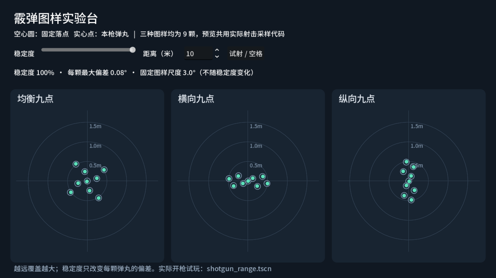

# 霰弹：配置、图样与试玩

## 最快上手

1. 在 **Player → Equipment → Primary Weapon / Secondary Weapon** 展开武器；敌人仍在自己的 **Weapon** 配置。
2. 将 **Fire Mode** 设为 **霰弹**。会自动创建一份可用的九点配置；展开同一资源里的 **Shotgun**。
3. 在 **Pattern** 选择图样，在 **Pellet Damage** 调每颗伤害。其余先用默认值即可。
4. **Shot Interval（射击间隔）** 仍在武器共用参数中。当前霰弹是半自动：每按一次左键打一组弹丸，按住不会持续射击。调大间隔可模拟泵动节奏，暂时没有额外的泵动动作。
5. 弹药种类仍由 **Ammo Type** 独立指定。如果要使用霰弹备弹池，选 **SHOTGUN**；更改 Fire Mode 不会擅自修改已有弹药类型、弹匣、伤害或间隔。
6. 想一发一发装填：在 **Shotgun → 逐发装填** 勾选 **Shell By Shell Reload**，用 **Shell Reload Seconds** 设置装一发的时间。默认关闭、每发默认 0.6 秒；现有资源不会自动改变换弹方式。

可以直接把 `resources/weapons/test_shotgun.tres` 拖入原武器槽。该示例已经设置霰弹模式、霰弹备弹池、6 发弹匣、0.35 秒间隔、2.4 秒换弹、18 米锁定和 30 米射程，每颗 8 伤害，9 颗全中为 72。这些是可调的实现初值，并非用户指定的最终平衡数值。

已有 `.tres`、主场景、关卡和玩家／敌人节点结构没有为此修改。`Fire Mode` 原编号单发 0、自动 1、近战 2 不变，只追加霰弹 3。切回原模式后原参数恢复显示，霰弹参数保留待下次使用。编辑共享武器或图样之前，若只想影响一个实例，先“设为唯一”或另存新资源。

## 在画板上设计弹丸位置

1. 在文件系统双击 `resources/weapons/patterns/balanced.tres`，或展开武器的 **Shotgun → Pattern**。检查器里的 **弹丸落点画板** 就是编辑入口，不需要写坐标数组。
2. 要保留原图样，**先点“另存副本…”**，选择自己的 `.tres` 文件名。保存后检查器自动切到新副本；它不会自动替换武器的 Pattern 引用。
3. **左键点空白处加一颗、拖动已有点移动、右键点已有点删除**。支持原生撤销／重做；拖动中按 Esc 取消这次移动。“载入图样…”可复制三种预设的点，“清空”清除当前点。
4. 点 **保存当前**，再把新的 `.tres` 拖到武器的 **Shotgun → Pattern**。内嵌或未保存的资源先用“另存副本”；直接修改共享图样会影响所有引用它的武器。

画板中心是瞄准方向，X 向右、Y 向上；点数就是弹丸数，最多 64 颗。画板只编辑固定图样，实际覆盖大小还由 **Pattern Angle Degrees** 和目标距离决定，各颗随机偏差仍由稳定度参数决定。清空后运行时会回退为中心一颗，检查器会明确提示。

画板属于项目原有 **武器模式参数** 插件（`weapon_mode_inspector`）。若只看到普通 Points 数组，先在“项目设置 → 插件”确认该插件启用。

## 两个独立预览场景

- 打开 `scenes/presentation/shotgun_pattern_preview.tscn`，切到 **2D** 就能看到三种图样；它是 Control 界面，3D 视图没有模型。若画面显示不全，可缩小 2D 编辑器缩放。旧版本只在运行时创建界面，因此编辑器里是空的；现在已支持编辑器预览。
- 按 **F6** 后可滑动稳定度、修改距离，点击“试射”或按空格重新采样。空心圆是固定落点，实心点是这次的实际弹丸。预览调用与真实射击相同的采样函数。实验台比较三种内置图样；自定义落点在上述 Pattern 检查器编辑，并通过实际武器试玩。
- 打开 `scenes/presentation/shotgun_range.tscn` 按 **F6**：原玩家、相机和靶场的独立组合。右键瞄准、左键射击、R 换弹；1 是霰弹示例，2 是原副武器。训练靶的“命中次数”按整枪计，测试靶按实际命中弹丸累计扣血。离开靶区再进入可复位靶场。

## 三种初始图样

图样资源位于 `resources/weapons/patterns/`，均为本项目设计的九点图样，并非对其他游戏图样的复刻。

| 文件 | 图样 | 用途与取舍 |
| --- | --- | --- |
| `balanced.tres` | 均衡九点 | 中心 1 颗、内圈 4 颗、外圈 4 颗，覆盖各方向，作为默认值。 |
| `horizontal.tres` | 横向九点 | 左右展开、上下较窄，便于观察横向覆盖和多目标命中；远处单体容易漏掉两侧弹丸。 |
| `vertical.tres` | 纵向九点 | 上下展开、左右较窄，便于比较竖向目标覆盖；要考虑矮墙、头部和地面遮挡。 |

**Pattern → 弹丸落点画板** 对应资源的 `points` 数组，格式仍为 `PackedVector2Array`，原图样可直接复制和复用。每个二维点对应一颗弹丸：X 向右，Y 向上，`(0, 0)` 对应瞄准中心。点数就是弹丸数，无需另填一个可能不一致的数量。

坐标通常在 `-1～1`；乘 **Pattern Angle Degrees** 得到水平／垂直角偏移。例如尺度 3°、点 `(1, 0)`，在垂直瞄准轴的 10 米平面上约向右偏 0.52 米。距离增加，实际覆盖自然扩大。保存新的 `ShotgunPattern` 资源并拖入 Pattern 即可复用。运行时忽略非有限坐标、限制坐标范围，最多使用 64 点；空图样回退到一颗中心弹丸。

## 瞄准如何影响霰弹

**固定落点不随精度缩放或整体偏移；稳定度改变每颗弹丸自己的偏差。** 每次射击各颗弹丸独立取样，不共用一次随机方向，也不再先抽“这一枪是否命中中心”。

| Shotgun 字段 | 初值 | 含义 |
| --- | --- | --- |
| Pattern Angle Degrees | 3° | 图样自身的固定尺度，决定基本覆盖。 |
| Stable Jitter Degrees | 0.08° | 完全稳定时，每颗随机偏差的最大角度；设为 0 可以精确复现图样。 |
| Unstable Jitter Degrees | 0.55° | 稳定度为 0 时，每颗随机偏差的最大角度；在两端之间连续插值。 |
| Starting Stability | 0.65 | 初始稳定度；0 最不稳定，1 最稳定。 |
| Settle Seconds | 1.2 秒 | 从初始稳定度恢复到 1 的用时，另外计算恢复等待。 |
| Shell Stability Loss | 0.18 | 每枪的稳定度损失，只扣一次。 |
| Stability Recovery Delay | 0.35 秒 | 新损失发生后，恢复前的等待。 |

同一组配置还提供移动、跟枪和下限参数，字段悬停说明解释各自含义。受击、压制、蹲姿加成和切枪状态沿用原生命周期；玩家两种 Aim Mode 与敌人都使用这组霰弹稳定度参数。霰弹模式下原中心概率与单弹散布角参数隐藏，避免同时调两套实际弹道。

原锁定准星的圆圈仍表示稳定度，不是弹丸覆盖边界。需要看真实图样，使用上面的图样实验台；实际弹道与伤害由三维物理射线决定。

## 一发一发装填

用户要求逐发装填配置放在 ShotgunSettings，并支持右键打断。当前实现的入口是 **Shotgun → 逐发装填 → Shell By Shell Reload**；只对 **Fire Mode = 霰弹** 生效。`ShotgunSettings` 的源文件是 [`scripts/weapons/shotgun_settings.gd`](../../movement_demo/scripts/weapons/shotgun_settings.gd)，图样资源类型则是 [`shotgun_pattern.gd`](../../movement_demo/scripts/weapons/shotgun_pattern.gd)。通常直接改检查器即可，无需修改脚本。

- 按 **R** 连续补入，每完成一发才增加弹匣弹量、扣一发备弹；满匣或备弹用完即结束。每枪消耗的是一发霰弹，不按弹丸数扣弹。
- **新按右键瞄准即可中断**，装填间隙或本发进行中都有效。已装好的保留，尚未完成的一发清零、不扣备弹；右键本身不会开枪。按住右键再按 R 仍能正常装填，需松开再按右键才中断。
- 已有余弹时，瞄准状态下新按左键也会中断并尝试射击，仍受原冷却等限制。空匣扣扳机不会自动取消装填。中断后再次按 R 继续补弹。
- 切枪、快速装填被奔跑中断等情况同样保留已入匣弹药，不保存原整匣模式的 50% 检查点。奔跑中按 R 仍按原慢速倍率装填；暂停不计时，对话等生命周期仍可取消。
- 容量继续用原 **Magazine Capacity**；开启后使用 **Shell Reload Seconds**，不使用整匣的 **Reload Seconds**。例如缺 4 发、每发 0.6 秒，正常补满需 2.4 秒；0.6 秒是当前默认值，可自行修改。
- 敌人也可开启同一配置。身体持续装填到满匣，原 AI 仍决定请求和取消时机；不会因为第一发装好就自动开枪。原规划与协调快照读取真实剩余装填时间，不新增霰弹专用决策。

默认关闭逐发装填，因此现有武器和示例仍保持原换弹行为。关闭时，原整匣换弹及玩家半程中断规则不变。当前没有装填动画或额外起手／收尾时长。

## 结算与边界

每枪只消耗一发弹药，执行一次冷却、射击惩罚、枪声和 `shot_fired` 通知。每颗弹丸各自被第一个碰撞体挡住，因此同枪可以命中多个目标，部分弹丸被挡不影响其他未被挡住的弹丸。

所有射线先查询完，再结算伤害。同一个前排目标即使被打死，也不会导致同枪后面的弹丸临时穿过它。同一目标的弹丸伤害合计后调用一次原受击接口，只施加一次命中干扰／减速；已经命中的目标不再重复吃近弹压制。其他目标取最近且无遮挡的实际弹道，每枪最多通知一次。命中特效按真实弹丸碰撞点表现。

玩家的区域、对话、翻越、近战占用、空弹匣、换弹和冷却限制继续生效。敌人仍通过原身体射击入口、兵种资格、瞄准、视野和 AI 请求开枪；屏幕外禁射规则保留。此功能不新增个人 Utility、协调器策略或霰弹专用站位决策，也不实现新的伤害衰减或弹丸穿透。

## 维护与验证

- `weapon_data.gd` 保留原资源类型，追加 Fire Mode 和可选 Shotgun 配置；只有霰弹读取新的稳定度设置。
- `shotgun_settings.gd` 保存霰弹配置，`shotgun_pattern.gd` 保存图样，`shotgun_ballistics.gd` 负责采样、真实射线和近弹几何。它不消费弹药、不管理身体、AI 或受伤。
- 原 `weapon_ammo.gd` 负责逐发计时／扣备弹，并提供只读 `reload_remaining_seconds()` 给 UI 和 AI；玩家 Combat 决定右键、射击、奔跑及切枪中断。
- 原 `addons/weapon_mode_inspector/weapon_inspector.gd` 注册图样编辑器；同目录 `shotgun_pattern_property.gd` 负责检查器、撤销和保存，`shotgun_pattern_canvas.gd` 只负责画点与鼠标交互。插件关闭不影响运行时资源读取。
- 玩家与敌人在各自原射击入口增加霰弹分支，伤害和通知仍由各自执行。旧单弹分支保留。
- `tests/shotgun_test.gd` 覆盖图样不缩放、各颗独立偏差、三维方向、序列化、遮挡、多目标、死亡前统一查询、一次结算、双边射击、切枪、换弹、半自动扳机与较长间隔。
- `tests/shotgun_inspector_test.gd` 验证真实检查器的霰弹选项、参数显示、旧值保留和原生撤销／重做；以 `--headless --editor --script` 单独运行。
- `tests/shotgun_reload_test.gd` 覆盖逐发弹药守恒、备弹不足、长帧、共享池、玩家右键与射击中断、切枪、快慢装填、暂停／对话和敌人身体／规划耗时。
- `tests/shotgun_pattern_editor_test.gd` 验证真实检查器画板的点击、拖动、原生撤销、预设、只读、保存／另存副本及编辑器 2D 预览；用 `--editor --max-fps 60 --script res://tests/shotgun_pattern_editor_test.gd` 运行。

运行专项：`python movement_demo/tests/run_combat_regressions.py --godot E:/Godot/Godot_v4.7.2-stable_win64_console.exe shotgun_test shotgun_reload_test`。完整目录检查：`python movement_demo/tests/run_regressions.py --check`。

本轮霰弹专项本地与独立副本均为 43/43，霰弹检查器功能断言 10/10。旧武器兼容、弹药、槽位、自动射击、换弹检查点、相机范围，以及三项敌人火控／压制专项通过。旧受击干扰测试有 4 项在修改前后同样失败；无头编辑器退出有已有资源占用诊断。完整范围和基线对照见[敌人测试记录](../enemy-tests.md#霰弹模式2026-10-25)。
