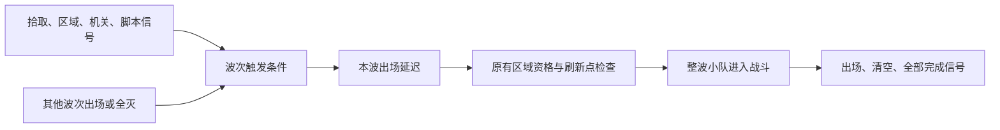

# 敌人波次：通用事件触发设计草案

日期：2026-10-25。

状态：**仅设计，尚未实现，暂不进入代码实施。** 用户已明确扩展方向；下文的字段名、组合规则、生命周期与实施范围是建议，供后续讨论。当前实际功能仍以[波次使用说明](../../gameplay/ENEMY_WAVES.md)为准。

## 1. 用户想解决的问题

波次不应只受相邻上一波影响。场景中的拾取、到达地点、机关动作，以及其他脚本发出的事件，都应能触发对应的一波敌人。

核心使用方式是：**在波次节点上配置监听什么事件，事件满足后由波次系统释放已经摆好的敌人。** 常见接线应在检查器里完成，不为每一个事件单独写一份刷怪脚本。

“上一波死亡后生成”“上一波出现几秒后生成”也属于这一大类：它们是预设好的触发来源与延迟组合，而不是与场景事件并列的另一套生成系统。

这不是专门的剧情系统。剧情将来可以接入，但拾取物、区域、机关、计时器和普通玩法脚本同样是事件来源。当前最重要的约束仍是易上手、保留已有场景部署方式。

## 2. 建议的整体模型

每个 Wave 保留两部分：

| 部分 | 管什么 |
| --- | --- |
| 小队与敌人部署 | 这一波放哪些敌人、放在哪里；沿用现有 Squad、兵种和检查器配置 |
| 出场触发配置 | 监听哪个来源、什么事件、是否过滤参数，以及满足后等几秒 |

关系可以理解为：



事件回调只记录条件变化，不在信号回调里直接实例化敌人。实际倒计时、占位检查、生成、死亡统计和清理仍由区域时钟与波次控制器统一负责。

### 方案比较

| 方案 | 优点 | 问题 |
| --- | --- | --- |
| **通用信号监听 + 常用触发预设，推荐** | 普通事件通过检查器接线；已有顺序出场可以作为预设保留；新玩法发业务信号即可复用 | 需要集中做好参数过滤、重复事件与生命周期管理 |
| 每类事件增加一个专用刷怪脚本 | 最初单个案例容易实现 | 每添一种事件都要接生成逻辑，违背本次需求，也容易出现重复生成和清理遗漏 |
| 全局事件总线 + 通用规则图 | 能描述复杂跨场景条件 | 当前缺少必要性；会增加事件命名、全局作用域、可视化工具与调试成本 |

推荐先使用**指定来源节点的实际信号**，不要求所有现有系统改成全局广播，也不在波次脚本中硬编码物品名、任务名或具体机关。

## 3. 检查器如何配置

建议保留普通配置和自定义配置两个入口，字段名称暂定。

### 普通入口：沿用现在的操作

“出场方式”默认选择 **按排列顺序**。

- `Wait For Previous Clear`：继续决定等待相邻上一波全灭，还是从它出场时开始计时。
- `Start Delay Seconds`：继续表示上述条件成立后等待几秒。
- 第一波从本轮开始计时。

内部可以把这些操作转换为“上一波清空事件／上一波出场事件 + 延迟”。没有配置自定义触发的旧场景，其行为保持一致；不能仅因为新增字段就让后续波开局出现。

### 自定义入口：本波监听指定事件

“出场方式”选择 **事件触发**，再添加触发项。普通情况只需要一项：

| 配置 | 用法 |
| --- | --- |
| 触发类型 | 常用预设，或“来源节点的信号” |
| 来源节点 | 从场景树拖入拾取物、区域、机关、计时器或其他波次 |
| 信号 | 通用模式指定来源已有的信号名；常用预设自动选定 |
| 参数筛选 | 无参信号通常不需要；有参信号可限定物品ID、玩家、目标状态等 |
| 条件组合 | 单项无需关注；多项可选择“任一满足”或“全部满足” |
| 出场延迟 | 复用 `Start Delay Seconds`，触发成立后再等多少秒 |

触发配置建议用 Wave 的资源属性保存，不把触发器作为新的子节点塞进 Wave。当前 Wave 的直接子节点只允许 Squad，EnemyWaves 的直接子节点只允许 Wave；保留这种容易理解的部署树。

通用信号名需要合法性检查和清楚的错误提示。动态信号下拉列表可以作为后续易用性改进；首步优先用常用预设减少手填，不为这份草案承诺一个新的可视化编辑器。

### 配置例子

以下都是未来用法，当前检查器尚无这些字段。

| 想要的效果 | 配置思路 |
| --- | --- |
| 捡到指定钥匙后出现伏兵 | 监听物品来源的拾取信号；若监听 GameState，则筛选 `item_gained` 的物品ID |
| 玩家进入走廊后刷一队敌人 | 来源选走廊 Area3D，监听 `body_entered`，预设自动限定玩家 |
| 门完全打开后出敌人 | 监听门自身的“打开完成”信号；具体信号须由门的脚本提供 |
| 一个 Timer 到时刷敌人 | 来源选该 Timer，监听 `timeout`；额外出场延迟可设0 |
| 第二波全灭后3秒刷第三波 | 普通顺序入口；或明确指定第二波的清空事件，再设延迟3秒 |
| 第一波全灭且玩家进入大厅后出增援 | 两个触发项，组合为“全部满足” |
| 按下警报按钮或进入禁区，任一发生就出增援 | 两个触发项，组合为“任一满足” |
| 将来某个新玩法满足条件后刷怪 | 新玩法发自己的业务信号，Wave 配置监听；不另写敌人生成逻辑 |

## 4. 与现有波次顺序的关系

**按排列顺序**模式继续看 EnemyWaves 下同一层 Wave 从上到下的顺序，名字不决定编号。

**事件触发**模式按自己的配置等待，不暗中附加“前面所有波都必须出场”的条件。例如拾取事件绑定 Wave3，即使 Wave2 还未触发，Wave3 也可以出场。否则它仍会被前一波卡住，无法表达独立伏兵。

两种模式可以混用：

```text
EnemyWaves
├─ Wave1   按排列顺序：入区后出场
├─ Wave2   事件触发：捡到钥匙
├─ Wave3   事件触发：玩家进入大厅
└─ Wave4   按排列顺序：等待相邻 Wave3 全灭，再等2秒
```

上例 Wave4 默认依赖 Wave3，不会自动等待 Wave2。若需要“Wave2、Wave3 都全灭”，应明确配置两个清空触发项并选择“全部满足”。

因此控制器需要从单个“下一波指针”扩展为**每波自己的等待、倒计时和占位状态**。一个已触发波次被堵住时，不应堵住其他独立且已满足条件的波次。多个波次同帧就绪时，建议按树顺序检查，临时受阻则继续看其他候选，**每个有效物理步最多提交一波**；提交前仍复查真实占位。生成过程中新发出的信号留到下一次推进处理，避免0秒触发链递归刷出，也不依赖同一帧刚加入的身体已经进入所有物理查询。

运行时显示的波次编号仍可按初始树序分配，但显式依赖应引用具体 Wave 节点，不用易变的数字3或节点名字符串代表目标。普通模式的“上一波”随树序改变；显式引用的某一波不会因为重新排序就变成另一个目标。

## 5. 事件语义：避免漏触发与重复刷怪

建议首步统一采用**本轮发生过**的触发语义，每个触发项满足后记住结果。

| 情况 | 建议行为 |
| --- | --- |
| 同一事件反复发出 | 只把条件记为满足；本轮该波最多生成一次，不重新计时 |
| “全部满足”的两个事件先后发生 | 分别记住，最后一项满足时开始出场倒计时；不要求同帧发生 |
| 条件满足时正在对话或暂停 | 保留已收到的触发，正常运行后再推进计时／生成 |
| 事件发生后，刷新点暂时被占用 | 保持该波待生成，按原重试规则等待，不丢事件 |
| 多波监听同一来源信号 | 各自满足自己的条件，不把事件只消费给其中一波 |
| 玩家尚未进入战斗区，但监听已经建立 | 可以记住事件；仍需区域运行资格满足后才实际生成 |
| 信号早于监听建立 | 普通信号不能补回历史；需选择可查询状态的来源，或在接线就绪后发出事件 |

“本轮拾取过钥匙”和“现在持有钥匙”不是同一条件；“曾进入大厅”和“现在仍在大厅”也不同。首步预设应明确使用“拾取事件”“进入事件”的名称，不把它们伪装成持续状态判断。

对于确实需要兼容提前完成的状态，后续可增加“持有物品”“旗标为真”等状态型条件：先接变化通知，再查询当前值，并在生成前复核。状态型条件的撤销和倒计时重置规则应单独定稿，不能默默与一次性事件混用。

### 有参数的信号必须能筛选

通用监听应支持无参信号及项目实际使用的有参信号；只支持无参会迫使用户继续为每个已有事件写转发脚本。

建议先提供少量结构化筛选：指定参数等于配置值、节点参数属于某组；多个筛选同时满足才算收到有效事件。常用预设负责隐藏参数下标等细节，例如：

- `GameState.item_gained(item_id, display_name, total)`：按 `item_id` 过滤，其他物品不能误触发。
- `Area3D.body_entered(body)`：限定 `body` 属于玩家组，敌人或道具进入不能触发玩家伏击。
- `flag_changed(flag, value)`：按旗标名和目标布尔值过滤，false不能当作开启。
- `quest_changed(quest_id, previous, current)`：同时限定任务ID和目标状态。

首步不做自由表达式、任意代码字符串、复杂字典路径或嵌套逻辑图。实施时必须依据来源实际信号定义验证参数数量、下标、类型及回调签名，不能把不兼容的信号直接接到同一个固定参数回调。

## 6. 现有接口可以如何接入

已核对的来源如下。这些脚本已经存在，但**通用波次监听尚未实现**。

| 现有来源 | 已有接口 | 设计意义 |
| --- | --- | --- |
| `scripts/systems/game_state.gd` | `item_gained`、`flag_changed`、`value_changed`；物品／旗标查询 | 可监听拾取和状态变化；不复制它的物品或旗标数据 |
| `scripts/world/interactable.gd` | `interacted(interactable, player)` | 可监听成功交互，不把 blocked 当成功 |
| 场景中的 Area3D | `body_entered`／`body_exited` | 地点触发，必须过滤对象；优先复用已有区域 |
| 场景中的 Timer 或普通脚本 | 其已有信号 | 通过通用来源配置接入，不要求业务脚本认识波次内部实现 |
| `scripts/systems/stage/quest_controller.gd` | `quest_changed`、`status_of` | 以后可加任务条件，但任务状态仍由原控制器维护 |
| `scripts/systems/stage/stage_controller.gd` | `stage_changed`、`phase_changed` | 以后可监听阶段变化，不在波次内重做阶段系统 |
| `scripts/ui/dialogue_ui.gd` | `dialogue_started(source)`／`dialogue_ended(source)` | 可监听界面事件；结束也可能来自关闭或来源离场，不能等同剧情成功 |
| `scripts/world/enemy_wave_controller.gd` | `wave_started(index)`、`wave_cleared(index)`、`encounter_completed()` | 保留现有出口，供其他玩法响应战斗结果 |

建议给持续存在的 Wave 配置节点增加自己的 `spawned`／`cleared` 信号（名字暂定），由控制器在真实生成／退树完成时统一发出。这样另一个 Wave 可以直接拖入这个节点作为来源，不必用控制器总信号中的数字筛选。现有控制器的三个信号保留兼容。

不能把尚未出场的 Enemy 模板当作长期事件来源：模板在捕获时会移出并释放，运行副本也会变化。需要等待某组敌人死亡时使用该 Wave 的清空事件；特殊单体可先放进独立一波，不依赖某次运行实例的临时路径。

现有 `CallMethodEffect` 可对目标调用无参／布尔参数方法，能辅助启动整场等简单操作，但它不代替本方案的通用监听。现有 `start_encounter()` 只启动整轮，不能描述“拾取后单独放出第三波”。

## 7. 模块边界与实现约束

建议职责划分，文件名仅作后续拆分参考，本轮不创建运行文件：

| 模块 | 职责 |
| --- | --- |
| `enemy_wave_definition.gd` | 保存出场方式、触发配置、原部署引用和延迟；提供该波生命周期信号 |
| 波次触发配置 Resource | 只保存来源、信号、筛选和组合配置；不保存本轮是否触发、连接句柄等运行数据 |
| 波次事件订阅辅助脚本 | 解析来源、验证并连接信号、过滤事件、解除连接；没有自己的生成循环 |
| `enemy_wave_controller.gd` | 按波保存触发结果与状态，使用区域时钟推进，统一生成／计数／清理 |
| 既有场景事件脚本 | 继续发自己的业务信号，不复制波次生成代码，不接管敌人生命周期 |

来源路径建议相对 Wave 配置节点解析，支持从场景树拖入；允许明确指定同一加载场景中的区域外来源，例如 GameState 或任务节点，但不会自动扫描全地图并监听所有同名信号。跨关卡动态来源和全局事件路由暂不纳入首步。

普通配置由控制器编译为和自定义触发相同的内部条件结构，不维持两套互相独立的生成逻辑。复制 Wave 时只复制配置，新一轮触发结果和订阅必须独立；共享 Resource 不能被写入运行状态。

静态配置缺来源、缺信号、参数筛选不合法、必需依赖无法成立时给出明确诊断，不静默当作满足。直接依赖自己的清空、没有外部入口的必需依赖环应拒绝；“任一满足”带独立外部入口时不能仅因存在一条环边就误判。实施中先支持可确定的检查，其他等待情况在诊断中列出具体未满足项。

## 8. 监听、离场与完成的生命周期

建议把“监听一轮”和“开始实际战斗”区分开：

1. 场景部署捕获后，等所需来源可解析时建立订阅；必需接线就绪前不执行自动生成。
2. 监听就绪后开始记录这一轮事件，包括玩家尚未入区期间收到的事件。开始战斗不再次清空这些记录。
3. 有效区域时钟才推进出场延迟与生成；外部信号不能绕过导航、完整胶囊占位和暂停／死亡／对话守卫。
4. 每波触发只允许从“未触发”进入“待生成”；已生成或已清空的波不能被重复信号再次生成。
5. 离场或 `reset_encounter()` 取消所有待生成项和倒计时，清理全部运行副本，清空本轮触发记录，更新轮次标识，并为下一轮重新准备监听。
6. 回调携带所属轮次标识；断开旧订阅，延迟到达的旧回调无效。场景卸载时释放全部订阅和引用，不留下监听旧关卡的全局连接。

来源节点在触发前消失、来源为运行时动态生成等情况不能静默成功。首步建议要求来源在接线时可用；失效给明确诊断，不新增无限搜索与自动重绑机制。

事件型触发在复位后需要重新发生。如果拾取物已经消失，就不能指望同一个拾取信号再发一次；应由场景自身重置拾取物，或以后选用“当前持有物品”的状态型条件。波次系统不得为重开擅自清空 GameState：目前它的物品和旗标在重载场景后仍可保留，任务控制器则有自己的复位规则。

首步完成规则建议沿用：**所有配置波次都已生成，并且全部全灭后，才发 encounter_completed。** 未触发的事件波仍属于未完成，会显示“等待事件”，不能把“当前没有活敌人”直接当作战斗结束。

这意味着可选伏兵、互斥分支、取消某波后仍算完成，需要另外定义“该波是否必须参与完成”的规则。先记录为后续扩展，不暗中跳过永远没有发生的事件，也不假定本草案已经解决全部分支关卡。

## 9. 后续实施建议与验收重点

用户目前只要求文档，以下不是已排期或已授权执行的实施任务。

建议第一步形成一个完整的小功能：保留顺序入口，增加通用来源信号、结构化参数筛选、拾取／玩家入区／指定波次清空预设、平铺的任一／全部组合，以及按波独立调度。先不做嵌套条件、可选分支、跨场景总线、存档恢复和新的关卡编辑器。

必要验收集中覆盖：

- 旧关卡的全灭／定时逻辑保持一致；模板隔离、资源语义与原路径仍正确。
- 同一通用监听分别接拾取、区域、无参信号和带参数脚本事件，不新增每事件的刷怪脚本。
- 物品ID、玩家对象、目标状态筛选有效；错误参数有诊断，不误放敌人。
- 独立的后置波可以先出场；某波占位受阻不阻塞另一独立波，同帧就绪不重叠生成。
- 多条件先后满足、重复事件、暂停期间触发、先监听后入区、绑定前事件的边界符合文档。
- 离场后旧回调失效；重入不继承上轮脉冲，来源业务状态不被波次重置。
- 编辑器复制、排序、保存重开保持触发引用和参数；显式波次引用不随编号错误改指。
- 只从真实生成／死亡结果发出波次信号；未触发波不误报完成。

本草案仅完成本地源码与文档核对，没有实现信号适配器或执行新功能验证。实施前需验证本项目 Godot 版本中的有参信号适配、接线时机和资源检查器可用性；不把设计意图当作已经测试通过。

## 10. 延后再定的能力

- 状态型条件，以及条件撤销后倒计时暂停、重置还是保持的问题。
- 可选波次、互斥分支、取消波次、显式结束战斗及其完成信号语义。
- 已发生事件跨关卡保留、存档恢复和动态来源重绑。
- 更复杂的条件嵌套、数量阈值、重复生成或无限增援。
- 需要时再做信号选择器与条件诊断面板，而不是先搭一个新的事件编辑框架。

这些是可能的后续方向，不是用户已经确认必须实现的功能。
