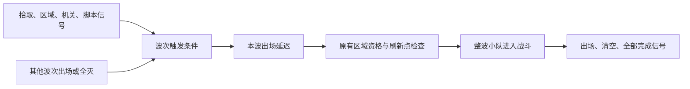

# 场景总调度器：现有五关流程、事件刷新与演出接入设计

初始事件波次草案：2026-10-25。更新：2026-10-28。

状态：**仅设计，尚未实现。本次不修改运行代码、场景和资源。** 下文明确区分当前项目、用户要求和建议接口；未实现内容不能按现有API使用。依据：[项目结构](../../project-layout.md)、[五关与波次](../../gameplay/ENEMY_WAVES.md)、[相机](../../gameplay/CAMERA.md)、[玩家装备](../../gameplay/WEAPON_SLOTS.md)。

## 1. 本项目要解决的具体问题

当前五关已经有完整的开场说明、区域激活、战斗波次、死亡重开、通关按钮和下一关流程，但控制权分散：PlayGuide管开场暂停，EnemyWaves管刷新，Health管死亡界面与重载，LevelFlow管通关界面与切关，shooting_range管区域复位。

用户希望将原EnemyWaves入口升级为**场景总调度器**，统一组织这些流程，并能接收场景事件安排敌人出场。用户明确提出独立演出相机方案，以及由调度器响应玩家死亡并显示死亡信息；还提出完整游戏流程中玩家跨场景数据应如何归属的问题。用户补充PlayGuide只是临时说明，后续教程替代后可以移除；因此它不是调度器的固定依赖。

因此本次设计重点是下表，而不是为当前关卡添加护送、成长、奖励、音乐导演或其他未提出的玩法：

| 需要统一的事情 | 在当前项目中的具体用途 |
| --- | --- |
| 开场与放行 | 必要模块准备好→按配置执行可选引导→正常运行；当前可接PlayGuide，未来可替换或省略 |
| 事件与动作 | 保留现有波次部署，接入拾取、交互、到达地点或脚本信号触发；也能只执行提示／镜头 |
| 暂停与镜头 | 增援成功出现→暂停战斗→专用相机展示→切回→恢复；不与开场、死亡和通关暂停互相覆盖 |
| 死亡与重开 | Health报告死亡→调度器取消当前流程并显示现有死亡界面→接收重开请求→重载当前关 |
| 通关与切关 | 现有全部波次清空条件满足→调度器显示现有结果界面→按钮进入下一关；第5关保留回第1关 |
| 离区与卸载 | 当前区域复位时同步取消相关事件等待、镜头与延迟；切关后旧回调不能影响新关 |
| 玩家数据准备 | 当前仍用每关保存配置；未来连续流程由独立数据服务／玩家绑定组件交接，调度器安排时机 |
| 可定位的问题 | 显示“等关闭说明／等事件／出生位置被占／镜头处理中／重载失败”，不再靠分别猜各节点状态 |

它是总调度器的依据在于：开场、死亡、结果、重开和镜头本身都不依赖某一波。移除所有Wave后，调度核心仍能完成“开场说明→关闭后运行→玩家死亡→死亡界面→重开”；敌人部署是可选执行模块。

原事件波次方案保留在附录A。原合法出生、资源隔离、AI与区域职责仍有效，但附录里的“完成”“复位”和“首步”仅指波次子系统，不能代替本场景流程。

## 2. 哪些职责从哪里收拢

| 当前模块与已存在行为 | 目标职责 | 调度器接管的决定 |
| --- | --- | --- |
| `ui/play_guide.gd`：当前临时说明，ready时暂停，关闭时恢复 | 过渡期提供说明显示／关闭适配；后续教程可替代并移除 | 只按配置请求引导及其控制限制，不硬编码PlayGuide节点或脚本 |
| `player/player_health.gd`：结算死亡、暂停、显示死亡界面、处理重开 | 继续结算生命与自身失能，发送died；生命HUD可保持原职责 | 死亡后的流程中断、暂停、死亡信息显示和重开 |
| `systems/level_flow.gd`：监听波次完成、展示结果、选下一关、切场景 | 复用现有关卡路径表和结果界面；显示与切换实现可拆为适配部分 | 是否通关、何时显示结果、按钮请求是否有效、何时切关 |
| `world/enemy_wave_controller.gd`：模板、刷新、统计、清理 | 提取为敌人执行职责，保留原接口兼容 | 本场景何时请求出场、与镜头和其他动作如何衔接 |
| `world/shooting_range.gd`：入区、离区、区域推进与复位 | 继续管理区域资格、导航、注册、局部战斗清理 | 场景动作与区域生命周期的衔接；不复制其AI／导航逻辑 |
| `systems/player_camera.gd`与Phantom Camera | 保持玩家跟随、武器视野与地面锚点 | 不接管其跟随算法；只请求独立演出组件展示目标 |
| 新增专用演出相机组件 | 复制画面、切入、移动、返回、切回 | 何时播放、等待／取消，以及需要的暂停与输入限制 |
| `world/ammo_drop_controller.gd`等补给组件 | 保持原掉落选择、数量限制、拾取和清理 | 只协调区域／场景复位，当前不增加新奖励或补给系统 |

总调度器不存第二份生命、弹药、敌人存活人数或任务状态，也不替各节点执行物理与AI更新。它持有流程状态和请求身份，业务模块报告真实结果。

现有节点路径、资源引用、脚本UID和用户保存参数保留。概念名可称SceneDirector，原EnemyWaves路径可作为兼容入口；不再另建一个与它争夺控制权的第二总控制器。

### EnemyWaves与CombatZone建议保持分开

本节讨论的是 **EnemyWaves**，不是单个Wave。EnemyWaves升级后是场景调度入口；当前CombatZone是Area3D，提供区域形状和玩家进出检测。它们的生命周期和数据职责不同，建议不合成同一个节点／脚本。

当前工程实际还有第三层：场景根上的shooting_range.gd订阅CombatZone，维护区域玩家、敌人注册、导航／协同和局部复位。不能把这些都误认为CombatZone本身在执行，也不应把这套区域服务整体塞进总调度器。

```text
Lvl1（原shooting_range.gd：区域服务）
├─ CombatZone（Area3D）
│  └─ CollisionShape3D（区域范围）
├─ EnemyWaves（升级为场景调度入口，保留现有Wave部署）
├─ Player
└─ Camera3D
```

| 部分 | 负责的事实或决定 |
| --- | --- |
| CombatZone | 区域在哪里、哪个身体进入／离开，提供原空间边界 |
| 区域服务shooting_range | 玩家过滤、当前区域运行资格、导航和成员管理、执行局部清理 |
| 升级后的EnemyWaves | 收到区域事实后启动什么流程、请求哪些动作、如何与死亡／镜头／通关协调 |

推荐的接线方向为“CombatZone检测→区域服务整理事实→总调度器按场景规则响应”，敌人执行仍查询区域资格。当前自动入区开战、离区复位作为兼容策略保留；若以后需要改变策略，由调度规则显式选择并调用区域接口，不由两个地方同时执行重置。

分开的直接意义是：玩家还没进CombatZone时也能初始化和显示引导；玩家离开区域后仍能完成镜头清理、显示死亡结果或重开；调整区域形状不会改变场景流程配置。总调度器不应因Area3D里没有玩家就停止工作。未来有多个区域时也无需复制整套死亡／通关控制。

如果只是希望搭建关卡时一次拖入，可以将这些节点作为一个可复用场景组合，但内部继续分工；当前已有根场景包含它们，不需要为“合并”迁移现有节点或破坏路径。单个Area3D上合并调度代码虽可实现，却会把场景生命周期和空间检测耦合，不建议作为本次方向。

## 3. 先配置当前五关需要的流程

当前五关可直接使用一份简单流程预设，无需先制作复杂阶段图：

```text
准备 → 可选开场引导（可省略）→ 正常运行
                         ├─ 玩家死亡 → 死亡界面 → 请求重开
                         ├─ 当前关完成 → 结果界面 → 请求下一关／第1关
                         └─ 事件动作 → 等待结果 → 回到正常运行
重开／切关：取消旧执行 → 请求加载 → 新关重新准备
加载失败：保留错误与可重试界面
```

“增援展示中”是正在执行的场景动作及暂停原因，不应取代整个场景生命周期。关闭说明不能解除死亡暂停，镜头结束不能解除通关暂停。

检查器建议只提供当前需要的分组：

| 分组 | 配置内容 |
| --- | --- |
| 场景绑定 | Player／Health、结果UI、区域、敌人执行部分、演出相机；引导提供者是可选绑定 |
| 开场流程 | 不使用引导／临时PlayGuide适配／以后教程适配；配置完成后启动什么，敌人仍遵守区域资格 |
| 场景事件规则 | 来源节点、信号／条件、参数过滤、动作列表、重复范围 |
| 死亡与通关 | 失败来源、完成条件、显示内容、重开／下一关请求 |
| 关卡与玩家初始化 | 原关卡编号／路径表；本地配置或未来连续玩家数据模式 |
| 调试 | 当前流程、待执行动作、阻断原因与最近错误 |

配置用资源保存，连接、计时和执行状态只属于本场景实例。当前Wave → Squad → Enemy部署方式及第一关Existing Squads外部引用继续保留；新事件流程不要求移动这些节点。

当前五关的完成预设仍是所有配置波出场并清空。总调度核心的完成规则可以另配，但本次不擅自给五关新增任务、撤离点、分支或计时玩法。

## 4. 场景事件与动作：从已有接口接入

| 可使用的现有来源 | 能表达什么 | 接入边界 |
| --- | --- | --- |
| Health.died | 本场玩家死亡 | 只处理当前绑定玩家和本场身份，重复通知不重复结算 |
| EnemyWaves的出场／清空／完成事件 | 增援展示、某波之后的动作、当前关完成 | 表示真实执行结果，不把请求出场当已出场 |
| Area3D.body_entered | 玩家到达位置 | 过滤玩家；不把敌人进入当玩家进入 |
| Interactable.interacted | 成功使用现有交互物 | blocked不算成功，调用来源明确 |
| GameState.item_gained／flag_changed | 指定物品获得、指定旗标变化 | 检查参数；属于现有交互状态，不等于全局玩家存档 |
| Timer.timeout或普通脚本信号 | 延迟后动作、未来自定义事件 | 不另写一套刷怪实现，计时须遵守所属暂停规则 |
| 可选引导提供者完成／结果按钮 | 放行、重开、切关 | 临时PlayGuide需补关闭通知；教程接自身完成结果，核心不查固定节点 |

场景规则是“来源与条件→动作→实际结果”，不以Wave编号作为唯一入口。例如：成功交互→请求Wave2→展示出场位置；或者只在进入指定位置后显示提示。事件型条件记住所属轮次内发生过的事实；需要“当前旗标仍开启”时调用公开状态查询并在执行前复核。

首版动作只需：请求可选引导并等待明确结果、等待时间、请求指定部署、等待清空、请求镜头、显示结果、请求重开／切关，以及明确目标的公开动作适配。先支持顺序动作和独立规则并行等待，不为当前需求建设任意并行图或重复事件框架。

信号回调只记录事实，统一调度边界推进普通动作；死亡立即关闭普通动作资格，再安全清理。请求先建立结果监听、再发给执行模块，以免同步完成时漏事件。每项带场景代次和执行ID，旧回调不能推进新场景。

一条规则在本场景／本轮区域战斗内默认只执行一次。区域战斗规则可随区域复位，开场说明与当前关结果不会因为出入CombatZone就自动重播。动态占位阻塞一个出场请求时不阻塞无关规则。

## 5. 开场、死亡、通关和重开

### 可选开场引导，PlayGuide只是当前适配

当前PlayGuide在_ready直接暂停并保存旧暂停值。过渡期接线可以是：必要模块就绪→调度器申请开场暂停／鼠标控制→PlayGuide显示→发出关闭通知→释放本次限制。只在配置使用该临时说明时执行。

调度核心只识别“请求引导、引导完成／取消／失败”的动作契约，不硬编码PlayGuide类型、节点路径、文案或每关必须显示说明。不配置引导时，准备完成即可进入正常运行；显式配置了某引导但目标缺失时报告配置错误，不能一直等待不存在的节点。

后续教程通过适配同一动作契约替换PlayGuide。互动教程可能允许玩家走动、瞄准或交互，不能沿用“教程没结束就暂停整场”的假设；教程按具体步骤申请必要的输入限制，调度器根据实际完成事件继续。暂停只是临时说明采用的策略，不是所有引导的必选行为。本次不提前实现教程系统。

当前启用PlayGuide时，玩家已在CombatZone的启动请求可记录，但关闭前不生成；移除或禁用PlayGuide后不能留下永久阻断。引导完成与原区域资格是两项独立条件，无引导不等于允许在战斗区外生成。

### 玩家死亡

Health仍立即结算生命、标记死亡并停止玩家自身动作，然后发died。它不再暂停整场、显示死亡信息或自行重载；现有死亡UI节点路径可保留，由独立UI适配部分控制。

调度器收到死亡后：取得死亡暂停→取消普通事件动作和演出→安全切回有效玩家相机／清理镜头→显示现有死亡信息。镜头清理失败不能让死亡界面永久等待。重复死亡只处理一次。

重开按钮只发请求；调度器确认当前处于死亡结果且未在加载，再请求重载当前关。失败保留死亡暂停并恢复重试按钮。旧Health里的直接重开回调必须移交，不能两处都执行一次。

### 当前关完成与下一关

当前LevelFlow已按关卡编号显示下一关，第5关回第1关。保留这套关卡表与界面文案；改为敌人执行模块报告完成→调度器统一判定→显示结果。

同一结算步玩家死亡和波次完成同时发生时死亡优先，保留现有LevelFlow的死亡保护意图。若必要镜头仍在执行，等待其正常收尾后再显示通关界面；死亡可中断未提交的通关候选。结果只显示一次，不自动跳关。

按钮发下一关请求，调度器取消旧动作、限制重复点击，再调用切换适配部分。加载失败继续沿现有重试反馈，不假报切换成功。新场景自己申请开场暂停，旧场景不得在卸载后无条件paused=false覆盖它。

### 一个不依赖刷怪的验收

在小验证场景里放玩家、死亡UI和调度器，不配置Wave或PlayGuide：场景直接正常运行，玩家死亡显示结果，按钮正常重开；再单独验证可选PlayGuide及替身互动教程的完成接线。此用例验证调度器确实管理场景生命周期，而不是给波次更新器换名。

## 6. 合并现有暂停与控制权

本项目至少有PlayGuide、LevelFlow、Health三处直接写SceneTree.paused。增加镜头后，不能再加第四个各自保存旧布尔值的暂停者。

建议统一暂停协调入口，用原因／持有者记录开场、演出、死亡、通关限制。释放只撤销自己的请求；死亡先持有暂停，再释放镜头请求，不出现中间恢复战斗的一帧。UI鼠标模式与焦点也按拥有者恢复。

| 当前场景状态 | 战斗与普通流程 | 演出与UI |
| --- | --- | --- |
| 已配置的临时说明未关闭 | 持有说明暂停时不推进 | 说明可操作；未配置说明不进入该状态 |
| 正常运行 | 按区域及角色资格推进 | 正常显示 |
| 增援镜头 | 玩家／敌人战斗与普通延迟冻结 | 当前演出相机继续，必要提示可更新 |
| 死亡／通关结果 | 停止普通推进 | 结果按钮可操作，镜头已取消或完成 |
| 正在重载／切关 | 不接纳新的普通动作 | 加载失败仍能显示并重试 |

战斗冻结覆盖移动、AI／协同、射击、换弹、治疗、受击持续时间和波次计时，不能只停EnemyWaves。演出使用单独的有效演出时间，不把整个区域设成Always。暂停时已收到事件可以保留，但不伪造来源未发出的事件。

死亡、取消、重开请求与卸载清理不能被普通流程暂停挡住。每个动作只由一个时钟推进；场景流程不依赖has_active_player，而敌人生成仍由区域合法推进入口执行。

## 7. 区域离场、重开和切关的清理衔接

当前shooting_range在最后一个玩家离开CombatZone时执行区域复位，包含ammo_drops、受管波次、cooperation、tactical_map、presentation_reset及其他目标。保留这些业务模块的清理职责和原先后约束，不让总调度器再逐个敌人重复清理。

需要补的场景层协调是：区域复位前使相关动作身份失效，取消该区域的事件等待、出场延迟和镜头，再由区域完成原清理；必要时增加明确复位通知／接口。开场说明、关卡编号、全局交互状态和已显示结果不因区域复位而清空。

场景卸载／整关重开则使全部执行身份失效，解除订阅和相机／暂停引用，阻止旧加载回调或旧角色引用影响新关。执行取消是幂等的；卸载时不要求对已不存在的玩家播放镜头返回动画。

GameState当前物品和旗标跨场景重载保留。调度器不能为了重开而擅自清空；原区域掉落清理也不应被改成新的跨关玩家库存策略。相关范围必须按已有业务归属处理。

## 8. 独立演出相机：复制画面、切入、移动、切回

采用用户本轮提出的方向：保留玩家跟随相机，另设一台专用Camera3D负责视野转移。EnemyWaves只请求“展示目标”，无需持续监控、移动或改写玩家相机。演出相机控制组件掌握两台相机引用，负责画面复制、当前相机切换、平滑移动和结果回报。

建议场景中增加独立可复用的演出相机组件，与现有玩家相机同级，初始不激活；保持现有部署子树兼容，不放进EnemyWaves的Wave直接子层，也不挪动原相机及其Phantom子节点。新增组件沿systems相机职责组织，具体命名暂定：

```text
战斗场景
├─ Camera3D                  原玩家相机场景，保留原路径
│  ├─ PhantomCameraHost
│  ├─ CameraGroundAnchor
│  └─ PhantomCamera3D
├─ PresentationCamera        新Camera3D及演出控制脚本，默认非当前
└─ EnemyWaves                场景总调度入口，演出只是可调用能力之一
```

这是同一Viewport中的两台实际Camera3D；同一时刻只有一台负责显示。演出相机不需要复制另一套Phantom跟随链，也不绑定武器变化来常驻跟踪玩家；只由自己的演出控制逻辑写入。若无演出组件，展示动作诊断并降级，旧场景照常使用原相机。

### 切入与返回顺序

1. 取得相机使用权并确认预期的玩家相机仍是当前画面来源；其他演出或对话占用时排队，不从别人的镜头强行切走。暂停及互斥规则按第6节执行。
2. 在同一次交接中，将玩家相机**当前实际显示的画面状态**复制到演出相机，再把演出相机设为当前。复制后与源画面重合才开始移动，不能先切到新相机的默认位置。
3. 演出相机平滑移向刷新点，保留复制来的俯视角和投影方式作为默认；可按预设调整视野与停留时间。目标点表示地面焦点，需加上相机观察偏移，不能把Camera3D本体直接放到敌人脚下。玩家相机不参与这段移动。
4. 展示结束时，由相机组件向玩家相机侧取得当前有效返回画面，包括正常跟随位置与视野。推荐演出相机先平滑回到该画面，最终对齐后再切回；也可以后显式提供直接切回选项，默认不在敌人视角瞬间跳回玩家。
5. 切回完成后，演出相机恢复非当前状态，清理本次Tween、提示和临时引用，返回完成结果，再由演出执行器释放暂停与输入限制。避免玩家已经能操作但画面还在返回途中。

只在开始、返回及必要的交接复核时读取玩家相机；EnemyWaves不保存相机位置／Size的镜像状态。返回途中若窗口、玩家位置或正常视野发生变化，由相机组件更新返回目标并在切换前复核，不把持续追踪责任放回场景调度器。

### “相同参数”需要复制哪些内容

| 画面状态 | 复制目的与约束 |
| --- | --- |
| 世界位置、朝向及可见相机偏移 | 两台相机切换时构图重合；包括跟随／插值后实际显示的状态，不只复制编辑器保存transform |
| 投影类型、Size／FOV、宽高保持方式、投影偏移 | 当前工程是正交俯视，Size尤其重要；复制当前值，不直接拿武器目标值替代未完成的视野过渡 |
| Near／Far、Cull Mask等裁剪参数 | 避免切换后物体突然出现或消失 |
| 相机使用的Environment、Attributes及适用的后处理覆盖 | 避免曝光、景深或颜色突变；沿用相同有效配置，不修改共享资源；演出要改资源内容时用独立副本 |

复制的是画面状态，不是整个节点树、脚本、信号连接、玩家跟随绑定或运行计时；不复制current状态代替明确切换。实际涉及的参数需结合当前引擎与渲染器验证，尤其是物理插值、相机offset及后处理历史；参数相同只是必要条件，切换无跳变仍须画面验收。

### 玩家相机在后台与暂停中的行为

本地PhantomCameraHost的常规跟随更新没有以其父Camera3D的current为退出条件，因此单纯切走显示源并不等于停止原跟随。它仍只写玩家相机，演出组件只写演出相机，两者不争同一个transform。这里仅是源码核对，尚未执行双相机运行验证。

树暂停是另一件事：不能因为玩家相机非当前仍能更新，就假定暂停期间锚点、Host和武器视野过渡也会推进。首期冻结战斗时玩家通常不动；如果外部脚本移动玩家、改变装备或窗口尺寸，则由相机侧的有限同步入口在返回前更新正常画面，或允许必要的纯相机链在演出时钟下更新。两者需在实施阶段选定并验证，不能短暂恢复整场战斗只为刷新相机，也不能在EnemyWaves里重写玩家跟随算法。

玩家相机保留自己的目标、地面锚点和武器配置，切回时不把演出前的旧参数覆盖回它。源相机失效或场景已卸载时取消展示并释放；若其他更高优先级拥有者已接管显示，旧演出结束不能强行make_current抢回画面。

### 遮挡、UI与取消

现有player_camera在非当前时会清理其遮挡透明辅助；需要显式交接这个表现职责。建议相机组件让遮挡辅助跟随当前显示相机工作，切入时交接到演出目标、切回时交接回玩家；同一网格同一时刻只有一个材质效果拥有者。不能让两个独立辅助同时保存／恢复同一网格材质，也不能直接复制运行中的透明材质缓存。具体可复用现有辅助实现，不扩大透明对象范围，不修改碰撞；暂停期间仍须允许必要的清理执行。

镜头移动会改变屏内／屏外判断、准星和血条投影，展示期间继续冻结战斗并隐藏战斗准星；其他读取相机的表现需要使用当前显示相机，硬编码玩家相机的调用者需逐项核对。镜头看到敌人不构成AI感知证据。

跳过只结束本次镜头和提示，仍须完成切回、清理和释放；不撤销已刷敌人、不跳过必须发生的机关或目标更新。普通取消且玩家相机仍有效时安全切回；卸载无需播放返回动画。任一交接失败走同一幂等清理出口，不留下当前相机错误、永久暂停或输入锁。

## 9. 敌人执行模块与增援展示

总调度器请求出场，敌人模块保留模板捕获、完整胶囊／导航校验、原刷新点等待、按波统计、出生搜索与运行实例清理。总调度器不重新实现这些功能。

Wave的原顺序／延时入口继续可用；场景事件入口最终进入同一出场请求通路。同一部署不能同时由两份无约束配置重复触发。区域是否允许战斗由原区域守卫决定，场景规则不能绕过暂停、死亡、对话与出生合法性。

用户提出的增援流程具体为：事件满足→请求指定部署→等待真实生成→在新成员第一次行为推进前建立演出屏障→专用相机展示→切回→释放演出限制。刷新位置受阻时不暂停玩家看空位置，也不先显示“增援已到”。

展示请求在出场前准备，但成功提交时才进入冻结／展示边界。不能等下一帧才暂停，让新敌人先攻击；生成调用返回后的区域协同推进也须复查屏障。提交失败取消相应演出，镜头失败则可跳过表现，已生成敌人不重复刷出。

每个有效物理步最多提交一波，受阻请求不阻塞其他独立合法请求。原出生搜索仍使用一次合法提示，不因镜头展示变成真实目击或隐藏玩家位置跟踪。详见附录A及[敌人AI说明](../../enemy-ai.md)。

## 10. 玩家跨场景数据：独立负责，调度器安排时机

### 当前项目实际是什么

Health._ready按本地max_health恢复生命；Equipment._ready按本关保存的武器、初始备弹和医疗包初始化。五关各自保存了玩家配置。GameState是AutoLoad，保存对话／交互物品／旗标，但重新运行游戏会重置，不是完整的玩家存档。

玩家角色随关卡创建和销毁可以继续保留。未来连续流程需要独立保留的是所选装备、每槽弹匣、按弹种备弹、医疗包，以及按规则延续的生命等数据；无需让整棵Player常驻，也不应把这些数值全塞进总调度器。

### 建议分工

| 部分 | 负责什么 |
| --- | --- |
| 跨场景玩家数据服务，暂称PlayerSession | 保存明确版本的本局交接记录；提供当前玩家的有效数据入口 |
| 玩家侧绑定组件，暂称PlayerStateBinding | 应用选定初值、收集Health／Equipment等完整快照、绑定／解绑当前角色 |
| Health／Equipment／Combat | 活动角色的生命、弹药及战斗状态仍按原职责唯一结算 |
| 场景总调度器 | 决定本次是换关、重开还是本地试玩；安排捕获／应用的时机，等待player_ready |
| 未来存档服务 | 若需要退出游戏后继续，再负责磁盘读写和版本校验；不与跨场景内存保留混为一谈 |

PlayerSession可由常驻根节点或AutoLoad持有；玩家绑定组件可放在Player内部，不改变原Health／Equipment／Combat路径。静态参数仍由WeaponData和本地配置等提供，运行数量不能写回共享资源。本次不新增等级、技能、货币或成长系统。

绑定期间实时生命／库存仍以原角色模块为权威，交接记录不是第二份同时可写的实时数据。全局需要读取当前值时通过有效绑定查询只读快照；无角色时才使用已提交记录并标明时效。旧角色卸载回调不能覆盖新绑定，调度器不需要每帧同步所有玩家参数。

### 与当前五关配置的关系

| 操作 | 数据来源建议 |
| --- | --- |
| 当前五关与独立F6试玩 | 继续使用本关保存的Player配置；不自动覆盖用户已有装备和数量 |
| 以后启用连续玩家模式正常换关 | 捕获当前角色的完整携带状态，交给下一关的新角色 |
| 死亡重开 | 使用本关入口记录或本地初值，不能用死亡时0血记录覆盖重开基线 |
| 退出游戏再继续 | 需要另外接入持久存档，当前GameState不提供完整保证 |

是否跨关保留当前血量、弹药，还是补满，以及关卡指定装备是否覆盖玩家携带装备，需要具体玩法确认，不能由agent擅自选定并改掉五关配置。本次只明确职责，未授权把现有五关切换为连续模式。

连续模式接入时要改清初始化顺序：准备数据→原组件统一应用→通知就绪→放行。不能应用记录后又被_ready补满血／弹匣。现有ammo_snapshot按弹种合并，无法恢复每槽弹匣，需专门的完整导出／导入接口；不用当前掉落／显示快照冒充存档。

换关前在原角色仍有效时捕获一致快照，切换失败保留原角色状态。重开基线与正常交接记录分开，不在Player._exit_tree无条件自动保存。临时锁定对象、Node引用、Tween等不直接跨场景保存；换弹／冷却等具体延续规则在连续模式实施时单独定义。

## 11. 可复用的现有交互组件，不强塞进五关

项目已有Interactable、GameState、CallMethodEffect和sliding_barrier，因此事件动作可以接这些现有能力，而不是先创造一套新的任务或机关框架。

- 若关卡配置拾取物：按item_gained的物品ID过滤，再请求指定部署或提示。
- 若配置现有交互物：监听interacted，调用已有对象的公开动作。
- 若使用sliding_barrier：可以请求open／close，但当前is_open在Tween开始时就改变，不能当“移动完成”。需要等待门实际打开时，应补完成通知或适配真实Tween结果。
- 独立main.tscn中的任务／NPC状态系统有自己的职责；五关流程不会因为增加总调度器就自动接入或重做这套任务系统。

这提供了用户需要的“监听场景事件来安排事情”的扩展通路，但不修改五关现有地图，不凭空添加钥匙、门、NPC或新目标。等待动作失败须有明确诊断，不能靠假报成功推进。

## 12. 实现组织与当前范围

保留原EnemyWaves入口作为兼容外壳，内部装配场景流程核心和敌人执行部分。前者不要求存在Wave，后者才校验Wave／Squad部署。原节点路径、UID、资源引用和已有配置保持，私有模块按项目world／systems职责组织。

新增核心只需负责事件接线、流程状态、动作请求／结果和取消身份；暂停协调与独立相机是相应执行能力。资源保存静态配置，各实例保存运行状态。不要求所有模块统一改用全局事件总线。

迁移时须按场景一次明确切换所有权：若仍使用PlayGuide，其暂停申请通过通用引导适配接入；Health的死亡UI／重开、LevelFlow的通关／切关都交给总调度流程。旧独立演示可暂时保留旧接线，但已接管场景不能同时运行两套结果处理。

本次不纳入：护送、奖励系统、环境危险、成长系统、音乐状态机、复杂流程图编辑器和检查点存档。需要以后再结合真实关卡提出，不作为总调度器成立的前提。玩家连续数据是用户提出的后续接口方向，保留第10节的设计边界。

## 13. 实施顺序与实际验收

| 阶段 | 在本项目中交付什么 |
| --- | --- |
| A 场景流程与现有UI接管 | 无Wave且无PlayGuide夹具先验证运行、死亡、重开；再接可选引导适配和现有Health／LevelFlow，当前配置行为保持 |
| B 事件与敌人执行接入 | 保留原波次部署和区域校验，接拾取／交互／Area3D／脚本信号，独立规则不被某波受阻卡住 |
| C 专用演出相机 | 增援实际生成后的冻结、复制画面切入、展示、返回切回、取消与清理 |
| D 连续玩家模式，后续单独确认 | 数据服务／角色绑定及换关快照；以确认后的携带规则接入，不默认改变五关或F6配置 |

验收重点与项目对应：

1. 当前配置使用说明时仍可关闭，关闭不解除其他暂停；禁用／移除PlayGuide后直接正常启动；替身互动教程可允许玩法执行并报告完成，不被硬编码的整场暂停卡住。
2. Health只报告死亡和处理自身失能；死亡界面及重载请求由调度器发起，重复信号／按钮只处理一次。
3. 最后一名敌人清空与玩家同帧死亡时死亡优先；第1～4关保留下一关按钮，第5关保留回第1关；切换失败可重试。
4. 镜头移出、停留、返回过程中死亡／离区／重载，均取消旧动作、释放引用，不永久暂停、不让旧回调切走新关镜头。
5. 入区、离区和重入保留原波次／掉落／协同／地图清理；不因离区重播开场，不复活旧轮成员或泄漏尸体与镜头状态。
6. 刷新位置被占时不提前展示成功；实际生成后玩家、旧敌人与新增敌人都冻结，返回后按原进度恢复；出生搜索与原AI规则不变。
7. 两台相机切入画面匹配，原相机仍保持玩家绑定；窗口／装备状态变化后正确返回，遮挡材质不由两套辅助争写。
8. 无Wave、无PlayGuide也能运行→玩家死亡→UI→重开；未进入／已离开CombatZone也能处理场景控制，证明它不依赖波次更新或区域占用。
9. 事件参数过滤、重复事件、先订阅后请求、旧代次回调、动态占位与重置正确；缺信号或对象不能静默成功。
10. 以后连续玩家模式接入时验证每槽弹匣／共享备弹不丢失，_ready不覆盖交接值，死亡数据不污染重开基线，F6仍使用本地配置。

按[敌人测试](../../enemy-tests.md)与[测试说明](../../testing.md)选取enemy_wave_test、enemy_wave_search_test、level_flow_test、player_camera_test、player_scene_reuse_test、camera_occlusion_test及涉及的生命／装备／交互专项。新增验证必须覆盖真实调用方向和结果，不能只看旧波次测试通过。镜头切换、鼠标焦点、按钮和完整五关流程需实际渲染验收。

最小诊断内容：当前关／场景代次、当前流程、等待事件或动作、哪个暂停原因仍有效、哪个出场点受阻、最近加载错误。先用现有诊断方式，不为此新建大型编辑器。

## 14. 本次交付与依据

仅修改设计与对应待办，没有修改运行代码／场景／资源，没有运行Godot，不把文档检查说成新能力已通过。

已核对README、项目结构、波次／敌人／测试／相机／装备等说明，以及PlayGuide、Health、LevelFlow、shooting_range、enemy_wave_controller、GameState、Equipment、sliding_barrier和相机相关源码。当前事实与建议接口已分开，现有未提供的关闭通知、动作完成通知和完整玩家快照需要实施时新增。

用户明确方向为总场景调度、场景事件驱动、独立演出相机、死亡信息由调度器控制，以及PlayGuide为可替换／移除的临时说明；EnemyWaves与CombatZone分开是本次架构建议，未实际改动节点；玩家跨场景数据是用户追加的架构问题。具体适配接口、控制权令牌和连续数据交接方式仍为设计建议，未替用户决定跨关平衡与装备规则。

## 附录A：原事件波次专项设计

以下保留原草案。A.1～A.10中的“首步”“控制器”“完成”“复位”限于波次模块，不能作为场景核心的必需条件。旧快捷配置按正文进入统一出场请求通路，原模板、几何、资源隔离和AI约束继续有效。

### A.1. 用户想解决的问题

波次不应只受相邻上一波影响。场景中的拾取、到达地点、机关动作，以及其他脚本发出的事件，都应能触发对应的一波敌人。

核心使用方式是：**在波次节点上配置监听什么事件，事件满足后由波次系统释放已经摆好的敌人。** 常见接线应在检查器里完成，不为每一个事件单独写一份刷怪脚本。

“上一波死亡后生成”“上一波出现几秒后生成”也属于这一大类：它们是预设好的触发来源与延迟组合，而不是与场景事件并列的另一套生成系统。

这不是专门的剧情系统。剧情将来可以接入，但拾取物、区域、机关、计时器和普通玩法脚本同样是事件来源。当前最重要的约束仍是易上手、保留已有场景部署方式。

### A.2. 建议的整体模型

每个 Wave 保留两部分：

| 部分 | 管什么 |
| --- | --- |
| 小队与敌人部署 | 这一波放哪些敌人、放在哪里；沿用现有 Squad、兵种和检查器配置 |
| 出场触发配置 | 监听哪个来源、什么事件、是否过滤参数，以及满足后等几秒 |

关系可以理解为：



事件回调只记录条件变化，不在信号回调里直接实例化敌人。实际倒计时、占位检查、生成、死亡统计和清理仍由区域时钟与波次控制器统一负责。

#### 方案比较

| 方案 | 优点 | 问题 |
| --- | --- | --- |
| **通用信号监听 + 常用触发预设，推荐** | 普通事件通过检查器接线；已有顺序出场可以作为预设保留；新玩法发业务信号即可复用 | 需要集中做好参数过滤、重复事件与生命周期管理 |
| 每类事件增加一个专用刷怪脚本 | 最初单个案例容易实现 | 每添一种事件都要接生成逻辑，违背本次需求，也容易出现重复生成和清理遗漏 |
| 全局事件总线 + 通用规则图 | 能描述复杂跨场景条件 | 当前缺少必要性；会增加事件命名、全局作用域、可视化工具与调试成本 |

推荐先使用**指定来源节点的实际信号**，不要求所有现有系统改成全局广播，也不在波次脚本中硬编码物品名、任务名或具体机关。

### A.3. 检查器如何配置

建议保留普通配置和自定义配置两个入口，字段名称暂定。

#### 普通入口：沿用现在的操作

“出场方式”默认选择 **按排列顺序**。

- `Wait For Previous Clear`：继续决定等待相邻上一波全灭，还是从它出场时开始计时。
- `Start Delay Seconds`：继续表示上述条件成立后等待几秒。
- 第一波从本轮开始计时。

内部可以把这些操作转换为“上一波清空事件／上一波出场事件 + 延迟”。没有配置自定义触发的旧场景，其行为保持一致；不能仅因为新增字段就让后续波开局出现。

#### 自定义入口：本波监听指定事件

“出场方式”选择 **事件触发**，再添加触发项。普通情况只需要一项：

| 配置 | 用法 |
| --- | --- |
| 触发类型 | 常用预设，或“来源节点的信号” |
| 来源节点 | 从场景树拖入拾取物、区域、机关、计时器或其他波次 |
| 信号 | 通用模式指定来源已有的信号名；常用预设自动选定 |
| 参数筛选 | 无参信号通常不需要；有参信号可限定物品ID、玩家、目标状态等 |
| 条件组合 | 单项无需关注；多项可选择“任一满足”或“全部满足” |
| 出场延迟 | 复用 `Start Delay Seconds`，触发成立后再等多少秒 |

触发配置建议用 Wave 的资源属性保存，不把触发器作为新的子节点塞进 Wave。当前 Wave 的直接子节点只允许 Squad，EnemyWaves 的直接子节点只允许 Wave；保留这种容易理解的部署树。

通用信号名需要合法性检查和清楚的错误提示。动态信号下拉列表可以作为后续易用性改进；首步优先用常用预设减少手填，不为这份草案承诺一个新的可视化编辑器。

#### 配置例子

以下都是未来用法，当前检查器尚无这些字段。

| 想要的效果 | 配置思路 |
| --- | --- |
| 捡到指定钥匙后出现伏兵 | 监听物品来源的拾取信号；若监听 GameState，则筛选 `item_gained` 的物品ID |
| 玩家进入走廊后刷一队敌人 | 来源选走廊 Area3D，监听 `body_entered`，预设自动限定玩家 |
| 门完全打开后出敌人 | 监听门自身的“打开完成”信号；具体信号须由门的脚本提供 |
| 一个 Timer 到时刷敌人 | 来源选该 Timer，监听 `timeout`；额外出场延迟可设0 |
| 第二波全灭后3秒刷第三波 | 普通顺序入口；或明确指定第二波的清空事件，再设延迟3秒 |
| 第一波全灭且玩家进入大厅后出增援 | 两个触发项，组合为“全部满足” |
| 按下警报按钮或进入禁区，任一发生就出增援 | 两个触发项，组合为“任一满足” |
| 将来某个新玩法满足条件后刷怪 | 新玩法发自己的业务信号，Wave 配置监听；不另写敌人生成逻辑 |

### A.4. 与现有波次顺序的关系

**按排列顺序**模式继续看 EnemyWaves 下同一层 Wave 从上到下的顺序，名字不决定编号。

**事件触发**模式按自己的配置等待，不暗中附加“前面所有波都必须出场”的条件。例如拾取事件绑定 Wave3，即使 Wave2 还未触发，Wave3 也可以出场。否则它仍会被前一波卡住，无法表达独立伏兵。

两种模式可以混用：

```text
EnemyWaves
├─ Wave1   按排列顺序：入区后出场
├─ Wave2   事件触发：捡到钥匙
├─ Wave3   事件触发：玩家进入大厅
└─ Wave4   按排列顺序：等待相邻 Wave3 全灭，再等2秒
```

上例 Wave4 默认依赖 Wave3，不会自动等待 Wave2。若需要“Wave2、Wave3 都全灭”，应明确配置两个清空触发项并选择“全部满足”。

因此控制器需要从单个“下一波指针”扩展为**每波自己的等待、倒计时和占位状态**。一个已触发波次被堵住时，不应堵住其他独立且已满足条件的波次。多个波次同帧就绪时，建议按树顺序检查，临时受阻则继续看其他候选，**每个有效物理步最多提交一波**；提交前仍复查真实占位。生成过程中新发出的信号留到下一次推进处理，避免0秒触发链递归刷出，也不依赖同一帧刚加入的身体已经进入所有物理查询。

运行时显示的波次编号仍可按初始树序分配，但显式依赖应引用具体 Wave 节点，不用易变的数字3或节点名字符串代表目标。普通模式的“上一波”随树序改变；显式引用的某一波不会因为重新排序就变成另一个目标。

### A.5. 事件语义：避免漏触发与重复刷怪

建议首步统一采用**本轮发生过**的触发语义，每个触发项满足后记住结果。

| 情况 | 建议行为 |
| --- | --- |
| 同一事件反复发出 | 只把条件记为满足；本轮该波最多生成一次，不重新计时 |
| “全部满足”的两个事件先后发生 | 分别记住，最后一项满足时开始出场倒计时；不要求同帧发生 |
| 条件满足时正在对话或暂停 | 保留已收到的触发，正常运行后再推进计时／生成 |
| 事件发生后，刷新点暂时被占用 | 保持该波待生成，按原重试规则等待，不丢事件 |
| 多波监听同一来源信号 | 各自满足自己的条件，不把事件只消费给其中一波 |
| 玩家尚未进入战斗区，但监听已经建立 | 可以记住事件；仍需区域运行资格满足后才实际生成 |
| 信号早于监听建立 | 普通信号不能补回历史；需选择可查询状态的来源，或在接线就绪后发出事件 |

“本轮拾取过钥匙”和“现在持有钥匙”不是同一条件；“曾进入大厅”和“现在仍在大厅”也不同。首步预设应明确使用“拾取事件”“进入事件”的名称，不把它们伪装成持续状态判断。

对于确实需要兼容提前完成的状态，后续可增加“持有物品”“旗标为真”等状态型条件：先接变化通知，再查询当前值，并在生成前复核。状态型条件的撤销和倒计时重置规则应单独定稿，不能默默与一次性事件混用。

#### 有参数的信号必须能筛选

通用监听应支持无参信号及项目实际使用的有参信号；只支持无参会迫使用户继续为每个已有事件写转发脚本。

建议先提供少量结构化筛选：指定参数等于配置值、节点参数属于某组；多个筛选同时满足才算收到有效事件。常用预设负责隐藏参数下标等细节，例如：

- `GameState.item_gained(item_id, display_name, total)`：按 `item_id` 过滤，其他物品不能误触发。
- `Area3D.body_entered(body)`：限定 `body` 属于玩家组，敌人或道具进入不能触发玩家伏击。
- `flag_changed(flag, value)`：按旗标名和目标布尔值过滤，false不能当作开启。
- `quest_changed(quest_id, previous, current)`：同时限定任务ID和目标状态。

首步不做自由表达式、任意代码字符串、复杂字典路径或嵌套逻辑图。实施时必须依据来源实际信号定义验证参数数量、下标、类型及回调签名，不能把不兼容的信号直接接到同一个固定参数回调。

### A.6. 现有接口可以如何接入

已核对的来源如下。这些脚本已经存在，但**通用波次监听尚未实现**。

| 现有来源 | 已有接口 | 设计意义 |
| --- | --- | --- |
| `scripts/systems/game_state.gd` | `item_gained`、`flag_changed`、`value_changed`；物品／旗标查询 | 可监听拾取和状态变化；不复制它的物品或旗标数据 |
| `scripts/world/interactable.gd` | `interacted(interactable, player)` | 可监听成功交互，不把 blocked 当成功 |
| 场景中的 Area3D | `body_entered`／`body_exited` | 地点触发，必须过滤对象；优先复用已有区域 |
| 场景中的 Timer 或普通脚本 | 其已有信号 | 通过通用来源配置接入，不要求业务脚本认识波次内部实现 |
| `scripts/systems/stage/quest_controller.gd` | `quest_changed`、`status_of` | 以后可加任务条件，但任务状态仍由原控制器维护 |
| `scripts/systems/stage/stage_controller.gd` | `stage_changed`、`phase_changed` | 以后可监听阶段变化，不在波次内重做阶段系统 |
| `scripts/ui/dialogue_ui.gd` | `dialogue_started(source)`／`dialogue_ended(source)` | 可监听界面事件；结束也可能来自关闭或来源离场，不能等同剧情成功 |
| `scripts/world/enemy_wave_controller.gd` | `wave_started(index)`、`wave_cleared(index)`、`encounter_completed()` | 保留现有出口，供其他玩法响应战斗结果 |

建议给持续存在的 Wave 配置节点增加自己的 `spawned`／`cleared` 信号（名字暂定），由控制器在真实生成／退树完成时统一发出。这样另一个 Wave 可以直接拖入这个节点作为来源，不必用控制器总信号中的数字筛选。现有控制器的三个信号保留兼容。

不能把尚未出场的 Enemy 模板当作长期事件来源：模板在捕获时会移出并释放，运行副本也会变化。需要等待某组敌人死亡时使用该 Wave 的清空事件；特殊单体可先放进独立一波，不依赖某次运行实例的临时路径。

现有 `CallMethodEffect` 可对目标调用无参／布尔参数方法，能辅助启动整场等简单操作，但它不代替本方案的通用监听。现有 `start_encounter()` 只启动整轮，不能描述“拾取后单独放出第三波”。

### A.7. 模块边界与实现约束

建议职责划分，文件名仅作后续拆分参考，本轮不创建运行文件：

| 模块 | 职责 |
| --- | --- |
| `enemy_wave_definition.gd` | 保存出场方式、触发配置、原部署引用和延迟；提供该波生命周期信号 |
| 波次触发配置 Resource | 只保存来源、信号、筛选和组合配置；不保存本轮是否触发、连接句柄等运行数据 |
| 波次事件订阅辅助脚本 | 解析来源、验证并连接信号、过滤事件、解除连接；没有自己的生成循环 |
| `enemy_wave_controller.gd` | 按波保存触发结果与状态，使用区域时钟推进，统一生成／计数／清理 |
| 既有场景事件脚本 | 继续发自己的业务信号，不复制波次生成代码，不接管敌人生命周期 |

来源路径建议相对 Wave 配置节点解析，支持从场景树拖入；允许明确指定同一加载场景中的区域外来源，例如 GameState 或任务节点，但不会自动扫描全地图并监听所有同名信号。跨关卡动态来源和全局事件路由暂不纳入首步。

普通配置由控制器编译为和自定义触发相同的内部条件结构，不维持两套互相独立的生成逻辑。复制 Wave 时只复制配置，新一轮触发结果和订阅必须独立；共享 Resource 不能被写入运行状态。

静态配置缺来源、缺信号、参数筛选不合法、必需依赖无法成立时给出明确诊断，不静默当作满足。直接依赖自己的清空、没有外部入口的必需依赖环应拒绝；“任一满足”带独立外部入口时不能仅因存在一条环边就误判。实施中先支持可确定的检查，其他等待情况在诊断中列出具体未满足项。

### A.8. 监听、离场与完成的生命周期

建议把“监听一轮”和“开始实际战斗”区分开：

1. 场景部署捕获后，等所需来源可解析时建立订阅；必需接线就绪前不执行自动生成。
2. 监听就绪后开始记录这一轮事件，包括玩家尚未入区期间收到的事件。开始战斗不再次清空这些记录。
3. 有效区域时钟才推进出场延迟与生成；外部信号不能绕过导航、完整胶囊占位和暂停／死亡／对话守卫。
4. 每波触发只允许从“未触发”进入“待生成”；已生成或已清空的波不能被重复信号再次生成。
5. 离场或 `reset_encounter()` 取消所有待生成项和倒计时，清理全部运行副本，清空本轮触发记录，更新轮次标识，并为下一轮重新准备监听。
6. 回调携带所属轮次标识；断开旧订阅，延迟到达的旧回调无效。场景卸载时释放全部订阅和引用，不留下监听旧关卡的全局连接。

来源节点在触发前消失、来源为运行时动态生成等情况不能静默成功。首步建议要求来源在接线时可用；失效给明确诊断，不新增无限搜索与自动重绑机制。

事件型触发在复位后需要重新发生。如果拾取物已经消失，就不能指望同一个拾取信号再发一次；应由场景自身重置拾取物，或以后选用“当前持有物品”的状态型条件。波次系统不得为重开擅自清空 GameState：目前它的物品和旗标在重载场景后仍可保留，任务控制器则有自己的复位规则。

首步完成规则建议沿用：**所有配置波次都已生成，并且全部全灭后，才发 encounter_completed。** 未触发的事件波仍属于未完成，会显示“等待事件”，不能把“当前没有活敌人”直接当作战斗结束。

这意味着可选伏兵、互斥分支、取消某波后仍算完成，需要另外定义“该波是否必须参与完成”的规则。先记录为后续扩展，不暗中跳过永远没有发生的事件，也不假定本草案已经解决全部分支关卡。

### A.9. 后续实施建议与验收重点

用户目前只要求文档，以下不是已排期或已授权执行的实施任务。

建议第一步形成一个完整的小功能：保留顺序入口，增加通用来源信号、结构化参数筛选、拾取／玩家入区／指定波次清空预设、平铺的任一／全部组合，以及按波独立调度。先不做嵌套条件、可选分支、跨场景总线、存档恢复和新的关卡编辑器。

必要验收集中覆盖：

- 旧关卡的全灭／定时逻辑保持一致；模板隔离、资源语义与原路径仍正确。
- 同一通用监听分别接拾取、区域、无参信号和带参数脚本事件，不新增每事件的刷怪脚本。
- 物品ID、玩家对象、目标状态筛选有效；错误参数有诊断，不误放敌人。
- 独立的后置波可以先出场；某波占位受阻不阻塞另一独立波，同帧就绪不重叠生成。
- 多条件先后满足、重复事件、暂停期间触发、先监听后入区、绑定前事件的边界符合文档。
- 离场后旧回调失效；重入不继承上轮脉冲，来源业务状态不被波次重置。
- 编辑器复制、排序、保存重开保持触发引用和参数；显式波次引用不随编号错误改指。
- 只从真实生成／死亡结果发出波次信号；未触发波不误报完成。

本草案仅完成本地源码与文档核对，没有实现信号适配器或执行新功能验证。实施前需验证本项目 Godot 版本中的有参信号适配、接线时机和资源检查器可用性；不把设计意图当作已经测试通过。

### A.10. 原事件波次阶段延后再定的能力

- 状态型条件，以及条件撤销后倒计时暂停、重置还是保持的问题。
- 可选波次、互斥分支、取消波次、显式结束战斗及其完成信号语义。
- 已发生事件跨关卡保留、存档恢复和动态来源重绑。
- 更复杂的条件嵌套、数量阈值、重复生成或无限增援。
- 需要时再做信号选择器与条件诊断面板，而不是先搭一个新的事件编辑框架。

这些是可能的后续方向，不是用户已经确认必须实现的功能。
