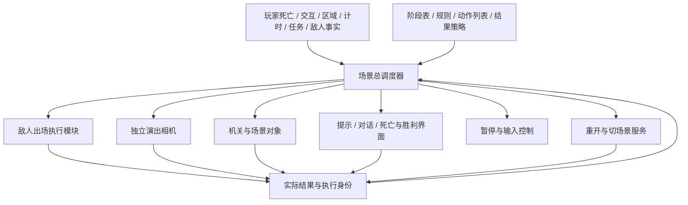
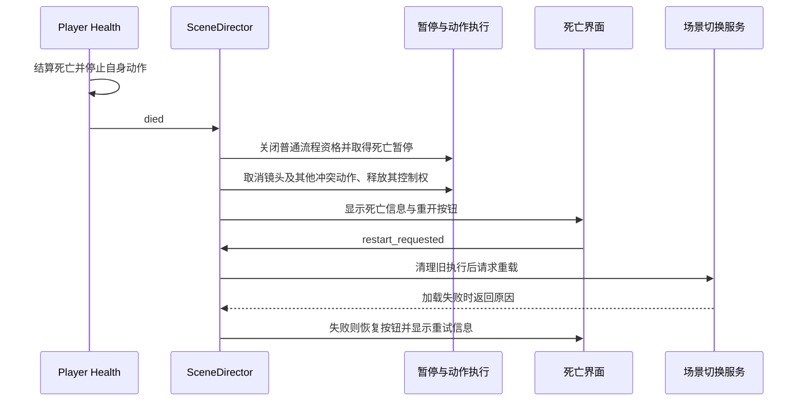
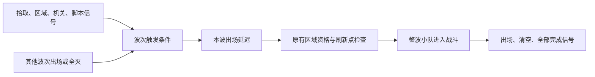

# 场景总调度器设计：流程、事件、演出与场景生命周期

初始事件波次草案：2026-10-25。场景总调度设计更新：2026-10-28。

状态：**仅设计，尚未实现。本次只更新文档，不修改运行代码。** 具体字段、模块名和默认策略是设计建议，不能当作现有接口使用。当前实现见[项目结构](../../project-layout.md)、[波次说明](../../gameplay/ENEMY_WAVES.md)及[相机说明](../../gameplay/CAMERA.md)。

## 1. 用户要求与设计中心

用户要求将原EnemyWaves节点升级为整个场景的控制与调度入口：根据场景事件安排刷新、暂停、镜头和其他流程。用户进一步明确了两个方向：

- 镜头转移使用独立演出相机，复制玩家相机画面参数后切入、移动、再切回；调度器不持续监控或移动玩家相机。
- 玩家节点在死亡时发出信号；总调度器收到信号后控制死亡信息的显示。玩家节点不再自行决定死亡界面与整场后续流程。

**设计主体是场景运行过程：现在处于什么阶段、哪些事件有意义、下一步执行什么、多个请求如何协调、何时成功或失败、如何退出和重新开始。** 敌人出场、镜头展示、机关、提示和结果界面都是可调用能力。

总调度器应在没有任何Wave、没有敌人、玩家尚未进入战斗区时正常工作。一个“开场提示→机关解谜→镜头展示→到达出口→完成”的场景必须能直接配置出来，不需要伪造波次或打开特殊的无敌人模式。

本次依据用户纠正，重写正文的职责与配置模型。原事件波次方案保留在附录A，作为敌人执行模块的专项设计；其中的波次启动、区域复位、全部波清空规则仅约束波次模块，不能决定整个场景的生命周期。原有有效的部署、占位、资源隔离和测试约束继续保留。

## 2. 总调度器拥有的状态与职责

概念名称建议为 `SceneDirector`。现有场景的 `EnemyWaves` 路径可作为兼容入口保留；名称兼容不代表继续让波次状态机作为核心。用户要求的是同一个入口升级，本方案不额外建立一个与它并行争权的总控制器。

| 总调度器负责 | 具体内容 |
| --- | --- |
| 场景生命周期 | 初始化、就绪、启动、运行、收尾、成功／失败、重开与卸载 |
| 流程阶段 | 当前主流程阶段、阶段切换、进入／退出动作、阶段内有效规则 |
| 事件与条件 | 接收业务事实、过滤参数、判断当前条件、避免重复执行 |
| 动作调度 | 顺序与有限并行、等待结果、超时、取消、优先级与互斥 |
| 控制权 | 谁要求暂停、谁限制输入、谁占用镜头、何时可以恢复 |
| 场景结果 | 响应玩家死亡等失败事实；按场景规则判定胜利及处理收尾 |
| 场景恢复 | 重开请求、调用场景切换服务、失败后允许重试，清理旧执行 |
| 诊断 | 当前阶段、等待原因、执行中的动作、占用者和异常 |

总调度器只持有**流程状态**及控制权，不复制玩家生命、敌人数量、物品库存、任务状态、门开关等业务数据。那些数据由业务组件维护，调度器通过信号和公开查询使用。它也不接管每个节点的每帧更新：物理、AI、导航和相机算法仍在各自模块中运行。



### 与现有模块的边界

| 模块 | 业务职责保留 | 与总调度器的关系 |
| --- | --- | --- |
| Player / Health | 生命结算、死亡事实、自身失能、伤害与死亡信号 | 报告死亡；不显示死亡结果、不暂停整场、不重载关卡 |
| 敌人波次执行模块 | 模板、合法出生、成员统计与清理 | 接收指定部署请求，报告已出场／清空／受阻／错误 |
| shooting_range | 区域成员、导航、战斗资格与公共查询 | 提供区域事实，局部复位不等于重置场景总调度器 |
| AI / Squad | 感知、决策、身体执行 | 遵守暂停资格；调度器不下发绕过AI规则的逐帧战术 |
| 玩家相机 | 玩家跟随、武器视野和地面锚点 | 演出交接时由相机组件读取有效画面 |
| 演出相机组件 | 镜头复制、切入、移动、返回、切回 | 执行目标展示请求，报告完成或取消 |
| 门／机关／声音 | 自己的动作、碰撞与表现 | 接收请求、报告实际结果 |
| GameState / Quest / Stage | 各自唯一的业务状态 | 信号输入和业务请求目标；不把任务状态复制进流程表 |
| 结果UI | 文本、按钮、焦点及界面表现 | 按请求显示；按钮只发用户意图，不自行决定场景流程 |
| 场景切换服务 | 实际重载／切换及错误返回 | 接受总调度器请求；不自行宣布胜利或失败 |

当前 `LevelFlow` 同时消费波次完成、显示结果、管理暂停和切关；目标结构要按上表拆清这些职责。关卡路径表、UI场景与节点引用可以保留，由适配层复用；不能仅在新调度器外面再保留第二套自动通关流程。

## 3. 使用者配置的是场景流程

总入口检查器建议优先展示以下分组：**场景启动、模块绑定、主流程阶段、全局事件规则、结果与重开、调试**。波次部署是其中一种模块内容，不能仍占据总调度器的全部配置模型。

| 配置 | 含义 |
| --- | --- |
| 启动策略 | 场景接线就绪后自动启动，或等待显式启动请求；不默认等待进入战斗区 |
| 模块绑定 | 玩家生命来源、区域、敌人执行模块、演出相机、UI和场景切换服务等；按用到的能力校验 |
| 初始阶段与阶段表 | 如开场、探索、解锁、撤离；阶段名称和数量由关卡定义 |
| 全局规则 | 所有运行阶段都可响应的事件，如玩家死亡、警报、用户重开请求 |
| 阶段规则 | 仅在特定阶段有效的事件、条件和动作 |
| 结果策略 | 哪些事实导致失败，哪些目标满足后成功，结果前需完成哪些收尾 |
| 重置策略 | 场景重载或显式局部重置，以及各业务模块负责恢复什么 |

资源只保存配置，场景实例保存连接、执行ID、当前阶段和运行状态。跨节点引用以明确的配置拥有者解析，检查器显示目标；不在共享资源中写入本轮触发结果。

### 阶段和规则

阶段表示一段场景流程，不代表一波敌人。例如“探索”可以没有敌人，“防守”可以包含多个敌人部署和机关，“撤离”可以在敌人仍存活时结束。

一条规则描述：**适用阶段＋事件／条件＋执行动作＋后续转移**。动作可以完成后留在原阶段，也可以请求转到另一个阶段。阶段切换由总调度器统一提交，不能由多个模块各自改当前阶段。

阶段建议支持进入动作、运行规则和退出动作。切换时先停止旧阶段接纳新规则，取消或收尾旧阶段局部动作，再进入新阶段；已经生成的敌人或打开的门不会因阶段切换自动撤销，是否清理由明确动作决定。全局规则继续有效。

阶段可省略：简单场景只用全局规则同样运行。没有敌人模块、没有Wave是合法配置；只有请求了不存在的刷怪能力才报配置错误。

项目已有StageController管理任务业务阶段。场景流程阶段与它的含义必须区分；如果某关明确以任务阶段为权威，则通过适配读取其变化，不再由SceneDirector维护另一份同义阶段。场景局部流程可以独立编排演出与收尾。

### 一个与刷怪无关的完整例子

| 阶段／规则 | 事件或条件 | 调度动作 |
| --- | --- | --- |
| 开场 | 场景就绪 | 显示说明，等待关闭，再进入探索 |
| 探索 | 玩家进入大厅 | 显示“寻找电源”，继续探索 |
| 解锁 | 电源已开启且终端交互成功 | 请求门打开，等待实际打开，调用演出相机展示出口 |
| 撤离 | 出口展示结束 | 更新提示；玩家进入出口后进入成功收尾 |
| 全局失败 | 玩家死亡 | 中断当前流程，暂停，显示死亡界面 |
| 全局重开 | 死亡界面发出重开请求 | 清理并请求重载，失败则显示重试状态 |

这个场景从头到尾不配置敌人，仍完整使用总调度器的启动、条件、动作、阶段、镜头和结束能力。

## 4. 事件、条件与动作执行

### 事件和状态分别处理

信号是已经发生的事实，例如“玩家进入过房间”“交互成功”“玩家死亡”。状态查询回答现在是否成立，例如“电源当前开启”“任务已完成”。两者不能混用：开关开过又关掉，不等于当前仍开启。

普通来源直接绑定实际节点信号，支持参数类型验证和少量结构化过滤，如指定物品ID、玩家组、目标任务。全局业务总线不是必要前提，也不要求每个事件都新写一份调度脚本。

规则应明确事件的记录范围：场景运行期间、当前阶段期间或指定战斗轮次。阶段内事件默认只在阶段激活后累计；需要提前发生仍有效的条件，显式选择场景范围记录或可查询状态。绑定前已经发生的脉冲不能凭空补回；初始化时先连接再查询支持的当前状态。

建议首期支持平铺的全部／任一条件、事件锁存和公开状态查询。事件满足后按所属范围记住；状态条件在动作开始前复核，执行前变假则重新等待并重置该规则的启动延迟。动作已经开始后不自动回滚，需明确的取消条件。复杂表达式和任意代码字符串后置。

### 动作协议

调度器向执行模块发出带场景代次、阶段／局部轮次和执行ID的请求。模块返回进行中、成功、失败或取消，调度器据此推进。等待信号必须先订阅再请求，并能处理同步完成；无执行身份的目标只允许互斥请求，防止旧反馈认错动作。

| 动作能力 | 真实完成依据 |
| --- | --- |
| 提示／说明／对话 | 请求已显示或用户已关闭，按动作定义；关闭不等于任务成功 |
| 场景对象操作 | 门、终端、灯光等模块报告完成 |
| 目标与业务状态更新 | 权威组件接受请求／报告变化，不直接改其私有数据 |
| 时间与事件等待 | 所属有效时钟或指定身份事件满足 |
| 展示目标 | 演出相机完成切入、展示、切回与清理 |
| 敌人部署 | 原执行器完成合法生成；另可等待指定部署清空 |
| 阶段转移／结束场景 | 调度器完成阶段或终态事务 |
| 结果显示／重开／切关 | UI或切场景服务返回对应结果 |

首期支持动作顺序执行，以及一层明确的并行组：例如同时播放警报、显示提示，再等待必要成员完成。并行组默认全部成功才完成；必要成员失败则取消仍在运行的同组动作，已产生的业务效果不自动回滚。装饰性成员可配置失败后继续。无需先搭建任意嵌套图编辑器。

每个有效推进步限制动作启动数；信号回调只记录结果，普通后续动作在统一调度边界执行，避免零延迟事件递归。死亡等终止控制事件可立即关闭执行资格，清理在安全边界完成。

规则默认在其作用域内执行一次，重复信号不重启执行；有重复需求时显式设置冷却和重入策略，首期不提供无限并发。一个动作等待门或刷新点时，不阻塞其他独立规则。

## 5. 冲突、暂停与控制权

调度器管理“哪些活动允许继续”，具体冻结仍由各执行入口遵守。镜头、模态UI、输入限制按资源申请令牌；只有拥有者能释放自己的占用。优先级决定下一项启动顺序，普通高优先级请求不擅自抢断已运行演出；死亡、重载和卸载属于终止控制，可取消冲突动作。

| 时间／活动 | 运行资格 |
| --- | --- |
| 场景流程时间 | 场景已启动，未被暂停或终态阻断；不依赖玩家是否进入战斗区 |
| 区域战斗时间 | 满足所属区域资格，且没有模拟暂停；只推进原战斗模块 |
| 演出时间 | 当前演出持有许可，没有菜单等外部阻断；可在战斗冻结时继续 |
| 生命周期控制 | 死亡、取消、重开、错误反馈和清理不能被普通流程暂停挡住 |

同一动作只由一个时钟推进。区域时钟不能驱动场景主流程，也不能与场景调度重复调用同一动作。菜单暂停时普通流程与镜头均暂停；增援展示时普通模拟停止而当前镜头继续。

冻结范围包括玩家操作、敌人身体与AI、协同、战斗倒计时、换弹／治疗／受击持续时间等，不能只停波次。暂停期间已收到事件保留，但来源未运行就不会凭空产生新事件。不能短暂恢复战斗只为让相机或UI动一下。

现有PlayGuide、LevelFlow与Player Health都有直接写树暂停的逻辑；目标结构应把暂停申请统一交给协调入口，不保留“保存旧布尔值，再盲目还原”的并行写入者。死亡时先持有死亡暂停，再释放镜头暂停，避免清理演出的一瞬间恢复战斗。

输入与焦点也按所有者交接；演出结束清理积攒的动作边沿，防止误开火。每个执行的释放可重复调用，失败、跳过、取消和卸载都走同一清理路径；共享配置不存令牌。

## 6. 玩家死亡、结果显示与重开

本节体现用户明确要求：**死亡事实由玩家报告，死亡后的场景响应由总调度器决定。**

### 玩家负责什么

Health结算生命归零，设置自身死亡状态，停止自身移动／攻击等不应继续的行为，并发送一次 `died`。健康值、伤害和自身失能仍归玩家模块，不能等总调度器稍后收到信号才阻止死人开火。

目标结构下，Health不再调用死亡界面show，不设置整棵场景树暂停，不处理重开按钮，不自行reload_current_scene。死亡界面的现有节点路径可为兼容保留，显示逻辑交给独立UI控制组件；不因职责调整擅自移动用户场景节点。

### 总调度器收到死亡后做什么



默认玩家死亡导致场景失败，但死亡响应策略由场景配置：将来可选择复活点、扣除一次机会或展示不同信息，玩家脚本不需要知道这些关卡规则。首期先完成“失败→死亡界面→重开”。

处理死亡时，先立刻阻止新的普通动作和胜利提交，再在安全时机取消流程、处理相机交接和显示界面。UI不能等某个已经被冻结的普通动作结束才出现。重复死亡信号及重复按钮点击均去重，结果每轮只提交一次。

### UI和切场景的边界

死亡／胜利UI只显示传入内容，并发出重开、下一关或返回菜单请求。总调度器检查当前结果状态、是否已在切换，以及请求是否允许，再调用切换服务。UI按钮不直接reload或change_scene，切换服务不反过来判定胜负。

同一结算步死亡与成功同时发生时默认死亡优先；成功候选延后到统一结果提交点复核。终态提交后屏蔽普通玩法事件，仍接受允许的结果界面请求和清理回调。

重载成功后旧调度器可能已销毁，不等待它继续处理成功回调；新场景按自己的初始化流程启动。旧场景的暂停令牌、信号和镜头引用必须释放，不能把“重载成功后paused=false”无条件写到新场景，覆盖新场景的开场暂停。重载失败则保持死亡状态和暂停，恢复按钮并明确报错，允许重试。

## 7. 场景完成、阶段结束与局部战斗结束

这三个结果各有范围：阶段结束只转移流程；某组敌人清空只报告战斗事实；场景完成由场景目标和必须收尾决定。没有敌人也能成功，敌人全部清空也不自动意味着整关结束。

建议总调度器提供独立场景结果，如 `scene_completed`、`scene_failed(reason)`；现有 `wave_started`、`wave_cleared`、`encounter_completed` 保留在波次兼容接口，语义不变。旧关卡“所有波次清空就通关”被表达为一条场景成功规则，结果仍经过总调度器。

完成策略示例：抵达出口、激活全部终端、保护对象到计时结束、完成任务，或清空指定部署。任务结果仍由任务系统提供。护送对象死亡、玩家死亡、时间耗尽等通过全局失败规则进入相同结果处理。

可选伏兵、互斥路线和仍有敌人的撤离是流程分支问题，不通过偷偷跳过wave来解决。阶段退出或场景结束明确取消不再需要的未执行请求；已存在敌人是保留、等待清空还是随场景卸载，由该场景的结束策略决定。取消不伪装成清空成功。

胜利收尾可以包含镜头、开门、结算提示等，必须动作完成后再显示最终结果；死亡可中断普通胜利候选与尚未提交的收尾。已提交终态不再被旧回调改写。切关仍由用户按钮或显式配置请求，不暗中自动跳关。

## 8. 独立演出相机：复制画面、切入、移动、切回

采用用户本轮提出的方向：保留玩家跟随相机，另设一台专用Camera3D负责视野转移。EnemyWaves只请求“展示目标”，无需持续监控、移动或改写玩家相机。演出相机控制组件掌握两台相机引用，负责画面复制、当前相机切换、平滑移动和结果回报。

建议场景中增加独立可复用的演出相机组件，与现有玩家相机同级，初始不激活；保持现有部署子树兼容，不放进EnemyWaves的Wave直接子层，也不挪动原相机及其Phantom子节点。新增组件沿systems相机职责组织，具体命名暂定：

```text
战斗场景
├─ Camera3D                  原玩家相机场景，保留原路径
│  ├─ PhantomCameraHost
│  ├─ CameraGroundAnchor
│  └─ PhantomCamera3D
├─ PresentationCamera        新Camera3D及演出控制脚本，默认非当前
└─ EnemyWaves                场景总调度入口，演出只是可调用能力之一
```

这是同一Viewport中的两台实际Camera3D；同一时刻只有一台负责显示。演出相机不需要复制另一套Phantom跟随链，也不绑定武器变化来常驻跟踪玩家；只由自己的演出控制逻辑写入。若无演出组件，展示动作诊断并降级，旧场景照常使用原相机。

### 切入与返回顺序

1. 取得相机使用权并确认预期的玩家相机仍是当前画面来源；其他演出或对话占用时排队，不从别人的镜头强行切走。暂停及互斥规则按第5节执行。
2. 在同一次交接中，将玩家相机**当前实际显示的画面状态**复制到演出相机，再把演出相机设为当前。复制后与源画面重合才开始移动，不能先切到新相机的默认位置。
3. 演出相机平滑移向刷新点，保留复制来的俯视角和投影方式作为默认；可按预设调整视野与停留时间。目标点表示地面焦点，需加上相机观察偏移，不能把Camera3D本体直接放到敌人脚下。玩家相机不参与这段移动。
4. 展示结束时，由相机组件向玩家相机侧取得当前有效返回画面，包括正常跟随位置与视野。推荐演出相机先平滑回到该画面，最终对齐后再切回；也可以后显式提供直接切回选项，默认不在敌人视角瞬间跳回玩家。
5. 切回完成后，演出相机恢复非当前状态，清理本次Tween、提示和临时引用，返回完成结果，再由演出执行器释放暂停与输入限制。避免玩家已经能操作但画面还在返回途中。

只在开始、返回及必要的交接复核时读取玩家相机；EnemyWaves不保存相机位置／Size的镜像状态。返回途中若窗口、玩家位置或正常视野发生变化，由相机组件更新返回目标并在切换前复核，不把持续追踪责任放回场景调度器。

### “相同参数”需要复制哪些内容

| 画面状态 | 复制目的与约束 |
| --- | --- |
| 世界位置、朝向及可见相机偏移 | 两台相机切换时构图重合；包括跟随／插值后实际显示的状态，不只复制编辑器保存transform |
| 投影类型、Size／FOV、宽高保持方式、投影偏移 | 当前工程是正交俯视，Size尤其重要；复制当前值，不直接拿武器目标值替代未完成的视野过渡 |
| Near／Far、Cull Mask等裁剪参数 | 避免切换后物体突然出现或消失 |
| 相机使用的Environment、Attributes及适用的后处理覆盖 | 避免曝光、景深或颜色突变；沿用相同有效配置，不修改共享资源；演出要改资源内容时用独立副本 |

复制的是画面状态，不是整个节点树、脚本、信号连接、玩家跟随绑定或运行计时；不复制current状态代替明确切换。实际涉及的参数需结合当前引擎与渲染器验证，尤其是物理插值、相机offset及后处理历史；参数相同只是必要条件，切换无跳变仍须画面验收。

### 玩家相机在后台与暂停中的行为

本地PhantomCameraHost的常规跟随更新没有以其父Camera3D的current为退出条件，因此单纯切走显示源并不等于停止原跟随。它仍只写玩家相机，演出组件只写演出相机，两者不争同一个transform。这里仅是源码核对，尚未执行双相机运行验证。

树暂停是另一件事：不能因为玩家相机非当前仍能更新，就假定暂停期间锚点、Host和武器视野过渡也会推进。首期冻结战斗时玩家通常不动；如果外部脚本移动玩家、改变装备或窗口尺寸，则由相机侧的有限同步入口在返回前更新正常画面，或允许必要的纯相机链在演出时钟下更新。两者需在实施阶段选定并验证，不能短暂恢复整场战斗只为刷新相机，也不能在EnemyWaves里重写玩家跟随算法。

玩家相机保留自己的目标、地面锚点和武器配置，切回时不把演出前的旧参数覆盖回它。源相机失效或场景已卸载时取消展示并释放；若其他更高优先级拥有者已接管显示，旧演出结束不能强行make_current抢回画面。

### 遮挡、UI与取消

现有player_camera在非当前时会清理其遮挡透明辅助；需要显式交接这个表现职责。建议相机组件让遮挡辅助跟随当前显示相机工作，切入时交接到演出目标、切回时交接回玩家；同一网格同一时刻只有一个材质效果拥有者。不能让两个独立辅助同时保存／恢复同一网格材质，也不能直接复制运行中的透明材质缓存。具体可复用现有辅助实现，不扩大透明对象范围，不修改碰撞；暂停期间仍须允许必要的清理执行。

镜头移动会改变屏内／屏外判断、准星和血条投影，展示期间继续冻结战斗并隐藏战斗准星；其他读取相机的表现需要使用当前显示相机，硬编码玩家相机的调用者需逐项核对。镜头看到敌人不构成AI感知证据。

跳过只结束本次镜头和提示，仍须完成切回、清理和释放；不撤销已刷敌人、不跳过必须发生的机关或目标更新。普通取消且玩家相机仍有效时安全切回；卸载无需播放返回动画。任一交接失败走同一幂等清理出口，不留下当前相机错误、永久暂停或输入锁。

## 9. 敌人刷新作为一个执行模块接入

这里才处理原波次需求。敌人模块维护部署、导航、占位、实例、死亡统计、清理与局部轮次；总调度器只使用请求和结果，不维护第二份存活列表。

一个场景规则可以是：“警报发生→请求某组敌人出场→展示出生点→继续当前阶段”；另一个规则可以是：“清空守卫且终端解锁→开门”。不存在只能按波次编号推进整个场景的前提。

新场景的触发和动作编排集中放在场景规则中，Wave主要描述部署。原顺序字段和Wave触发快捷配置保留为兼容预设，转换到同一请求通路；同一部署不能同时被快捷配置和主流程无约束地驱动。现有玩家未入区、导航、完整身体占位等生成守卫不因总调度请求而失效。

### 增援展示的事务边界

规则的展示配置归动作编排，不写成敌人模块内部的相机逻辑。调度器可为“业务动作成功后立即展示”准备通用演出上下文：执行模块在成功提交、尚未对外发布完成事件及推进新实例行为的边界通知它，建立演出屏障，再交给独立演出相机。此能力也可用于机关揭示，不限定敌人。

出生受阻时继续原等待和重试，不提前锁住玩家看空位置。整波提交成功后、敌人第一次行为推进前，屏障须已生效；不能等下一帧执行独立镜头动作才暂停。必要时在实例入树前做短暂提交隔离，失败立即释放。区域回调在出场调用返回后也复查屏障，避免同一次回调继续推进协同。

显示失败可降级为文字提示，已经生成的敌人保留，不重刷；必需的业务生成失败不能伪装成成功。多个出场请求保留每个有效物理步最多提交一波的限制；一个位置受阻不阻塞其他独立请求。

原模板捕获、Existing Squads、资源共享隔离、出生搜索与合法感知约束继续沿附录A及[敌人AI说明](../../enemy-ai.md)。镜头看到敌人或显示提示不授予AI额外目击、攻击许可或隐藏玩家坐标。

## 10. 生命周期与重置

总调度器建议使用 `initializing / ready / running / finishing / succeeded / failed / restarting / exiting`。暂停记录为资格与持有者，不抹掉主流程阶段和动作进度；敌人模块状态不能替代这套场景状态。

初始化顺序为：解析模块与配置→建立事件订阅→查询支持的当前状态→就绪→按启动策略开始。只有使用了敌人能力，才要求该模块完成模板准备；纯机关／提示场景不依赖Wave或CombatZone。

运行身份分为场景代次、阶段执行身份，以及执行模块自己的局部轮次。离开战斗区只复位该区域战斗与相关请求，不清空场景阶段、全局事件和已经完成的场景动作。等待旧局部轮次的动作返回取消，不能自动消费下一轮同名事件。

退出阶段取消阶段局部执行；场景失败取消普通流程，但保留结果界面与重开控制；整个场景重置／卸载才停止全部订阅和执行。处理时先作废身份、阻止新请求，再取消动作、清理实例和释放控制权，晚到回调无效。

不把取消理解为倒放所有业务动作。已打开的门、已发奖励、持久GameState数据由各业务模块的明确重置策略管理；场景重开不能擅自清空持久物品或旗标。首期不提供通用回滚和流程中途存档。

## 11. 实现组织与兼容接入

建议内部独立职责为：场景流程运行器、事件／条件适配器、动作执行注册表、暂停与控制权协调器、场景结果与切换适配。敌人生成与相机都是执行模块，不作为调度核心的基类或必须依赖。

可保留现有 `EnemyWaves` 节点路径及脚本UID作为兼容外壳，在内部装配通用SceneDirector核心与原敌人执行模块。新增流程配置使用资源或私有辅助，不擅自移动已有Wave、Squad、Player或相机场景节点；第一关Existing Squads对原外部Squad的引用继续有效。未来是否把编辑器名称改为SceneDirector单独处理，不将改名当作总调度改造的完成标准。

现有“EnemyWaves下必须有Wave”的校验只属于旧波次配置，不能放进通用SceneDirector核心。旧场景默认保持原配置解释；新场景流程配置无需任何Wave便能通过。需要一次明确的场景接入切换，切换后同一业务响应只允许一个权威执行者。

接入完整场景时同步完成以下接线：Health死亡→调度器→死亡UI；敌人完成→场景结果规则→结果UI；UI重开／下一关请求→调度器→切换服务。旧Health、LevelFlow、PlayGuide的直接暂停、结果显示或切关入口按其新职责移交，不能在调度器中再做一遍而留下原自动逻辑。

未迁移的独立演示场景可以暂时沿用旧接线，但目标场景禁止两套接线同时启用。迁移选择必须显式、可诊断；目标模式缺死亡UI或切换服务时报告配置错误，不静默退回由Health操纵整个场景。

## 12. 其他值得支持的场景能力

| 能力 | 用途与边界 |
| --- | --- |
| 场景目标与指引 | 阶段进入时显示目标，业务事实达成后更新；不复制已有任务系统 |
| 环境与交互资格 | 开门、锁门、灯光、警报、终端启用等，通过对象公开接口 |
| 分支与节奏 | 警报路线／静默路线、休整、补给窗口、撤离窗口 |
| 对话与演出组合 | 等待对话关闭、展示目标、再交回操作；对话结束不等于任务成功 |
| 失败原因与不同结果 | 玩家死亡、保护目标损坏、超时；复用结果流程但显示不同原因 |
| 调试与预览 | 显示阶段、条件、动作和控制权；以后可做安全的单流程预览 |

首期必须具备基本阶段、全局死亡规则、事件／状态条件、动作等待与取消、专用相机、结果UI和重开通路。复杂分支编辑器、无限循环、跨场景事件总线、运行中存档恢复、检查点复活与自动难度调节属于后续建议，不作为用户已确认需求。

## 13. 验证与实施顺序

**先证明通用场景调度成立，再接回敌人模块。** 不再以“先把事件刷怪做完整”作为整个改造的第一项成果。

| 阶段 | 独立验收结果 |
| --- | --- |
| A 通用流程核心 | 不创建任何Wave，运行阶段、事件／状态条件、顺序及有限并行动作、等待与取消；场景可独立启动和结束 |
| B 场景生命周期接管 | 玩家死亡→调度器→死亡信息→重开；胜利与切关也经总调度，暂停所有权完整移交 |
| C 表现与对象能力 | 专用演出相机、提示、一个真实机关，完成第3节的无敌人示例 |
| D 敌人能力接入 | 原波次通过请求／结果接入同一个流程核心，增援展示、旧关卡兼容及区域局部重置通过 |

每阶段同步相应现行说明并验证，当前文档不表示已经实现或测试通过。保留原路径与资源不等于保留旧职责；验收必须同时检查调用方向和实际行为。

必要验收：

- 无Wave、无敌人模块的场景能完整运行；主流程不依赖has_active_player，不依赖波次完成信号。
- 玩家死亡只结算自身并发信号；调用追踪证明暂停、死亡UI与重载请求来自总调度流程，Health没有隐藏的直接显示／重载通路。
- 死亡发生在机关等待、镜头移出／停留／返回、菜单暂停或胜利收尾时，均正确中断；死亡UI不被普通流程暂停阻塞。
- 同帧死亡和成功候选以死亡优先；死亡通知和重开按钮重复触发不重复执行；重载失败保持死亡界面并可重试。
- 场景切换后新场景入场暂停不被旧令牌释放或旧回调解除，原相机与材质引用无泄漏。
- 事件早到、阶段切换、状态条件变假、异步同步完成、超时和取消均遵守身份与作用域，旧阶段回调不能推进新阶段。
- 并行组必要动作失败取消同组未结束动作；等待一个对象不堵住无关规则；独占镜头不被两个流程同时持有。
- 专用相机切入前画面匹配，返回先对齐再切回；原玩家相机目标不变，暂停中参数变化可正确交接，遮挡材质不会由两套辅助争写。
- 旧波次部署、合法出生、清空、资源隔离、出生搜索与原五关行为回归；区域离场只取消局部战斗，不重新播放场景开场或重置撤离阶段。
- 清空全部敌人不会绕过未完成的场景目标；无敌人场景可成功；允许留敌撤离的场景按显式规则结束。

运行验证选择[敌人测试](../../enemy-tests.md)和[项目测试说明](../../testing.md)中的相关专项；保留enemy_wave_test、enemy_wave_search_test、level_flow_test、player_camera_test、player_scene_reuse_test、camera_occlusion_test及涉及的交互／生命专项。新调度核心增加对应行为与结构验证，不能仅复用旧波次测试宣称通过。真实UI点击、镜头交接和完整场景流程需画面验收。

诊断快照至少显示场景代次、当前阶段、未满足条件、动作ID与目标、所用时钟、排队原因、暂停／相机持有者、结果状态和最近错误。非法信号、缺模块、重复ID、无入口的必需依赖环在接线时报告；运行失败不伪装成动作完成。

## 14. 本次交付范围

本次仅重写设计文档。已依据本地README、项目结构、敌人／相机／交互／任务说明，以及波次、区域、Player Health、LevelFlow、PlayGuide、DialogueUI和相机相关代码核对职责与接线。

总场景调度、独立演出相机、玩家死亡由调度器控制显示，是用户明确提出的方向。阶段资源形式、动作协议、暂停令牌、默认失败优先和分期顺序是配套设计建议。没有修改运行代码、场景或资源，没有运行Godot，不将文档检查视为新功能验收。

## 附录A：原事件波次专项设计

以下保留原草案的具体内容，作为敌人执行模块的设计依据。标题编号改为A.1～A.10；文中的“首步”“完成”“重置”和“控制器”均限于原事件波次子系统。新场景的总入口、通用条件、无Wave运行、场景生命周期与结果权限以正文为准；波次快捷配置须按第9节经统一请求通路接入，不能重新成为场景核心。

### A.1. 用户想解决的问题

波次不应只受相邻上一波影响。场景中的拾取、到达地点、机关动作，以及其他脚本发出的事件，都应能触发对应的一波敌人。

核心使用方式是：**在波次节点上配置监听什么事件，事件满足后由波次系统释放已经摆好的敌人。** 常见接线应在检查器里完成，不为每一个事件单独写一份刷怪脚本。

“上一波死亡后生成”“上一波出现几秒后生成”也属于这一大类：它们是预设好的触发来源与延迟组合，而不是与场景事件并列的另一套生成系统。

这不是专门的剧情系统。剧情将来可以接入，但拾取物、区域、机关、计时器和普通玩法脚本同样是事件来源。当前最重要的约束仍是易上手、保留已有场景部署方式。

### A.2. 建议的整体模型

每个 Wave 保留两部分：

| 部分 | 管什么 |
| --- | --- |
| 小队与敌人部署 | 这一波放哪些敌人、放在哪里；沿用现有 Squad、兵种和检查器配置 |
| 出场触发配置 | 监听哪个来源、什么事件、是否过滤参数，以及满足后等几秒 |

关系可以理解为：



事件回调只记录条件变化，不在信号回调里直接实例化敌人。实际倒计时、占位检查、生成、死亡统计和清理仍由区域时钟与波次控制器统一负责。

#### 方案比较

| 方案 | 优点 | 问题 |
| --- | --- | --- |
| **通用信号监听 + 常用触发预设，推荐** | 普通事件通过检查器接线；已有顺序出场可以作为预设保留；新玩法发业务信号即可复用 | 需要集中做好参数过滤、重复事件与生命周期管理 |
| 每类事件增加一个专用刷怪脚本 | 最初单个案例容易实现 | 每添一种事件都要接生成逻辑，违背本次需求，也容易出现重复生成和清理遗漏 |
| 全局事件总线 + 通用规则图 | 能描述复杂跨场景条件 | 当前缺少必要性；会增加事件命名、全局作用域、可视化工具与调试成本 |

推荐先使用**指定来源节点的实际信号**，不要求所有现有系统改成全局广播，也不在波次脚本中硬编码物品名、任务名或具体机关。

### A.3. 检查器如何配置

建议保留普通配置和自定义配置两个入口，字段名称暂定。

#### 普通入口：沿用现在的操作

“出场方式”默认选择 **按排列顺序**。

- `Wait For Previous Clear`：继续决定等待相邻上一波全灭，还是从它出场时开始计时。
- `Start Delay Seconds`：继续表示上述条件成立后等待几秒。
- 第一波从本轮开始计时。

内部可以把这些操作转换为“上一波清空事件／上一波出场事件 + 延迟”。没有配置自定义触发的旧场景，其行为保持一致；不能仅因为新增字段就让后续波开局出现。

#### 自定义入口：本波监听指定事件

“出场方式”选择 **事件触发**，再添加触发项。普通情况只需要一项：

| 配置 | 用法 |
| --- | --- |
| 触发类型 | 常用预设，或“来源节点的信号” |
| 来源节点 | 从场景树拖入拾取物、区域、机关、计时器或其他波次 |
| 信号 | 通用模式指定来源已有的信号名；常用预设自动选定 |
| 参数筛选 | 无参信号通常不需要；有参信号可限定物品ID、玩家、目标状态等 |
| 条件组合 | 单项无需关注；多项可选择“任一满足”或“全部满足” |
| 出场延迟 | 复用 `Start Delay Seconds`，触发成立后再等多少秒 |

触发配置建议用 Wave 的资源属性保存，不把触发器作为新的子节点塞进 Wave。当前 Wave 的直接子节点只允许 Squad，EnemyWaves 的直接子节点只允许 Wave；保留这种容易理解的部署树。

通用信号名需要合法性检查和清楚的错误提示。动态信号下拉列表可以作为后续易用性改进；首步优先用常用预设减少手填，不为这份草案承诺一个新的可视化编辑器。

#### 配置例子

以下都是未来用法，当前检查器尚无这些字段。

| 想要的效果 | 配置思路 |
| --- | --- |
| 捡到指定钥匙后出现伏兵 | 监听物品来源的拾取信号；若监听 GameState，则筛选 `item_gained` 的物品ID |
| 玩家进入走廊后刷一队敌人 | 来源选走廊 Area3D，监听 `body_entered`，预设自动限定玩家 |
| 门完全打开后出敌人 | 监听门自身的“打开完成”信号；具体信号须由门的脚本提供 |
| 一个 Timer 到时刷敌人 | 来源选该 Timer，监听 `timeout`；额外出场延迟可设0 |
| 第二波全灭后3秒刷第三波 | 普通顺序入口；或明确指定第二波的清空事件，再设延迟3秒 |
| 第一波全灭且玩家进入大厅后出增援 | 两个触发项，组合为“全部满足” |
| 按下警报按钮或进入禁区，任一发生就出增援 | 两个触发项，组合为“任一满足” |
| 将来某个新玩法满足条件后刷怪 | 新玩法发自己的业务信号，Wave 配置监听；不另写敌人生成逻辑 |

### A.4. 与现有波次顺序的关系

**按排列顺序**模式继续看 EnemyWaves 下同一层 Wave 从上到下的顺序，名字不决定编号。

**事件触发**模式按自己的配置等待，不暗中附加“前面所有波都必须出场”的条件。例如拾取事件绑定 Wave3，即使 Wave2 还未触发，Wave3 也可以出场。否则它仍会被前一波卡住，无法表达独立伏兵。

两种模式可以混用：

```text
EnemyWaves
├─ Wave1   按排列顺序：入区后出场
├─ Wave2   事件触发：捡到钥匙
├─ Wave3   事件触发：玩家进入大厅
└─ Wave4   按排列顺序：等待相邻 Wave3 全灭，再等2秒
```

上例 Wave4 默认依赖 Wave3，不会自动等待 Wave2。若需要“Wave2、Wave3 都全灭”，应明确配置两个清空触发项并选择“全部满足”。

因此控制器需要从单个“下一波指针”扩展为**每波自己的等待、倒计时和占位状态**。一个已触发波次被堵住时，不应堵住其他独立且已满足条件的波次。多个波次同帧就绪时，建议按树顺序检查，临时受阻则继续看其他候选，**每个有效物理步最多提交一波**；提交前仍复查真实占位。生成过程中新发出的信号留到下一次推进处理，避免0秒触发链递归刷出，也不依赖同一帧刚加入的身体已经进入所有物理查询。

运行时显示的波次编号仍可按初始树序分配，但显式依赖应引用具体 Wave 节点，不用易变的数字3或节点名字符串代表目标。普通模式的“上一波”随树序改变；显式引用的某一波不会因为重新排序就变成另一个目标。

### A.5. 事件语义：避免漏触发与重复刷怪

建议首步统一采用**本轮发生过**的触发语义，每个触发项满足后记住结果。

| 情况 | 建议行为 |
| --- | --- |
| 同一事件反复发出 | 只把条件记为满足；本轮该波最多生成一次，不重新计时 |
| “全部满足”的两个事件先后发生 | 分别记住，最后一项满足时开始出场倒计时；不要求同帧发生 |
| 条件满足时正在对话或暂停 | 保留已收到的触发，正常运行后再推进计时／生成 |
| 事件发生后，刷新点暂时被占用 | 保持该波待生成，按原重试规则等待，不丢事件 |
| 多波监听同一来源信号 | 各自满足自己的条件，不把事件只消费给其中一波 |
| 玩家尚未进入战斗区，但监听已经建立 | 可以记住事件；仍需区域运行资格满足后才实际生成 |
| 信号早于监听建立 | 普通信号不能补回历史；需选择可查询状态的来源，或在接线就绪后发出事件 |

“本轮拾取过钥匙”和“现在持有钥匙”不是同一条件；“曾进入大厅”和“现在仍在大厅”也不同。首步预设应明确使用“拾取事件”“进入事件”的名称，不把它们伪装成持续状态判断。

对于确实需要兼容提前完成的状态，后续可增加“持有物品”“旗标为真”等状态型条件：先接变化通知，再查询当前值，并在生成前复核。状态型条件的撤销和倒计时重置规则应单独定稿，不能默默与一次性事件混用。

#### 有参数的信号必须能筛选

通用监听应支持无参信号及项目实际使用的有参信号；只支持无参会迫使用户继续为每个已有事件写转发脚本。

建议先提供少量结构化筛选：指定参数等于配置值、节点参数属于某组；多个筛选同时满足才算收到有效事件。常用预设负责隐藏参数下标等细节，例如：

- `GameState.item_gained(item_id, display_name, total)`：按 `item_id` 过滤，其他物品不能误触发。
- `Area3D.body_entered(body)`：限定 `body` 属于玩家组，敌人或道具进入不能触发玩家伏击。
- `flag_changed(flag, value)`：按旗标名和目标布尔值过滤，false不能当作开启。
- `quest_changed(quest_id, previous, current)`：同时限定任务ID和目标状态。

首步不做自由表达式、任意代码字符串、复杂字典路径或嵌套逻辑图。实施时必须依据来源实际信号定义验证参数数量、下标、类型及回调签名，不能把不兼容的信号直接接到同一个固定参数回调。

### A.6. 现有接口可以如何接入

已核对的来源如下。这些脚本已经存在，但**通用波次监听尚未实现**。

| 现有来源 | 已有接口 | 设计意义 |
| --- | --- | --- |
| `scripts/systems/game_state.gd` | `item_gained`、`flag_changed`、`value_changed`；物品／旗标查询 | 可监听拾取和状态变化；不复制它的物品或旗标数据 |
| `scripts/world/interactable.gd` | `interacted(interactable, player)` | 可监听成功交互，不把 blocked 当成功 |
| 场景中的 Area3D | `body_entered`／`body_exited` | 地点触发，必须过滤对象；优先复用已有区域 |
| 场景中的 Timer 或普通脚本 | 其已有信号 | 通过通用来源配置接入，不要求业务脚本认识波次内部实现 |
| `scripts/systems/stage/quest_controller.gd` | `quest_changed`、`status_of` | 以后可加任务条件，但任务状态仍由原控制器维护 |
| `scripts/systems/stage/stage_controller.gd` | `stage_changed`、`phase_changed` | 以后可监听阶段变化，不在波次内重做阶段系统 |
| `scripts/ui/dialogue_ui.gd` | `dialogue_started(source)`／`dialogue_ended(source)` | 可监听界面事件；结束也可能来自关闭或来源离场，不能等同剧情成功 |
| `scripts/world/enemy_wave_controller.gd` | `wave_started(index)`、`wave_cleared(index)`、`encounter_completed()` | 保留现有出口，供其他玩法响应战斗结果 |

建议给持续存在的 Wave 配置节点增加自己的 `spawned`／`cleared` 信号（名字暂定），由控制器在真实生成／退树完成时统一发出。这样另一个 Wave 可以直接拖入这个节点作为来源，不必用控制器总信号中的数字筛选。现有控制器的三个信号保留兼容。

不能把尚未出场的 Enemy 模板当作长期事件来源：模板在捕获时会移出并释放，运行副本也会变化。需要等待某组敌人死亡时使用该 Wave 的清空事件；特殊单体可先放进独立一波，不依赖某次运行实例的临时路径。

现有 `CallMethodEffect` 可对目标调用无参／布尔参数方法，能辅助启动整场等简单操作，但它不代替本方案的通用监听。现有 `start_encounter()` 只启动整轮，不能描述“拾取后单独放出第三波”。

### A.7. 模块边界与实现约束

建议职责划分，文件名仅作后续拆分参考，本轮不创建运行文件：

| 模块 | 职责 |
| --- | --- |
| `enemy_wave_definition.gd` | 保存出场方式、触发配置、原部署引用和延迟；提供该波生命周期信号 |
| 波次触发配置 Resource | 只保存来源、信号、筛选和组合配置；不保存本轮是否触发、连接句柄等运行数据 |
| 波次事件订阅辅助脚本 | 解析来源、验证并连接信号、过滤事件、解除连接；没有自己的生成循环 |
| `enemy_wave_controller.gd` | 按波保存触发结果与状态，使用区域时钟推进，统一生成／计数／清理 |
| 既有场景事件脚本 | 继续发自己的业务信号，不复制波次生成代码，不接管敌人生命周期 |

来源路径建议相对 Wave 配置节点解析，支持从场景树拖入；允许明确指定同一加载场景中的区域外来源，例如 GameState 或任务节点，但不会自动扫描全地图并监听所有同名信号。跨关卡动态来源和全局事件路由暂不纳入首步。

普通配置由控制器编译为和自定义触发相同的内部条件结构，不维持两套互相独立的生成逻辑。复制 Wave 时只复制配置，新一轮触发结果和订阅必须独立；共享 Resource 不能被写入运行状态。

静态配置缺来源、缺信号、参数筛选不合法、必需依赖无法成立时给出明确诊断，不静默当作满足。直接依赖自己的清空、没有外部入口的必需依赖环应拒绝；“任一满足”带独立外部入口时不能仅因存在一条环边就误判。实施中先支持可确定的检查，其他等待情况在诊断中列出具体未满足项。

### A.8. 监听、离场与完成的生命周期

建议把“监听一轮”和“开始实际战斗”区分开：

1. 场景部署捕获后，等所需来源可解析时建立订阅；必需接线就绪前不执行自动生成。
2. 监听就绪后开始记录这一轮事件，包括玩家尚未入区期间收到的事件。开始战斗不再次清空这些记录。
3. 有效区域时钟才推进出场延迟与生成；外部信号不能绕过导航、完整胶囊占位和暂停／死亡／对话守卫。
4. 每波触发只允许从“未触发”进入“待生成”；已生成或已清空的波不能被重复信号再次生成。
5. 离场或 `reset_encounter()` 取消所有待生成项和倒计时，清理全部运行副本，清空本轮触发记录，更新轮次标识，并为下一轮重新准备监听。
6. 回调携带所属轮次标识；断开旧订阅，延迟到达的旧回调无效。场景卸载时释放全部订阅和引用，不留下监听旧关卡的全局连接。

来源节点在触发前消失、来源为运行时动态生成等情况不能静默成功。首步建议要求来源在接线时可用；失效给明确诊断，不新增无限搜索与自动重绑机制。

事件型触发在复位后需要重新发生。如果拾取物已经消失，就不能指望同一个拾取信号再发一次；应由场景自身重置拾取物，或以后选用“当前持有物品”的状态型条件。波次系统不得为重开擅自清空 GameState：目前它的物品和旗标在重载场景后仍可保留，任务控制器则有自己的复位规则。

首步完成规则建议沿用：**所有配置波次都已生成，并且全部全灭后，才发 encounter_completed。** 未触发的事件波仍属于未完成，会显示“等待事件”，不能把“当前没有活敌人”直接当作战斗结束。

这意味着可选伏兵、互斥分支、取消某波后仍算完成，需要另外定义“该波是否必须参与完成”的规则。先记录为后续扩展，不暗中跳过永远没有发生的事件，也不假定本草案已经解决全部分支关卡。

### A.9. 后续实施建议与验收重点

用户目前只要求文档，以下不是已排期或已授权执行的实施任务。

建议第一步形成一个完整的小功能：保留顺序入口，增加通用来源信号、结构化参数筛选、拾取／玩家入区／指定波次清空预设、平铺的任一／全部组合，以及按波独立调度。先不做嵌套条件、可选分支、跨场景总线、存档恢复和新的关卡编辑器。

必要验收集中覆盖：

- 旧关卡的全灭／定时逻辑保持一致；模板隔离、资源语义与原路径仍正确。
- 同一通用监听分别接拾取、区域、无参信号和带参数脚本事件，不新增每事件的刷怪脚本。
- 物品ID、玩家对象、目标状态筛选有效；错误参数有诊断，不误放敌人。
- 独立的后置波可以先出场；某波占位受阻不阻塞另一独立波，同帧就绪不重叠生成。
- 多条件先后满足、重复事件、暂停期间触发、先监听后入区、绑定前事件的边界符合文档。
- 离场后旧回调失效；重入不继承上轮脉冲，来源业务状态不被波次重置。
- 编辑器复制、排序、保存重开保持触发引用和参数；显式波次引用不随编号错误改指。
- 只从真实生成／死亡结果发出波次信号；未触发波不误报完成。

本草案仅完成本地源码与文档核对，没有实现信号适配器或执行新功能验证。实施前需验证本项目 Godot 版本中的有参信号适配、接线时机和资源检查器可用性；不把设计意图当作已经测试通过。

### A.10. 原事件波次阶段延后再定的能力

- 状态型条件，以及条件撤销后倒计时暂停、重置还是保持的问题。
- 可选波次、互斥分支、取消波次、显式结束战斗及其完成信号语义。
- 已发生事件跨关卡保留、存档恢复和动态来源重绑。
- 更复杂的条件嵌套、数量阈值、重复生成或无限增援。
- 需要时再做信号选择器与条件诊断面板，而不是先搭一个新的事件编辑框架。

这些是可能的后续方向，不是用户已经确认必须实现的功能。
