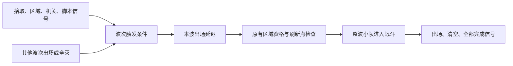
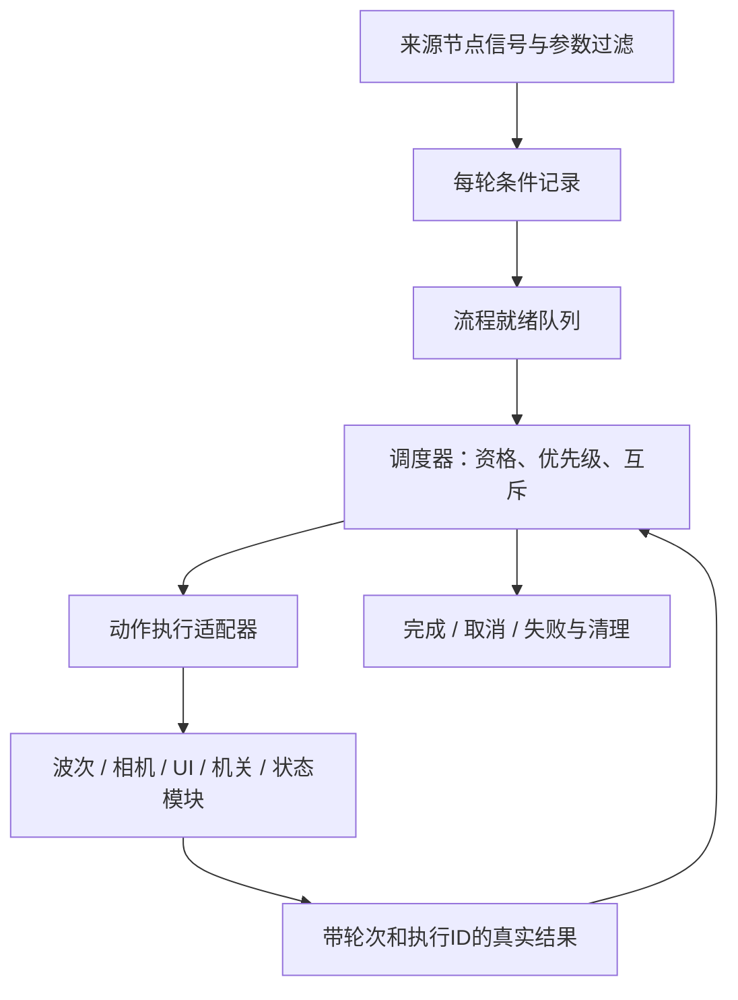

# EnemyWaves 场景总调度：事件、波次与演出设计草案

初稿：2026-10-25。场景总调度扩展：2026-10-28。

状态：**仅设计，尚未实现，暂不进入代码实施。** 用户已明确扩展方向；下文的字段名、组合规则、生命周期与实施范围是建议，供后续讨论。当前实际功能仍以[波次使用说明](../../gameplay/ENEMY_WAVES.md)为准。

## 阅读范围与本次扩展

用户本次明确要求：将战斗场景的 EnemyWaves 从波次刷新控制节点扩展为场景总控制与调度入口；能够监听场景事件控制刷新，并在增援出现时暂停事件、移动镜头提示玩家；补充其他必要能力并更新本文件。本次交付仅为设计文档。用户随后提出专用演出相机方案：开始时复制玩家跟随相机参数并切入，移动到增援位置，最后切回玩家相机；本草案按此方向更新第14.3节，具体平滑返回和异常处理仍为配套建议。

第1～10节保留原事件触发方案，作为波次子能力的设计基础；其中“首步”指事件波次阶段，并非整个场景调度能力已经覆盖。第11～18节补充总调度方案、推荐默认语义、实施阶段与验收。全部新增接口、字段和模块均为建议，尚未实现，用户未逐项确认。

“暂停事件”暂按推荐方案解释为：暂停战斗模拟及普通流程推进，保留已收到的事件，允许当前镜头演出继续，结束后恢复。是否希望演出时敌人仍走入场动画、是否允许跳过，属于可调整的体验选择，不写成用户已确认要求。

## 1. 用户想解决的问题

波次不应只受相邻上一波影响。场景中的拾取、到达地点、机关动作，以及其他脚本发出的事件，都应能触发对应的一波敌人。

核心使用方式是：**在波次节点上配置监听什么事件，事件满足后由波次系统释放已经摆好的敌人。** 常见接线应在检查器里完成，不为每一个事件单独写一份刷怪脚本。

“上一波死亡后生成”“上一波出现几秒后生成”也属于这一大类：它们是预设好的触发来源与延迟组合，而不是与场景事件并列的另一套生成系统。

这不是专门的剧情系统。剧情将来可以接入，但拾取物、区域、机关、计时器和普通玩法脚本同样是事件来源。当前最重要的约束仍是易上手、保留已有场景部署方式。

## 2. 建议的整体模型

每个 Wave 保留两部分：

| 部分 | 管什么 |
| --- | --- |
| 小队与敌人部署 | 这一波放哪些敌人、放在哪里；沿用现有 Squad、兵种和检查器配置 |
| 出场触发配置 | 监听哪个来源、什么事件、是否过滤参数，以及满足后等几秒 |

关系可以理解为：



事件回调只记录条件变化，不在信号回调里直接实例化敌人。实际倒计时、占位检查、生成、死亡统计和清理仍由区域时钟与波次控制器统一负责。

### 方案比较

| 方案 | 优点 | 问题 |
| --- | --- | --- |
| **通用信号监听 + 常用触发预设，推荐** | 普通事件通过检查器接线；已有顺序出场可以作为预设保留；新玩法发业务信号即可复用 | 需要集中做好参数过滤、重复事件与生命周期管理 |
| 每类事件增加一个专用刷怪脚本 | 最初单个案例容易实现 | 每添一种事件都要接生成逻辑，违背本次需求，也容易出现重复生成和清理遗漏 |
| 全局事件总线 + 通用规则图 | 能描述复杂跨场景条件 | 当前缺少必要性；会增加事件命名、全局作用域、可视化工具与调试成本 |

推荐先使用**指定来源节点的实际信号**，不要求所有现有系统改成全局广播，也不在波次脚本中硬编码物品名、任务名或具体机关。

## 3. 检查器如何配置

建议保留普通配置和自定义配置两个入口，字段名称暂定。

### 普通入口：沿用现在的操作

“出场方式”默认选择 **按排列顺序**。

- `Wait For Previous Clear`：继续决定等待相邻上一波全灭，还是从它出场时开始计时。
- `Start Delay Seconds`：继续表示上述条件成立后等待几秒。
- 第一波从本轮开始计时。

内部可以把这些操作转换为“上一波清空事件／上一波出场事件 + 延迟”。没有配置自定义触发的旧场景，其行为保持一致；不能仅因为新增字段就让后续波开局出现。

### 自定义入口：本波监听指定事件

“出场方式”选择 **事件触发**，再添加触发项。普通情况只需要一项：

| 配置 | 用法 |
| --- | --- |
| 触发类型 | 常用预设，或“来源节点的信号” |
| 来源节点 | 从场景树拖入拾取物、区域、机关、计时器或其他波次 |
| 信号 | 通用模式指定来源已有的信号名；常用预设自动选定 |
| 参数筛选 | 无参信号通常不需要；有参信号可限定物品ID、玩家、目标状态等 |
| 条件组合 | 单项无需关注；多项可选择“任一满足”或“全部满足” |
| 出场延迟 | 复用 `Start Delay Seconds`，触发成立后再等多少秒 |

触发配置建议用 Wave 的资源属性保存，不把触发器作为新的子节点塞进 Wave。当前 Wave 的直接子节点只允许 Squad，EnemyWaves 的直接子节点只允许 Wave；保留这种容易理解的部署树。

通用信号名需要合法性检查和清楚的错误提示。动态信号下拉列表可以作为后续易用性改进；首步优先用常用预设减少手填，不为这份草案承诺一个新的可视化编辑器。

### 配置例子

以下都是未来用法，当前检查器尚无这些字段。

| 想要的效果 | 配置思路 |
| --- | --- |
| 捡到指定钥匙后出现伏兵 | 监听物品来源的拾取信号；若监听 GameState，则筛选 `item_gained` 的物品ID |
| 玩家进入走廊后刷一队敌人 | 来源选走廊 Area3D，监听 `body_entered`，预设自动限定玩家 |
| 门完全打开后出敌人 | 监听门自身的“打开完成”信号；具体信号须由门的脚本提供 |
| 一个 Timer 到时刷敌人 | 来源选该 Timer，监听 `timeout`；额外出场延迟可设0 |
| 第二波全灭后3秒刷第三波 | 普通顺序入口；或明确指定第二波的清空事件，再设延迟3秒 |
| 第一波全灭且玩家进入大厅后出增援 | 两个触发项，组合为“全部满足” |
| 按下警报按钮或进入禁区，任一发生就出增援 | 两个触发项，组合为“任一满足” |
| 将来某个新玩法满足条件后刷怪 | 新玩法发自己的业务信号，Wave 配置监听；不另写敌人生成逻辑 |

## 4. 与现有波次顺序的关系

**按排列顺序**模式继续看 EnemyWaves 下同一层 Wave 从上到下的顺序，名字不决定编号。

**事件触发**模式按自己的配置等待，不暗中附加“前面所有波都必须出场”的条件。例如拾取事件绑定 Wave3，即使 Wave2 还未触发，Wave3 也可以出场。否则它仍会被前一波卡住，无法表达独立伏兵。

两种模式可以混用：

```text
EnemyWaves
├─ Wave1   按排列顺序：入区后出场
├─ Wave2   事件触发：捡到钥匙
├─ Wave3   事件触发：玩家进入大厅
└─ Wave4   按排列顺序：等待相邻 Wave3 全灭，再等2秒
```

上例 Wave4 默认依赖 Wave3，不会自动等待 Wave2。若需要“Wave2、Wave3 都全灭”，应明确配置两个清空触发项并选择“全部满足”。

因此控制器需要从单个“下一波指针”扩展为**每波自己的等待、倒计时和占位状态**。一个已触发波次被堵住时，不应堵住其他独立且已满足条件的波次。多个波次同帧就绪时，建议按树顺序检查，临时受阻则继续看其他候选，**每个有效物理步最多提交一波**；提交前仍复查真实占位。生成过程中新发出的信号留到下一次推进处理，避免0秒触发链递归刷出，也不依赖同一帧刚加入的身体已经进入所有物理查询。

运行时显示的波次编号仍可按初始树序分配，但显式依赖应引用具体 Wave 节点，不用易变的数字3或节点名字符串代表目标。普通模式的“上一波”随树序改变；显式引用的某一波不会因为重新排序就变成另一个目标。

## 5. 事件语义：避免漏触发与重复刷怪

建议首步统一采用**本轮发生过**的触发语义，每个触发项满足后记住结果。

| 情况 | 建议行为 |
| --- | --- |
| 同一事件反复发出 | 只把条件记为满足；本轮该波最多生成一次，不重新计时 |
| “全部满足”的两个事件先后发生 | 分别记住，最后一项满足时开始出场倒计时；不要求同帧发生 |
| 条件满足时正在对话或暂停 | 保留已收到的触发，正常运行后再推进计时／生成 |
| 事件发生后，刷新点暂时被占用 | 保持该波待生成，按原重试规则等待，不丢事件 |
| 多波监听同一来源信号 | 各自满足自己的条件，不把事件只消费给其中一波 |
| 玩家尚未进入战斗区，但监听已经建立 | 可以记住事件；仍需区域运行资格满足后才实际生成 |
| 信号早于监听建立 | 普通信号不能补回历史；需选择可查询状态的来源，或在接线就绪后发出事件 |

“本轮拾取过钥匙”和“现在持有钥匙”不是同一条件；“曾进入大厅”和“现在仍在大厅”也不同。首步预设应明确使用“拾取事件”“进入事件”的名称，不把它们伪装成持续状态判断。

对于确实需要兼容提前完成的状态，后续可增加“持有物品”“旗标为真”等状态型条件：先接变化通知，再查询当前值，并在生成前复核。状态型条件的撤销和倒计时重置规则应单独定稿，不能默默与一次性事件混用。

### 有参数的信号必须能筛选

通用监听应支持无参信号及项目实际使用的有参信号；只支持无参会迫使用户继续为每个已有事件写转发脚本。

建议先提供少量结构化筛选：指定参数等于配置值、节点参数属于某组；多个筛选同时满足才算收到有效事件。常用预设负责隐藏参数下标等细节，例如：

- `GameState.item_gained(item_id, display_name, total)`：按 `item_id` 过滤，其他物品不能误触发。
- `Area3D.body_entered(body)`：限定 `body` 属于玩家组，敌人或道具进入不能触发玩家伏击。
- `flag_changed(flag, value)`：按旗标名和目标布尔值过滤，false不能当作开启。
- `quest_changed(quest_id, previous, current)`：同时限定任务ID和目标状态。

首步不做自由表达式、任意代码字符串、复杂字典路径或嵌套逻辑图。实施时必须依据来源实际信号定义验证参数数量、下标、类型及回调签名，不能把不兼容的信号直接接到同一个固定参数回调。

## 6. 现有接口可以如何接入

已核对的来源如下。这些脚本已经存在，但**通用波次监听尚未实现**。

| 现有来源 | 已有接口 | 设计意义 |
| --- | --- | --- |
| `scripts/systems/game_state.gd` | `item_gained`、`flag_changed`、`value_changed`；物品／旗标查询 | 可监听拾取和状态变化；不复制它的物品或旗标数据 |
| `scripts/world/interactable.gd` | `interacted(interactable, player)` | 可监听成功交互，不把 blocked 当成功 |
| 场景中的 Area3D | `body_entered`／`body_exited` | 地点触发，必须过滤对象；优先复用已有区域 |
| 场景中的 Timer 或普通脚本 | 其已有信号 | 通过通用来源配置接入，不要求业务脚本认识波次内部实现 |
| `scripts/systems/stage/quest_controller.gd` | `quest_changed`、`status_of` | 以后可加任务条件，但任务状态仍由原控制器维护 |
| `scripts/systems/stage/stage_controller.gd` | `stage_changed`、`phase_changed` | 以后可监听阶段变化，不在波次内重做阶段系统 |
| `scripts/ui/dialogue_ui.gd` | `dialogue_started(source)`／`dialogue_ended(source)` | 可监听界面事件；结束也可能来自关闭或来源离场，不能等同剧情成功 |
| `scripts/world/enemy_wave_controller.gd` | `wave_started(index)`、`wave_cleared(index)`、`encounter_completed()` | 保留现有出口，供其他玩法响应战斗结果 |

建议给持续存在的 Wave 配置节点增加自己的 `spawned`／`cleared` 信号（名字暂定），由控制器在真实生成／退树完成时统一发出。这样另一个 Wave 可以直接拖入这个节点作为来源，不必用控制器总信号中的数字筛选。现有控制器的三个信号保留兼容。

不能把尚未出场的 Enemy 模板当作长期事件来源：模板在捕获时会移出并释放，运行副本也会变化。需要等待某组敌人死亡时使用该 Wave 的清空事件；特殊单体可先放进独立一波，不依赖某次运行实例的临时路径。

现有 `CallMethodEffect` 可对目标调用无参／布尔参数方法，能辅助启动整场等简单操作，但它不代替本方案的通用监听。现有 `start_encounter()` 只启动整轮，不能描述“拾取后单独放出第三波”。

## 7. 模块边界与实现约束

建议职责划分，文件名仅作后续拆分参考，本轮不创建运行文件：

| 模块 | 职责 |
| --- | --- |
| `enemy_wave_definition.gd` | 保存出场方式、触发配置、原部署引用和延迟；提供该波生命周期信号 |
| 波次触发配置 Resource | 只保存来源、信号、筛选和组合配置；不保存本轮是否触发、连接句柄等运行数据 |
| 波次事件订阅辅助脚本 | 解析来源、验证并连接信号、过滤事件、解除连接；没有自己的生成循环 |
| `enemy_wave_controller.gd` | 按波保存触发结果与状态，使用区域时钟推进，统一生成／计数／清理 |
| 既有场景事件脚本 | 继续发自己的业务信号，不复制波次生成代码，不接管敌人生命周期 |

来源路径建议相对 Wave 配置节点解析，支持从场景树拖入；允许明确指定同一加载场景中的区域外来源，例如 GameState 或任务节点，但不会自动扫描全地图并监听所有同名信号。跨关卡动态来源和全局事件路由暂不纳入首步。

普通配置由控制器编译为和自定义触发相同的内部条件结构，不维持两套互相独立的生成逻辑。复制 Wave 时只复制配置，新一轮触发结果和订阅必须独立；共享 Resource 不能被写入运行状态。

静态配置缺来源、缺信号、参数筛选不合法、必需依赖无法成立时给出明确诊断，不静默当作满足。直接依赖自己的清空、没有外部入口的必需依赖环应拒绝；“任一满足”带独立外部入口时不能仅因存在一条环边就误判。实施中先支持可确定的检查，其他等待情况在诊断中列出具体未满足项。

## 8. 监听、离场与完成的生命周期

建议把“监听一轮”和“开始实际战斗”区分开：

1. 场景部署捕获后，等所需来源可解析时建立订阅；必需接线就绪前不执行自动生成。
2. 监听就绪后开始记录这一轮事件，包括玩家尚未入区期间收到的事件。开始战斗不再次清空这些记录。
3. 有效区域时钟才推进出场延迟与生成；外部信号不能绕过导航、完整胶囊占位和暂停／死亡／对话守卫。
4. 每波触发只允许从“未触发”进入“待生成”；已生成或已清空的波不能被重复信号再次生成。
5. 离场或 `reset_encounter()` 取消所有待生成项和倒计时，清理全部运行副本，清空本轮触发记录，更新轮次标识，并为下一轮重新准备监听。
6. 回调携带所属轮次标识；断开旧订阅，延迟到达的旧回调无效。场景卸载时释放全部订阅和引用，不留下监听旧关卡的全局连接。

来源节点在触发前消失、来源为运行时动态生成等情况不能静默成功。首步建议要求来源在接线时可用；失效给明确诊断，不新增无限搜索与自动重绑机制。

事件型触发在复位后需要重新发生。如果拾取物已经消失，就不能指望同一个拾取信号再发一次；应由场景自身重置拾取物，或以后选用“当前持有物品”的状态型条件。波次系统不得为重开擅自清空 GameState：目前它的物品和旗标在重载场景后仍可保留，任务控制器则有自己的复位规则。

首步完成规则建议沿用：**所有配置波次都已生成，并且全部全灭后，才发 encounter_completed。** 未触发的事件波仍属于未完成，会显示“等待事件”，不能把“当前没有活敌人”直接当作战斗结束。

这意味着可选伏兵、互斥分支、取消某波后仍算完成，需要另外定义“该波是否必须参与完成”的规则。先记录为后续扩展，不暗中跳过永远没有发生的事件，也不假定本草案已经解决全部分支关卡。

## 9. 后续实施建议与验收重点

用户目前只要求文档，以下不是已排期或已授权执行的实施任务。

建议第一步形成一个完整的小功能：保留顺序入口，增加通用来源信号、结构化参数筛选、拾取／玩家入区／指定波次清空预设、平铺的任一／全部组合，以及按波独立调度。先不做嵌套条件、可选分支、跨场景总线、存档恢复和新的关卡编辑器。

必要验收集中覆盖：

- 旧关卡的全灭／定时逻辑保持一致；模板隔离、资源语义与原路径仍正确。
- 同一通用监听分别接拾取、区域、无参信号和带参数脚本事件，不新增每事件的刷怪脚本。
- 物品ID、玩家对象、目标状态筛选有效；错误参数有诊断，不误放敌人。
- 独立的后置波可以先出场；某波占位受阻不阻塞另一独立波，同帧就绪不重叠生成。
- 多条件先后满足、重复事件、暂停期间触发、先监听后入区、绑定前事件的边界符合文档。
- 离场后旧回调失效；重入不继承上轮脉冲，来源业务状态不被波次重置。
- 编辑器复制、排序、保存重开保持触发引用和参数；显式波次引用不随编号错误改指。
- 只从真实生成／死亡结果发出波次信号；未触发波不误报完成。

本草案仅完成本地源码与文档核对，没有实现信号适配器或执行新功能验证。实施前需验证本项目 Godot 版本中的有参信号适配、接线时机和资源检查器可用性；不把设计意图当作已经测试通过。

## 10. 原事件波次阶段延后再定的能力

- 状态型条件，以及条件撤销后倒计时暂停、重置还是保持的问题。
- 可选波次、互斥分支、取消波次、显式结束战斗及其完成信号语义。
- 已发生事件跨关卡保留、存档恢复和动态来源重绑。
- 更复杂的条件嵌套、数量阈值、重复生成或无限增援。
- 需要时再做信号选择器与条件诊断面板，而不是先搭一个新的事件编辑框架。

这些是可能的后续方向，不是用户已经确认必须实现的功能。

## 11. 总控制节点的定位与方案选择

建议把 EnemyWaves 作为**本场景流程的统一编排入口**：接收事件，判断条件，安排动作顺序，等待真实结果，控制中断与收尾。波次生成是它调用的一项能力。场景内可以编排“开门→增援→镜头提示→更新目标”，也可以只提示目标而不生成敌人。

| 方案 | 收益 | 代价与结论 |
| --- | --- | --- |
| **保留 EnemyWaves 入口，内部拆分编排与执行，推荐** | 原节点路径、部署树和外部引用保留，用户集中配置流程 | 需清楚分开流程状态、波次状态和演出控制权 |
| 新建同级 SceneDirector，再管理 EnemyWaves | 命名清楚、独立复用方便 | 增加第二个入口，需调整现有接线；本次不作为默认方案 |
| 所有逻辑直接堆入 enemy_wave_controller.gd | 初期少几个文件 | 相机、任务、AI、暂停耦合，难以验证和清理，不建议 |

保留节点名 EnemyWaves、脚本路径与 UID，检查器可增加“场景流程”分组；概念上称“场景调度器”，不因此自动改名迁移。保留 EnemyWaves → Wave → Squad → Enemy 部署树，以及第一关 Existing Squads 对原外部 Squad 的引用。

“总调度”不意味着所有状态都归它写。它负责何时请求，原模块负责如何执行和是否成功：

| 参与者 | 保持的职责 | 调度器如何协作 |
| --- | --- | --- |
| 区域 shooting_range | 区域激活、注册、公共时钟、导航、离场复位 | 查询运行资格，沿区域入口推进战斗侧流程 |
| 波次执行部分 | 模板捕获、占位复核、整波提交、死亡统计、清理 | 接收指定 Wave 的一次出场请求，返回真实结果 |
| Player / Combat / Health | 移动、攻击、生命与死亡重开 | 通过统一控制限制暂停操作，不直接改血量或动作内部状态 |
| AI / Squad | 个人与团队决策、合法感知、身体执行 | 仅接入暂停生命周期；镜头提示不授予目击或强制攻击 |
| player_camera / Phantom Camera | 原玩家相机的跟随、武器视野与地面锚点 | 保留原跟随职责；仅在镜头交接时由相机组件读取画面状态 |
| 专用演出相机及其控制组件（新增） | 复制起始画面、切入、移动、返回与切回 | 接收调度器的目标及演出参数，独立完成镜头操作并返回结果 |
| GameState / Quest / Stage | 物品、旗标、任务及阶段的权威数据 | 监听变化或调用公开业务入口，不复制一套任务状态 |
| 门、机关、声音、UI | 自身动作与表现 | 请求动作并等待结果；缺少能力时新增适配器 |
| LevelFlow | 通关界面、按钮和切关 | 旧模式保留波次完成接线；扩展模式接场景结果 |

作用域默认是一份加载场景及其既有战斗区域，不新增全局剧情单例，不自动接管其他场景。多区域场景将来可以增加显式区域引用，但仍各自保留波次执行和区域资格，不由一个区域的激活替其他区域放行。

### 内部职责如何拆开

第7节是原波次子能力的边界；扩展后建议在同一入口内部增加以下私有组件。名称是职责名，不是要求立即创建同名节点或文件。

| 私有组件 | 输入与输出 | 状态归属 |
| --- | --- | --- |
| 事件订阅器 | 来源信号→过滤后的本轮条件记录 | 连接和条件记录，不执行玩法动作 |
| 流程运行器 | 就绪条件→动作请求→真实结果→下一步 | 流程状态、当前动作、执行ID和等待时间 |
| 波次执行器 | Wave请求→提交／受阻／清空／失败 | 原模板、运行成员、出生检查和清理数据 |
| 演出执行器 | 镜头提示预设→完成／降级／取消 | 当前演出与持有的控制权；调用专用演出相机控制组件和UI适配入口 |
| 暂停与控制权协调入口 | 申请／释放→有效许可 | 使用者令牌与原因；覆盖场景内现有暂停使用者 |

EnemyWaves负责装配和生命周期转发，流程运行器不复制敌人列表，演出执行器不自行刷怪。资源仍放配置职责目录，运行辅助按项目 world／systems 分工；不为拆分移动已有场景节点、改变脚本UID或新增第二个区域AI循环。

## 12. 从“触发一波”扩展为“触发一段流程”

### 12.1 配置模型

建议在 EnemyWaves 增加 `Sequences` 资源数组；不向只允许 Wave 的直接子节点列表塞入触发器、镜头或流程节点。镜头标记放在现有场景允许的位置，通过路径引用。

每条流程保存：稳定ID、启用开关、作用域、触发配置、动作列表、优先级、重复策略、失败策略，以及是否阻塞场景完成。首期重复策略固定为每轮一次；无触发配置不代表自动执行，开场必须明确选择“本轮开始”预设。

资源只保存配置，连接、当前动作、等待结果、已触发标记和控制权令牌由本场景运行实例保存。共享资源中的路径以明确的配置拥有者解析：Wave 条件相对 Wave，Sequences 的条件及动作相对 EnemyWaves；检查器显示解析目标，不让同一相对路径因内部辅助对象变化而改指。



Wave 上保留第3节的简易触发入口；多动作联动在 Sequences 配置。若某 Wave 由流程负责出场，建议新增“流程请求”出场方式，关闭该波自动触发入口，避免两份配置争夺出场时机。简单入口和流程请求最终进入同一个波次执行状态机。

### 场景流程不能被战斗区资格绑死

建议显式区分两种流程作用域，场景实例标识与战斗轮次标识分别维护：

| 作用域 | 何时能推进 | 何时复位 | 例子 |
| --- | --- | --- | --- |
| 区域战斗，默认 | 本轮已启动且满足所属区域运行资格 | 区域离场或 reset_encounter | 波次触发、战斗中增援、波间等待 |
| 场景流程，显式选择 | 场景接线就绪、未进入终态，且没有暂停／死亡等阻断 | 场景重载或显式场景复位 | 入场提示、战后开门、离开战斗区后的出口提示 |

不把“所有波次清空”当作场景流程停止；扩展模式中仍可执行后续目标和收尾。场景流程可以观察区域事件，但其中的刷怪动作仍须本区域资格，离区绝不绕过原生成守卫。

区域复位时，与旧战斗轮次绑定的出场／清空等待返回取消结果；场景流程即使保留，也不能把这类旧等待悄悄挂到下一轮或消费下一轮的同名信号。纯场景流程的已完成记录与场景级提示不因玩家跨过战斗区边界而重播。默认失败策略取消依赖旧轮次的这条流程，保留诊断；确需下一轮重试应明确配置重启入口。

场景普通流程需要不依赖 has_active_player 的调度入口，按场景可运行时间推进；战斗动作仍仅由 advance_from_region 推进，演出用独立演出时间。三者可以共用调度核心，但每个动作只归一个时钟推进，不在区域和节点自身更新中重复执行。现有代码只有区域波次推进，因此这是新增接入要求，不能只加资源数组便宣称支持场景外流程。

不要求关卡为了执行提示而伪造空Wave。后续若需要完全无波次的场景，提供显式“仅场景流程”模式并同步配置校验；现有波次模式缺Wave仍按错误处理。本次首期验证可在已有战斗场景中执行不含刷怪动作的独立流程，无需先开放空控制器。

### 12.2 动作目录与等待契约

| 动作类型（拟定） | 完成含义 | 关键规则 |
| --- | --- | --- |
| 请求波次出场 | 指定波完整提交成功 | 受阻保持等待，取消不伪装成已清空 |
| 等待波次清空 | 指定波真实完成清理 | 先建立监听再查本轮状态，避免错过已完成事件 |
| 等待时间 | 指定时钟累计达到时长 | 战斗等待用区域有效时间，镜头等待用演出时间 |
| 增援展示 | 获得控制权、聚焦、提示、回位并释放 | 推荐封装成预设，避免用户手工漏写恢复 |
| UI提示／声音 | 按配置已提交或播放结束 | 明确是否等待；装饰性失败可诊断后跳过 |
| 请求机关动作 | 目标报告业务完成 | 调用方法返回不自动等同于门已打开 |
| 更新旗标／目标 | 权威组件接受业务请求 | 任务完成仍由任务控制器判断，禁止随意改内部字段 |

首期动作列表顺序执行，不做任意嵌套并行图。提示和声音可作为增援预设中的同时表现；多个独立流程可以等待各自结果，镜头只允许一个拥有者。通用方法调用先限定公开且可验证的接口；现有 InteractionEffect 可复用其业务能力，但其同步 apply 契约不能直接冒充可等待、可取消的流程动作。

上述目录覆盖最终设计，首期按第17节分阶段落地；B阶段先支持波次、等待和提示，机关及目标业务适配在D阶段接入。所有异步动作都先建立结果监听，再发请求，并处理请求过程中同步完成的情况；通用无身份信号只允许同一目标的一项互斥请求，复杂并发需适配器返回执行ID，不能把上次晚到结果认作本次成功。

动作运行结果建议区分 `running / succeeded / failed / cancelled`，每次执行携带轮次与执行ID。配置中指定等待信号、参数过滤和超时处理；必须等待的异步动作不得无限挂起且无诊断。流程等待占位可继续沿原重试策略，诊断必须明确显示“占位受阻”，不为超时强行挤出敌人。

### 12.3 调度、重复与事件保留

信号回调只更新条件、记录结果，统一在调度边界推进动作。生成引发的新事件下一次推进处理，保持每个有效物理步最多提交一波；每次推进还有动作数量上限，避免零时长动作链占满一帧。

同一流程本轮触发一次；运行中重复事件不重启，不重复累计队列项。多个流程监听同一事件可分别就绪。同优先级按配置顺序，优先级只影响下一条可执行流程，不默认抢断正在播放的镜头。只因某个刷新点受阻，不能阻塞其他独立波；共享相机等独占资源的流程可以排队。

普通暂停期间收到的事件仍可记录，但暂停的来源自身未发信号时不凭空补造事件。演出期间暂停其他普通流程的动作推进，保留其条件和剩余时间；死亡、重置、卸载等控制事件立即进入取消清理，不被普通队列阻塞。队列按流程去重并有容量诊断，不无限堆积原始信号。

### 12.4 一段完整关卡流程的配置示例

以下是未来配置示意，不是已有资源格式：

| 流程 | 作用域与触发 | 动作顺序 |
| --- | --- | --- |
| 入口提示 | 场景流程；场景就绪且入场说明关闭 | 显示“进入大厅寻找终端” |
| 终端增援 | 区域战斗；指定终端成功交互 | 请求Wave2并使用增援展示预设→等待该波清空→请求出口门打开→等待门实际打开 |
| 撤离提示 | 场景流程；出口门实际打开 | 显示“前往出口” |
| 完成撤离 | 场景流程；玩家进入出口且撤离条件满足 | 提交目标完成事实→等待必要收尾→由场景结果规则判定胜利 |

接线就绪属于场景内部生命周期；入场说明结束需要为现有PlayGuide补充可观察状态或通知。出口门开关、目标事实与胜利判定各有权威来源，不靠提示文字倒推状态。示例中第一个流程使用“接线就绪后已关闭”的状态或可靠的生命周期通知，不能监听一个接线前已发出的关闭脉冲。

这个例子说明三种配置各管一件事：Wave管敌人部署，Sequence管动作先后，场景结果规则管是否胜利。若任务系统已经管理撤离目标，只监听它的结果，不在EnemyWaves再维护一份任务进度。

## 13. 增援刷新与镜头提醒的完整闭环

推荐首期采用**真实出场后立即冻结并展示**，贴合“增援已经刷新”的需求；暂不默认实现“镜头先移过去，再让敌人在镜头里走入场”的另一套生成语义。

1. 流程条件满足，请求指定 Wave；继续原延迟、区域资格、导航和完整胶囊占位检查。
2. 刷新点受阻时维持待出场，不暂停玩家，不播放“增援已到”提示；其他独立波继续按资格调度。
3. 请求波次时就绑定可选展示预设，提交成功后先设置演出屏障，再发布出场通知；这段事务不等待镜头、不让出战斗步。屏障须在新敌人第一次战斗推进之前生效，冻结战斗和玩家操作，再将展示请求交给演出执行器。不能先用普通出场动作返回、下一帧才执行独立镜头动作，也不能只依赖任意订阅顺序的 wave_started 外部回调。若实例ready中可能产生战斗副作用，应在加入场景树前做提交期隔离，提交失败立即释放。无展示配置时继续原流程。
4. 原区域在波次调用返回后复核演出屏障，避免同一次物理回调继续推进cooperation；其他战斗入口也遵守该许可，不能认为设置树暂停会自动中断正在执行的函数。演出相机先复制玩家相机当前画面并切为当前相机，再平滑移动到指定标记或成功生成成员的有效中心，显示“敌方增援”等可配置提示，停留后返回。
5. 演出相机平滑回到玩家相机当前有效画面并对齐参数，再切回玩家相机；释放本次控制权，下一有效战斗步继续。玩家相机的跟随目标、武器视野职责始终保留。

建议检查器预设字段：目标 Wave、固定镜头标记／运行成员中心、移入时长、停留时长、返回时长、可选视野大小、提示文字、提示音、是否允许跳过。固定标记优先适合狭长入口或分散小队；不能直接引用已捕获并释放的 Enemy 模板作为镜头目标。

示例推荐值为移入0.5秒、停留1.2秒、返回0.5秒，均可调整，不是用户要求或现有默认值。未配置演出的旧场景不自动插入镜头。

多个增援同时就绪时按原生成上限处理；展示期间后续生成暂停，回位后再推进下一波，避免连续抢镜。首期每波展示一次，后续可选增加提示冷却或同地点合并。目标已失效时取消该段镜头，尝试非阻塞文字提示并释放限制；已成功生成的敌人保留，不因展示失败再次生成或回滚。

若镜头当前被对话等更高优先级流程占用，则保留展示请求，战斗按对话原有规则暂停；取得资格后再展示。外部约束解除时，应先处理待展示屏障再放行战斗。必须设置等待诊断及可取消出口，不能无限锁住输入等相机。

## 14. 暂停、输入和相机控制权

### 14.1 模拟时间、演出时间与暂停范围

| 状态 | 战斗模拟与普通动作 | 当前镜头演出 | 事件接收／清理 |
| --- | --- | --- | --- |
| 正常战斗 | 按区域资格推进 | 无或普通相机跟随 | 正常 |
| 增援展示 | 冻结 | 演出时钟推进 | 记录事件，取消信号立即处理 |
| 菜单／入场说明等外部暂停 | 冻结 | 冻结并保留镜头进度 | 可接收实际发出的信号，允许清理 |
| 对话占用 | 沿现有守卫冻结，禁止启动新镜头 | 首期不并行；保留或挂起 | 不把对话关闭等同剧情成功 |
| 玩家死亡／区域离场／卸载 | 取消本轮待执行流程 | 取消并释放 | 旧轮次回调无效 |

场景普通时间与区域有效战斗时间属于模拟侧，都受演出及外部暂停阻断；场景时间不要求玩家在战斗区。演出时间仅在当前演出持有许可且没有外部阻断时累计。异步动作超时使用它所属的有效时钟，菜单停留不算玩法超时；资源加载失败等外部结果仍可通知并进入清理。

战斗冻结必须覆盖玩家移动／开火／近战／换弹／治疗、敌人身体／AI／协同、受击持续时间、战斗定时器和普通波次延迟。仅冻结 EnemyWaves 不够。演出时间只服务镜头、提示及其必要动画，不驱动AI或波次，也不通过墙钟让出生搜索提示、冷却等在恢复时突然过期。

不把整个区域设为 Always 来维持镜头，否则会让战斗继续。实施时在原区域推进链增加暂停资格，演出单独推进；选择树暂停或局部模拟门控时，必须核对所有参与者。首期推荐统一暂停协调入口管理树暂停及演出许可，仅让必要相机／UI执行部分在演出期间处理；外部菜单暂停仍停止演出时钟。不得使用全局 time_scale=0 作为唯一方案。

### 14.2 所有权与恢复

新增暂停／输入／相机申请应返回所属执行的令牌。释放只移除自己的令牌，所有有效阻断者都释放后才恢复。清理函数可重复调用，失败、跳过、死亡、重载均走同一释放路径；不能无条件 `paused=false`，也不能把过时的“进入前暂停值”盖回去。

当前 PlayGuide 和 LevelFlow 各自保存 `_previous_pause` 并写 SceneTree.paused，Player Health在死亡时暂停、重载成功后解除暂停；因此实现本方案时必须将入场说明、结果界面、死亡重开以及实际使用的其他暂停写入点接入同一协调规则，或证明适配能保持所有权。不能只给新流程加令牌便宣称现有嵌套暂停已安全。协调入口的生命周期须覆盖这些使用者，场景卸载释放旧持有者，不泄漏到下一关。

输入限制作用于玩法入口，UI仍可接收菜单与跳过操作；恢复时清除演出期间积攒的交互、射击边沿输入，避免一回位就误开火。鼠标模式、UI焦点也按持有者恢复，不能覆盖后来打开的菜单。

### 14.3 独立演出相机：复制画面、切入、移动、切回

采用用户本轮提出的方向：保留玩家跟随相机，另设一台专用Camera3D负责视野转移。EnemyWaves只请求“展示目标”，无需持续监控、移动或改写玩家相机。演出相机控制组件掌握两台相机引用，负责画面复制、当前相机切换、平滑移动和结果回报。

建议场景中增加独立可复用的演出相机组件，与现有玩家相机同级，初始不激活；不放进只允许Wave的EnemyWaves直接子层，也不挪动原相机及其Phantom子节点。新增组件沿systems相机职责组织，具体命名暂定：

```text
战斗场景
├─ Camera3D                  原玩家相机场景，保留原路径
│  ├─ PhantomCameraHost
│  ├─ CameraGroundAnchor
│  └─ PhantomCamera3D
├─ PresentationCamera        新Camera3D及演出控制脚本，默认非当前
└─ EnemyWaves                只发演出请求、等待结果或取消
```

这是同一Viewport中的两台实际Camera3D；同一时刻只有一台负责显示。演出相机不需要复制另一套Phantom跟随链，也不绑定武器变化来常驻跟踪玩家；只由自己的演出控制逻辑写入。若无演出组件，展示动作诊断并降级，旧场景照常使用原相机。

#### 切入与返回顺序

1. 取得相机使用权并确认预期的玩家相机仍是当前画面来源；其他演出或对话占用时排队，不从别人的镜头强行切走。暂停战斗的规则仍按第13节执行。
2. 在同一次交接中，将玩家相机**当前实际显示的画面状态**复制到演出相机，再把演出相机设为当前。复制后与源画面重合才开始移动，不能先切到新相机的默认位置。
3. 演出相机平滑移向刷新点，保留复制来的俯视角和投影方式作为默认；可按预设调整视野与停留时间。目标点表示地面焦点，需加上相机观察偏移，不能把Camera3D本体直接放到敌人脚下。玩家相机不参与这段移动。
4. 展示结束时，由相机组件向玩家相机侧取得当前有效返回画面，包括正常跟随位置与视野。推荐演出相机先平滑回到该画面，最终对齐后再切回；也可以后显式提供直接切回选项，默认不在敌人视角瞬间跳回玩家。
5. 切回完成后，演出相机恢复非当前状态，清理本次Tween、提示和临时引用，返回完成结果，再由演出执行器释放暂停与输入限制。避免玩家已经能操作但画面还在返回途中。

只在开始、返回及必要的交接复核时读取玩家相机；EnemyWaves不保存相机位置／Size的镜像状态。返回途中若窗口、玩家位置或正常视野发生变化，由相机组件更新返回目标并在切换前复核，不把持续追踪责任放回场景调度器。

#### “相同参数”需要复制哪些内容

| 画面状态 | 复制目的与约束 |
| --- | --- |
| 世界位置、朝向及可见相机偏移 | 两台相机切换时构图重合；包括跟随／插值后实际显示的状态，不只复制编辑器保存transform |
| 投影类型、Size／FOV、宽高保持方式、投影偏移 | 当前工程是正交俯视，Size尤其重要；复制当前值，不直接拿武器目标值替代未完成的视野过渡 |
| Near／Far、Cull Mask等裁剪参数 | 避免切换后物体突然出现或消失 |
| 相机使用的Environment、Attributes及适用的后处理覆盖 | 避免曝光、景深或颜色突变；沿用相同有效配置，不修改共享资源；演出要改资源内容时用独立副本 |

复制的是画面状态，不是整个节点树、脚本、信号连接、玩家跟随绑定或运行计时；不复制current状态代替明确切换。实际涉及的参数需结合当前引擎与渲染器验证，尤其是物理插值、相机offset及后处理历史；参数相同只是必要条件，切换无跳变仍须画面验收。

#### 玩家相机在后台与暂停中的行为

本地PhantomCameraHost的常规跟随更新没有以其父Camera3D的current为退出条件，因此单纯切走显示源并不等于停止原跟随。它仍只写玩家相机，演出组件只写演出相机，两者不争同一个transform。这里仅是源码核对，尚未执行双相机运行验证。

树暂停是另一件事：不能因为玩家相机非当前仍能更新，就假定暂停期间锚点、Host和武器视野过渡也会推进。首期冻结战斗时玩家通常不动；如果外部脚本移动玩家、改变装备或窗口尺寸，则由相机侧的有限同步入口在返回前更新正常画面，或允许必要的纯相机链在演出时钟下更新。两者需在实施阶段选定并验证，不能短暂恢复整场战斗只为刷新相机，也不能在EnemyWaves里重写玩家跟随算法。

玩家相机保留自己的目标、地面锚点和武器配置，切回时不把演出前的旧参数覆盖回它。源相机失效或场景已卸载时取消展示并释放；若其他更高优先级拥有者已接管显示，旧演出结束不能强行make_current抢回画面。

#### 遮挡、UI与取消

现有player_camera在非当前时会清理其遮挡透明辅助；需要显式交接这个表现职责。建议相机组件让遮挡辅助跟随当前显示相机工作，切入时交接到演出目标、切回时交接回玩家；同一网格同一时刻只有一个材质效果拥有者。不能让两个独立辅助同时保存／恢复同一网格材质，也不能直接复制运行中的透明材质缓存。具体可复用现有辅助实现，不扩大透明对象范围，不修改碰撞；暂停期间仍须允许必要的清理执行。

镜头移动会改变屏内／屏外判断、准星和血条投影，展示期间继续冻结战斗并隐藏战斗准星；其他读取相机的表现需要使用当前显示相机，硬编码玩家相机的调用者需逐项核对。镜头看到敌人不构成AI感知证据。

跳过只结束本次镜头和提示，仍须完成切回、清理和释放；不撤销已刷敌人、不跳过必须发生的机关或目标更新。普通取消且玩家相机仍有效时安全切回；卸载无需播放返回动画。任一交接失败走同一幂等清理出口，不留下当前相机错误、永久暂停或输入锁。

## 15. 建议补充的场景能力及完成规则

下列是基于总调度用途的补充建议；分层实现，不要求首期一次做完。

| 能力 | 典型用途 | 建议阶段 |
| --- | --- | --- |
| 场景目标与提示 | 消灭守卫后提示“开启终端”，到达出口后撤离 | 完成核心闭环后接入 |
| 门／交互资格与环境联动 | 警报响起、门关闭、清场后开门、灯光变化 | 经公开接口添加动作适配器 |
| 明确胜利／失败条件 | 护送对象死亡失败、交互完成胜利、限时坚守 | 单独完成规则阶段 |
| 可选增援与互斥分支 | 静默路线免增援，触发警报才加入战斗 | 完成规则阶段 |
| 战斗节奏控制 | 间歇补给、阶段间休整、增加目标提示 | 使用时间和公开业务动作组合 |
| 调试快照与配置诊断 | 看出为何没刷新、谁占相机、等待哪个条件 | 核心阶段必须有文字诊断 |
| 状态型条件与阈值 | 当前持有钥匙、剩余敌人达到阈值、目标耐久 | 后续独立定义撤销及采样语义 |
| 存档、动态来源、无限增援 | 恢复流程中点、跨关事件、循环压力 | 暂缓，不属于首期 |

### 波次完成与场景完成分开

原 `encounter_completed` 继续表示全部配置波次真实出场并清空，不偷换成“任务成功”或“流程播完”。旧场景默认兼容模式，LevelFlow 继续原接线。

扩展场景建议另设 `scenario_completed`／`scenario_failed(reason)`（拟定），并在 LevelFlow 显式选择结果来源；同一场景只订阅一条胜利来源，避免波次清空时提前弹窗、相机没回位就切关。场景完成要求目标满足、必须流程结束、必要波次满足完成策略、没有阻塞收尾的动作；结果每轮仅发一次。失败／死亡与胜利同次结算时失败优先，沿当前 LevelFlow 的同帧死亡保护方向处理。

可选波次默认不允许仍有活敌人时宣布安全通关：未触发可选波可在结算前明确取消；已生成的可选波默认需清空。撤离关若允许留敌，应显式配置结束与清理策略。互斥分支必须记录选中分支、取消未选分支及其监听；不能将取消伪造成 wave_cleared。场景进入终态后停止接收新的普通流程请求。

首期沿用第8节的严格波次完成规则；在独立完成规则阶段落地前，不配置会永久阻塞旧通关逻辑的可选波与互斥分支。收尾动画若要阻塞结算，必须使用扩展结果来源或显式接入收尾屏障，不能声称旧 LevelFlow 已会等待。

## 16. 生命周期、异常和诊断

本节的“本轮”对区域流程指战斗轮次，对场景流程指场景实例；跨作用域动作同时记录两种身份，按第12节处理取消。

流程建议具有未启用、等待条件、排队、执行、成功、取消、失败状态；暂停作为执行资格记录，不抹掉正在等待哪个动作。波次仍有自己未触发、延迟、占位等待、已生成、已清空的状态，两者不混用。

初始化按“捕获部署模板→解析配置并建立订阅→查询支持的当前状态→标记监听就绪→允许启动”完成。区域重置先提升战斗轮次标识、停止接纳旧请求，再取消相关动作、释放其控制权、清理运行波次和区域订阅；准备好后建立新轮监听。场景级复位才同时取消两类流程，重建场景订阅；场景卸载后不重新接线。第一次实际开战不能清掉已经监听到的事件。

场景调度器不主动清空全局物品／旗标。门、机关等可逆场景状态由各自组件提供明确复位入口；流程取消默认不倒放所有已完成动作，不自动撤销已发奖励。跨轮重发奖励需业务幂等键和重置范围，首期不提供通用奖励回滚。

| 异常 | 推荐处理 |
| --- | --- |
| 必需来源、信号、Wave引用不存在，ID重复 | 配置错误，阻止受影响流程；必需流程错误阻止正常通关并说明原因 |
| 必需依赖环且无可进入路径 | 加载时诊断；不能只按存在环边就拒绝有外部入口的任一条件 |
| 运行目标离场／执行超时 | 按动作失败策略取消或失败，释放控制权，不伪报成功 |
| 相机、音效、提示失败 | 默认降级提示或跳过表现，已提交刷怪保持，必要业务动作仍执行 |
| 静态出生位置非法 | 沿原波次错误处理，不靠镜头或随机移动掩盖 |
| 旧回调／重复完成／外部重置 | 轮次与执行ID校验后忽略，释放操作幂等 |
| 流程失败后仍有生成波次 | 保留明确错误状态；仅通过配置的失败收尾或原重置清理 |

只读调试快照至少包括：轮次、流程ID、未满足条件、当前动作、等待对象、计时所属时钟与剩余值、各波状态、排队原因、控制权持有者、最近失败原因。首期使用现有诊断方式输出；专用可视化编辑器后置。

## 17. 建议实施阶段与验证

本节是设计中的实施顺序，未授权开始代码工作；每阶段应保持旧场景可用。原第9节的波次验收继续有效。

| 阶段 | 可独立验收结果 | 必需验证 |
| --- | --- | --- |
| A 事件波次基础 | 通用信号过滤、顺序兼容、独立波次请求与状态 | 原第9节；enemy_wave_test、enemy_wave_search_test及结构校验 |
| B 场景流程编排 | Sequences、两种作用域、串行动作、异步结果、取消和诊断；可无刷怪执行提示 | 重复事件、重入、零延迟链、受阻独立流程、资源隔离与保存重开 |
| C 增援展示闭环 | 真实生成→战斗冻结→专用相机复制／切入／展示／返回／切回 | 暂停所有权、双相机独立写入与显示交接、输入、异常释放、真实画面和战斗冻结 |
| D 场景目标与收尾 | 机关联动、扩展结果来源、可选分支 | 不提前通关、死亡优先、取消分支、已生成可选波、切关失败恢复 |

B阶段即可提供流程请求，C阶段补齐用户提出的镜头体验；D阶段的具体玩法按实际关卡选用。各阶段同步现行功能文档与待办，完成实现后再把本文件对应项标为已落实，不提前把建议写进“当前能力”。

### 关键端到端验收

- 警报触发且旧敌人仍存活：增援合法生成后，玩家、旧敌人和新敌人均冻结；镜头聚焦并显示提示，回位后全部按原进度继续。验证实际移动、伤害、换弹、冷却、出生提示年龄，不能只看暂停变量。
- 占位受阻：仍能正常战斗，无空镜头假提示；解除占位后仅生成一次。配置错误不跳过，受阻波不阻塞其他独立波。
- 演出中菜单打开：镜头也停；关闭菜单后续播；结束演出不得解除仍存在的对话、入场说明或结算限制。
- 镜头目标释放、玩家死亡、区域离场、重置、切关、跳过：无永久暂停、输入锁、旧相机引用和晚到回调；新轮不会继承旧事件。
- 同时就绪的两波及两个镜头：生成与相机控制权均串行且顺序可解释，没有重复刷怪和抢镜。
- 双相机切入前后画面重合，Size正在过渡时也不跳变；演出相机移动期间原玩家相机跟随目标不变，Phantom不写演出相机。返回先对齐再切回，全程只有一台当前显示相机。
- 演出期间武器变化、窗口尺寸变化或外部脚本移动玩家：按当前有效画面返回；暂停时不会使用过时跟随结果，准星、血条及装饰材质恢复正常；曝光／裁剪／透明效果无切换闪变。
- 纯场景事件：无新增敌人也能执行提示／机关流程，证明编排不再被“当前波编号”绑住；未入战斗区及清场离区后的场景流程正常推进，旧区域请求不能误触发新轮。
- 完成与收尾：旧五关行为不变；扩展模式不会在最后一波死亡但机关／镜头尚未收尾时提前结算，同帧死亡不获胜。

实现验证按[敌人测试](../../enemy-tests.md)和[项目验证说明](../../testing.md)运行相关专项；相机增加 player_camera_test、player_scene_reuse_test、camera_occlusion_test，关卡使用 level_flow_test。涉及交互／任务再选相应专项。新增测试覆盖真实行为与结构边界，不修改原门槛以迁就实现。镜头平滑、暂停时真实画面、输入恢复和完整关卡流程需渲染试玩，headless通过不能替代。

## 18. 本次文档核对与仍可调整的选择

2026-10-28已对照本地 README、项目结构、敌人AI／测试、波次、相机、交互和任务说明，并检查 enemy_wave_controller、shooting_range、player_camera、LevelFlow、PlayGuide、Player Health及DialogueUI的现有调用关系；另核对player_camera_rig场景和本地PhantomCameraHost／PhantomCamera3D更新入口，以支持专用演出相机方案。本次只更新本设计文件，没有修改运行代码、场景、资源、现行功能说明或测试；没有运行Godot，也没有验证新能力已经可用。

推荐但尚未逐项确认的选择包括：保留EnemyWaves命名作为总入口、资源数组编排、先真实生成再冻结展示、首期每轮一次／顺序动作、冻结战斗的暂停范围、示例镜头时长、允许跳过、扩展结果信号与可选波规则。后续可据用户体验偏好调整；已确认的核心目标仍是场景总调度、事件驱动刷新与增援镜头提醒；专用演出相机按用户本轮提出的方向纳入，平滑返回、复制清单和后台同步细节属于配套建议。