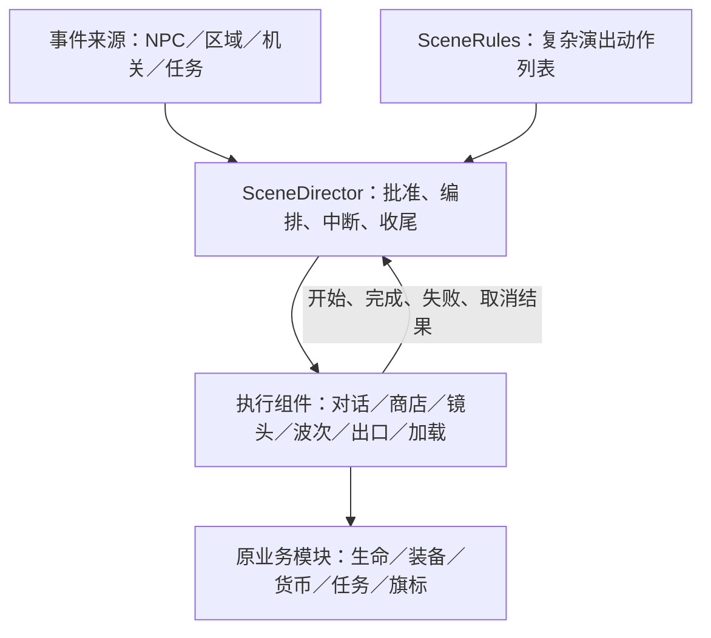

# SceneDirector 统一场景调度设计

日期：2026-11-10。

状态：总体方向已由用户确认；本文为待书面复核的设计草案，尚未进入实施。

依据：[项目结构](../../project-layout.md)、[现行导演教程](../../gameplay/SCENE_DIRECTOR.md)、[原导演设计](2026-10-25-enemy-wave-event-triggers-design_todo.md)、[原实施记录](../plans/2026-10-28-scene-director-implementation.md)。

## 1. 用户已确认的方向

1. SceneDirector 是场景流程的最高调度入口，场景中的脚本演出、事件演出均由它安排。
2. 普通 NPC 对话、商店打开／关闭、传送与切场景也必须经过导演；伤害、库存、扣款、任务奖励等结算仍属于原业务模块。
3. 采用“统一请求入口 + 资源编排”：日常交互直接提交请求，复杂演出继续使用 SceneRules 动作列表。
4. 正在对话或逛商店时，新触发的普通演出先等待；玩家死亡立即处理。
5. 每个正式场景只有一个明确配置的导演，包括酒馆；执行组件必须能真正取消，普通等待与后台逻辑仍可并行。
6. 以当前本地工程为基线，保留节点路径、资源引用、脚本 UID、五关部署与用户保存参数；敌人血量保持本地配置。

以下请求状态、接口名称、控制资源划分和失败策略是实现建议，不作为用户此前逐项指定的要求。书面方案复核后再细化实施计划。

## 2. 当前实现与缺口

| 部分 | 当前实现 | 本次需要收拢的内容 |
| --- | --- | --- |
| 导演入口 | 五关有 SceneDirector；旧 Main 可由区域临时创建核心 | 酒馆和五关均明确装配，统一查找并防止重复接管 |
| 对话 | NPC 直接调用 DialogueUI；界面已有会话编号和结束信号 | 发起、占用玩家交互、取消与结束回报交给导演协调 |
| 商店 | NPC 直接打开 ShopController，控制器自行申请暂停 | 导演批准打开并管理流程控制，购买结算仍在 ShopController |
| 传送 | ChangeSceneEffect 直接切场景；关卡门先写快照 | 导演先批准，再准备状态、取消旧流程和执行加载 |
| 自定义脚本 | CALL_METHOD 可等待完成信号；取消主要是断开等待 | 为持续执行的脚本提供取消契约，停止实际执行并清理占用 |
| 波次与出口 | 波次执行器报告结果，导演完成后调用 LevelFlow 显示出口 | 保留部署与出口位置，明确出场授权和出口启用命令归导演 |

现有 SceneEvent、SceneFlowRule、SceneFlowAction、SceneFlowRunner 与暂停协调器继续使用，不新建第二套事件总线，也不把业务代码集中搬进导演。

## 3. 职责与组织

- **导演核心**保存本场生命周期、有效执行身份与流程控制权，决定哪些请求可以开始。
- **请求与执行管理**作为核心的内部辅助模块，管理待执行请求、前台流程与完成结果；不另设公开的总调度入口。
- **SceneFlowRunner**继续推进资源规则，调用同一请求与执行机制，保留独立规则之间的并行等待。
- **执行适配**连接 DialogueUI、ShopController、演出相机和自定义脚本，负责调用组件并转换结果；组件的实际业务与画面实现保留。
- **GameState、Equipment、Health、QuestController**仍是各自数据与结算的所有者。导演不保存第二份库存、生命、货币或任务状态。

正式场景明确装配一个 SceneDirector，不增加跨场景 AutoLoad 导演。导演注册范围是所属场景，查询不能误选另一场景或临时测试场景中的实例。独立组件测试显式装配最小导演或注入适配，不用生产代码的静默绕过路径凑通过。

旧 enemy_wave_controller.gd 的 UID 和公开入口保留为兼容接入层。区域继续管理导航、成员与局部复位；完成正式场景迁移后，不再由区域临时创建另一个导演。

## 4. 统一请求与执行契约

建议内部使用带身份的请求对象，区分“已接收”和“已执行完成”。具体类名与公开方法名在实施计划中确定。

| 信息 | 用途 |
| --- | --- |
| 请求类型 | 对话、商店、镜头、脚本演出、波次、出口启用、场景切换等 |
| 来源、玩家与目标 | 验证请求属于本场，建立取消条件；节点引用不能延长已离场节点的生命 |
| 参数 | 对话资源、商品控制器、目标场景、镜头目标等；沿用实际资源与节点引用 |
| 场景代次与执行编号 | 让旧回调、重复回调与失效来源无法推进新流程 |
| 状态与结果 | 等待、运行、完成、失败、取消或拒绝；结果可查询，不依赖事后才连接的信号 |
| 控制需求 | 是否占用玩家交互、演出镜头、暂停与鼠标；由导演统一协调 |

请求开始前连接完成／失败通知，再调用执行组件；同步完成也不能漏掉。每次执行最多产生一个终态结果。

保留已有接口与成功事件的含义：请求排队不能冒充交互成功、敌人已生成或场景已切换。需要同步返回的兼容入口只在本次确实获准并开始执行时报告成功，实际业务结果继续由相应事件报告。

### 自定义脚本演出

持续执行的演出需要“开始、取消、完成／失败”契约，可通过适配节点连接原脚本。具体方法签名属于实施设计，不强制所有现有脚本重命名。

- 导演可以开始、等待或取消演出。
- 执行者取消时停止自己创建的 Timer、Tween、动画或其他持续工作；异步恢复处必须复核执行身份，不能在取消后继续写状态。
- 已发起的不可逆业务结算不能由通用取消方法猜测撤销；需要回滚的业务由其适配明确提供准备、提交与恢复逻辑。
- 原 CALL_METHOD 的即时公开方法调用继续可用。持续执行的异步动作必须明确接入取消能力，不能只填完成信号就声称已纳入生命周期管理。

## 5. 顺序、并行与控制权

用户已确认“先完成当前对话，再播放新触发的普通演出”。建议按以下默认规则落地：

| 情况 | 建议行为 |
| --- | --- |
| 对话／商店打开时触发普通剧情或镜头 | 记录事件并等待，交互结束后复核目标和条件再开始 |
| 演出期间玩家再次按 E 请求普通交互 | 当次拒绝并给出忙碌原因，不积攒按键后自动打开远处 NPC 的界面 |
| 多次重复提交同一次交互或演出 | 按来源与执行身份去重，不重复开窗、生成或加载 |
| 死亡 | 立即关闭普通请求资格，取消当前流程及等待请求，再进入死亡界面 |
| 已获准的重开／切场景 | 关闭后续普通请求，取消旧执行，再加载；同一时刻只有一个加载请求 |
| 纯计时、等待旗标／波次清空、后台检测 | 在原规则允许范围内并行，不占用整个场景的前台位置 |
| 区域复位 | 取消该区域本轮的请求与执行，保留原 SCENE／REGION 区分 |

镜头与交互界面需要协调，同一时刻不能各自抢占玩家。整个场景不采用一条把所有等待和战斗都堵住的总串行队列。

导演统一决定暂停、鼠标和输入限制的取得与释放，底层沿用 ScenePauseCoordinator 的所有者／令牌机制。执行组件不能自行恢复整场暂停或原玩家镜头。完成或取消的回调即使在暂停期间也必须被接收并完成清理，不能等世界恢复才释放暂停而形成死锁。

已经有效发生的事件仍按原 SceneEvent 规则记录事实，来源随后被删除不自动抹去事实；具体执行需要的玩家或目标失效时，单独取消该执行并报告原因。

## 6. 典型流程

### 打开商店

1. NPC 收到有效交互，向本场导演请求打开指定商店。
2. 导演检查玩家、场景状态与前台占用，批准后取得控制限制。
3. ShopController 打开界面，继续负责目录、校验、扣款与商品效果；购买不另起一套场景流程。
4. 关闭按钮向导演请求结束，导演要求组件关闭并清理占用，再启动仍有效的等待演出。
5. 死亡、来源离场或场景卸载时，导演走同一取消路径，不能留下商店暂停。

对话使用相同生命周期，沿用 DialogueUI 已有会话编号和异步加载保护。对话资源仍由原节点或请求指定，不硬编码 NPC 名称与剧情。

### 事件演出与波次

保留 SceneEvent → SceneRules 的配置方式。普通方法、等待、镜头和演出调用均由导演发起或授权；波次执行器继续处理模板、导航、出生点与真实清空统计。

原 Wave.Event Nodes、顺序出场等配置保留，通过接入层取得导演的执行许可，不要求重排 Wave → Squad → Enemy。真实生成成功后才播放增援展示，继续保留生成屏障与出生安全检查。

### 清场后启用出口

真实波次清空／完成条件满足 → 导演进入完成流程 → 命令 LevelFlow 适配器启用原 TavernReturnPortal。LevelFlow 保留关卡编号、结果视图与相关适配，出口位置和外观保留，不独立决定本场何时完成。

### 传送与加载失败

1. 传送门检查原交互条件，向导演请求目标场景与所需业务准备。
2. 导演批准加载后，业务适配先保存修改前的可恢复状态，再记录关卡完成、入关／返程快照与检查点；排队、拒绝不能提前修改这些数据。
3. 取消旧执行，经原 SceneTransition 执行加载，保留中性环境处理。
4. 加载失败时由准备该数据的适配恢复状态，导演提供原目标重试或返回可操作状态，不能提前发奖、遗留一次性快照或留下永久暂停。
5. 引擎接受场景切换是旧场景提交的边界；目标场景就绪后由新导演重新准备。旧场景回调不能继续操作新场景。

死亡后的重开／回酒店沿原检查点规则办理，继续保留商品旗标、医疗包资源／数量、武器弹药和货币的既有恢复语义。

## 7. 迁移边界

实施应在现有模块内逐步接入：先建立唯一入口与请求生命周期，再接入对话／商店、传送与场景加载，随后补齐脚本演出的取消能力与规则适配。每一步以现有玩法可运行和对应约束通过为条件；详细文件任务与执行顺序另写实施计划。

- 不重排地图、不迁移部署层、不替换原玩家相机跟随框架。
- 保留已有节点路径、资源引用、脚本 UID 与正常使用的公开接口；新导演装配仅增加必要节点和绑定。
- 现有已配置的独立切场景效果改为导演请求适配，不能继续作为正式场景的旁路。
- 一旦正式场景进入统一模式，缺少导演或取消契约应给出可定位的错误，不能静默回退到原独立调度。
- 运行时功能与结构约束一起验收，不以新增一个请求转发方法就认定已经拥有统一控制权。
- 本地已修改的 project.godot、Main、SceneDirector 预制、地图、插件和资源均需先核对并保留。只提交本任务修改，不 pull 或带入其他远端内容。

## 8. 验收与回归

| 范围 | 必须验证的结果 |
| --- | --- |
| 唯一入口 | 酒馆、五关及无 Wave／无引导场景都能明确绑定；多区域不创建多个导演 |
| 统一发起 | 对话、商店、传送、剧情、镜头与出口启用均经过导演；正式入口没有独立抢占或切场景旁路 |
| 对话与演出冲突 | 对话期间记录演出，结束后只执行一次；关闭商店后同理 |
| 真实取消 | 死亡／切场景后，持续脚本、Timer、Tween 和界面确实停止；迟到信号不产生后续动作 |
| 暂停与输入 | 关闭一个流程不解除其他有效限制；暂停期间能接收结束通知；无永久暂停或旧鼠标捕获 |
| 并行等待 | 无关事件等待、区域规则与合法波次请求不被前台队列互相堵死 |
| 交互与失效 | 忙碌时拒绝的 E 不产生成功事件或延迟弹窗；目标删除、重复回调、跨代回调安全结束 |
| 传送事务 | 被拒绝或加载失败时不写错完成标记、不重复发奖、不污染待恢复快照，原目标能重试 |
| 原玩法 | A 逐关解锁、清场返程、死亡二选一、商店购买及商品旗标／医疗包／装备的既有恢复语义保持 |
| 编辑器与真实画面 | 默认场景可直接启动；事件配置与资源引用仍可编辑；真实镜头、对话和鼠标交接符合流程 |

优先复用导演、事件、增援镜头、关卡、任务、商店和医疗包已有专项，并补上述实际缺口的测试。测试须同时覆盖无错误退出、行为与结构；原性能／时间门槛、本地数值和既有失败不得为本设计放宽。

当前仅完成设计整理，未执行本设计的实现回归。现有玩法的验证记录见各专项文档，不能移作本次改造已通过的证据。

## 9. 交付与后续复核

本文通过书面复核后，再编写实施计划；实现、必要回归和现行教程更新按独立阶段验收。每阶段仅提交已核对文件并普通推送配置的 main 分支，报告提交与推送结果。

原设计和历史记录保持原有语境；实施时更新现行教程、项目结构与待办，明确哪些内容已经迁移，哪些仍未实施。
